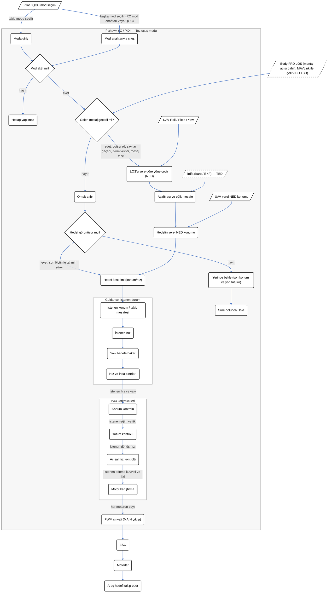

# Şema 1 — Hedef Takip Uçuş Modu: Üst Seviye Akış

> **Not:** Bu şema FC'ye özel olarak güncellendi, bkz. `agent-os/specs/2026-10-18-m15-fc-only-flow-diagrams/`. Önceki spec'in `spec.md`, `tasks.md` ve `implementation/` metinleri Pi'yi ve Şema 2'nin 5 adımlı (D) akışını anlatmaya devam eder.

FC'ye MAVLink ile body FRD LOS gelir (montaj açısı dahil), FC bunu PWM'e kadar işler. Pixhawk 6C üzerinde çalışan tez uçuş modu, mod aktifken gelen mesajı kontrol eder, LOS'u araç yönelimi ve irtifayla hedefin yerel NED konumuna çevirir (geolocation), hedefi kestirir ve guidance ile istenen hızı ve yaw'u üretir. Hedef bir süre görünmezse araç yerinde bekler, süre dolunca Hold'a geçer. İsteği PX4'ün kendi kontrolcüleri motor karıştırmaya ve MAIN çıkışındaki PWM sinyaline kadar taşır, ESC'ler motorları döndürür. Hesap düz dünya kabulüyle yerel NED çerçevesinde yapılır, küresel koordinat dönüşümü yoktur.

- Üslup rehberi: [referans görsel](../planning/visuals/WhatsApp%20Image%202026-09-26%20at%2000.07.13.jpeg) (`../planning/visuals/WhatsApp Image 2026-09-26 at 00.07.13.jpeg`). Görsel birebir kopyalanmadı, yalnızca şekil dili alındı.
- Lejant: paralelkenar = girdi, yuvarlak köşeli kutu = işlem, eşkenar dörtgen = karar, kesik çizgili kutu = açık konu (TBD). Ok üzerindeki yazı, bir adımdan sonrakine geçen bilgidir.
- Guidance yasasının ayrıntısı bu şemada yoktur. Bkz. `/home/yusuf/Desktop/guidance-yasalari.md`. PX4'e özel ayrıntılar `02-px4-detayli-akis.md` dosyasındadır. Her kutunun Şema 2 karşılığı, o dosyadaki (B) bloğunun "Şema 1 ile karşılık" tablosundadır.

