# Şema 2: PX4 v1.17.0 Detaylı Akış — `tez_follow` External Mode

> **Not:** Bu şema FC'ye özel olarak güncellendi, bkz. `agent-os/specs/2026-10-18-m15-fc-only-flow-diagrams/`. Önceki spec'in `spec.md`, `tasks.md` ve `implementation/` metinleri Pi'yi ve 5 adımlı (D) akışını anlatmaya devam eder.

Bu şema, FC'ye MAVLink ile gelen body FRD LOS ile bir insanı takip eden `tez_follow` uçuş modunun PX4 v1.17.0 içinde nasıl kurulacağını gösterir. Modül FC içinde çalışır, kendini `mc_nn_control` gibi uORB üzerinden external mode olarak kaydeder, `trajectory_setpoint` yayınlar ve uçuşu PX4'ün mevcut kontrolcülerine bırakır. Zincir, kontrolcülerden sonra MAIN PWM çıkışına kadar gösterilir. Modülün kodu sonraki spec'te yazılır. Buradaki her topic, alan, parametre ve dosya yolu bu repodaki v1.17.0 kaynağından alınmıştır.

- **Düz dünya kabulü:** Hedef, kalkış zeminiyle aynı yatay düzlemdedir. ECEF/WGS84 dönüşümü yapılmaz, hedef konumu yerel NED'de hesaplanır.
- **Guidance:** Yasanın ayrıntısı bu şemaya kopyalanmaz. Bkz. `/home/yusuf/Desktop/guidance-yasalari.md`.
- **Ad kaynağı:** `../implementation/1-ad-envanteri.md` (Task Group 1). Spec ile kaynak çeliştiğinde kaynaktaki ad ve davranış yazılmıştır.
- **Bloklar:** (A) Başlatma, mod kaydı ve arming check. (B) Çevrim başına veri akışı. (C) Mod seçimi, çıkış, hedef kaybı ve failsafe. (D) Doğrulama akışı.

## Lejant

### Katmanlar

Her blok, ilgili katmanları aşağıdaki başlıklarla `subgraph` olarak ayırır.

| Katman | `subgraph` başlığı | Ağırlıklı olduğu blok |
|---|---|---|
| MAVLink | `MAVLink` | B, C |
| uORB | Subgraph yerine kenar etiketi: kenarın üzerindeki ad uORB topic adıdır | Tümü |
| `tez_follow` modülü | `tez_follow modülü (öneri)` | A, B, C |
| commander | `commander` | A, C |
| FlightModeManager ve kontrolcüler | `FlightModeManager ve kontrolcüler` | A, B |
| QGC/RC | `QGC / RC` | C |
| Doğrulama | `Doğrulama` | D |
| Derleme ve başlatma | `Derleme ve başlatma` | A |

### Şekiller ve renkler

| Şekil / sınıf | Anlamı |
|---|---|
| Paralelkenar (`input`) | Dış girdi veya topic yayıncısı |
| Yuvarlak köşeli kutu (`process`) | İşlem |
| Eşkenar dörtgen (`decision`) | Karar |
| Stadyum (`process`) | Başlangıç veya çevrim sınırı |
| Kesik çizgili kutu (`tbd`) | TBD: ekipçe karar verilecek açık konu |
| Sarı kutu (`note`) | Not, gerekçe |
| Kırmızı çerçeveli kutu (`warn`) | Uyarı, güvenlik açısından önemli davranış |
| Gri kutu (`ref`) | Başka bir bloğa atıf |
| Düz ok | Akış veya veri. Etiket bir topic adıysa veri o topic ile taşınır |
| Noktalı ok / çizgi | Not bağlantısı veya dolaylı/gecikmeli akış |

### Ad etiketleri

| Etiket | Anlamı |
|---|---|
| Etiketsiz | v1.17.0 kaynağında birebir doğrulandı |
| (doğrulanacak) | Ad kaynakta var ama davranış yalnızca SITL/donanımda kanıtlanabilir, ya da ad kesin değil |
| (öneri) | Kaynakta yok, bu proje için önerilen ad (`tez_follow`, `TEZ_FOL_*`, `CONFIG_MODULES_TEZ_FOLLOW`, `*_gz_x500_tez*`) |
| TBD | Açık konu, `tbd` sınıfıyla kesik çizgili gösterilir |

## Açık konular (TBD)

| # | Konu | Kısa açıklama | Blok |
|---|---|---|---|
| 1 | ICD | FC'nin beklediği hedef LOS mesajı. `DEBUG_VECT` mevcut aday. Gösterim, hız, gecikme, zaman damgası ve "hedef yok" sinyali kararlaştırılacak | B |
| 2 | Yükseklik kaynağı | Geçici olarak `-vehicle_local_position.z` (baro füzyonlu). Baro drift ve zemin düzlemi kabulü konuşulacak | B |
| 3 | Nihai guidance yasası | Çalışma temeli var, nihai yasa `guidance-yasalari.md` üzerinden seçilecek | B |
| 4 | Setpoint tipi | `trajectory_setpoint` veya `goto_setpoint` + `GotoControl` | B |
| 5 | Ön koşul onayı | `tez/pin/allowed-paths.txt` içine `src/modules/tez_*` ve iki `.px4board` dosyası, ayrı PR | A |
| 6 | Süre parametreleri | `TEZ_FOL_TOUT` (~1 s) ve `TEZ_FOL_HOLD_T` (~5–10 s) kesinleşecek | C |
| 7 | Hareketli insan modeli ve tez dünyası | Gazebo'daki hareketli insan modelinin ve tez dünyasının dosya konumu. `Tools/simulation/gz` kilitli, izinli yollar `tez/*`, `gz_env.sh.in`, `px4-rc.gzsim`. Kullanıcıya sorulacak (spec (D): "Model konumu TBD") | D |
| 8 | SITL'de LOS girdisi | Test sırasında FC'ye gelecek LOS mesajının SITL'de nasıl üretileceği. Eski SITL LOS gönderim adımı kullanıcı kararıyla silindi, ileride eklenebilir | D |

<!--
Blok yazım kuralları (Task Group 4-6 için, render edilmez):
- Her blok kendi classDef tanımlarını içerir, bloklar arası paylaşılmaz. Aşağıdaki paleti kopyalayın.
- Node id'leri blok harfiyle başlar (a..., b..., c..., d...). ASCII, benzersiz, Mermaid anahtar kelimesi değil.
- Özel karakterli etiketler "..." içinde. Etiket içinde çift tırnak için #quot;, < ve > için #60; ve #62; kullanın.
- Kenar etiketi topic adıdır: kaynak node, iki tire, "trajectory_setpoint", iki tire ve ok, hedef node (bkz. (A) bloğu).

    classDef input fill:#ffffff,stroke:#000000,stroke-width:1px,color:#000000
    classDef process fill:#ffffff,stroke:#000000,stroke-width:1px,color:#000000
    classDef decision fill:#ffffff,stroke:#000000,stroke-width:1px,color:#000000
    classDef tbd fill:#ffffff,stroke:#000000,stroke-width:1px,stroke-dasharray:5 5,color:#000000
    classDef note fill:#fff8c4,stroke:#b59f00,stroke-width:1px,color:#000000
    classDef warn fill:#ffffff,stroke:#c62828,stroke-width:2px,color:#000000
    classDef ref fill:#eeeeee,stroke:#757575,stroke-width:1px,color:#000000
    linkStyle default stroke:#1565c0,stroke-width:1.5px
-->

## (A) Başlatma, mod kaydı ve arming check

Modül, `mc_nn_control` `Run()` sırasını izler: çıkış kontrolü → kayıt isteği gönder → cevabı bekle (cevap gelince kontrol modunu yapılandır) → her çevrimde arming check isteğine cevap ver → (B) bloğuna geç. Kayıt **disarm iken** yapılmalıdır, bu yüzden modül boot'ta başlatılır. Mod yalnızca havada çalışır: `can_arm_and_run = !vehicle_land_detected.landed`.

```mermaid
flowchart TB
    subgraph aBuild ["Derleme ve başlatma"]
        aPre("TBD: Ön koşul onayı (allowed-paths ve .px4board)<br/>tez/pin/allowed-paths.txt içine src/modules/tez_*<br/>ve iki .px4board dosyası, ayrı PR, henüz onaylanmadı")
        aKconfig("CONFIG_MODULES_TEZ_FOLLOW=y (öneri)<br/>boards/px4/fmu-v6c/default.px4board<br/>boards/px4/sitl/default.px4board")
        aStartSitl("SITL başlatma noktası (doğrulanacak)<br/>ROMFS/px4fmu_common/init.d-posix/airframes/#60;id#62;_gz_x500_tez.post (öneri)<br/>noktasız #60;id#62;_gz_x500_tez airframe dosyası ve<br/>airframes/CMakeLists.txt kaydı da gerekir<br/>px4-rc.mavlink sonrasında çalışır")
        aStartHw("Donanım başlatma noktası (doğrulanacak)<br/>SD kart /fs/microsd/etc/extras.txt<br/>rcS içinde commander ve mavlink sonrasında çalışır")
        aRcLocked("Not: upstream rc.mc_apps kilitli<br/>tez_follow buraya eklenmez")
        aBoot(["tez_follow start: boot'ta, disarm iken"])
    end

    subgraph aMod ["tez_follow modülü (öneri)"]
        aSkel("Modül iskeleti: ModuleBase + ModuleParams + px4::ScheduledWorkItem<br/>(src/examples/work_item deseni)<br/>kuyruk: px4::wq_configurations::nav_and_controllers<br/>(mc_nn_control ile aynı kuyruk, 6C'de yükü doğrulanacak)<br/>ScheduleOnInterval ~50 Hz (öneri)")
        aSkelNote("Not: mc_nn_control px4::WorkItem'dır ve vehicle_angular_velocity<br/>callback'iyle çalışır. ScheduledWorkItem + ScheduleOnInterval<br/>deseni src/examples/work_item'dan gelir")
        aRun(["Run(): her çevrim"])
        aExitQ{"should_exit() ?"}
        aSentQ{"Kayıt isteği<br/>gönderildi mi?"}
        aReq("Kayıt isteği (RegisterNeuralFlightMode deseni)<br/>name = #quot;Tez Follow#quot; (öneri, char[25], sabit)<br/>request_id (benzersiz)<br/>px4_ros2_api_version = 1<br/>register_arming_check = true<br/>register_mode = true")
        aIdQ{"mode_id ve arming_check_id<br/>geçerli mi (≠ -1)?"}
        aReplyQ{"Kayıt cevabı<br/>(CheckModeRegistration)"}
        aRegFail("Kayıt başarısız: mod QGC/RC listesinde görünmez<br/>setpoint yayınlanmaz, PX4_ERR bir kez<br/>QGC uyarısı events ile (öneri)")
        aConfig("Kontrol modu yapılandırması (ConfigureNeuralFlightMode deseni)<br/>tip vehicle_control_mode_s<br/>source_id = mode_id<br/>timestamp = hrt_absolute_time()")
        aFlags("config_control_setpoints bayrakları<br/>true: flag_multicopter_position_control_enabled,<br/>flag_control_position_enabled, flag_control_velocity_enabled,<br/>flag_control_altitude_enabled, flag_control_climb_rate_enabled,<br/>flag_control_acceleration_enabled, flag_control_attitude_enabled,<br/>flag_control_rates_enabled, flag_control_allocation_enabled,<br/>flag_control_termination_enabled<br/>false: flag_control_manual_enabled, flag_control_auto_enabled,<br/>flag_control_offboard_enabled")
        aNnDiff("Not: mc_nn_control config'inde flag_multicopter_position_control_enabled = false<br/>yazar (pozisyon kontrolünü kapatır, actuator_motors yayınlar).<br/>tez_follow pozisyon kontrolünü açık tutar, trajectory_setpoint yayınlar")
        aCycleEnd(["return: sonraki çevrim"])
        aChkQ{"arming_check_request<br/>güncellendi mi?"}
        aRateNote("Not: istek her çevrimde kontrol edilir.<br/>~50 Hz (20 ms) çevrim, 50 ms cevap süresinin içinde kalır")
        aReplyBuild("arming_check_reply hazırla (ReplyToArmingCheck deseni)<br/>request_id = istekteki request_id<br/>registration_id = arming_check_id<br/>can_arm_and_run = !vehicle_land_detected.landed<br/>mode_req_attitude = true<br/>mode_req_local_position = true<br/>mode_req_local_alt = true<br/>mode_req_angular_velocity = true<br/>mode_req_prevent_arming = true (bu modda arm edilemez)<br/>mode_req_manual_control = false<br/>timestamp = hrt_absolute_time()")
        aAirNote("Not: yalnızca havada. Yerde can_arm_and_run = false olduğundan<br/>mod çalışamaz. Disarm iken mod seçilebilir ama arm engellenir.<br/>Moda giriş koşulları (C) bloğunda")
        aUnreg("Kayıt silme (UnregisterNeuralFlightMode deseni)<br/>kayıt gönderildiyse: name (kayıttaki adla birebir), arming_check_id, mode_id,<br/>mode_executor_id = -1 (executor yok)<br/>ardından exit_and_cleanup()")
    end

    subgraph aCmd ["commander"]
        aArmedQ{"armed mı?<br/>(COM_MODE_ARM_CHK = 0)"}
        aReject("armed iken kayıt reddi<br/>PX4_ERR #quot;Not accepting registration requests while armed#quot;<br/>success = false")
        aRegister("ModeManagement::checkNewRegistrations<br/>boş mod slotu: mode_id ∈ NAVIGATION_STATE_EXTERNAL1..8 (23..30)<br/>arming check kaydı: arming_check_id<br/>cevap: request_id, success, arming_check_id, mode_id, name")
        aHash("Not: COM_MODE${i}_HASH (COM_MODE0_HASH..COM_MODE7_HASH)<br/>mod adının FNV-1a hash'i parametreye yazılır.<br/>Aynı ad hep aynı slota düşer, bu yüzden mod adı sabit tutulur")
        aCfgStore("ModeManagement::checkConfigControlSetpointUpdates<br/>source_id kayıtlı bir mod olmalı<br/>yapılandırma mod kaydına saklanır")
        aUpdCtl("Commander::updateControlMode → ModeManagement::updateControlMode<br/>nav_state == mode_id iken yapılandırma vehicle_control_mode olur.<br/>flag_armed ve flag_multicopter_position_control_enabled<br/>commander'da yeniden türetilir (bu modda sonuç yine true)")
        aChkReq("HealthAndArmingChecks externalChecks<br/>her UPDATE_INTERVAL = 300 ms yeni istek, request_id artırılır<br/>cevap REQUEST_TIMEOUT = 50 ms içinde gelmeli,<br/>request_id eşleşmeli, timestamp son 300 ms içinde olmalı")
        aChkEval{"Eşleşen cevap<br/>zamanında geldi mi?"}
        aChkOk("Cevap işlenir, cevapsız sayacı sıfırlanır<br/>can_arm_and_run ve mode_req_* failsafe bayraklarına yazılır<br/>can_arm_and_run = false → mode_req_other")
        aNoReply{"Ardışık cevapsız istek<br/>NUM_NO_REPLY_UNTIL_UNRESPONSIVE = 3<br/>sınırını aştı mı?"}
        aInitNote("Not: sınır aşımı 4. ardışık cevapsız istekte olur.<br/>Kayıttan sonra ilk cevaba kadar sınır 10'dur")
        aUnresp("Mod unresponsive → mode_req_other")
        aFallback("UYARI: mod aktifken RTL'e düşer, Hold'a değil<br/>Failsafe::checkModeFallback: modeCanRun false → Action::RTL<br/>Bu yüzden hedef kaybı için can_arm_and_run = false kullanılmaz,<br/>hedef kaybı (C) bloğunda modülün kendi Hold isteğiyle çözülür")
        aUnregArmedQ{"armed mı?<br/>(COM_MODE_ARM_CHK = 0)"}
        aUnregDefer("Kayıt silme isteği işlenmez: ModeManagement::update<br/>checkUnregistrations'ı yalnızca disarm iken çağırır.<br/>Modül çıktığı için cevaplar kesilir → unresponsive yolu<br/>(SITL'de doğrulanacak)")
        aUnregDo("ModeManagement::checkUnregistrations<br/>mod ve arming check kaydı silinir")
        aUnregActiveQ{"Silinen mod<br/>aktif mi?"}
        aHold("Hold'a geçer (NAVIGATION_STATE_AUTO_LOITER)")
        aGone("Mod listeden çıkar")
    end

    subgraph aCtl ["FlightModeManager ve kontrolcüler"]
        aPosCtl("mc_pos_control: want_takeoff'u yalnızca flag_control_offboard_enabled<br/>iken kendisi hesaplar. Bu modda offboard bayrağı false,<br/>want_takeoff üretilmez → moda yerden kalkış yok")
    end

    aLandIn[/"land_detector"/]
    aToB("(B) bloğuna devam: vehicle_status.nav_state == mode_id<br/>ise hesap ve setpoint")
    aToC("(C) bloğu: mod adı AVAILABLE_MODES ile QGC'ye gider,<br/>QGC/RC mod seçimi")

    aPre --> aKconfig
    aKconfig --> aStartSitl
    aKconfig --> aStartHw
    aStartSitl --> aBoot
    aStartHw --> aBoot
    aRcLocked -.- aBoot
    aBoot --> aSkel
    aSkel -.- aSkelNote
    aSkel -- "ScheduleOnInterval" --> aRun
    aRun --> aExitQ
    aExitQ -- "hayır" --> aSentQ
    aExitQ -- "evet" --> aUnreg
    aSentQ -- "hayır" --> aReq
    aSentQ -- "evet" --> aIdQ
    aReq -- "register_ext_component_request" --> aArmedQ
    aReq --> aCycleEnd
    aArmedQ -- "evet" --> aReject
    aArmedQ -- "hayır" --> aRegister
    aRegister -.- aHash
    aRegister -- "register_ext_component_reply" --> aReplyQ
    aReject -- "register_ext_component_reply" --> aReplyQ
    aRegister -. "mod adı (name)" .-> aToC
    aIdQ -- "hayır" --> aReplyQ
    aReplyQ -- "cevap yok" --> aCycleEnd
    aReplyQ -- "success = false" --> aRegFail
    aReplyQ -- "success = true" --> aConfig
    aConfig --> aFlags
    aFlags -.- aNnDiff
    aConfig -- "config_control_setpoints" --> aCfgStore
    aConfig --> aCycleEnd
    aCfgStore --> aUpdCtl
    aUpdCtl -- "vehicle_control_mode" --> aPosCtl
    aIdQ -- "evet" --> aChkQ
    aChkReq -- "arming_check_request" --> aChkQ
    aChkQ -.- aRateNote
    aChkQ -- "evet" --> aReplyBuild
    aChkQ -- "hayır" --> aToB
    aLandIn -- "vehicle_land_detected" --> aReplyBuild
    aReplyBuild -.- aAirNote
    aReplyBuild -- "arming_check_reply" --> aChkEval
    aReplyBuild --> aToB
    aChkEval -- "evet" --> aChkOk
    aChkEval -- "hayır" --> aNoReply
    aNoReply -.- aInitNote
    aNoReply -- "hayır: sonraki istek" --> aChkReq
    aNoReply -- "evet" --> aUnresp
    aChkOk -. "300 ms sonra" .-> aChkReq
    aChkOk -- "mod aktifken can_arm_and_run = false" --> aFallback
    aUnresp -- "mod aktifken" --> aFallback
    aUnreg -- "unregister_ext_component" --> aUnregArmedQ
    aUnregArmedQ -- "evet" --> aUnregDefer
    aUnregArmedQ -- "hayır" --> aUnregDo
    aUnregDefer -. "cevaplar kesilir" .-> aNoReply
    aUnregDo --> aUnregActiveQ
    aUnregActiveQ -- "evet" --> aHold
    aUnregActiveQ -- "hayır" --> aGone

    classDef input fill:#ffffff,stroke:#000000,stroke-width:1px,color:#000000
    classDef process fill:#ffffff,stroke:#000000,stroke-width:1px,color:#000000
    classDef decision fill:#ffffff,stroke:#000000,stroke-width:1px,color:#000000
    classDef tbd fill:#ffffff,stroke:#000000,stroke-width:1px,stroke-dasharray:5 5,color:#000000
    classDef note fill:#fff8c4,stroke:#b59f00,stroke-width:1px,color:#000000
    classDef warn fill:#ffffff,stroke:#c62828,stroke-width:2px,color:#000000
    classDef ref fill:#eeeeee,stroke:#757575,stroke-width:1px,color:#000000
    linkStyle default stroke:#1565c0,stroke-width:1.5px

    class aLandIn input
    class aKconfig,aStartSitl,aStartHw,aBoot,aSkel,aRun,aReq,aConfig,aFlags,aCycleEnd,aReplyBuild,aUnreg process
    class aRegister,aCfgStore,aUpdCtl,aChkReq,aChkOk,aUnresp,aUnregDo,aHold,aGone,aPosCtl process
    class aExitQ,aSentQ,aIdQ,aReplyQ,aChkQ,aArmedQ,aChkEval,aNoReply,aUnregArmedQ,aUnregActiveQ decision
    class aPre tbd
    class aRcLocked,aSkelNote,aNnDiff,aRateNote,aAirNote,aHash,aInitNote note
    class aReject,aRegFail,aFallback,aUnregDefer warn
    class aToB,aToC ref
```

**(A) notları ve kaynak satırları**

- Kayıt, cevap, yapılandırma, arming check ve kayıt silme deseni: `src/modules/mc_nn_control/mc_nn_control.cpp:132-212`, `Run()` sırası `:436-477`.
- Kayıt ve armed iken red: `src/modules/commander/ModeManagement.cpp:218-335`, `:371-387`. Red yalnızca `COM_MODE_ARM_CHK = 0` (varsayılan) iken olur.
- `COM_MODE${i}_HASH`: `src/modules/commander/module.yaml:5-16`, `ModeManagement.cpp:97-111`. Gerçek parametre adları `COM_MODE0_HASH..COM_MODE7_HASH`.
- Kontrol modu: `ModeManagement.cpp:521-536`, `:582-602`, bayrakların yeniden türetilmesi `src/modules/commander/Commander.cpp:2603-2617`.
- Arming check zamanlaması: `src/modules/commander/HealthAndArmingChecks/checks/externalChecks.hpp:69-75`, `externalChecks.cpp:225-295`. Cevapta `request_id` alanı zorunludur, eşleşmeyen cevap yok sayılır.
- RTL'e düşüş: `src/modules/commander/failsafe/failsafe.cpp:659-704`.
- Kayıt silme: `ModeManagement.cpp:337-364` (aktif mod silinirse Hold). `name` kayıttaki adla eşleşmezse mod silinmez (`ModeManagement.cpp:185-194`, `:353`). `mode_executor_id` alanı `msg/versioned/UnregisterExtComponent.msg:9` (-1 = kayıtlı değil). `mc_nn_control` bu alanı 0 bırakır (`mc_nn_control.cpp:146-155`), 0 otopilot executor'ıdır ve zararsızdır (`ModeManagement.hpp:52-53`, `ModeManagement.cpp:499-510`). `checkUnregistrations` yalnızca disarm iken çağrılır (`:371-409`). Armed iken modül durdurulursa istek bekler, cevaplar kesildiği için mod unresponsive olur ve aktifse RTL'e düşer.
- `want_takeoff`: `src/modules/mc_pos_control/MulticopterPositionControl.cpp:464-486`.
- Başlatma: donanım `ROMFS/px4fmu_common/init.d/rcS:25`, `:599-603`. SITL `.post` mekanizması `ROMFS/px4fmu_common/init.d-posix/rcS:217-229`, `:359-363`.

## (B) Çevrim başına veri akışı (run loop)

Bu blok, (A) adımlarından sonra her `Run()` çevriminde olanı gösterir: FC'ye gelen LOS örneği MAVLink üzerinden `debug_vect` topic'ine düşer, modül örneği doğrular, mod aktifse hedefin yerel NED konumunu hesaplar, hedefi kestirir, guidance ve saturation ile `trajectory_setpoint` yayınlar. Bu setpoint'i PX4'ün kontrolcü zinciri motorlara kadar taşır. Kenar etiketleri uORB topic adlarıdır, MAVLink mesajları "MAVLink" önekiyle yazılmıştır.

- **Çevrim sırası:** (A) → abonelikleri güncelle → `nav_state == mode_id` kapısı → moda giriş kontrolü → konum geçerliliği → girdi doğrulama (dört adım) → geolocation → kestirim → guidance → saturation → `trajectory_setpoint`.
- **Mod aktifken her çevrimde setpoint yayınlanır.** Geçerli LOS yoksa veya durum geçersizse (C) bloğundaki tutma setpoint'i yayınlanır. Hiç yayın yapılmayan tek durum, modun aktif olmadığı çevrimdir.
- **FC portu:** FC tarafı TELEM2 = `/dev/ttyS3`.

Şema 1 ile karşılık:

| Şema 1 kutusu | (B) karşılığı |
|---|---|
| Pilot / QGC mod seçimi | `bCmdr` (`vehicle_status`). Seçim yolları (C) bloğunda (`QGC / RC` subgraph'ı) |
| Moda giriş | `bGate` (evet), `bEntryQ`, `bEntry`. Giriş koşulları (C) bloğunda |
| Mod anahtarıyla çıkış | `bGate` (hayır). Çıkış yolu (C) bloğunda |
| Mod aktif mi? | `bGate` |
| Hesap yapılmaz | `bIdle` |
| Body FRD LOS (montaj açısı dahil), MAVLink ile gelir (ICD TBD) | `bLosIn`, `bIcd`, MAVLink katmanı (`bLinkHw`, `bLinkSitl`, `bRecv`) |
| Gelen mesaj geçerli mi? | `bVecQ`, `bChkName`, `bChkFinite`, `bChkNorm`, `bChkFresh` (evet → `bAccept`) |
| Örnek atılır | `bDrop` |
| Hedef görünüyor mu? | `bAgeQ` |
| Yerinde bekle (son konum ve yön tutulur) | `bLostRef` (konum + yaw tutma, (C) bloğu hedef kaybı) |
| Süre dolunca Hold | `bLostRef` (Hold isteği, (C) bloğu) |
| UAV Roll / Pitch / Yaw | `bEkf` (`vehicle_attitude`), `bSubs` |
| İrtifa (baro / EKF) — TBD | `bEkf` (`vehicle_local_position`), `bAlt`, `bAltTbd` |
| UAV yerel NED konumu | `bEkf` (`vehicle_local_position`), `bSubs` |
| LOS'u yere göre yöne çevir (NED) | `bLosNed` |
| Aşağı açı ve eğik mesafe | `bUdQ`, `bAlt`, `bRange` |
| Hedefin yerel NED konumu | `bTgt` |
| Hedef kestirimi (konum/hız) | `bEst` |
| Guidance: istenen durum | Şema 1'de alt kutu: `bGuid`, `bSat`, `bTraj` |
| İstenen konum / takip mesafesi | `bGuid` |
| İstenen hız | `bGuid` |
| Yaw hedefe bakar | `bGuid`, `bTraj` (yaw) |
| Hız ve irtifa sınırları | `bSat`, `bTraj` |
| PX4 kontrolcüleri | Şema 1'de alt kutu: `FlightModeManager ve kontrolcüler` subgraph'ı (`bFmm`, `bPos`, `bAtt`, `bRate`, `bAlloc`) |
| Konum kontrolü | `bPos` |
| Tutum kontrolü | `bAtt` |
| Açısal hız kontrolü | `bRate` |
| Motor karıştırma | `bAlloc`, `bMix` |
| PWM sinyali (MAIN çıkışı) | `bLimQ`, `bLimDis`, `bLimFail`, `bLimOn`, `bIoDrv`, `bIoMcu`, `bMainPwm` |
| ESC | `bOutEsc` |
| Motorlar | `bMotors` |
| Araç hedefi takip eder | `bFollow` |

```mermaid
flowchart TB
    bLosIn[/"Body FRD LOS (montaj açısı dahil), MAVLink ile TELEM2'den gelir (ICD TBD)<br/>FC'nin beklediği alanlar:<br/>DEBUG_VECT aday<br/>name en fazla 9 karakter (ör. #quot;TEZ_LOS#quot;, öneri)<br/>x/y/z = LOS_body birim vektör<br/>FC montaj açısını bilmez<br/>time_usec FC'de kullanılmaz"/]

    subgraph bLink ["MAVLink"]
        bLinkHw("Donanım: Pixhawk 6C TELEM2 (doğrulanacak)<br/>CONFIG_BOARD_SERIAL_TEL2=#quot;/dev/ttyS3#quot;<br/>MAV_1_CONFIG = 102 (TELEM 2, varsayılan kapalı)<br/>MAV_1_MODE = 2 (Onboard, varsayılan)<br/>TELEM2 varsayılan baud 921600")
        bLinkSitl("SITL: UDP onboard bağlantısı (px4-rc.mavlink)<br/>local 14580 / remote 14540<br/>mavlink start -m onboard")
        bRecv("MavlinkReceiver::handle_message_debug_vect<br/>(MAVLINK_MSG_ID_DEBUG_VECT)<br/>timestamp = hrt_absolute_time()<br/>name kopyalanır, son bayt NUL yapılır<br/>x/y/z kopyalanır, MAVLink time_usec atılır")
        bIcd("TBD: ICD (FC'nin beklediği hedef LOS mesajı)<br/>mesaj tipi (DEBUG_VECT aday), LOS gösterimi (birim vektör / iki açı),<br/>hız (10–30 Hz öneri), gecikme (#60; 150 ms öneri),<br/>yakalama anı zaman damgası, confidence, #quot;hedef yok#quot; sinyali")
        bTsNote("Not: debug_vect.timestamp FC'ye varış anıdır, LOS ölçüm anı değil.<br/>Ölçüm anındaki tutumla eşleştirme ICD kararına bağlıdır (TBD)")
        bQueueNote("Not: debug_vect tek instance, kuyruk uzunluğu 1.<br/>Her MAVLink bağlantısından gelen DEBUG_VECT aynı topic'e yazılır,<br/>name filtresi bu yüzden gerekir")
    end

    bEkf[/"ekf2<br/>UAV Roll / Pitch / Yaw, UAV yerel NED konumu,<br/>İrtifa (baro / EKF)"/]
    bCmdr[/"commander"/]
    bLand[/"land_detector"/]

    subgraph bMod ["tez_follow modülü (öneri)"]
        bFromA(["(A) bloğundan: Run() çevrimi<br/>kayıt tamam, arming check isteği cevaplandı"])
        bSubs("Abonelikler (her çevrim update)<br/>vehicle_attitude.q (FRD → NED quaternion)<br/>vehicle_local_position: x/y/z, xy_valid, z_valid, heading,<br/>xy_reset_counter, z_reset_counter<br/>vehicle_status.nav_state<br/>vehicle_land_detected.landed")
        bGate{"vehicle_status.nav_state<br/>== mode_id ?"}
        bIdle("Mod aktif değil: hesap yapılmaz,<br/>trajectory_setpoint yayınlanmaz<br/>kestirim ve guidance durumu sıfırlanır (öneri)")
        bEntryQ{"Moda giriş<br/>ilk çevrimi mi?"}
        bEntry("Giriş hazırlığı (öneri)<br/>giriş irtifası = -vehicle_local_position.z saklanır<br/>ilk trajectory_setpoint bu çevrimde yayınlanır")
        bPosQ{"xy_valid ve z_valid true,<br/>xy_reset_counter ve z_reset_counter<br/>değişmedi mi?"}
        bVecQ{"debug_vect<br/>güncellendi mi?"}
        bChkName{"1. name filtresi<br/>name == ICD adı ?"}
        bChkFinite{"2. PX4_ISFINITE<br/>x, y, z sonlu mu?"}
        bChkNorm{"3. Birim vektör normu<br/>abs(norm - 1) #60; tolerans (öneri) ?"}
        bChkFresh{"4. Tazelik<br/>hrt_absolute_time() - timestamp<br/>#60; TEZ_FOL_TOUT (öneri) ?"}
        bDrop("Örnek atılır ve sayılır<br/>reddedilen örnek sayacı (perf_counter, öneri)<br/>bu çevrimde yeni ölçüm yok")
        bAccept("Ölçüm kabul edilir (dört adım geçti)<br/>LOS_body saklanır. Hedef kaybı sayacı burada değil,<br/>u_D kontrolünden sonra yenilenir (öneri)")
        bAgeQ{"Son geçerli ölçüm (dört adım + u_D)<br/>TEZ_FOL_TOUT (öneri) içinde mi?"}
        bLosNed("Body LOS → Vehicle-carried NED LOS<br/>LOS_NED = R(q) · LOS_body<br/>R(q): vehicle_attitude.q (FRD → NED)")
        bUdQ{"u_D #62; eşik ?<br/>LOS yere bakıyor mu<br/>(u_D: LOS_NED Down bileşeni, eşik öneri)"}
        bAlt("h = yer düzlemine göre yükseklik<br/>geçici: h = -vehicle_local_position.z<br/>(baro füzyonlu, EKF orijinine göre)")
        bAltTbd("TBD: Yükseklik kaynağı<br/>baro drift → slant range hatası, zemin = kalkış düzlemi kabulü,<br/>yerden yükseklik ile EKF orijinine göre yükseklik farkı.<br/>Hata hassasiyeti: guidance-yasalari.md bölüm 0")
        bRange("Aşağı açı (down angle) ve eğik mesafe (slant range)<br/>slant range = h / u_D<br/>down angle = asin(u_D)")
        bTgt("Hedefin yerel NED konumu<br/>hedef NED = UAV NED + slant range · LOS_NED<br/>UAV NED = vehicle_local_position x/y/z")
        bEst("Hedef kestirimi (konum/hız)<br/>alfa-beta / low-pass (öneri)<br/>yeni ölçümde güncelleme, ölçüm yoksa yalnızca tahmin")
        bEstNote("Not: follow_target_estimator (TargetEstimator) yalnızca fikir kaynağıdır.<br/>Follow Me (FlightTaskAutoFollowTarget) ve kodu kullanılmaz")
        bGuid("Guidance (istenen durum: hız + yaw)<br/>çalışma temeli: sabit irtifa (TEZ_FOL_ALT (öneri) veya giriş irtifası),<br/>sabit yatay mesafe (TEZ_FOL_DIST (öneri)),<br/>P kazancı (TEZ_FOL_KP (öneri)) + hedef hızı ileri beslemesi, yaw hedefe bakar.<br/>Yasa ayrıntısı şemada yok, bkz. /home/yusuf/Desktop/guidance-yasalari.md")
        bGuidTbd("TBD: Nihai guidance yasası<br/>çalışma temeli dışındaki yasalar (pure pursuit, PN, sabit açılı takip vb.)<br/>guidance-yasalari.md üzerinden seçilecek")
        bSat("Saturation, parametreler (öneri)<br/>yatay hız: TEZ_FOL_VXY_MAX, dikey hız: TEZ_FOL_VZ_MAX<br/>yaw hızı: TEZ_FOL_YR_MAX, min irtifa: TEZ_FOL_MIN_ALT<br/>sonlu olmayan çıkış yayınlanmaz")
        bTraj("trajectory_setpoint hazırla ve yayınla (NED)<br/>velocity[0], velocity[1]: guidance yatay hızı<br/>position[2] (sabit irtifa) veya velocity[2]<br/>yaw (hedefe bakış) ve/veya yawspeed<br/>kontrol edilmeyen alanlar NaN (ör. acceleration, jerk)<br/>timestamp = hrt_absolute_time()")
        bTrajNote("Not: mc_pos_control geçerlilik kuralı (PositionControl::_inputValid)<br/>her eksende position, velocity veya acceleration'dan en az biri sonlu,<br/>x ve y çifti birlikte sonlu ya da birlikte NaN olmalı.<br/>Geçersizse 200 ms son geçerli setpoint, sonra generateFailsafeSetpoint.<br/>yaw NaN ise mevcut yaw tutulur")
        bFirstWarn("UYARI: moda girişte ilk çevrimde trajectory_setpoint yayınlanmalı.<br/>Aksi halde mc_pos_control son FlightTask setpoint'ini kullanmaya devam eder<br/>(Position/Hold'dan geçiş), pozisyon kontrolü yeni açıldıysa<br/>generateFailsafeSetpoint üretir. Mod aktifken her çevrim yayınlanır")
        bSpTbd("TBD: Setpoint tipi<br/>trajectory_setpoint (bu şema) veya goto_setpoint + GotoControl<br/>goto_setpoint yalnızca trajectory_setpoint güncellenmeyen çevrimde kullanılır")
        bLostRef("(C) bloğu: hedef kaybı<br/>TEZ_FOL_TOUT (öneri) aşıldı → son NED konumu ve son yaw tutulur,<br/>TEZ_FOL_HOLD_T (öneri) sonra Hold isteği")
        bSafeRef("(C) bloğu: güvenli taraf<br/>xy_valid/z_valid false, EKF reset veya u_D geçersiz →<br/>konum tutulur, yeni takip setpoint'i üretilmez")
        bCycleEnd(["return: sonraki çevrim"])
    end

    subgraph bCtl ["FlightModeManager ve kontrolcüler"]
        bFmm("FlightModeManager::start_flight_task<br/>nav_state ∈ NAVIGATION_STATE_EXTERNAL1..8 → FlightTaskIndex::None<br/>FlightTask çalışmaz, trajectory_setpoint'i yalnızca tez_follow yayınlar")
        bPos("mc_pos_control (MulticopterPositionControl)<br/>girdiler: trajectory_setpoint + vehicle_local_position + vehicle_control_mode<br/>adjustSetpointForEKFResets, PositionControl")
        bLimNote("Not: ikinci emniyet katmanı (mc_pos_control limitleri, varsayılanlar)<br/>MPC_XY_VEL_MAX = 12 m/s, MPC_Z_VEL_MAX_UP = 3 m/s,<br/>MPC_Z_VEL_MAX_DN = 1.5 m/s, MPC_TILTMAX_AIR = 45°.<br/>Modülün kendi saturation'ından sonra uygulanır")
        bStaleWarn("UYARI: mc_pos_control trajectory_setpoint için tazelik zaman aşımı uygulamaz.<br/>Modül donarsa son setpoint (ör. yatay hız) uygulanmaya devam eder,<br/>arming check cevapsız kalıp commander RTL'e geçene kadar ((A) bloğu)")
        bAtt("mc_att_control")
        bRate("mc_rate_control")
        bAlloc("control_allocator")

        subgraph bOut ["Çıkış: mixer_module ve px4io"]
            bMix("mixer_module MixingOutput (öneki PWM_MAIN) / FunctionMotors<br/>actuator_motors aboneliği, THR_MDL_FAC (varsayılan 0) eğrisi<br/>[0,1] → [-1,1], reversible olmayan motorda negatif değer → NAN<br/>armed değilse kanal çıkışı NAN")
            bLimQ{"output_limit (limitAndUpdateOutputs)<br/>çıkış durumu ?<br/>kontrol sırası: kill/lockdown → termination → armed"}
            bLimDis("Disarmed değeri: PWM_MAIN_DISn<br/>(varsayılan 1000 µs)<br/>NAN kanal da bu değere gider")
            bLimFail("Failsafe değeri: PWM_MAIN_FAILn<br/>varsayılan -1: fonksiyonun varsayılan failsafe değeri,<br/>motorlarda disarmed değerine düşer (doğrulanacak)")
            bLimOn("output_limit_calc_single<br/>[-1,1] → PWM_MAIN_MINn..PWM_MAIN_MAXn doğrusal<br/>(varsayılan 1000–2000 µs)<br/>arm sonrası 500 ms ramp: disarmed değerinden hedefe")
            bIoDrv("px4io sürücüsü (FMU tarafı)<br/>PX4IO::updateOutputs → io_reg_set(PX4IO_PAGE_DIRECT_PWM)<br/>fonksiyonu atanmamış kanala 0 yazılır (sinyal yok)")
            bIoMcu("IO işlemcisi (px4iofirmware, px4_io-v2)<br/>PX4IO_PAGE_DIRECT_PWM → r_page_direct_pwm<br/>→ up_pwm_servo_set")
            bMainPwm("MAIN 1–4 PWM çıkışı, 400 Hz<br/>PWM_MAIN_TIM0 (MAIN 1-2), PWM_MAIN_TIM1 (MAIN 3-4), varsayılan 400<br/>darbe genişliği PWM_MAIN_MIN..PWM_MAIN_MAX (1000–2000 µs)")
            bFuncNote("Not: motor ataması PWM_MAIN_FUNC1..4 = 101..104 (Motor 1..4)<br/>varsayılan 0 (Disabled), 4019_x500_v2 airframe ayarlamaz,<br/>QGC Actuators sekmesinde elle yapılır (doğrulanacak)<br/>MAIN 1–4 ↔ motor sırası (doğrulanacak)")
            bSitlNote("Not (SITL, ayrı dal çizilmez): gz_bridge aynı MixingOutput'u kullanır (öneki SIM_GZ_EC)<br/>4001_gz_x500: SIM_GZ_EC_FUNC1..4 = 101..104, MIN 150 / MAX 1000<br/>çıkış PWM değil motor hızıdır (gz::msgs::Actuators), ramp yok")
            bIoNote("Not (doğrulanacak): V6C10 / V6C11 donanım sürümlerinde PX4IO yoktur<br/>(board_config.h: NO PX4IO). Kullanıcının kartında IO olduğu varsayılır")
            bOutPubNote("Not: actuator_outputs yan çıkışı<br/>mixer_module, sürücü çağrısından sonra yayınlar<br/>(yalnızca updateOutputs true dönerse).<br/>ULog varsayılan setinde (opsiyonel, 100 ms)")
        end
    end

    bOutEsc("ESC 1–4<br/>MAIN portuna PWM ile bağlı (kullanıcı bilgisi)")
    bMotors("Motorlar 1–4")
    bFollow("Araç hedefi takip eder")

    bLog("ULog (logger)<br/>varsayılan sette: trajectory_setpoint, vehicle_local_position<br/>debug_vect yalnızca SDLOG_PROFILE bit 5 (Debug) açıkken kaydedilir<br/>(varsayılan 1, SITL 131, ikisinde de bit 5 kapalı)")
    bMsgNote("Not: hedef NED konumu/durumu loglanacaksa yeni uORB mesajı gerekebilir.<br/>msg/ kilitli → (doğrulanacak / kullanıcıya sor)")
    bParams("Parametreler (öneri): module.yaml, ≤16 karakter, kesin adlar sonraki spec'te<br/>TEZ_FOL_TOUT, TEZ_FOL_HOLD_T, TEZ_FOL_ALT, TEZ_FOL_DIST, TEZ_FOL_KP,<br/>TEZ_FOL_VXY_MAX, TEZ_FOL_VZ_MAX, TEZ_FOL_YR_MAX, TEZ_FOL_MIN_ALT")

    bLosIn -- "MAVLink DEBUG_VECT (seri, TELEM2)" --> bLinkHw
    bLosIn -- "MAVLink DEBUG_VECT (UDP, SITL)" --> bLinkSitl
    bLosIn -.- bIcd
    bLinkHw --> bRecv
    bLinkSitl --> bRecv
    bIcd -.- bRecv
    bRecv -.- bTsNote
    bRecv -.- bQueueNote
    bRecv -- "debug_vect" --> bVecQ
    bFromA --> bSubs
    bEkf -- "vehicle_attitude" --> bSubs
    bEkf -- "vehicle_local_position" --> bSubs
    bCmdr -- "vehicle_status" --> bSubs
    bLand -- "vehicle_land_detected" --> bSubs
    bSubs --> bGate
    bGate -- "hayır" --> bIdle
    bIdle --> bCycleEnd
    bGate -- "evet" --> bEntryQ
    bEntryQ -- "evet" --> bEntry
    bEntryQ -- "hayır" --> bPosQ
    bEntry --> bPosQ
    bPosQ -- "hayır" --> bSafeRef
    bPosQ -- "evet" --> bVecQ
    bVecQ -- "evet" --> bChkName
    bVecQ -- "hayır" --> bAgeQ
    bChkName -- "evet" --> bChkFinite
    bChkName -- "hayır" --> bDrop
    bChkFinite -- "evet" --> bChkNorm
    bChkFinite -- "hayır" --> bDrop
    bChkNorm -- "evet" --> bChkFresh
    bChkNorm -- "hayır" --> bDrop
    bChkFresh -- "evet" --> bAccept
    bChkFresh -- "hayır" --> bDrop
    bDrop --> bAgeQ
    bAgeQ -- "hayır" --> bLostRef
    bAgeQ -- "evet: yeni ölçüm yok" --> bEst
    bAccept --> bLosNed
    bLosNed --> bUdQ
    bUdQ -- "hayır: zaman güncellenmez (öneri)" --> bSafeRef
    bUdQ -- "evet: son geçerli ölçüm zamanı güncellenir (öneri)" --> bAlt
    bAlt -.- bAltTbd
    bAlt --> bRange
    bRange --> bTgt
    bTgt -- "yeni ölçüm" --> bEst
    bEst -.- bEstNote
    bEst --> bGuid
    bGuid -.- bGuidTbd
    bGuid --> bSat
    bSat -.- bParams
    bSat --> bTraj
    bLostRef -. "konum + yaw tutma setpoint'i" .-> bTraj
    bSafeRef -. "konum tutma setpoint'i" .-> bTraj
    bTraj -.- bTrajNote
    bTraj -.- bFirstWarn
    bTraj -.- bSpTbd
    bTraj --> bCycleEnd
    bTraj -- "trajectory_setpoint" --> bPos
    bCmdr -- "vehicle_status" --> bFmm
    bFmm -. "FlightTask trajectory_setpoint yayınlamaz" .-> bPos
    bCmdr -- "vehicle_control_mode" --> bPos
    bEkf -- "vehicle_local_position" --> bPos
    bPos -.- bLimNote
    bPos -.- bStaleWarn
    bPos -- "vehicle_attitude_setpoint" --> bAtt
    bAtt -- "vehicle_rates_setpoint" --> bRate
    bRate -- "vehicle_torque_setpoint" --> bAlloc
    bRate -- "vehicle_thrust_setpoint" --> bAlloc
    bAlloc -- "actuator_motors" --> bMix
    bMix -.- bSitlNote
    bMix -- "outputs[i]: [-1,1] veya NAN" --> bLimQ
    bLimQ -- "kill / lockdown" --> bLimDis
    bLimQ -- "termination" --> bLimFail
    bLimQ -- "armed değil" --> bLimDis
    bLimQ -- "normal (armed)" --> bLimOn
    bLimDis -- "µs değeri" --> bIoDrv
    bLimFail -- "µs değeri" --> bIoDrv
    bLimOn -- "µs değeri" --> bIoDrv
    bIoDrv -. "actuator_outputs" .-> bOutPubNote
    bOutPubNote -.- bLog
    bIoDrv -- "seri hat /dev/ttyS4 (USART6, 1.5 Mbps)" --> bIoMcu
    bIoMcu -.- bIoNote
    bIoMcu --> bMainPwm
    bMainPwm -.- bFuncNote
    bMainPwm -- "PWM 400 Hz" --> bOutEsc
    bOutEsc --> bMotors
    bMotors --> bFollow
    bTraj -.- bLog
    bLog -.- bMsgNote

    classDef input fill:#ffffff,stroke:#000000,stroke-width:1px,color:#000000
    classDef process fill:#ffffff,stroke:#000000,stroke-width:1px,color:#000000
    classDef decision fill:#ffffff,stroke:#000000,stroke-width:1px,color:#000000
    classDef tbd fill:#ffffff,stroke:#000000,stroke-width:1px,stroke-dasharray:5 5,color:#000000
    classDef note fill:#fff8c4,stroke:#b59f00,stroke-width:1px,color:#000000
    classDef warn fill:#ffffff,stroke:#c62828,stroke-width:2px,color:#000000
    classDef ref fill:#eeeeee,stroke:#757575,stroke-width:1px,color:#000000
    linkStyle default stroke:#1565c0,stroke-width:1.5px

    class bLosIn,bEkf,bCmdr,bLand input
    class bLinkHw,bLinkSitl,bRecv,bSubs,bIdle,bEntry,bDrop,bAccept,bCycleEnd process
    class bLosNed,bAlt,bRange,bTgt,bEst,bGuid,bSat,bTraj,bFmm,bPos,bAtt,bRate,bAlloc process
    class bMix,bLimDis,bLimFail,bLimOn,bIoDrv,bIoMcu,bMainPwm,bOutEsc,bMotors,bFollow process
    class bGate,bEntryQ,bPosQ,bVecQ,bChkName,bChkFinite,bChkNorm,bChkFresh,bAgeQ,bUdQ,bLimQ decision
    class bIcd,bAltTbd,bGuidTbd,bSpTbd tbd
    class bTsNote,bQueueNote,bEstNote,bTrajNote,bLimNote,bLog,bMsgNote,bParams,bFuncNote,bSitlNote,bIoNote,bOutPubNote note
    class bFirstWarn,bStaleWarn warn
    class bFromA,bLostRef,bSafeRef ref
```

**(B) notları ve kaynak satırları**

- MAVLink girişi: dispatch `src/modules/mavlink/mavlink_receiver.cpp:298-299`, `handle_message_debug_vect` `:2797-2812` (`timestamp = hrt_absolute_time()` `:2804`, son bayt NUL `:2806`). MAVLink `DEBUG_VECT` tanımı `src/modules/mavlink/mavlink/message_definitions/v1.0/common.xml:6961-6968`. uORB `msg/DebugVect.msg:1-5` (`name` char[10], kullanılabilir en fazla 9 karakter). Tek yayıncı `mavlink_receiver.h:336` (`uORB::Publication`, tek instance).
- Donanım bağlantısı: `boards/px4/fmu-v6c/default.px4board:6`. `MAV_${i}_CONFIG` `src/modules/mavlink/module.yaml:41-48` (varsayılan `[TEL1, "", ""]`, yani `MAV_1_CONFIG` kapalı), TELEM 2 = 102 ve 921600 baud `Tools/serial/generate_config.py:92-96`. `MAV_${i}_MODE` `module.yaml:54-79` (varsayılan `[0, 2, 0]`).
- SITL bağlantısı: `ROMFS/px4fmu_common/init.d-posix/px4-rc.mavlink:4-5` (portlar, `+px4_instance` ofseti), `:26` (`-m onboard`).
- Durum girdileri: `msg/versioned/VehicleAttitude.msg:10` (`q`, FRD → NED), `msg/versioned/VehicleLocalPosition.msg:9-10`, `:15-17`, `:21`, `:23`, `:42`, `msg/versioned/VehicleStatus.msg:35`, `msg/versioned/VehicleLandDetected.msg:8`. `vehicle_local_position.z` aşağı pozitiftir ve orijin EKF başlangıç konumudur (`VehicleLocalPosition.msg:1-2`, `:17`), bu yüzden `h = -z` kalkış zeminine göre yüksekliktir.
- Hedef kaybı sayacı (öneri): son geçerli ölçüm zamanı yalnızca dört adımı ve `u_D` kontrolünü geçen ölçümle güncellenir. `u_D` geçersiz ölçümler sayacı yenilemez, böylece `u_D` geçersizliği `TEZ_FOL_TOUT`'tan uzun sürerse (C) bloğundaki hedef kaybı yoluna girilir.
- Mod kapısı: `mc_nn_control::Run()` deseni `src/modules/mc_nn_control/mc_nn_control.cpp:436-477`.
- `trajectory_setpoint` alanları ve NaN kuralı: `msg/versioned/TrajectorySetpoint.msg:4`, `:8`, `:11-17`. Geçerlilik kuralı `src/modules/mc_pos_control/PositionControl/PositionControl.cpp:224-250`, yaw NaN davranışı `:116-117`. Geçersiz setpoint yedeği (200 ms son geçerli, sonra failsafe) `src/modules/mc_pos_control/MulticopterPositionControl.cpp:573-597`.
- İlk çevrim kuralı: `MulticopterPositionControl.cpp:402-411` (pozisyon kontrolünün açılma anı), `:442-449` (`generateFailsafeSetpoint` yalnızca o andan sonra setpoint gelmediyse), `:636-685`. `trajectory_setpoint` yalnızca güncellenince okunur (`:438`), tazelik zaman aşımı yoktur.
- `goto_setpoint` alternatifi: `MulticopterPositionControl.cpp:429-436`, `src/modules/mc_pos_control/GotoControl/`.
- EKF reset düzeltmesi: `MulticopterPositionControl.cpp:440`, `:687-730`.
- FlightTask kapanışı: `src/modules/flight_mode_manager/FlightModeManager.cpp:136-143`.
- Kontrolcü zinciri: `MulticopterPositionControl.hpp:99`, `:102`, `:107`, `:109`, `src/modules/mc_att_control/mc_att_control.hpp:105`, `:115`, `src/modules/mc_rate_control/MulticopterRateControl.hpp:100`, `:110-111`, `src/modules/control_allocator/ControlAllocator.hpp:178-179`, `:187`. `actuator_motors` tüketicisi `src/lib/mixer_module/functions/FunctionMotors.hpp:52` (pwm_out, dshot ve gz_bridge `MixingOutput` kullanır).
- **PWM zinciri** (yalnızca MAIN dalı, ESC'ler kullanıcı bilgisine göre MAIN portuna PWM ile bağlıdır): mixer `src/lib/mixer_module/mixer_module.cpp:421-576` (`update()` `:421`, armed değilse NAN `:460-464`, kill/lockdown → disarmed `:491-495`, termination → `actualFailsafeValue` `:497-501`, normal → `output_limit_calc` `:505`, sürücü çağrısı ve ardından `actuator_outputs` yayını `:527-529`, `output_limit_calc_single` `:535-576`), `output_limit_calc` durumları `:578-663` (500 ms ramp `:582`, `:640-654`, OFF → disarmed `:633-638`), yayın `:666-676`, `<prefix>_FUNCn/DISn/MINn/CENTn/MAXn/FAILn` `:117-131`, `actualFailsafeValue` `:691-710`. FunctionMotors `src/lib/mixer_module/functions/FunctionMotors.hpp:52-120` (`actuator_motors` aboneliği `:52`, `THR_MDL_FAC` `:53`, `:83-107`, [0,1] → [-1,1] `:109-118`). Motor fonksiyonları `src/lib/mixer_module/output_functions.yaml:5`, `:10-12` (Disabled = 0, Motor1..12 = 101..112), `THR_MDL_FAC` varsayılanı `src/lib/mixer_module/motor_params.c:57`. px4io `src/drivers/px4io/px4io.cpp:227` (`PWM_MAIN` öneki, ramp açık), `:363-378` (`updateOutputs` → `PX4IO_PAGE_DIRECT_PWM`), `src/drivers/px4io/module.yaml:5`, `:10-12`, `:22-28` (DIS/MIN/MAX 1000/1000/2000, protokol varsayılanı 400 Hz, DShot seçeneği yok). IO işlemcisi `src/modules/px4iofirmware/registers.c:186-193`, `src/modules/px4iofirmware/mixer.cpp:122-127`, `:230-234`. Kart `boards/px4/fmu-v6c/src/board_config.h:59-72` (`/dev/ttyS4`, USART6, 1.5 Mbps), `:149-150` (V6C10/V6C11 NO PX4IO), `boards/px4/fmu-v6c/src/manifest.c:89-100`, `:108-109`, `boards/px4/fmu-v6c/default.px4board:32` (`CONFIG_DRIVERS_PX4IO=y`). Başlatma `ROMFS/px4fmu_common/init.d/rcS:414` (`px4io start`, kapı `:389`), `ROMFS/px4fmu_common/init.d/airframes/4019_x500_v2` (`PWM_*_FUNC` ataması yok). Parametre varsayılanları `build/px4_fmu-v6c_default/parameters.xml` (build çıktısı): `PWM_MAIN_FUNC1` = 0 `:2166`, `PWM_MAIN_TIM0` (MAIN 1-2) = 400 `:2783`, `PWM_MAIN_TIM1` (MAIN 3-4) = 400 `:2796`, `PWM_MAIN_TIM2` (MAIN 5-8) = 400 `:2809`, `PWM_MAIN_DIS1` = 1000 `:2054`, `PWM_MAIN_MIN1` = 1000 `:2718`, `PWM_MAIN_MAX1` = 2000 `:2670`, `PWM_MAIN_FAIL1` = -1 `:2110`. `PWM_MAIN_FAIL` = -1 çözümü: `_failsafe_value` `uint16_t` (`mixer_module.hpp:244`, `mixer_module.cpp:194`, `:696`), `defaultFailsafeValue` NAN (`src/lib/mixer_module/functions/FunctionProviderBase.hpp:64`), NAN → disarmed (`mixer_module.cpp:538-539`), `parameters.xml:2174` (build çıktısı). Davranış donanımda kanıtlanmadığı için şemada "(doğrulanacak)" kalır. `actuator_outputs` ULog'u `src/modules/logger/logged_topics.cpp:162`. SITL yan notu `ROMFS/px4fmu_common/init.d-posix/airframes/4001_gz_x500:35-48`, `src/modules/simulation/gz_bridge/module.yaml:13`, `src/modules/simulation/gz_bridge/GZMixingInterfaceESC.hpp:81`, `GZMixingInterfaceESC.cpp:48`, `:80-88`. AUX çıkışları (FMU, `rcS:478-479`) çizilmez.
- Limitler: `src/modules/mc_pos_control/multicopter_position_control_limits_params.c:47`, `:64`, `:81`, `:96`. Uygulama `MulticopterPositionControl.cpp:525`, `:536-545`.
- ULog: `src/modules/logger/logged_topics.cpp:131`, `:145` (varsayılan set), `:289-294`, `:569-570` (debug seti). `SDLOG_PROFILE` bit 5 `src/modules/logger/module.yaml:71-104`, SITL varsayılanı `ROMFS/px4fmu_common/init.d-posix/rcS:182`.
- Kestirim fikri: `src/modules/flight_mode_manager/tasks/AutoFollowTarget/follow_target_estimator/TargetEstimator.hpp:112`. Kullanılmaz.
- Guidance: yasa seçenekleri ve hata hassasiyeti yalnızca `/home/yusuf/Desktop/guidance-yasalari.md` dokümanındadır (bölüm 0 geolocation, bölüm 1 kestirim, bölüm 3 çalışma temeli, yaw yasası, `trajectory_setpoint` özeti).

## (C) Mod seçimi, çıkış, hedef kaybı ve failsafe

Bu blok pilotun modu nasıl seçtiğini, moddan nasıl çıktığını, hedef kaybolunca ne olduğunu ve PX4 failsafe'lerinin bu modla nasıl etkileştiğini gösterir. Moda QGC'den veya RC mod anahtarından girilir, yine mod anahtarıyla (veya QGC'den) çıkılır. Stick hareketi modu değiştirmez. Hedef kaybolursa modül önce konumu ve yaw'u tutar, süre dolunca kendisi Hold ister.

- **İki ayrı yol:** Hedef kaybında modül, `VEHICLE_CMD_SET_NAV_STATE` ile **Hold** ister (planlı yol). Modül çöker, donar veya konum geçersiz olursa commander `Failsafe::checkModeFallback` ile **RTL**'e düşer (RTL çalışamazsa Land, sonra Descend, en sonda Terminate). Hedef kaybı için bu fallback yolu kullanılmaz.
- **Giriş yolları:** QGC yolu `VEHICLE_CMD_DO_SET_MODE` ile, RC yolu `action_request` ile commander'a gelir. İkisi de `UserModeIntention::change` içinde aynı kurala bağlıdır: disarm iken her zaman izin, armed iken `canRun(mode_id)`.
- **Güvenli taraf, konum geçersizken (seçilen davranış, öneri):** `xy_valid` false iken konum tutma setpoint'i geçersizdir (pozisyon durumu NaN). Bu yüzden modül yatay hızı sıfır yayınlar (`velocity[0..1] = 0`, `position[0..1]` NaN). `z_valid` ise `position[2]` tutulur, değilse `velocity[2] = 0` yayınlanır. Asıl tepkiyi PX4 varsayılanı verir: commander `local_position_invalid` (veya `local_altitude_invalid`) görür, mod `mode_req_local_position` / `mode_req_local_alt` nedeniyle çalışamaz sayılır ve `checkModeFallback` modu terk ettirir. Modülün setpoint'i yalnızca bu kısa pencerede uygulanır.
- **Yükseklik:** Tutulan konumun `z` değeri EKF orijinine göredir. Bu orijin kalkış zemini olmayabilir (bkz. (B) yükseklik kaynağı TBD).

```mermaid
flowchart TB
    subgraph cPilot ["QGC / RC"]
        cQgcSel[/"QGC 5.1.4 mod listesi (doğrulanacak)<br/>pilot #quot;Tez Follow#quot; (öneri) modunu seçer<br/>mod kayıtlı değilse #quot;(Mode not available)#quot; görünür"/]
        cRcSw[/"RC verici mod anahtarı<br/>COM_FLTMODE1..6 = 100..107 (External Mode 1..8)"/]
        cStick[/"Pilot stick hareketi<br/>manual_control_setpoint.sticks_moving"/]
        cExitSel[/"Pilot çıkışı: RC mod anahtarı başka slota<br/>veya QGC'den başka mod (ör. Position)"/]
    end

    subgraph cLink ["MAVLink"]
        cAvail("streams/AVAILABLE_MODES.hpp<br/>mod adı register_ext_component_reply.name'den önbelleğe alınır<br/>custom_mode = get_px4_custom_mode(mode_id)<br/>can_set_nav_states_mask'te yoksa #quot;(Mode not available)#quot;")
        cHb("HEARTBEAT custom mode (streams/HEARTBEAT.hpp)<br/>main_mode = PX4_CUSTOM_MAIN_MODE_AUTO (4)<br/>sub_mode = PX4_CUSTOM_SUB_MODE_EXTERNALx (11..18)")
        cRecvMode("mavlink_receiver: MAV_CMD_DO_SET_MODE veya SET_MODE<br/>→ VEHICLE_CMD_DO_SET_MODE (176)<br/>param1 = base_mode (CUSTOM_MODE_ENABLED)<br/>param2 = PX4_CUSTOM_MAIN_MODE_AUTO (4)<br/>param3 = PX4_CUSTOM_SUB_MODE_EXTERNALx (11..18)")
    end

    cFromA(["(A) bloğundan: kayıt tamam<br/>success = true, mode_id, name"])
    cRcUpd("rc_update<br/>mod anahtarı kanalı → mode_slot")
    cManCtl("manual_control: ManualControl::evaluateModeSlot<br/>yalnızca mode_slot değişince çalışır<br/>navStateFromParam(COM_FLTMODEx):<br/>100..107 → NAVIGATION_STATE_EXTERNAL1..8")
    cHashNote("Not: slot eşlemesi COM_MODE${i}_HASH ile kalıcı.<br/>Mod adı sabit kaldıkça mode_id hep aynı slota düşer.<br/>COM_FLTMODEx bu slota göre seçilir:<br/>mode_id 23 → 100, ..., 30 → 107")
    cSlotNote("Not: mod anahtarı kenar tetiklidir. Hold veya failsafe sonrası<br/>anahtar hâlâ tez_follow slotundaysa moda yeniden girmek için<br/>anahtar başka slota alınıp geri getirilir (veya QGC kullanılır)")
    cPosRef("(B) bloğu: mc_pos_control ve kontrolcü zinciri")

    subgraph cCmd ["commander"]
        cDoSetMode("Commander::handle_command: VEHICLE_CMD_DO_SET_MODE<br/>PX4_CUSTOM_SUB_MODE_EXTERNALx → NAVIGATION_STATE_EXTERNALx (23..30)")
        cAction("Commander::executeActionRequest<br/>ACTION_SWITCH_MODE (SOURCE_RC_MODE_SLOT)")
        cUmi("UserModeIntention::change(mode_id, ModeChangeSource::User)")
        cArmedQ{"armed mı?"}
        cDisarmOk("Disarm: mod seçimine her zaman izin<br/>arm, mode_req_prevent_arming ile engellenir<br/>(bu modda arm edilemez, kalkış Position'da yapılır)")
        cCanRunQ{"canRun(mode_id)?<br/>havada mı: can_arm_and_run = !vehicle_land_detected.landed<br/>mod responsive, mode_req_* sağlanıyor mu?"}
        cReject("Armed + yerde: geçiş reddedilir<br/>(mode_req_* sağlanmıyorsa da aynı sonuç)<br/>printRejectMode, VEHICLE_CMD_RESULT_TEMPORARILY_REJECTED<br/>mevcut mod korunur")
        cAccept("Armed + havada: geçiş kabul<br/>nav_state = mode_id<br/>vehicle_control_mode = config_control_setpoints yapılandırması")
        cOvQ{"Commander::manualControlCheck stick override<br/>armed, valid, sticks_moving, ROTARY_WING ve<br/>flag_control_manual_enabled = false ve<br/>(flag_control_auto_enabled veya flag_control_offboard_enabled) ve<br/>COM_RC_OVERRIDE ilgili biti açık mı?"}
        cNoOv("Stick modu değiştirmez (SITL doğrulama maddesi)<br/>bu modda flag_control_auto_enabled ve flag_control_offboard_enabled<br/>false olduğundan override_enabled = false kalır.<br/>mode_req_manual_control = false, stick girdisi kullanılmaz")
        cOvNote("Not: failsafe aktifken istek _failsafe_user_override_request ile<br/>failsafe/framework.cpp'ye gider ve aynı koşullara bağlıdır (doğrulanacak).<br/>Failsafe sırasında mod anahtarıyla devralma her zaman mümkündür")
        cPosctl("Position'a geçer (NAVIGATION_STATE_POSCTL)<br/>yalnızca auto veya offboard bayraklı modlarda (ör. Hold)")
        cOther("UserModeIntention::change(yeni mod)<br/>armed iken canRun(yeni mod) ise kabul<br/>nav_state != mode_id")
        cSetNav("Commander::handle_command: VEHICLE_CMD_SET_NAV_STATE (#quot;Used from ROS#quot;)<br/>hedef filtresi: target_system / target_component eşleşmeli veya 0<br/>nav_state = param1 + 0.5 → UserModeIntention::change")
        cHoldQ{"canRun(NAVIGATION_STATE_AUTO_LOITER)?"}
        cHold("Hold (NAVIGATION_STATE_AUTO_LOITER)<br/>VEHICLE_CMD_RESULT_ACCEPTED")
        cHoldRej("VEHICLE_CMD_RESULT_TEMPORARILY_REJECTED<br/>mod değişmez")
        cHoldNote("Not: Hold'da PX4 varsayılanı geçerlidir. COM_RC_OVERRIDE bit 0<br/>(varsayılan 1) açık olduğundan stick hareketi Position'a geçirir.<br/>Bu beklenen ve kabul edilen davranıştır")
        cHoldPassive("Not: Hold'dan sonra modül pasiftir (nav_state != mode_id).<br/>Hedef geri gelse de otomatik takibe dönülmez.<br/>Pilot moda RC veya QGC ile yeniden girer")
        cFsDef("PX4 varsayılan failsafe'leri (değiştirilmez)<br/>batarya: COM_LOW_BAT_ACT, veri bağlantısı: NAV_DLL_ACT,<br/>geofence: GF_ACTION, EKF / konum kaybı:<br/>local_position_invalid, local_altitude_invalid")
        cNoDefer("Not: tez_follow config_overrides_request yayınlamaz.<br/>config_overrides / defer_failsafes kullanılmaz,<br/>failsafe'ler ertelenmez")
        cRclQ{"RC kaybı: COM_RCL_EXCEPT bit 3<br/>(External Mode) set mi?<br/>(varsayılan 0)"}
        cRclAct("COM_RC_LOSS_T (0.5 s) sonra COM_FAIL_ACT_T (5 s) Hold,<br/>ardından NAV_RCL_ACT (varsayılan 2 = Return).<br/>RC dönünce tez_follow'a otomatik dönülmez<br/>(SITL'de doğrulanacak)")
        cRclIgn("RC kaybı bu modda yok sayılır")
        cUnresp("Modül çöker, donar veya uçuşta durdurulur<br/>arming_check_reply kesilir → unresponsive ((A) bloğu)<br/>armed iken unregister_ext_component işlenmez (SITL'de doğrulanacak)<br/>donma süresince son trajectory_setpoint uygulanır.<br/>Disarm iken kayıt silinirse aktif mod Hold'a geçer ((A) bloğu)")
        cRtl("UYARI: Failsafe::checkModeFallback → RTL, Hold değil<br/>RTL çalışamazsa Land, sonra Descend, en sonda Terminate.<br/>Bu yol hedef kaybından ayrıdır: hedef kaybında<br/>modül kendi Hold isteğini gönderir")
        cFsClear("Not: checkModeFallback eylemi koşul düzelince kalkar<br/>(ClearCondition::WhenConditionClears). Pilot devralmadıysa<br/>araç tez_follow'a geri döner (SITL'de doğrulanacak).<br/>Failsafe sırasında pilot mod anahtarı veya stick ile devralabilir")
    end

    subgraph cMod ["tez_follow modülü (öneri)"]
        cGate{"vehicle_status.nav_state<br/>== mode_id ?"}
        cExitStop("Mod aktif değil: setpoint üretmeyi bırakır<br/>trajectory_setpoint yayınlanmaz<br/>kestirim ve guidance durumu sıfırlanır (öneri)")
        cTrack("Takip ((B) bloğu)<br/>geolocation → kestirim → guidance → saturation<br/>moda girişte ilk çevrimde setpoint yayınlanır")
        cAgeQ{"Son geçerli ölçüm (dört adım + u_D)<br/>TEZ_FOL_TOUT (öneri) içinde mi?"}
        cLostIn("(B) bloğundan: hedef kaybı<br/>TEZ_FOL_TOUT (öneri) aşıldı → son NED konumu ve son yaw tutulur,<br/>TEZ_FOL_HOLD_T (öneri) sonra Hold isteği")
        cLost("Hedef kaybı: konum + yaw tut<br/>son NED konumu ve son yaw tutulur<br/>(kayıp anındaki araç konumu, EKF orijinine göre)<br/>position = tutulan konum, velocity NaN<br/>yaw = son yaw, yawspeed NaN")
        cHoldTQ{"Konum tutma süresi<br/>TEZ_FOL_HOLD_T (öneri) doldu mu?"}
        cBackQ{"Yeni geçerli ölçüm geldi mi?<br/>((B) dört adımlı girdi doğrulama + u_D)"}
        cBack("Hedef geri geldi: takibe dön<br/>hedef kestirimi yeni ölçümle yeniden başlatılır (öneri)")
        cHoldCmd("Hold isteği: vehicle_command yayınla<br/>command = VEHICLE_CMD_SET_NAV_STATE (100001)<br/>param1 = NAVIGATION_STATE_AUTO_LOITER (4)<br/>target_system / target_component = vehicle_status<br/>system_id / component_id (veya 0)<br/>source_component #60; 1000 → ModeChangeSource::User<br/>(doğrulanacak)")
        cRetry("Konum tutmaya devam (öneri)<br/>vehicle_command_ack izlenir,<br/>Hold isteği sınırlı sayıda tekrarlanır")
        cTimeTbd("TBD: Süre parametreleri<br/>TEZ_FOL_TOUT (~1 s) ve TEZ_FOL_HOLD_T (~5–10 s) (öneri)<br/>HOLD_T sayacının başlangıcı: konum tutmaya geçiş anı (öneri)")
        cSafeIn("(B) bloğundan: güvenli taraf<br/>xy_valid/z_valid false, EKF reset veya u_D geçersiz →<br/>konum tutulur, yeni takip setpoint'i üretilmez")
        cSafeQ{"Güvenli taraf nedeni?"}
        cSafeInv("Konum geçersiz (öneri)<br/>position[0..1] NaN, velocity[0..1] = 0 (yatay hız sıfır)<br/>z_valid ise position[2] tutulur, değilse velocity[2] = 0<br/>yaw = son yaw")
        cSafeInvNote("Not: velocity setpoint için v_xy_valid gerekir.<br/>Değilse setpoint geçersizdir: 200 ms son geçerli setpoint,<br/>sonra generateFailsafeSetpoint (blind land)")
        cSafeReset("EKF reset (xy_reset_counter / z_reset_counter değişti)<br/>tutulacak konum güncel konumdan yeniden alınır,<br/>hedef kestirimi sıfırlanır (öneri), yaw = son yaw.<br/>Sonraki kabul edilen ölçümle takip yeniden başlar")
        cSafeUd("u_D geçersiz (LOS yere bakmıyor)<br/>ölçüm geolocation'a girmez<br/>anlık konum ve son yaw tutulur")
        cSafeUdQ{"u_D geçersizliği<br/>TEZ_FOL_TOUT (öneri)'dan<br/>uzun sürdü mü?"}
        cUdNote("Not (öneri): u_D geçersiz ölçüm hedef kaybı sayacını<br/>yenilememeli. Aksi halde araç güvenli tarafta süresiz kalır,<br/>Hold'a hiç geçilmez")
        cPub("trajectory_setpoint yayınla ((B) bloğu bTraj)<br/>kontrol edilmeyen alanlar NaN<br/>timestamp = hrt_absolute_time()")
    end

    cFromA -- "register_ext_component_reply" --> cAvail
    cAvail -- "MAVLink AVAILABLE_MODES" --> cQgcSel
    cHb -- "MAVLink HEARTBEAT" --> cQgcSel
    cQgcSel -- "MAVLink MAV_CMD_DO_SET_MODE / SET_MODE" --> cRecvMode
    cRecvMode -- "vehicle_command" --> cDoSetMode
    cDoSetMode --> cUmi
    cRcSw --> cRcUpd
    cRcSw -.- cHashNote
    cRcUpd -- "manual_control_switches" --> cManCtl
    cManCtl -.- cSlotNote
    cManCtl -- "action_request" --> cAction
    cAction --> cUmi
    cUmi --> cArmedQ
    cArmedQ -- "hayır" --> cDisarmOk
    cArmedQ -- "evet" --> cCanRunQ
    cCanRunQ -- "hayır" --> cReject
    cCanRunQ -- "evet" --> cAccept
    cAccept -- "vehicle_status" --> cGate
    cAccept -- "vehicle_status" --> cHb
    cStick -- "manual_control_setpoint" --> cOvQ
    cOvQ -- "hayır: bu modda" --> cNoOv
    cOvQ -- "evet: auto / offboard modlarda" --> cPosctl
    cOvQ -.- cOvNote
    cExitSel -- "RC: action_request / QGC: vehicle_command" --> cOther
    cOther -- "vehicle_status" --> cGate
    cGate -- "hayır" --> cExitStop
    cGate -- "evet" --> cTrack
    cTrack --> cAgeQ
    cTrack --> cPub
    cAgeQ -- "evet: takip sürer" --> cTrack
    cAgeQ -- "hayır: TEZ_FOL_TOUT (öneri) aşıldı" --> cLost
    cAgeQ -.- cTimeTbd
    cLostIn -. "aynı durum" .-> cLost
    cLost --> cPub
    cLost --> cHoldTQ
    cHoldTQ -.- cTimeTbd
    cHoldTQ -- "hayır" --> cBackQ
    cBackQ -- "evet" --> cBack
    cBack -- "hedef geri gelirse takibe dön" --> cTrack
    cBackQ -. "hayır: sonraki çevrim" .-> cLost
    cHoldTQ -- "evet" --> cHoldCmd
    cHoldCmd -- "vehicle_command" --> cSetNav
    cSetNav --> cHoldQ
    cHoldQ -- "evet" --> cHold
    cHoldQ -- "hayır" --> cHoldRej
    cHoldRej -- "vehicle_command_ack" --> cRetry
    cRetry -. "sonraki çevrim" .-> cLost
    cHold -.- cHoldNote
    cHold -.- cHoldPassive
    cHold -. "stick hareketi (COM_RC_OVERRIDE bit 0)" .-> cPosctl
    cHold -- "vehicle_status" --> cGate
    cSafeIn --> cSafeQ
    cSafeQ -- "xy_valid / z_valid false" --> cSafeInv
    cSafeQ -- "EKF reset" --> cSafeReset
    cSafeQ -- "u_D geçersiz" --> cSafeUd
    cSafeInv -.- cSafeInvNote
    cSafeInv --> cPub
    cSafeReset --> cPub
    cSafeUd --> cPub
    cSafeUd --> cSafeUdQ
    cSafeUdQ -.- cUdNote
    cSafeUdQ -- "evet: hedef kaybı sayılır (öneri)" --> cLost
    cSafeUdQ -. "hayır: sonraki çevrim" .-> cTrack
    cPub -- "trajectory_setpoint" --> cPosRef
    cAccept -. "mod aktifken" .-> cFsDef
    cFsDef -.- cNoDefer
    cFsDef -- "RC kaybı" --> cRclQ
    cRclQ -- "hayır" --> cRclAct
    cRclQ -- "evet" --> cRclIgn
    cFsDef -- "konum / yükseklik kaybı: modeCanRun false" --> cRtl
    cSafeInv -. "commander: local_position_invalid" .-> cRtl
    cUnresp -- "mod aktifken" --> cRtl
    cRtl -.- cFsClear

    classDef input fill:#ffffff,stroke:#000000,stroke-width:1px,color:#000000
    classDef process fill:#ffffff,stroke:#000000,stroke-width:1px,color:#000000
    classDef decision fill:#ffffff,stroke:#000000,stroke-width:1px,color:#000000
    classDef tbd fill:#ffffff,stroke:#000000,stroke-width:1px,stroke-dasharray:5 5,color:#000000
    classDef note fill:#fff8c4,stroke:#b59f00,stroke-width:1px,color:#000000
    classDef warn fill:#ffffff,stroke:#c62828,stroke-width:2px,color:#000000
    classDef ref fill:#eeeeee,stroke:#757575,stroke-width:1px,color:#000000
    linkStyle default stroke:#1565c0,stroke-width:1.5px

    class cQgcSel,cRcSw,cStick,cExitSel input
    class cAvail,cHb,cRecvMode,cRcUpd,cManCtl,cDoSetMode,cAction,cUmi,cDisarmOk,cAccept,cNoOv,cPosctl,cOther process
    class cSetNav,cHold,cFsDef,cRclAct,cRclIgn,cUnresp,cExitStop,cTrack,cLost,cBack,cHoldCmd,cRetry,cPub process
    class cSafeInv,cSafeReset,cSafeUd process
    class cArmedQ,cCanRunQ,cOvQ,cHoldQ,cRclQ,cGate,cAgeQ,cHoldTQ,cBackQ,cSafeQ,cSafeUdQ decision
    class cTimeTbd tbd
    class cHashNote,cSlotNote,cOvNote,cHoldNote,cHoldPassive,cNoDefer,cFsClear,cSafeInvNote,cUdNote note
    class cReject,cHoldRej,cRtl warn
    class cFromA,cPosRef,cLostIn,cSafeIn ref
```

**(C) notları ve kaynak satırları**

- QGC mod listesi: `src/modules/mavlink/streams/AVAILABLE_MODES.hpp:76`, `:93-118` (ad ve "(Mode not available)"), `:195-207` (adın `register_ext_component_reply`'den önbelleğe alınması). Seçilebilirlik `vehicle_status.can_set_nav_states_mask` (`msg/versioned/VehicleStatus.msg:72`), kayıtlı external modlar için `src/modules/commander/ModeManagement.cpp:631-655`. QGC 5.1.4'ün adı gösterme ve komut gönderme biçimi bu repoda doğrulanamaz, SITL'de doğrulanacak.
- HEARTBEAT custom mode: `src/modules/mavlink/streams/HEARTBEAT.hpp:104`, `src/modules/commander/px4_custom_mode.h:44-50` (`PX4_CUSTOM_MAIN_MODE_AUTO = 4`), `:69-76` (`PX4_CUSTOM_SUB_MODE_EXTERNAL1..8 = 11..18`), `:102` (`get_px4_custom_mode`).
- Mod komutu girişi: `src/modules/mavlink/mavlink_receiver.cpp:616-617` (`MAV_CMD_DO_SET_MODE`), `:930-955` (`SET_MODE` → `VEHICLE_CMD_DO_SET_MODE`). `msg/versioned/VehicleCommand.msg:35` (`VEHICLE_CMD_DO_SET_MODE = 176`). İşleme `src/modules/commander/Commander.cpp:800-930`, external eşleme `:863-865`, ret ve ack `:915-929`.
- RC yolu: `src/modules/manual_control/ManualControl.cpp:170-177` (yalnızca `mode_slot` değişince), `:404-440` (`evaluateModeSlot`), `:573-600` (`navStateFromParam`, 100..107 → EXTERNAL1..8). `msg/ManualControlSwitches.msg:19`, `msg/ActionRequest.msg:15`, `:24`, `:26`. Commander tarafı `Commander.cpp:1651`, `:1723-1728`. `COM_FLTMODE${i}` ve `COM_MODE${i}_HASH`: `src/modules/commander/module.yaml:5-60`.
- Giriş kuralı: `src/modules/commander/UserModeIntention.cpp:44-92` (disarm iken her zaman izin `:54-55`, armed iken `canRun` `:58-59`). `can_arm_and_run = false` → `mode_req_other`: `src/modules/commander/HealthAndArmingChecks/checks/externalChecks.cpp:158-159`.
- Stick override: `Commander.cpp:2926-2972` (koşullar `:2936-2955`, Position'a geçiş `:2960`, failsafe aktifken `_failsafe_user_override_request` `:2967`). `failsafe/framework.cpp:502-534` (devralma). `COM_RC_OVERRIDE` `src/modules/commander/commander_params.c:436-446` (varsayılan 1, bit 0 auto, bit 1 offboard).
- Hold isteği: `msg/versioned/VehicleCommand.msg:114` (`VEHICLE_CMD_SET_NAV_STATE = 100001`), `:198` (`COMPONENT_MODE_EXECUTOR_START = 1000`). İşleme `Commander.cpp:936-946`, hedef filtresi `:746-749`, kaynak `:1559-1562`. `vehicle_status.system_id` / `component_id` `VehicleStatus.msg:118-119`. `NAVIGATION_STATE_AUTO_LOITER = 4` `VehicleStatus.msg:40`. Hold gereksinimleri `src/modules/commander/ModeUtil/mode_requirements.cpp:110-124`. `vehicle_command_ack` kuyruğu 4 (`msg/versioned/VehicleCommandAck.msg:26`).
- RC kaybı: `src/modules/commander/failsafe/failsafe.cpp:479-492` (`COM_RCL_EXCEPT` bit 3), `commander_params.c:629-633` (`COM_RCL_EXCEPT` varsayılan 0), `:616` (`NAV_RCL_ACT` varsayılan 2 = Return). Gecikme: `COM_RC_LOSS_T` `commander_params.c:139` (0.5 s), `COM_FAIL_ACT_T` `:296-311` (5 s Hold), `failsafe/framework.cpp:351-355`, `:489-499`. RC dönünce eylem `ClearCondition::OnModeChangeOrDisarm` ile kalmaya devam eder (`failsafe.cpp:43-83`).
- Diğer failsafe parametreleri (PX4 varsayılanında kalır): `COM_LOW_BAT_ACT` `commander_params.c:293`, `NAV_DLL_ACT` `:598`, `GF_ACTION` `src/modules/navigator/geofence_params.c:62`. Konum ve yükseklik geçerliliği `src/modules/commander/HealthAndArmingChecks/checks/estimatorCheck.cpp:733-735`, `:751`, `modeCanRun` `framework.cpp:699-716`.
- `config_overrides`: `msg/versioned/ConfigOverrides.msg:9-10`, `:21` (`# TOPICS config_overrides config_overrides_request`), işleme `ModeManagement.cpp:609`. tez_follow bu topic'i yayınlamaz.
- Fallback zinciri: `failsafe.cpp:636-640` (mod fallback'i `UserTakeoverAllowed::Always`, ertelenemez), `:659-704` (`checkModeFallback` → RTL), `framework.cpp:536-605` (RTL → Land → Descend → Terminate, hangisi çalışabiliyorsa), `:397-412` (`WhenConditionClears` ile eylem kalkar). Unresponsive moddan çıkış `externalChecks.cpp:236-243` (`total_num_unresponsive <= 3` iken).
- Konum geçersizken setpoint: `src/modules/mc_pos_control/PositionControl/PositionControl.cpp:224-250` (kontrol edilen eksenin durum tahmini sonlu olmalı), `src/modules/mc_pos_control/MulticopterPositionControl.cpp:318-360` (durumlar `xy_valid` / `v_xy_valid` ile doldurulur), `:573-597` (200 ms son geçerli, sonra failsafe), `:636-685` (`generateFailsafeSetpoint`: hız geçerliyse yatay hız 0, değilse blind land).

## (D) Doğrulama akışı

Bu blok, `tez_follow` kodu yazıldıktan sonra (sonraki spec) davranışın hangi sırayla ve nasıl kanıtlanacağını gösterir. Akış test piramidini izler (`agent-os/standards/testing/test-writing.md`): birim testleri → Gazebo Harmonic SITL → gerçek uçuş. Her SITL senaryosu bir ULog üretir. Metrikler bu ULog'dan pyulog script'iyle ölçülür, göz kararı "iyi uçtu" test sayılmaz. (A), (B) ve (C) bloklarında "(doğrulanacak)" kalan maddeler S1–S7 senaryolarına dağıtılmıştır.

- **Sıra:** Adım 1 GoogleTest → Adım 2 Gazebo Harmonic SITL → Adım 3 ULog + pyulog metrikleri → Adım 4 gerçek uçuş. Adım 2–3 her senaryo için ayrı bir SITL oturumunda tekrarlanır.
- **Başarısızlık:** Her adımın kapısından bir geri dönüş oku çıkar. Düzeltmede kod değiştiyse Adım 1'den, yalnızca senaryo, script veya test parametresi değiştiyse SITL senaryosundan yeniden başlanır.
- **Parametre dosyası:** Her SITL testinden önce silinir. Standart test sonrasında da sıfırlamayı ister, ikisi birlikte uygulanır. Test parametreleri `PX4_PARAM_<ad>` ortam değişkeniyle verilir, böylece her oturum aynı başlar.
- **Kapı:** Gerçek uçuş yalnızca S1–S7 aynı (son) kod sürümüyle SITL'de geçtikten sonra yapılır. RC kaybı ve modül donması yalnızca SITL'de denenir (öneri).

Senaryoların kapsadığı maddeler:

| Senaryo | Doğrulanan madde | Blok |
|---|---|---|
| S1 Kayıt ve başlatma | `.post` başlatma noktası, disarm iken kayıt, armed iken kayıt reddi, mod adı ve slotun sabit kalması | A |
| S2 Nominal takip | Takip mesafesi ve yaw hatası, ilk çevrim setpoint'i, mod geçişinde `trajectory_setpoint` çakışması | B |
| S3 Mod seçimi ve çıkış | QGC 5.1.4 mod adı ve `MAV_CMD_DO_SET_MODE`, RC anahtarıyla giriş ve çıkış, giriş koşulları, stick override, yeniden giriş | C |
| S4 Hedef kaybı | `TEZ_FOL_TOUT`, `TEZ_FOL_HOLD_T`, `VEHICLE_CMD_SET_NAV_STATE` ile Hold, hedef geri gelince takibe dönüş | C |
| S5 Girdi doğrulama ve güvenli taraf | `name` filtresi, `PX4_ISFINITE`, norm, tazelik, `u_D`, `xy_valid` false | B, C |
| S6 RC kaybı | `COM_RCL_EXCEPT` bit 3, `NAV_RCL_ACT` | C |
| S7 Modül sağlığı ve fallback | Uçuşta durdurma, donma, unresponsive → RTL zinciri, fallback sonrası otomatik dönüş, disarm iken kayıt silme | A, C |
| Adım 4 | TELEM2 (`MAV_1_CONFIG = 102`), `extras.txt`, TELEM2'den LOS alımı (`debug_vect`) | A, B |

```mermaid
flowchart TB
    subgraph dVer ["Doğrulama"]
        dStart(["Başlangıç: tez_follow kodu ve testleri yazıldı (sonraki spec)<br/>(A), (B), (C) bloklarındaki davranış sırayla kanıtlanır"])
        dPyramid("Not: test piramidi (testing/test-writing.md)<br/>birim → SITL → gerçek uçuş. Göz kararı #quot;iyi uçtu#quot; test sayılmaz,<br/>her metrik ULog'dan pyulog script'iyle ölçülür")

        subgraph dStep1 ["Adım 1: GoogleTest"]
            dUnit("Adım 1: GoogleTest (birim testleri)<br/>px4_add_unit_gtest: uORB/parametre gerektirmeyen saf fonksiyonlar<br/>uORB/parametre gerekirse px4_add_functional_gtest<br/>çalıştırma: make tests TESTFILTER=#60;ad#62;<br/>testler sonraki spec'te yazılır, burada yalnızca adım olarak görünür")
            dUnitFn("Test edilen saf fonksiyonlar<br/>düz dünya geolocation: LOS_NED, u_D eşiği, slant range, hedef NED<br/>guidance ve saturation (çalışma temeli, guidance-yasalari.md)<br/>ICD doğrulama: name filtresi, PX4_ISFINITE, birim vektör normu, tazelik<br/>hedef kaybı durum makinesi (öneri): TEZ_FOL_TOUT, TEZ_FOL_HOLD_T,<br/>Hold isteği, TEMPORARILY_REJECTED sonrası sınırlı tekrar")
            dUnitCase("Her fonksiyon için test durumları<br/>nominal, sınır (u_D eşikte, norm toleransta, küçük h, hız limitinde),<br/>NaN/Inf girdi, zaman aşımı (bayat örnek, hedef kaybı süreleri)")
            dUnitQ{"Tüm birim testleri<br/>geçti mi?"}
            dUnitFix("Başarısız: saf fonksiyon veya test düzeltilir")
        end

        subgraph dStep2 ["Adım 2: Gazebo Harmonic SITL"]
            dBuild("Derleme: make px4_sitl_default<br/>CONFIG_MODULES_TEZ_FOLLOW=y (öneri)<br/>ön koşul onayı gerekir ((A) bloğu)")
            dReset("SITL parametre dosyasını sıfırla (her SITL testinden önce)<br/>build/px4_sitl_default/rootfs/parameters.bson ve<br/>parameters_backup.bson silinir<br/>test parametreleri PX4_PARAM_#60;ad#62;=#60;değer#62; ortam değişkeniyle (rcS)")
            dSession("Not: her senaryo yeni bir SITL oturumunda çalışır.<br/>Parametreler ve unresponsive geri dönüş sayacı<br/>(total_num_unresponsive, kayıt başına en fazla 3 geri dönüş)<br/>önceki testten devralınmaz. Standart test sonrasında da sıfırlama ister")
            dSitl("Adım 2: Gazebo Harmonic SITL (gz-sim 8)<br/>HEADLESS=1 make px4_sitl gz_x500 (default dünya)<br/>tez airframe: PX4_SYS_AUTOSTART=#60;id#62; ile #60;id#62;_gz_x500_tez seçilir<br/>(öneri, doğrulanacak). .post dosyası tez_follow'u boot'ta,<br/>disarm iken başlatır ((A) bloğu)")
            dTarget("Not: make px4_sitl gz_x500_tez (öneri) hedefi airframe dosya adından otomatik üretilir,<br/>ancak Gazebo modeli x500_tez'i kilitli Tools/simulation/gz/models altında arar.<br/>Bu yüzden stok x500 modeli PX4_SYS_AUTOSTART ile kullanılır (doğrulanacak)")
            dPerson("TBD: Hareketli insan modeli ve tez dünyasının konumu<br/>Tools/simulation/gz kilitli, oraya dosya eklenmez.<br/>İzinli yollar: tez/*, gz_env.sh.in (GZ_SIM_RESOURCE_PATH), px4-rc.gzsim.<br/>Konum kullanıcıya sorulacak")
            dBootQ{"Açılış kontrolü: tez_follow kayıtlı mı?<br/>vehicle_status.can_set_nav_states_mask<br/>içinde mode_id biti var mı?"}
            dSitlFix("Başarısız: başlatma noktası, airframe<br/>veya kayıt akışı düzeltilir")
        end

        subgraph dScn ["SITL senaryoları (Adım 2–3, her biri ayrı oturum)"]
            dLosTbd("TBD: SITL'de LOS girdisinin nasıl üretileceği<br/>S2, S4 ve S5 bu girdiye ihtiyaç duyar<br/>Test sırasında FC'ye gelecek LOS mesajının (MAVLink DEBUG_VECT, ICD TBD)<br/>SITL'de nasıl üretileceği kararlaştırılmadı.<br/>Eski SITL LOS gönderim adımı kullanıcı kararıyla silindi, ileride eklenebilir")
            dRcSim("Pilot simülasyonu: pymavlink RC_CHANNELS_OVERRIDE → input_rc<br/>COM_RC_IN_MODE = 0 (SITL varsayılanı 1, mod anahtarı yalnızca RC kaynağında okunur)<br/>RC_MAP_ROLL/PITCH/YAW/THROTTLE ve RC_MAP_FLTMODE (varsayılan 0) atanır<br/>COM_FLTMODEx = 100 + (mode_id - 23)<br/>RC kaybı: override gönderimi kesilir")
            dQgc[/"QGC 5.1.4 (UDP 14550, doğrulanacak)<br/>mod listesinde #quot;Tez Follow#quot; (öneri) görünür,<br/>seçimde MAV_CMD_DO_SET_MODE gönderir"/]
            dFailNote("Not: gz SITL'de failure komutu yalnızca motor arızası uygular<br/>(FailureInjector). failure gps / rc_signal etkisizdir.<br/>RC kaybı override kesilerek, konum kaybı başka yöntemle üretilir (doğrulanacak)")
            dPick{"Sıradaki<br/>senaryo?"}
            dSc1("S1 Kayıt ve başlatma ((A) bloğu)<br/>.post ile boot'ta, disarm iken kayıt → mod listede<br/>armed iken tez_follow start → kayıt reddi<br/>#quot;Not accepting registration requests while armed#quot;<br/>yeniden başlatmada aynı mode_id (COM_MODE${i}_HASH)")
            dSc2("S2 Nominal takip ((B) bloğu)<br/>Position'da kalkış → moda giriş → hareketli insan takibi<br/>ilk çevrimde trajectory_setpoint, generateFailsafeSetpoint yok<br/>girişte ve çıkışta FlightTask ile tez_follow trajectory_setpoint'i<br/>bir çevrim üst üste yayınlayabilir: setpoint sıçraması yok mu (doğrulanacak)")
            dSc3("S3 Mod seçimi ve çıkış ((C) bloğu)<br/>QGC ile giriş, RC anahtarıyla giriş ve çıkış → setpoint durur<br/>disarm iken seçilir ama arm reddedilir, armed + yerde geçiş reddi<br/>COM_RC_STICK_OV eşiğini aşan stick hareketi modu değiştirmez,<br/>karşılaştırma: Hold'da stick → Position (COM_RC_OVERRIDE bit 0)<br/>Hold sonrası yeniden giriş: anahtar başka slota alınıp geri getirilir")
            dSc4("S4 Hedef kaybı ((C) bloğu)<br/>LOS mesajı kesilir → TEZ_FOL_TOUT (öneri) sonra konum + yaw tutulur<br/>TEZ_FOL_HOLD_T (öneri) sonra vehicle_command VEHICLE_CMD_SET_NAV_STATE<br/>(100001, param1 = 4) → vehicle_command_ack ACCEPTED → nav_state = 4 (doğrulanacak)<br/>alt durum: hedef HOLD_T dolmadan geri gelir → takibe dönülür<br/>TEMPORARILY_REJECTED → tekrar: SITL'de üretmek zor, Adım 1'de test edilir")
            dSc5("S5 Girdi doğrulama ve güvenli taraf ((B), (C) blokları)<br/>ikinci kaynaktan yanlış name'li DEBUG_VECT → atılır ve sayılır,<br/>debug_vect tek instance olduğundan doğru örnek kaybı da ölçülür<br/>NaN/Inf, norm dışı, bayat örnek → atılır, u_D ≤ eşik → konum tutulur<br/>u_D geçersizliği TEZ_FOL_TOUT (öneri)'dan uzun sürerse hedef kaybı<br/>xy_valid false → yatay hız 0, ardından commander fallback (doğrulanacak)")
            dSc6("S6 RC kaybı ((C) bloğu)<br/>COM_RCL_EXCEPT = 0: override kesilir → COM_RC_LOSS_T (0.5 s) →<br/>COM_FAIL_ACT_T (5 s) Hold → NAV_RCL_ACT = 2 Return (doğrulanacak)<br/>RC dönünce tez_follow'a otomatik dönülmez (OnModeChangeOrDisarm)<br/>COM_RCL_EXCEPT bit 3 set (8) → RC kaybı yok sayılır, takip sürer")
            dSc7("S7 Modül sağlığı ve fallback ((A), (C) blokları)<br/>uçuşta tez_follow stop: armed iken unregister_ext_component işlenmez →<br/>cevaplar kesilir → unresponsive → RTL (RTL çalışamazsa Land → Descend → Terminate)<br/>donma (test komutu, öneri): son trajectory_setpoint yaklaşık 1–1.3 s uygulanır<br/>(4. cevapsız istek: 4 × 300 ms + 50 ms), bu sürede yatay sapma ölçülür<br/>cevaplar dönerse fallback kalkar → tez_follow'a otomatik dönüş (en fazla 3 kez)<br/>disarm iken stop: mod listeden çıkar, seçiliyse Hold")
        end

        subgraph dStep3 ["Adım 3: ULog + pyulog metrikleri"]
            dLog("ULog kaydı (SITL: build/px4_sitl_default/rootfs/log/)<br/>SDLOG_PROFILE = 163 (SITL varsayılanı 131 + bit 5 Debug) → debug_vect<br/>SITL SDLOG_MODE = 1: log boot'tan başlar<br/>varsayılan sette: vehicle_status (nav_state, nav_state_user_intention),<br/>vehicle_command, vehicle_command_ack, failsafe_flags (mode_req_other),<br/>trajectory_setpoint, vehicle_local_position, manual_control_setpoint,<br/>manual_control_switches, input_rc ve PX4_WARN mesajları")
            dLogNote("Not: ULog'da trajectory_setpoint 200 ms aralıkla (5 Hz) kaydedilir,<br/>hiçbir SDLOG_PROFILE biti bunu artırmaz. arming_check_reply ve<br/>register_ext_component_reply hiç kaydedilmez. Tek çevrimlik olaylar için<br/>listener, tez_follow status (öneri) veya logger_topics.txt<br/>(dosya varsa profil setinin yerine geçer, doğrulanacak) kullanılır")
            dMetrics("Adım 3: pyulog metrikleri (script, pyulog 1.2.4)<br/>takip mesafesi hatası: yatay mesafe (araç, insan) - TEZ_FOL_DIST (öneri)<br/>yaw hatası: heading - hedefe kerteriz açısı<br/>hedef kaybında Hold'a geçiş süresi: son debug_vect → nav_state = 4,<br/>beklenen ≈ TEZ_FOL_TOUT + TEZ_FOL_HOLD_T (öneri)<br/>stick hareketinde nav_state değişmedi mi (manual_control_setpoint.sticks_moving)<br/>RC anahtarıyla çıkış: manual_control_switches.mode_slot değişimi → nav_state != mode_id")
            dMetricsMore("Ek metrikler (öneri)<br/>donma veya durdurma → nav_state = 5 (AUTO_RTL) süresi ve yatay sapma<br/>fallback sırasında nav_state_user_intention == mode_id, sonra otomatik dönüş<br/>reddedilen örnek sayısı (tez_follow status, öneri)<br/>mod geçişinde vehicle_local_position_setpoint sıçraması")
            dThr("Not: geçme eşikleri (ör. mesafe hatası RMS, en büyük yaw hatası)<br/>test script'i yazılırken sabitlenir (sonraki spec). Karar yalnızca<br/>script çıktısıdır, PlotJuggler 3.17.2 yalnızca inceleme içindir")
            dMetQ{"Senaryonun tüm metrikleri<br/>eşik içinde mi?"}
            dMetFix("Başarısız: ULog incelenir,<br/>kod, senaryo veya test parametresi düzeltilir")
            dMoreQ{"Çalıştırılmamış<br/>senaryo kaldı mı?"}
        end

        dRestart{"Düzeltmede kod<br/>değişti mi?"}
        dGate{"Gerçek uçuş kapısı: gerçek uçuş yalnızca SITL geçtikten sonra<br/>S1–S7 aynı (son) kod sürümüyle geçti mi?"}

        subgraph dStep4 ["Adım 4: Gerçek uçuş"]
            dHwBuild("Donanım derlemesi: make px4_fmu-v6c_default<br/>bellek kullanımı kontrol edilir (6C FLASH/RAM)<br/>airframe SYS_AUTOSTART = 4019 (x500_v2)")
            dHwCfg("Bağlantı ve başlatma (doğrulanacak)<br/>TELEM2 /dev/ttyS3: MAV_1_CONFIG = 102, MAV_1_MODE = 2 (Onboard)<br/>tez_follow başlatma: /fs/microsd/etc/extras.txt<br/>SDLOG_PROFILE bit 5 (debug_vect), donanımda SDLOG_MODE = 0 (log arm ile başlar)")
            dBench("Yer testi, pervanesiz (öneri)<br/>boot'ta disarm iken kayıt, QGC'de mod adı,<br/>debug_vect alımı (listener debug_vect, mavlink status),<br/>yerde armed iken moda geçiş reddi, bu modda arm engeli")
            dBenchQ{"Yer testi<br/>geçti mi?"}
            dHwCfgFix("Başarısız: parametre, kablo veya başlatma düzeltilir")
            dFlight("Adım 4: Gerçek uçuş: X500 V2 + Pixhawk 6C<br/>Position'da kalkış → RC veya QGC ile moda giriş → insan takibi<br/>hedef kaybı → Hold, RC anahtarıyla çıkış, stick testi<br/>RC kaybı ve modül donması yalnızca SITL'de denenir (öneri)<br/>pilot her an RC mod anahtarıyla devralmaya hazırdır")
            dFlightQ{"Uçuş metrikleri (aynı pyulog script'i)<br/>eşik içinde ve SITL ile tutarlı mı?"}
            dHwFix("Başarısız: uçuş sonlandırılır,<br/>fark yeni bir SITL senaryosu olarak eklenir")
        end

        dDone(["Doğrulama tamam: mod sahada kullanılabilir"])
    end

    dStart --> dUnit
    dStart -.- dPyramid
    dUnit --> dUnitFn
    dUnitFn --> dUnitCase
    dUnitCase --> dUnitQ
    dUnitQ -- "hayır" --> dUnitFix
    dUnitFix -- "geri dön: Adım 1" --> dUnit
    dUnitQ -- "evet" --> dBuild
    dBuild --> dReset
    dReset -.- dSession
    dReset --> dSitl
    dSitl -.- dTarget
    dSitl -.- dPerson
    dSitl --> dBootQ
    dBootQ -- "hayır" --> dSitlFix
    dSitlFix -- "geri dön" --> dRestart
    dBootQ -- "evet" --> dPick
    dLosTbd -.- dPick
    dRcSim -.- dFailNote
    dRcSim -- "MAVLink RC_CHANNELS_OVERRIDE" --> dPick
    dQgc -- "MAVLink MAV_CMD_DO_SET_MODE" --> dPick
    dPick -- "S1" --> dSc1
    dPick -- "S2" --> dSc2
    dPick -- "S3" --> dSc3
    dPick -- "S4" --> dSc4
    dPick -- "S5" --> dSc5
    dPick -- "S6" --> dSc6
    dPick -- "S7" --> dSc7
    dSc1 --> dLog
    dSc2 --> dLog
    dSc3 --> dLog
    dSc4 --> dLog
    dSc5 --> dLog
    dSc6 --> dLog
    dSc7 --> dLog
    dLog -.- dLogNote
    dLog --> dMetrics
    dMetrics -.- dMetricsMore
    dMetrics -.- dThr
    dMetrics --> dMetQ
    dMetQ -- "hayır" --> dMetFix
    dMetFix -- "geri dön" --> dRestart
    dMetQ -- "evet" --> dMoreQ
    dMoreQ -- "evet: sonraki senaryo, önce sıfırla" --> dReset
    dMoreQ -- "hayır" --> dGate
    dRestart -- "evet: Adım 1'den" --> dUnit
    dRestart -- "hayır: SITL senaryosundan" --> dReset
    dGate -- "hayır: senaryoları baştan çalıştır" --> dReset
    dGate -- "evet: SITL geçti" --> dHwBuild
    dHwBuild --> dHwCfg
    dHwCfg --> dBench
    dBench --> dBenchQ
    dBenchQ -- "hayır" --> dHwCfgFix
    dHwCfgFix -- "geri dön: yer testi" --> dHwCfg
    dBenchQ -- "evet" --> dFlight
    dFlight --> dFlightQ
    dFlightQ -- "hayır" --> dHwFix
    dHwFix -- "geri dön: SITL" --> dRestart
    dFlightQ -- "evet" --> dDone

    classDef input fill:#ffffff,stroke:#000000,stroke-width:1px,color:#000000
    classDef process fill:#ffffff,stroke:#000000,stroke-width:1px,color:#000000
    classDef decision fill:#ffffff,stroke:#000000,stroke-width:1px,color:#000000
    classDef tbd fill:#ffffff,stroke:#000000,stroke-width:1px,stroke-dasharray:5 5,color:#000000
    classDef note fill:#fff8c4,stroke:#b59f00,stroke-width:1px,color:#000000
    classDef warn fill:#ffffff,stroke:#c62828,stroke-width:2px,color:#000000
    classDef ref fill:#eeeeee,stroke:#757575,stroke-width:1px,color:#000000
    linkStyle default stroke:#1565c0,stroke-width:1.5px

    class dQgc input
    class dStart,dUnit,dUnitFn,dUnitCase,dUnitFix,dBuild,dReset,dSitl,dSitlFix,dRcSim process
    class dSc1,dSc2,dSc3,dSc4,dSc5,dSc6,dSc7,dLog,dMetrics,dMetricsMore,dMetFix process
    class dHwBuild,dHwCfg,dBench,dHwCfgFix,dFlight,dHwFix,dDone process
    class dUnitQ,dBootQ,dPick,dMetQ,dMoreQ,dRestart,dBenchQ,dFlightQ decision
    class dPerson,dLosTbd tbd
    class dPyramid,dSession,dTarget,dFailNote,dLogNote,dThr note
    class dGate warn
```

**(D) notları ve kaynak satırları**

- Test piramidi, pyulog ile ölçüm ve parametre dosyasının sıfırlanması: `agent-os/standards/testing/test-writing.md`. GoogleTest: `cmake/px4_add_gtest.cmake:40` (`px4_add_unit_gtest`), `:81` (`px4_add_functional_gtest`), `make tests TESTFILTER=...` `Makefile:406-407`.
- SITL hedefleri: `src/modules/simulation/gz_bridge/CMakeLists.txt:41` (airframe glob `*_gz_*`), `:97-120` (`gz_<model>` hedefi, `PX4_SIM_MODEL=gz_<model>`). Model `ROMFS/px4fmu_common/init.d-posix/px4-rc.gzsim:108-137` içinde `${PX4_GZ_MODELS}/<model>/model.sdf` olarak aranır, `PX4_GZ_MODELS` = `Tools/simulation/gz/models` (`src/modules/simulation/gz_bridge/gz_env.sh.in`). Aynı glob `.post` dosyasını da yakalar ve zararsız bir `gz_x500_tez.post` hedefi üretir. `HEADLESS`: `px4-rc.gzsim:52-55`.
- Airframe ve parametreler: `ROMFS/px4fmu_common/init.d-posix/rcS:41-44` (`PX4_SYS_AUTOSTART`), `:51-62` (model adından airframe arama), `:216-229` ve `:362-363` (`.post`). Parametre dosyaları `:67-68`, `PX4_PARAM_<ad>` `:129-136`. SITL varsayılanları: `COM_RC_IN_MODE 1` `:170`, `SDLOG_MODE 1` `:180`, `SDLOG_PROFILE 131` `:182`. Çalışma dizini `build/px4_sitl_default/rootfs` (`platforms/posix/src/px4/common/main.cpp:269`).
- İnsan modeli ve dünya için izinli yollar: `tez/pin/allowed-paths.txt:4`, `:8-11`. Konum kullanıcıya sorulacak (`agent-os/standards/simulation/gazebo.md`).
- Saat ve ground truth: `src/modules/simulation/gz_bridge/GZBridge.cpp:331-346` (PX4 saati gz `sim` saatine ayarlanır). Ground truth topic'leri ULog'a yalnızca SITL'de girer: `src/modules/logger/logged_topics.cpp:230-242`.
- Pilot simülasyonu: GCS bağlantısı `px4-rc.mavlink:11-14` (local 18570), uzak port varsayılanı 14550 `src/modules/mavlink/mavlink_main.h:96`. `RC_CHANNELS_OVERRIDE` → `input_rc`: `src/modules/mavlink/mavlink_receiver.cpp:2004-2087`. Mod anahtarı yalnızca seçili kaynak RC iken okunur: `src/modules/manual_control/ManualControl.cpp:165-177`. `rc_update` kaynağı `SOURCE_RC`: `src/modules/rc_update/rc_update.cpp:667`. `COM_RC_IN_MODE` `src/modules/commander/commander_params.c:199` (varsayılan 3), `COM_RC_LOSS_T` `:139`. `RC_MAP_ROLL`, `RC_MAP_THROTTLE`, `RC_MAP_FLTMODE`: `src/modules/rc_update/params.c:966`, `:1065`, `:1128`. `sticks_moving` eşiği `COM_RC_STICK_OV`: `ManualControl.cpp:117-119`.
- Arıza enjeksiyonu: `src/modules/commander/failure_detector/FailureInjector.cpp:48-61` (yalnızca `FAILURE_UNIT_SYSTEM_MOTOR`). GPS arızası yalnızca `simulator_mavlink`'te: `src/modules/simulation/simulator_mavlink/SimulatorMavlink.cpp:1263`.
- ULog: `src/modules/logger/logged_topics.cpp:69`, `:84`, `:94-95`, `:131` (`trajectory_setpoint` 200 ms), `:138-139`, `:145-146`, `:150`, debug seti `:289-294`, `logger_topics.txt` `:531-543` (dosya varsa profil seti kullanılmaz). `SDLOG_MODE` `src/modules/logger/module.yaml:16-31`, `SDLOG_PROFILE` `:71-104`.
- Kayıt ve mod durumu göstergeleri: `vehicle_status.can_set_nav_states_mask` `msg/versioned/VehicleStatus.msg:72`, `src/modules/commander/ModeManagement.cpp:631-655`. `nav_state_user_intention` `VehicleStatus.msg:33`. `failsafe_flags.mode_req_other` `msg/FailsafeFlags.msg:22`.
- Unresponsive zamanlaması: `src/modules/commander/HealthAndArmingChecks/checks/externalChecks.cpp:255-281` (4. ardışık cevapsız istek, `PX4_WARN` "flagging unresponsive"), `:241` (kayıt başına en fazla 3 geri dönüş, sayaç yeni kayıtta sıfırlanır `:70`), `:285-293` (300 ms istek aralığı).
- RC kaybı gecikmesi: `src/modules/commander/failsafe/failsafe.cpp:478-496`, `:43-83` (`fromNavDllOrRclActParam`, `ClearCondition::OnModeChangeOrDisarm`). `failsafe/framework.cpp:351-355` (gecikme yalnızca `UserTakeoverAllowed::Auto` eylemlerinde başlar), `:489-499` (gecikmeli Hold). `COM_FAIL_ACT_T` `commander_params.c:296-311` (varsayılan 5 s). Mod fallback'i `UserTakeoverAllowed::Always` kullanır, bu yüzden kendisi gecikme başlatmaz (`failsafe.cpp:636-640`).
- Hold isteği ve ack: `src/modules/commander/Commander.cpp:936-946`, `msg/versioned/VehicleCommandAck.msg:10-11`.
- Sürümler: pyulog 1.2.4 `tez/env/requirements-lock.txt:27`, pymavlink 2.4.50 `:25`, QGC 5.1.4 ve PlotJuggler 3.17.2 `tez/env/VERSIONS.md`.
- Donanım: airframe `ROMFS/px4fmu_common/init.d/airframes/4019_x500_v2`. TELEM2 ve `MAV_1_*` için (B) notlarına, `extras.txt` için (A) notlarına bakın.
