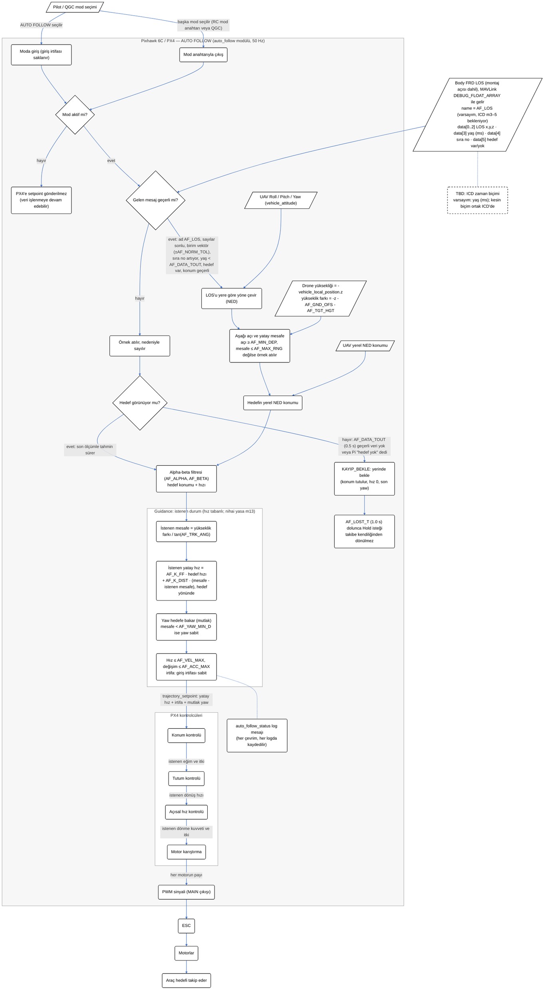

# Şema 1 — AUTO FOLLOW Uçuş Modu: Üst Seviye Akış

> **Güncelleme notu (2026-11-09):** Bu dosya, eski taslak `agent-os/specs/2026-10-15-m15-target-follow-flight-mode/diagrams/01-ust-seviye-akis.md`'nin kopyasıdır ve bu spec'in kararlarına göre güncellendi (kullanıcı onayı, `requirements.md` §11). Kararlaşan TBD'ler kararla değiştirildi, eski taslak adlar (`tez_follow`, `TEZ_FOL_*`, `TEZ_LOS`) AUTO FOLLOW / `auto_follow` / `AF_*` / `AF_LOS` oldu, masaüstü dosyası bağlantısı rapora çevrildi. **Asıl şema eski klasörde değişmeden durur.**
>
> Eski not (tarihsel): Bu şema FC'ye özel olarak güncellendi, bkz. `agent-os/specs/2026-10-18-m15-fc-only-flow-diagrams/`.

FC'ye MAVLink `DEBUG_FLOAT_ARRAY` (`name = AF_LOS`) ile body FRD LOS gelir (montaj açısı dahil), FC bunu PWM'e kadar işler. Pixhawk 6C üzerinde çalışan **AUTO FOLLOW** uçuş modu (`auto_follow` modülü, 50 Hz), mod aktifken gelen mesajı kontrol eder, LOS'u araç yönelimi ve yükseklik farkıyla hedefin yerel NED konumuna çevirir (geolocation), hedefi alpha-beta filtresiyle kestirir ve hız tabanlı guidance ile istenen yatay hızı ve yaw'u üretir. Hedef `AF_DATA_TOUT` boyunca görünmezse araç yerinde bekler, `AF_LOST_T` dolunca Hold'a geçer. İsteği (`trajectory_setpoint`) PX4'ün kendi kontrolcüleri motor karıştırmaya ve MAIN çıkışındaki PWM sinyaline kadar taşır, ESC'ler motorları döndürür. Hesap düz dünya kabulüyle yerel NED çerçevesinde yapılır, küresel koordinat dönüşümü yoktur.

- Üslup rehberi: [referans görsel](../../../2026-10-15-m15-target-follow-flight-mode/planning/visuals/WhatsApp%20Image%202026-09-26%20at%2000.07.13.jpeg) (eski taslak klasöründe). Görsel birebir kopyalanmadı, yalnızca şekil dili alındı.
- Lejant: paralelkenar = girdi, yuvarlak köşeli kutu = işlem, eşkenar dörtgen = karar, kesik çizgili kutu = açık konu (TBD). Ok üzerindeki yazı, bir adımdan sonrakine geçen bilgidir.
- Guidance yasasının ayrıntısı ve sayısal örnek: [`rapor.md`](../../rapor.md) (Bölüm 4.5) ve `spec.md`. PX4'e özel ayrıntılar `02-px4-detayli-akis.md` dosyasındadır. Her kutunun Şema 2 karşılığı, o dosyadaki (B) bloğunun "Şema 1 ile karşılık" tablosundadır.
- Girdi biçimi bir **varsayımdır** (V2); kesin biçim ortak ICD'de (yol haritası 3–5) belirlenecek. Açık kalan TBD: ICD zaman biçimi.

