# Şema 2: PX4 v1.17.0 Detaylı Akış — `auto_follow` (AUTO FOLLOW) External Mode

> **Güncelleme notu (2026-11-09):** Bu dosya, eski taslak `agent-os/specs/2026-10-15-m15-target-follow-flight-mode/diagrams/02-px4-detayli-akis.md`'nin kopyasıdır ve bu spec'in kararlarına göre güncellendi (kullanıcı onayı, `requirements.md` §11). Kararlaşan TBD'ler kararla değiştirildi (girdi `DEBUG_FLOAT_ARRAY` / `AF_LOS` varsayımı, yükseklik formülü, hız tabanlı guidance + alpha-beta, `trajectory_setpoint`, süreler `AF_DATA_TOUT` / `AF_LOST_T`, SITL girdisi `tez/sitl/af_los_gonder.py`). TBD kalanlar: kilit listesi onayı, ICD zaman biçimi, hareketli insan modeli ve dünyası (m06). Eski taslak adlar (`tez_follow`, `TEZ_FOL_*`, `TEZ_LOS`, `CONFIG_MODULES_TEZ_FOLLOW`) AUTO FOLLOW / `auto_follow` / `AF_*` / `AF_LOS` / `CONFIG_MODULES_AUTO_FOLLOW` oldu. Kullanıcı onayı bekleyen öneriler "(öneri)" ve `spec.md` "Açık konular" numarasıyla işaretlidir. **Asıl şema eski klasörde değişmeden durur.**
>
> **Güncelleme notu (2026-11-10, write-spec turu):** (A) bloğunda başlatma noktası karara bağlandı (`rc.mc_apps` satırı, 7. kilitli yol; B2-b), "bu modda arm yasak" kesinleşti (C1), yerde arm'lıyken geçiş engeli eklendi (B4, yöntem `spec.md` A14). (D) bloğundaki S1–S7, kullanıcıyla konuşulan tabloya döndürüldü (A1, A2): eski "kayıt" ve "mod seçimi" senaryoları ön kontrol oldu, RC kaybı ve modül donması testleri m16 adayı. Ayrıntı `spec.md` Bölüm 11.
>
> Eski not (tarihsel): Bu şema FC'ye özel olarak güncellendi, bkz. `agent-os/specs/2026-10-18-m15-fc-only-flow-diagrams/`.

Bu şema, FC'ye MAVLink `DEBUG_FLOAT_ARRAY` (`name = AF_LOS`) ile gelen body FRD LOS ile bir insanı takip eden **AUTO FOLLOW** uçuş modunun (`auto_follow` modülü) PX4 v1.17.0 içinde nasıl kurulacağını gösterir. Modül FC içinde çalışır, kendini `mc_nn_control` gibi uORB üzerinden external mode olarak kaydeder, `trajectory_setpoint` yayınlar ve uçuşu PX4'ün mevcut kontrolcülerine bırakır. Zincir, kontrolcülerden sonra MAIN PWM çıkışına kadar gösterilir. Modülün kodu bu spec'te (`2026-11-08-m15-takip-kodu`) yazılır. Buradaki her PX4 topic'i, alanı, parametresi ve dosya yolu bu repodaki v1.17.0 kaynağından alınmıştır; `auto_follow`, `AF_*`, `AF_LOS` ve `auto_follow_status` kullanıcı kararıyla verilen yeni adlardır.

- **Düz dünya kabulü:** Hedef, kalkış zeminiyle aynı yatay düzlemdedir. ECEF/WGS84 dönüşümü yapılmaz, hedef konumu yerel NED'de hesaplanır.
- **Guidance:** Yasanın ayrıntısı ve sayısal örnek bu şemaya kopyalanmaz. Bkz. [`rapor.md`](../../rapor.md) (Bölüm 4.5) ve `spec.md`.
- **Ad kaynağı:** PX4 adları v1.17.0 kaynağından; proje adları `requirements.md` §5.2 ve `spec.md`'den. Eski taslağın ad envanteri (`../../../2026-10-15-m15-target-follow-flight-mode/implementation/1-ad-envanteri.md`) proje adları için geçersizdir. Spec ile kaynak çeliştiğinde kaynaktaki ad ve davranış yazılmıştır.
- **Bloklar:** (A) Başlatma, mod kaydı ve arming check. (B) Çevrim başına veri akışı. (C) Mod seçimi, çıkış, hedef kaybı ve failsafe. (D) Doğrulama akışı.

## Lejant

### Katmanlar

Her blok, ilgili katmanları aşağıdaki başlıklarla `subgraph` olarak ayırır.

| Katman | `subgraph` başlığı | Ağırlıklı olduğu blok |
|---|---|---|
| MAVLink | `MAVLink` | B, C |
| uORB | Subgraph yerine kenar etiketi: kenarın üzerindeki ad uORB topic adıdır | Tümü |
| `auto_follow` modülü | `auto_follow modülü` | A, B, C |
| commander | `commander` | A, C |
| FlightModeManager ve kontrolcüler | `FlightModeManager ve kontrolcüler` | A, B |
| QGC/RC | `QGC / RC` | C |
| Doğrulama | `Doğrulama` | D |
| Derleme ve başlatma | `Derleme ve başlatma` | A |

### Şekiller ve renkler

| Şekil / sınıf | Anlamı |
|---|---|
| Paralelkenar (`input`) | Dış girdi veya topic yayıncısı |
| Yuvarlak köşeli kutu (`process`) | İşlem |
| Eşkenar dörtgen (`decision`) | Karar |
| Stadyum (`process`) | Başlangıç veya çevrim sınırı |
| Kesik çizgili kutu (`tbd`) | TBD: ekipçe karar verilecek açık konu |
| Sarı kutu (`note`) | Not, gerekçe |
| Kırmızı çerçeveli kutu (`warn`) | Uyarı, güvenlik açısından önemli davranış |
| Gri kutu (`ref`) | Başka bir bloğa atıf |
| Düz ok | Akış veya veri. Etiket bir topic adıysa veri o topic ile taşınır |
| Noktalı ok / çizgi | Not bağlantısı veya dolaylı/gecikmeli akış |

### Ad etiketleri

| Etiket | Anlamı |
|---|---|
| Etiketsiz | v1.17.0 kaynağında birebir doğrulandı |
| (doğrulanacak) | Ad kaynakta var ama davranış yalnızca SITL/donanımda kanıtlanabilir, ya da ad kesin değil |
| (karar) | Kaynakta yok, kullanıcı kararıyla verilen proje adı ya da değer (`auto_follow`, `AUTO FOLLOW`, `AF_*`, `AF_LOS`, `auto_follow_status`, `CONFIG_MODULES_AUTO_FOLLOW`). Proje adları ayrıca işaretlenmeden de kullanılır |
| (öneri) | Kullanıcı onayı bekleyen öneri (`spec.md` "Açık konular" A1–A12) |
| TBD | Açık konu, `tbd` sınıfıyla kesik çizgili gösterilir |

## Açık konular (TBD)

| # | Konu | Durum (2026-11-09) | Blok |
|---|---|---|---|
| 1 | ICD | **Kısmen kapandı.** Girdi varsayımı: MAVLink `DEBUG_FLOAT_ARRAY`, `name = AF_LOS`; `data[0..2]` LOS x/y/z, `data[3]` yaş (ms), `data[4]` sıra no, `data[5]` hedef var/yok (V2). **TBD kalır: ICD zaman biçimi** ve kesin mesaj (ortak ICD, m3–5) | B |
| 2 | Yükseklik kaynağı | **Kapandı (Karar 13-iii):** yükseklik farkı = `-vehicle_local_position.z` − `AF_GND_OFS` − `AF_TGT_HGT` | B |
| 3 | Nihai guidance yasası | **Kapandı (bu spec için):** hız tabanlı yasa + alpha-beta filtresi; nihai yasa ve ince ayar m13 | B |
| 4 | Setpoint tipi | **Kapandı (Karar 7-a):** `trajectory_setpoint` = yatay hız (`velocity[0..1]`) + irtifa (`position[2]`) + mutlak yaw | B |
| 5 | Ön koşul onayı | **TBD kalır:** `tez/pin/allowed-paths.txt` için 7 yol, Hüseyin onayı, ayrı PR: `ROMFS/px4fmu_common/init.d/rc.mc_apps` (B2-b), `src/modules/auto_follow/`, `boards/px4/sitl/default.px4board`, `boards/px4/fmu-v6c/default.px4board`, `msg/AutoFollowStatus.msg`, `msg/CMakeLists.txt`, `src/modules/logger/logged_topics.cpp` | A |
| 6 | Süre parametreleri | **Kapandı (Karar):** `AF_DATA_TOUT` = 0.5 s (sonra KAYIP_BEKLE), `AF_LOST_T` = 1.0 s (sonra Hold); Pi "hedef yok" derse KAYIP_BEKLE hemen başlar | C |
| 7 | Hareketli insan modeli ve tez dünyası | **TBD kalır (m06):** Gazebo'daki hareketli insan modelinin ve tez dünyasının dosya konumu. `Tools/simulation/gz` kilitli, izinli yollar `tez/*`, `gz_env.sh.in`, `px4-rc.gzsim` | D |
| 8 | SITL'de LOS girdisi | **Kapandı:** geçici gönderici `tez/sitl/af_los_gonder.py` (pymavlink 2.4.50), açık ve kapalı çevrim | D |

<!--
Blok yazım kuralları (Task Group 4-6 için, render edilmez):
- Her blok kendi classDef tanımlarını içerir, bloklar arası paylaşılmaz. Aşağıdaki paleti kopyalayın.
- Node id'leri blok harfiyle başlar (a..., b..., c..., d...). ASCII, benzersiz, Mermaid anahtar kelimesi değil.
- Özel karakterli etiketler "..." içinde. Etiket içinde çift tırnak için #quot;, < ve > için #60; ve #62; kullanın.
- Kenar etiketi topic adıdır: kaynak node, iki tire, "trajectory_setpoint", iki tire ve ok, hedef node (bkz. (A) bloğu).

    classDef input fill:#ffffff,stroke:#000000,stroke-width:1px,color:#000000
    classDef process fill:#ffffff,stroke:#000000,stroke-width:1px,color:#000000
    classDef decision fill:#ffffff,stroke:#000000,stroke-width:1px,color:#000000
    classDef tbd fill:#ffffff,stroke:#000000,stroke-width:1px,stroke-dasharray:5 5,color:#000000
    classDef note fill:#fff8c4,stroke:#b59f00,stroke-width:1px,color:#000000
    classDef warn fill:#ffffff,stroke:#c62828,stroke-width:2px,color:#000000
    classDef ref fill:#eeeeee,stroke:#757575,stroke-width:1px,color:#000000
    linkStyle default stroke:#1565c0,stroke-width:1.5px
-->

## (A) Başlatma, mod kaydı ve arming check

Modül, `mc_nn_control` `Run()` sırasını izler: çıkış kontrolü → kayıt isteği gönder → cevabı bekle (cevap gelince kontrol modunu yapılandır) → her çevrimde arming check isteğine cevap ver → (B) bloğuna geç. Kayıt **disarm iken** yapılmalıdır, bu yüzden modül boot'ta `rc.mc_apps`'ten, `AF_ENABLE` = 1 ise başlatılır (Karar B2-b, A13). `can_arm_and_run = true` (Karar 5-a): hedef yokken de; mod aktifken `false` olursa PX4 Hold'a değil RTL'e düşer. İstisna: yerdeyken ve mod aktif değilken `false` (Karar A14-a). `mode_req_*` listesi ve kontrol bayrakları karardır (`spec.md` A1, A2).

```mermaid
flowchart TB
    subgraph aBuild ["Derleme ve başlatma"]
        aPre("TBD: Ön koşul onayı (allowed-paths, 7 yol)<br/>src/modules/auto_follow/, boards/px4/sitl/default.px4board,<br/>boards/px4/fmu-v6c/default.px4board, msg/AutoFollowStatus.msg,<br/>msg/CMakeLists.txt, src/modules/logger/logged_topics.cpp,<br/>ROMFS/px4fmu_common/init.d/rc.mc_apps<br/>Hüseyin onayı, ayrı PR, henüz onaylanmadı")
        aKconfig("CONFIG_MODULES_AUTO_FOLLOW=y (karar)<br/>boards/px4/fmu-v6c/default.px4board<br/>boards/px4/sitl/default.px4board")
        aStartSitl("SITL: rcS (init.d-posix/rcS:289) → rc.vehicle_setup → rc.mc_apps<br/>Karar B2-b: rc.mc_apps içinde auto_follow start satırı<br/>(satırın koşulu açık, spec A13)")
        aStartHw("6C: rcS (init.d/rcS:485) → rc.vehicle_setup → rc.mc_apps<br/>aynı satır; SITL ile 6C aynı dosyayı kullanır")
        aRcLocked("Not: rc.mc_apps kilitli, 7. yol olarak talepte (B2-b).<br/>Hüseyin reddederse geri dönüş: SITL'de pxh'tan elle,<br/>6C'de SD kart /fs/microsd/etc/extras.txt (spec A8)")
        aBoot(["auto_follow start: boot'ta, disarm iken"])
    end

    subgraph aMod ["auto_follow modülü"]
        aSkel("Modül iskeleti: ModuleBase + ModuleParams + px4::ScheduledWorkItem<br/>(src/examples/work_item deseni)<br/>kuyruk: px4::wq_configurations::nav_and_controllers<br/>(mc_nn_control ile aynı kuyruk, 6C'de yükü doğrulanacak)<br/>ScheduleOnInterval 50 Hz (karar, sabit, parametre değil)")
        aSkelNote("Not: mc_nn_control px4::WorkItem'dır ve vehicle_angular_velocity<br/>callback'iyle çalışır. ScheduledWorkItem + ScheduleOnInterval<br/>deseni src/examples/work_item'dan gelir")
        aRun(["Run(): her çevrim"])
        aExitQ{"should_exit() ?"}
        aSentQ{"Kayıt isteği<br/>gönderildi mi?"}
        aReq("Kayıt isteği (RegisterNeuralFlightMode deseni)<br/>name = #quot;AUTO FOLLOW#quot; (karar, char[25], sabit)<br/>request_id (benzersiz)<br/>px4_ros2_api_version = 1<br/>register_arming_check = true<br/>register_mode = true")
        aIdQ{"mode_id ve arming_check_id<br/>geçerli mi (≠ -1)?"}
        aReplyQ{"Kayıt cevabı<br/>(CheckModeRegistration)"}
        aRegFail("Kayıt başarısız: mod QGC/RC listesinde görünmez<br/>setpoint yayınlanmaz, PX4_ERR bir kez<br/>QGC uyarısı events ile (öneri)")
        aConfig("Kontrol modu yapılandırması (ConfigureNeuralFlightMode deseni)<br/>tip vehicle_control_mode_s<br/>source_id = mode_id<br/>timestamp = hrt_absolute_time()")
        aFlags("config_control_setpoints bayrakları (Karar, spec A1, A2)<br/>true: flag_multicopter_position_control_enabled,<br/>flag_control_position_enabled, flag_control_velocity_enabled,<br/>flag_control_altitude_enabled, flag_control_climb_rate_enabled,<br/>flag_control_acceleration_enabled, flag_control_attitude_enabled,<br/>flag_control_rates_enabled, flag_control_allocation_enabled,<br/>flag_control_termination_enabled,<br/>flag_control_auto_enabled (A2: çubuk → Position)<br/>false: flag_control_manual_enabled, flag_control_offboard_enabled")
        aNnDiff("Not: mc_nn_control config'inde flag_multicopter_position_control_enabled = false<br/>yazar (pozisyon kontrolünü kapatır, actuator_motors yayınlar).<br/>auto_follow pozisyon kontrolünü açık tutar, trajectory_setpoint yayınlar")
        aCycleEnd(["return: sonraki çevrim"])
        aChkQ{"arming_check_request<br/>güncellendi mi?"}
        aRateNote("Not: istek her çevrimde kontrol edilir.<br/>~50 Hz (20 ms) çevrim, 50 ms cevap süresinin içinde kalır")
        aReplyBuild("arming_check_reply hazırla (ReplyToArmingCheck deseni)<br/>request_id = istekteki request_id<br/>registration_id = arming_check_id<br/>can_arm_and_run = true (Karar 5-a, hedef yokken de);<br/>istisna adayı: yerde ve mod aktif değilken false (B4, spec A14)<br/>mode_req_* (Karar, öneri kabul, spec A1):<br/>mode_req_attitude = true<br/>mode_req_local_position = true<br/>mode_req_local_alt = true<br/>mode_req_angular_velocity = true<br/>mode_req_prevent_arming = true (öneri: bu modda arm edilemez)<br/>mode_req_manual_control = false<br/>timestamp = hrt_absolute_time()")
        aAirNote("Not: can_arm_and_run hep true; hedef kaybını modül kendi<br/>Hold isteğiyle yönetir. Disarm iken mod her zaman seçilebilir<br/>(masa testi). Bu modda arm yasak: mode_req_prevent_arming = true (Karar C1).<br/>Moda giriş koşulları (C) bloğunda")
        aUnreg("Kayıt silme (UnregisterNeuralFlightMode deseni)<br/>kayıt gönderildiyse: name (kayıttaki adla birebir), arming_check_id, mode_id,<br/>mode_executor_id = -1 (executor yok)<br/>ardından exit_and_cleanup()")
    end

    subgraph aCmd ["commander"]
        aArmedQ{"armed mı?<br/>(COM_MODE_ARM_CHK = 0)"}
        aReject("armed iken kayıt reddi<br/>PX4_ERR #quot;Not accepting registration requests while armed#quot;<br/>success = false")
        aRegister("ModeManagement::checkNewRegistrations<br/>boş mod slotu: mode_id ∈ NAVIGATION_STATE_EXTERNAL1..8 (23..30)<br/>arming check kaydı: arming_check_id<br/>cevap: request_id, success, arming_check_id, mode_id, name")
        aHash("Not: COM_MODE${i}_HASH (COM_MODE0_HASH..COM_MODE7_HASH)<br/>mod adının FNV-1a hash'i parametreye yazılır.<br/>Aynı ad hep aynı slota düşer, bu yüzden mod adı sabit tutulur")
        aCfgStore("ModeManagement::checkConfigControlSetpointUpdates<br/>source_id kayıtlı bir mod olmalı<br/>yapılandırma mod kaydına saklanır")
        aUpdCtl("Commander::updateControlMode → ModeManagement::updateControlMode<br/>nav_state == mode_id iken yapılandırma vehicle_control_mode olur.<br/>flag_armed ve flag_multicopter_position_control_enabled<br/>commander'da yeniden türetilir (bu modda sonuç yine true)")
        aChkReq("HealthAndArmingChecks externalChecks<br/>her UPDATE_INTERVAL = 300 ms yeni istek, request_id artırılır<br/>cevap REQUEST_TIMEOUT = 50 ms içinde gelmeli,<br/>request_id eşleşmeli, timestamp son 300 ms içinde olmalı")
        aChkEval{"Eşleşen cevap<br/>zamanında geldi mi?"}
        aChkOk("Cevap işlenir, cevapsız sayacı sıfırlanır<br/>can_arm_and_run ve mode_req_* failsafe bayraklarına yazılır<br/>can_arm_and_run = false → mode_req_other")
        aNoReply{"Ardışık cevapsız istek<br/>NUM_NO_REPLY_UNTIL_UNRESPONSIVE = 3<br/>sınırını aştı mı?"}
        aInitNote("Not: sınır aşımı 4. ardışık cevapsız istekte olur.<br/>Kayıttan sonra ilk cevaba kadar sınır 10'dur")
        aUnresp("Mod unresponsive → mode_req_other")
        aFallback("UYARI: mod aktifken RTL'e düşer, Hold'a değil<br/>Failsafe::checkModeFallback: modeCanRun false → Action::RTL<br/>Bu yüzden hedef kaybı için can_arm_and_run = false kullanılmaz,<br/>hedef kaybı (C) bloğunda modülün kendi Hold isteğiyle çözülür")
        aUnregArmedQ{"armed mı?<br/>(COM_MODE_ARM_CHK = 0)"}
        aUnregDefer("Kayıt silme isteği işlenmez: ModeManagement::update<br/>checkUnregistrations'ı yalnızca disarm iken çağırır.<br/>Modül çıktığı için cevaplar kesilir → unresponsive yolu<br/>(SITL'de doğrulanacak)")
        aUnregDo("ModeManagement::checkUnregistrations<br/>mod ve arming check kaydı silinir")
        aUnregActiveQ{"Silinen mod<br/>aktif mi?"}
        aHold("Hold'a geçer (NAVIGATION_STATE_AUTO_LOITER)")
        aGone("Mod listeden çıkar")
    end

    subgraph aCtl ["FlightModeManager ve kontrolcüler"]
        aPosCtl("mc_pos_control: want_takeoff'u yalnızca flag_control_offboard_enabled<br/>iken kendisi hesaplar. Bu modda offboard bayrağı false,<br/>want_takeoff üretilmez → moda yerden kalkış yok")
    end

    aToB("(B) bloğuna devam: vehicle_status.nav_state == mode_id<br/>ise hesap ve setpoint")
    aToC("(C) bloğu: mod adı AVAILABLE_MODES ile QGC'ye gider,<br/>QGC/RC mod seçimi")

    aPre --> aKconfig
    aKconfig --> aStartSitl
    aKconfig --> aStartHw
    aStartSitl --> aBoot
    aStartHw --> aBoot
    aRcLocked -.- aBoot
    aBoot --> aSkel
    aSkel -.- aSkelNote
    aSkel -- "ScheduleOnInterval" --> aRun
    aRun --> aExitQ
    aExitQ -- "hayır" --> aSentQ
    aExitQ -- "evet" --> aUnreg
    aSentQ -- "hayır" --> aReq
    aSentQ -- "evet" --> aIdQ
    aReq -- "register_ext_component_request" --> aArmedQ
    aReq --> aCycleEnd
    aArmedQ -- "evet" --> aReject
    aArmedQ -- "hayır" --> aRegister
    aRegister -.- aHash
    aRegister -- "register_ext_component_reply" --> aReplyQ
    aReject -- "register_ext_component_reply" --> aReplyQ
    aRegister -. "mod adı (name)" .-> aToC
    aIdQ -- "hayır" --> aReplyQ
    aReplyQ -- "cevap yok" --> aCycleEnd
    aReplyQ -- "success = false" --> aRegFail
    aReplyQ -- "success = true" --> aConfig
    aConfig --> aFlags
    aFlags -.- aNnDiff
    aConfig -- "config_control_setpoints" --> aCfgStore
    aConfig --> aCycleEnd
    aCfgStore --> aUpdCtl
    aUpdCtl -- "vehicle_control_mode" --> aPosCtl
    aIdQ -- "evet" --> aChkQ
    aChkReq -- "arming_check_request" --> aChkQ
    aChkQ -.- aRateNote
    aChkQ -- "evet" --> aReplyBuild
    aChkQ -- "hayır" --> aToB
    aReplyBuild -.- aAirNote
    aReplyBuild -- "arming_check_reply" --> aChkEval
    aReplyBuild --> aToB
    aChkEval -- "evet" --> aChkOk
    aChkEval -- "hayır" --> aNoReply
    aNoReply -.- aInitNote
    aNoReply -- "hayır: sonraki istek" --> aChkReq
    aNoReply -- "evet" --> aUnresp
    aChkOk -. "300 ms sonra" .-> aChkReq
    aChkOk -- "mod aktifken can_arm_and_run = false" --> aFallback
    aUnresp -- "mod aktifken" --> aFallback
    aUnreg -- "unregister_ext_component" --> aUnregArmedQ
    aUnregArmedQ -- "evet" --> aUnregDefer
    aUnregArmedQ -- "hayır" --> aUnregDo
    aUnregDefer -. "cevaplar kesilir" .-> aNoReply
    aUnregDo --> aUnregActiveQ
    aUnregActiveQ -- "evet" --> aHold
    aUnregActiveQ -- "hayır" --> aGone

    classDef input fill:#ffffff,stroke:#000000,stroke-width:1px,color:#000000
    classDef process fill:#ffffff,stroke:#000000,stroke-width:1px,color:#000000
    classDef decision fill:#ffffff,stroke:#000000,stroke-width:1px,color:#000000
    classDef tbd fill:#ffffff,stroke:#000000,stroke-width:1px,stroke-dasharray:5 5,color:#000000
    classDef note fill:#fff8c4,stroke:#b59f00,stroke-width:1px,color:#000000
    classDef warn fill:#ffffff,stroke:#c62828,stroke-width:2px,color:#000000
    classDef ref fill:#eeeeee,stroke:#757575,stroke-width:1px,color:#000000
    linkStyle default stroke:#1565c0,stroke-width:1.5px

    class aKconfig,aStartSitl,aStartHw,aBoot,aSkel,aRun,aReq,aConfig,aFlags,aCycleEnd,aReplyBuild,aUnreg process
    class aRegister,aCfgStore,aUpdCtl,aChkReq,aChkOk,aUnresp,aUnregDo,aHold,aGone,aPosCtl process
    class aExitQ,aSentQ,aIdQ,aReplyQ,aChkQ,aArmedQ,aChkEval,aNoReply,aUnregArmedQ,aUnregActiveQ decision
    class aPre tbd
    class aRcLocked,aSkelNote,aNnDiff,aRateNote,aAirNote,aHash,aInitNote note
    class aReject,aRegFail,aFallback,aUnregDefer warn
    class aToB,aToC ref
```

**(A) notları ve kaynak satırları**

- Kayıt, cevap, yapılandırma, arming check ve kayıt silme deseni: `src/modules/mc_nn_control/mc_nn_control.cpp:132-212`, `Run()` sırası `:436-477`.
- Kayıt ve armed iken red: `src/modules/commander/ModeManagement.cpp:218-335`, `:371-387`. Red yalnızca `COM_MODE_ARM_CHK = 0` (varsayılan) iken olur.
- `COM_MODE${i}_HASH`: `src/modules/commander/module.yaml:5-16`, `ModeManagement.cpp:97-111`. Gerçek parametre adları `COM_MODE0_HASH..COM_MODE7_HASH`.
- Kontrol modu: `ModeManagement.cpp:521-536`, `:582-602`, bayrakların yeniden türetilmesi `src/modules/commander/Commander.cpp:2603-2617`.
- Arming check zamanlaması: `src/modules/commander/HealthAndArmingChecks/checks/externalChecks.hpp:69-75`, `externalChecks.cpp:225-295`. Cevapta `request_id` alanı zorunludur, eşleşmeyen cevap yok sayılır.
- RTL'e düşüş: `src/modules/commander/failsafe/failsafe.cpp:659-704`.
- Kayıt silme: `ModeManagement.cpp:337-364` (aktif mod silinirse Hold). `name` kayıttaki adla eşleşmezse mod silinmez (`ModeManagement.cpp:185-194`, `:353`). `mode_executor_id` alanı `msg/versioned/UnregisterExtComponent.msg:9` (-1 = kayıtlı değil). `mc_nn_control` bu alanı 0 bırakır (`mc_nn_control.cpp:146-155`), 0 otopilot executor'ıdır ve zararsızdır (`ModeManagement.hpp:52-53`, `ModeManagement.cpp:499-510`). `checkUnregistrations` yalnızca disarm iken çağrılır (`:371-409`). Armed iken modül durdurulursa istek bekler, cevaplar kesildiği için mod unresponsive olur ve aktifse RTL'e düşer.
- `want_takeoff`: `src/modules/mc_pos_control/MulticopterPositionControl.cpp:464-486`.
- Başlatma: donanım `ROMFS/px4fmu_common/init.d/rcS:25`, `:599-603`. SITL `.post` mekanizması `ROMFS/px4fmu_common/init.d-posix/rcS:217-229`, `:359-363`.

## (B) Çevrim başına veri akışı (run loop)

Bu blok, (A) adımlarından sonra her `Run()` çevriminde (50 Hz) olanı gösterir: FC'ye gelen `AF_LOS` örneği MAVLink `DEBUG_FLOAT_ARRAY` üzerinden `debug_array` topic'ine düşer, modül örneği doğrular, mod aktifse hedefin yerel NED konumunu hesaplar, hedefi alpha-beta filtresiyle kestirir, hız tabanlı guidance ve sınırlarla `trajectory_setpoint` yayınlar. Bu setpoint'i PX4'ün kontrolcü zinciri motorlara kadar taşır. Kenar etiketleri uORB topic adlarıdır, MAVLink mesajları "MAVLink" önekiyle yazılmıştır.

- **Çevrim sırası:** (A) → abonelikleri güncelle → `nav_state == mode_id` kapısı → moda giriş kontrolü → konum geçerliliği → girdi doğrulama (ad, sonluluk, norm, sıra no, gerçek yaş, hedef bayrağı) → geolocation (aşağı açı, menzil) → alpha-beta → guidance → sınırlar → `trajectory_setpoint` → `auto_follow_status`.
- **Mod aktifken her çevrimde setpoint yayınlanır.** Geçerli LOS yoksa veya durum geçersizse (C) bloğundaki tutma setpoint'i yayınlanır. Hiç yayın yapılmayan tek durum, modun aktif olmadığı çevrimdir.
- **FC portu:** FC tarafı TELEM2 = `/dev/ttyS3`.

Şema 1 ile karşılık:

| Şema 1 kutusu | (B) karşılığı |
|---|---|
| Pilot / QGC mod seçimi | `bCmdr` (`vehicle_status`). Seçim yolları (C) bloğunda (`QGC / RC` subgraph'ı) |
| Moda giriş | `bGate` (evet), `bEntryQ`, `bEntry`. Giriş koşulları (C) bloğunda |
| Mod anahtarıyla çıkış | `bGate` (hayır). Çıkış yolu (C) bloğunda |
| Mod aktif mi? | `bGate` |
| PX4'e setpoint gönderilmez (veri işlenmeye devam edebilir) | `bIdle` |
| Body FRD LOS (montaj açısı dahil), MAVLink DEBUG_FLOAT_ARRAY ile gelir (AF_LOS, varsayım) | `bLosIn`, MAVLink katmanı (`bLinkHw`, `bLinkSitl`, `bRecv`) |
| TBD: ICD zaman biçimi | `bIcd` |
| Gelen mesaj geçerli mi? | `bVecQ`, `bChkName`, `bChkFinite`, `bChkNorm`, `bChkSeq`, `bChkFresh`, `bChkFlag` (evet → `bAccept`), `bPosQ` |
| Örnek atılır, nedeniyle sayılır | `bDrop` |
| Hedef görünüyor mu? | `bAgeQ` |
| KAYIP_BEKLE: yerinde bekle (konum tutulur, hız 0, son yaw) | `bLostRef` (hover, (C) bloğu hedef kaybı) |
| AF_LOST_T (1.0 s) dolunca Hold isteği | `bLostRef` (Hold isteği, (C) bloğu) |
| UAV Roll / Pitch / Yaw (vehicle_attitude) | `bEkf` (`vehicle_attitude`), `bSubs` |
| Drone yüksekliği = -vehicle_local_position.z; yükseklik farkı | `bEkf` (`vehicle_local_position`), `bAlt`, `bAltNote` |
| UAV yerel NED konumu | `bEkf` (`vehicle_local_position`), `bSubs` |
| LOS'u yere göre yöne çevir (NED) | `bLosNed` |
| Aşağı açı ve yatay mesafe | `bUdQ`, `bAlt`, `bRange`, `bRngQ` |
| Hedefin yerel NED konumu | `bTgt` |
| Alpha-beta filtresi (AF_ALPHA, AF_BETA) | `bEst` |
| Guidance: istenen durum | Şema 1'de alt kutu: `bGuid`, `bSat`, `bTraj` |
| İstenen mesafe = yükseklik farkı / tan(AF_TRK_ANG) | `bGuid` |
| İstenen yatay hız | `bGuid` |
| Yaw hedefe bakar (mutlak) | `bGuid`, `bTraj` (yaw) |
| Hız ≤ AF_VEL_MAX, değişim ≤ AF_ACC_MAX; irtifa: giriş irtifası sabit | `bSat`, `bTraj` |
| PX4 kontrolcüleri | Şema 1'de alt kutu: `FlightModeManager ve kontrolcüler` subgraph'ı (`bFmm`, `bPos`, `bAtt`, `bRate`, `bAlloc`) |
| Konum kontrolü | `bPos` |
| Tutum kontrolü | `bAtt` |
| Açısal hız kontrolü | `bRate` |
| Motor karıştırma | `bAlloc`, `bMix` |
| PWM sinyali (MAIN çıkışı) | `bLimQ`, `bLimDis`, `bLimFail`, `bLimOn`, `bIoDrv`, `bIoMcu`, `bMainPwm` |
| ESC | `bOutEsc` |
| Motorlar | `bMotors` |
| Araç hedefi takip eder | `bFollow` |
| auto_follow_status log mesajı | `bLog` |

```mermaid
flowchart TB
    bLosIn[/"Body FRD LOS (montaj açısı dahil), MAVLink ile TELEM2'den gelir (varsayım V2)<br/>MAVLink DEBUG_FLOAT_ARRAY, name = #quot;AF_LOS#quot; (en fazla 9 karakter)<br/>data[0..2] = LOS_body birim vektör (x ileri, y sağ, z aşağı)<br/>data[3] = yaş (ms), data[4] = sıra no, data[5] = hedef var (1) / yok (0)<br/>FC montaj açısını bilmez, time_usec FC'de kullanılmaz<br/>data bir extension alanıdır: MAVLink 2 gerekir (doğrulanacak)"/]

    subgraph bLink ["MAVLink"]
        bLinkHw("Donanım: Pixhawk 6C TELEM2 (doğrulanacak)<br/>CONFIG_BOARD_SERIAL_TEL2=#quot;/dev/ttyS3#quot;<br/>MAV_1_CONFIG = 102 (TELEM 2, varsayılan kapalı)<br/>MAV_1_MODE = 2 (Onboard, varsayılan)<br/>TELEM2 varsayılan baud 921600")
        bLinkSitl("SITL: UDP onboard bağlantısı (px4-rc.mavlink)<br/>local 14580 / remote 14540<br/>mavlink start -m onboard")
        bRecv("MavlinkReceiver::handle_message_debug_float_array<br/>(MAVLINK_MSG_ID_DEBUG_FLOAT_ARRAY)<br/>timestamp = hrt_absolute_time() (varış anı)<br/>name kopyalanır, son bayt NUL yapılır, id = array_id<br/>data[58] kopyalanır, MAVLink time_usec atılır")
        bIcd("TBD: ICD zaman biçimi (ortak ICD, m3–5)<br/>varsayım: Pi yaşı ms olarak data[3]'te gönderir;<br/>kesin biçim, frekans (Pi 10–30 Hz bekleniyor) ve mesaj ICD'de.<br/>Pi farklı biçim gönderirse yalnızca girdi okuma kısmı değişir")
        bTsNote("Not: debug_array.timestamp FC'ye varış anıdır.<br/>Çekim anı ≈ varış anı - yaş (data[3]).<br/>Tutum varış anındakidir (V3), gecikme telafisi yok (m13/m16)")
        bQueueNote("Not: debug_array tek instance, kuyruk uzunluğu 1.<br/>Her MAVLink bağlantısından gelen DEBUG_FLOAT_ARRAY aynı topic'e yazılır,<br/>name filtresi bu yüzden gerekir")
    end

    bEkf[/"ekf2<br/>UAV Roll / Pitch / Yaw, UAV yerel NED konumu,<br/>İrtifa (baro / EKF)"/]
    bCmdr[/"commander"/]

    subgraph bMod ["auto_follow modülü"]
        bFromA(["(A) bloğundan: Run() çevrimi<br/>kayıt tamam, arming check isteği cevaplandı"])
        bSubs("Abonelikler (her çevrim update)<br/>vehicle_attitude.q (FRD → NED quaternion)<br/>vehicle_local_position: x/y/z, xy_valid, z_valid, heading,<br/>xy_reset_counter, z_reset_counter<br/>vehicle_status.nav_state<br/>debug_array (AF_LOS), parameter_update")
        bGate{"vehicle_status.nav_state<br/>== mode_id ?"}
        bIdle("PASIF (mod aktif değil): trajectory_setpoint yayınlanmaz<br/>doğrulama, geometri ve filtre çalışabilir,<br/>auto_follow_status yayınlanır (öneri)")
        bEntryQ{"Moda giriş<br/>ilk çevrimi mi?"}
        bEntry("Giriş hazırlığı<br/>giriş irtifası (vehicle_local_position.z) saklanır,<br/>position[2] olarak tutulur (Karar 6.4)<br/>ivme sınırlayıcı mevcut hızdan başlar (öneri)<br/>ilk trajectory_setpoint bu çevrimde yayınlanır")
        bPosQ{"xy_valid ve z_valid true,<br/>xy_reset_counter ve z_reset_counter<br/>değişmedi mi?"}
        bVecQ{"debug_array<br/>güncellendi mi?"}
        bChkName{"1. name filtresi<br/>name == #quot;AF_LOS#quot; ?"}
        bChkFinite{"2. PX4_ISFINITE<br/>data[0..5] sonlu mu?"}
        bChkNorm{"3. Birim vektör normu<br/>abs(norm - 1) ≤ AF_NORM_TOL (0.1) ?"}
        bChkSeq{"4. Sıra no<br/>data[4] #62; önceki sıra no ?"}
        bChkFresh{"5. Gerçek yaş<br/>(hrt_absolute_time() - timestamp) + data[3]<br/>#60; AF_DATA_TOUT (0.5 s) ?"}
        bChkFlag{"6. Hedef bayrağı<br/>data[5] == 1 ?"}
        bDrop("Örnek atılır, nedeniyle sayılır<br/>perf_counter + auto_follow_status sayaçları (alan adları öneri)<br/>hız sınırlı PX4_WARN, bu çevrimde yeni ölçüm yok")
        bAccept("Ölçüm kabul edilir (altı adım geçti)<br/>LOS_body saklanır. Son geçerli ölçüm zamanı burada değil,<br/>açı ve menzil kontrolünden sonra yenilenir (öneri)")
        bAgeQ{"Son geçerli ölçüm (tüm kontroller)<br/>AF_DATA_TOUT (0.5 s) içinde mi?"}
        bLosNed("Body LOS → Vehicle-carried NED LOS<br/>LOS_NED = R(q) · LOS_body<br/>R(q): vehicle_attitude.q (FRD → NED)")
        bUdQ{"7. Aşağı bakış açısı<br/>asin(LOS_NED.z) ≥ AF_MIN_DEP (10°) ?"}
        bAlt("Yükseklik farkı (Karar 13-iii)<br/>h = -vehicle_local_position.z - AF_GND_OFS - AF_TGT_HGT<br/>(-z: EKF orijinine, yani kalkış zeminine göre)")
        bAltNote("Not (V4): zemin düz ve kalkış düzlemi kabul edilir.<br/>Baro kayması ve EKF orijini farkının etkisi<br/>SITL ve uçuş loglarında gözlenir")
        bRange("Aşağı açı ve yatay mesafe<br/>δ = asin(LOS_NED.z)<br/>d = h / tan(δ)")
        bRngQ{"8. Menzil<br/>0 #60; d ≤ AF_MAX_RNG (40 m) ?"}
        bTgt("Hedefin yerel NED konumu (yatay)<br/>hedef_xy = UAV_xy + d · LOS_NED_xy / norm(LOS_NED_xy)<br/>UAV_xy = vehicle_local_position x/y")
        bEst("Alpha-beta filtresi (AlphaBetaFilter, Karar 6.1)<br/>AF_ALPHA, AF_BETA → hedef konumu + hızı<br/>yeni ölçümde düzeltme, her çevrimde tahmin (öneri)")
        bEstNote("Not: follow_target_estimator (TargetEstimator) yalnızca fikir kaynağıdır.<br/>Follow Me (FlightTaskAutoFollowTarget) ve kodu kullanılmaz")
        bGuid("Guidance: hız tabanlı (Karar 6-a)<br/>istenen mesafe = h / tan(AF_TRK_ANG)<br/>v_xy = AF_K_FF · hedef hızı + AF_K_DIST · (mesafe - istenen mesafe) · hedef yönü<br/>yaw = hedefe bakış (mutlak); mesafe #60; AF_YAW_MIN_D ise yaw sabit<br/>irtifa = giriş irtifası. Ayrıntı: rapor.md 4.5")
        bGuidNote("Not: hız tabanlı yasa + alpha-beta bu spec'in ilk yasasıdır.<br/>Nihai yasa ve ince ayar m13'tür.<br/>Açık çevrim testlerde AF_K_FF = 0")
        bSat("Sınırlar<br/>yatay hız büyüklüğü ≤ AF_VEL_MAX (2 m/s)<br/>hız komutu değişimi ≤ AF_ACC_MAX (3 m/s²)<br/>sonlu olmayan çıkış yayınlanmaz")
        bTraj("trajectory_setpoint hazırla ve yayınla (NED, Karar 7-a)<br/>velocity[0], velocity[1]: guidance yatay hızı<br/>position[2]: giriş irtifası<br/>yaw: hedefe bakış (mutlak)<br/>position[0..1], velocity[2], acceleration, jerk, yawspeed NaN<br/>timestamp = hrt_absolute_time()")
        bTrajNote("Not: mc_pos_control geçerlilik kuralı (PositionControl::_inputValid)<br/>her eksende position, velocity veya acceleration'dan en az biri sonlu,<br/>x ve y çifti birlikte sonlu ya da birlikte NaN olmalı.<br/>Geçersizse 200 ms son geçerli setpoint, sonra generateFailsafeSetpoint.<br/>yaw NaN ise mevcut yaw tutulur")
        bFirstWarn("UYARI: moda girişte ilk çevrimde trajectory_setpoint yayınlanmalı.<br/>Aksi halde mc_pos_control son FlightTask setpoint'ini kullanmaya devam eder<br/>(Position/Hold'dan geçiş), pozisyon kontrolü yeni açıldıysa<br/>generateFailsafeSetpoint üretir. Mod aktifken her çevrim yayınlanır")
        bSpNote("Karar 7-a: trajectory_setpoint (hız xy + konum z + mutlak yaw).<br/>goto_setpoint hız tabanlı yasaya uymadığı için seçilmedi")
        bLostRef("(C) bloğu: hedef kaybı<br/>AF_DATA_TOUT (0.5 s) aşıldı veya Pi #quot;hedef yok#quot; →<br/>KAYIP_BEKLE: konum tutulur, hız 0, son yaw<br/>AF_LOST_T (1.0 s) sonra Hold isteği")
        bSafeRef("(C) bloğu: güvenli taraf (öneri, spec A10)<br/>xy_valid/z_valid false veya EKF reset →<br/>yeni takip setpoint'i üretilmez")
        bCycleEnd(["return: sonraki çevrim"])
    end

    subgraph bCtl ["FlightModeManager ve kontrolcüler"]
        bFmm("FlightModeManager::start_flight_task<br/>nav_state ∈ NAVIGATION_STATE_EXTERNAL1..8 → FlightTaskIndex::None<br/>FlightTask çalışmaz, trajectory_setpoint'i yalnızca auto_follow yayınlar")
        bPos("mc_pos_control (MulticopterPositionControl)<br/>girdiler: trajectory_setpoint + vehicle_local_position + vehicle_control_mode<br/>adjustSetpointForEKFResets, PositionControl")
        bLimNote("Not: ikinci emniyet katmanı (mc_pos_control limitleri, varsayılanlar)<br/>MPC_XY_VEL_MAX = 12 m/s, MPC_Z_VEL_MAX_UP = 3 m/s,<br/>MPC_Z_VEL_MAX_DN = 1.5 m/s, MPC_TILTMAX_AIR = 45°.<br/>Modülün kendi saturation'ından sonra uygulanır")
        bStaleWarn("UYARI: mc_pos_control trajectory_setpoint için tazelik zaman aşımı uygulamaz.<br/>Modül donarsa son setpoint (ör. yatay hız) uygulanmaya devam eder,<br/>arming check cevapsız kalıp commander RTL'e geçene kadar ((A) bloğu)")
        bAtt("mc_att_control")
        bRate("mc_rate_control")
        bAlloc("control_allocator")

        subgraph bOut ["Çıkış: mixer_module ve px4io"]
            bMix("mixer_module MixingOutput (öneki PWM_MAIN) / FunctionMotors<br/>actuator_motors aboneliği, THR_MDL_FAC (varsayılan 0) eğrisi<br/>[0,1] → [-1,1], reversible olmayan motorda negatif değer → NAN<br/>armed değilse kanal çıkışı NAN")
            bLimQ{"output_limit (limitAndUpdateOutputs)<br/>çıkış durumu ?<br/>kontrol sırası: kill/lockdown → termination → armed"}
            bLimDis("Disarmed değeri: PWM_MAIN_DISn<br/>(varsayılan 1000 µs)<br/>NAN kanal da bu değere gider")
            bLimFail("Failsafe değeri: PWM_MAIN_FAILn<br/>varsayılan -1: fonksiyonun varsayılan failsafe değeri,<br/>motorlarda disarmed değerine düşer (doğrulanacak)")
            bLimOn("output_limit_calc_single<br/>[-1,1] → PWM_MAIN_MINn..PWM_MAIN_MAXn doğrusal<br/>(varsayılan 1000–2000 µs)<br/>arm sonrası 500 ms ramp: disarmed değerinden hedefe")
            bIoDrv("px4io sürücüsü (FMU tarafı)<br/>PX4IO::updateOutputs → io_reg_set(PX4IO_PAGE_DIRECT_PWM)<br/>fonksiyonu atanmamış kanala 0 yazılır (sinyal yok)")
            bIoMcu("IO işlemcisi (px4iofirmware, px4_io-v2)<br/>PX4IO_PAGE_DIRECT_PWM → r_page_direct_pwm<br/>→ up_pwm_servo_set")
            bMainPwm("MAIN 1–4 PWM çıkışı, 400 Hz<br/>PWM_MAIN_TIM0 (MAIN 1-2), PWM_MAIN_TIM1 (MAIN 3-4), varsayılan 400<br/>darbe genişliği PWM_MAIN_MIN..PWM_MAIN_MAX (1000–2000 µs)")
            bFuncNote("Not: motor ataması PWM_MAIN_FUNC1..4 = 101..104 (Motor 1..4)<br/>varsayılan 0 (Disabled), 4019_x500_v2 airframe ayarlamaz,<br/>QGC Actuators sekmesinde elle yapılır (doğrulanacak)<br/>MAIN 1–4 ↔ motor sırası (doğrulanacak)")
            bSitlNote("Not (SITL, ayrı dal çizilmez): gz_bridge aynı MixingOutput'u kullanır (öneki SIM_GZ_EC)<br/>4001_gz_x500: SIM_GZ_EC_FUNC1..4 = 101..104, MIN 150 / MAX 1000<br/>çıkış PWM değil motor hızıdır (gz::msgs::Actuators), ramp yok")
            bIoNote("Not (doğrulanacak): V6C10 / V6C11 donanım sürümlerinde PX4IO yoktur<br/>(board_config.h: NO PX4IO). Kullanıcının kartında IO olduğu varsayılır")
            bOutPubNote("Not: actuator_outputs yan çıkışı<br/>mixer_module, sürücü çağrısından sonra yayınlar<br/>(yalnızca updateOutputs true dönerse).<br/>ULog varsayılan setinde (opsiyonel, 100 ms)")
        end
    end

    bOutEsc("ESC 1–4<br/>MAIN portuna PWM ile bağlı (kullanıcı bilgisi)")
    bMotors("Motorlar 1–4")
    bFollow("Araç hedefi takip eder")

    bLog("ULog (logger)<br/>auto_follow_status: her çevrim yayınlanır, varsayılan listeye<br/>add_topic ile her zaman kaydedilir (Karar L2-b, kilitli yol)<br/>varsayılan sette ayrıca: trajectory_setpoint (200 ms), vehicle_local_position<br/>ham debug_array yalnızca debug bitiyle; gerek yok (ham girdi kopyalanır)")
    bMsgNote("Karar L2-b: kendi mesajımız msg/AutoFollowStatus.msg → auto_follow_status<br/>(alan adları öneri, spec Bölüm 9). Hüseyin reddederse geri dönüş:<br/>debug_array + log sözlüğü. logger_topics.txt kullanılmaz:<br/>varsayılan listenin yerine geçer")
    bParams("Parametreler (karar, module.yaml, ≤16 karakter)<br/>AF_TRK_ANG, AF_K_DIST, AF_K_FF, AF_VEL_MAX, AF_ACC_MAX,<br/>AF_ALPHA, AF_BETA, AF_DATA_TOUT, AF_LOST_T, AF_YAW_MIN_D,<br/>AF_TGT_HGT, AF_GND_OFS, AF_NORM_TOL, AF_MIN_DEP, AF_MAX_RNG")

    bLosIn -- "MAVLink DEBUG_FLOAT_ARRAY (seri, TELEM2)" --> bLinkHw
    bLosIn -- "MAVLink DEBUG_FLOAT_ARRAY (UDP, SITL)" --> bLinkSitl
    bLosIn -.- bIcd
    bLinkHw --> bRecv
    bLinkSitl --> bRecv
    bIcd -.- bRecv
    bRecv -.- bTsNote
    bRecv -.- bQueueNote
    bRecv -- "debug_array" --> bVecQ
    bFromA --> bSubs
    bEkf -- "vehicle_attitude" --> bSubs
    bEkf -- "vehicle_local_position" --> bSubs
    bCmdr -- "vehicle_status" --> bSubs
    bSubs --> bGate
    bGate -- "hayır" --> bIdle
    bIdle --> bCycleEnd
    bGate -- "evet" --> bEntryQ
    bEntryQ -- "evet" --> bEntry
    bEntryQ -- "hayır" --> bPosQ
    bEntry --> bPosQ
    bPosQ -- "hayır" --> bSafeRef
    bPosQ -- "evet" --> bVecQ
    bVecQ -- "evet" --> bChkName
    bVecQ -- "hayır" --> bAgeQ
    bChkName -- "evet" --> bChkFinite
    bChkName -- "hayır" --> bDrop
    bChkFinite -- "evet" --> bChkNorm
    bChkFinite -- "hayır" --> bDrop
    bChkNorm -- "evet" --> bChkSeq
    bChkSeq -- "evet" --> bChkFresh
    bChkSeq -- "hayır" --> bDrop
    bChkNorm -- "hayır" --> bDrop
    bChkFresh -- "evet" --> bChkFlag
    bChkFlag -- "evet" --> bAccept
    bChkFlag -- "hayır: hedef yok, KAYIP_BEKLE hemen" --> bLostRef
    bChkFresh -- "hayır" --> bDrop
    bDrop --> bAgeQ
    bAgeQ -- "hayır" --> bLostRef
    bAgeQ -- "evet: yeni ölçüm yok" --> bEst
    bAccept --> bLosNed
    bLosNed --> bUdQ
    bUdQ -- "hayır: örnek atılır (neden: açı)" --> bDrop
    bUdQ -- "evet" --> bAlt
    bAlt -.- bAltNote
    bAlt --> bRange
    bRange --> bRngQ
    bRngQ -- "evet: son geçerli ölçüm zamanı güncellenir (öneri)" --> bTgt
    bRngQ -- "hayır: örnek atılır (neden: menzil)" --> bDrop
    bTgt -- "yeni ölçüm" --> bEst
    bEst -.- bEstNote
    bEst --> bGuid
    bGuid -.- bGuidNote
    bGuid --> bSat
    bSat -.- bParams
    bSat --> bTraj
    bLostRef -. "konum + yaw tutma setpoint'i" .-> bTraj
    bSafeRef -. "konum tutma setpoint'i" .-> bTraj
    bTraj -.- bTrajNote
    bTraj -.- bFirstWarn
    bTraj -.- bSpNote
    bTraj --> bCycleEnd
    bTraj -- "trajectory_setpoint" --> bPos
    bCmdr -- "vehicle_status" --> bFmm
    bFmm -. "FlightTask trajectory_setpoint yayınlamaz" .-> bPos
    bCmdr -- "vehicle_control_mode" --> bPos
    bEkf -- "vehicle_local_position" --> bPos
    bPos -.- bLimNote
    bPos -.- bStaleWarn
    bPos -- "vehicle_attitude_setpoint" --> bAtt
    bAtt -- "vehicle_rates_setpoint" --> bRate
    bRate -- "vehicle_torque_setpoint" --> bAlloc
    bRate -- "vehicle_thrust_setpoint" --> bAlloc
    bAlloc -- "actuator_motors" --> bMix
    bMix -.- bSitlNote
    bMix -- "outputs[i]: [-1,1] veya NAN" --> bLimQ
    bLimQ -- "kill / lockdown" --> bLimDis
    bLimQ -- "termination" --> bLimFail
    bLimQ -- "armed değil" --> bLimDis
    bLimQ -- "normal (armed)" --> bLimOn
    bLimDis -- "µs değeri" --> bIoDrv
    bLimFail -- "µs değeri" --> bIoDrv
    bLimOn -- "µs değeri" --> bIoDrv
    bIoDrv -. "actuator_outputs" .-> bOutPubNote
    bOutPubNote -.- bLog
    bIoDrv -- "seri hat /dev/ttyS4 (USART6, 1.5 Mbps)" --> bIoMcu
    bIoMcu -.- bIoNote
    bIoMcu --> bMainPwm
    bMainPwm -.- bFuncNote
    bMainPwm -- "PWM 400 Hz" --> bOutEsc
    bOutEsc --> bMotors
    bMotors --> bFollow
    bTraj -.- bLog
    bLog -.- bMsgNote

    classDef input fill:#ffffff,stroke:#000000,stroke-width:1px,color:#000000
    classDef process fill:#ffffff,stroke:#000000,stroke-width:1px,color:#000000
    classDef decision fill:#ffffff,stroke:#000000,stroke-width:1px,color:#000000
    classDef tbd fill:#ffffff,stroke:#000000,stroke-width:1px,stroke-dasharray:5 5,color:#000000
    classDef note fill:#fff8c4,stroke:#b59f00,stroke-width:1px,color:#000000
    classDef warn fill:#ffffff,stroke:#c62828,stroke-width:2px,color:#000000
    classDef ref fill:#eeeeee,stroke:#757575,stroke-width:1px,color:#000000
    linkStyle default stroke:#1565c0,stroke-width:1.5px

    class bLosIn,bEkf,bCmdr input
    class bLinkHw,bLinkSitl,bRecv,bSubs,bIdle,bEntry,bDrop,bAccept,bCycleEnd process
    class bLosNed,bAlt,bRange,bTgt,bEst,bGuid,bSat,bTraj,bFmm,bPos,bAtt,bRate,bAlloc process
    class bMix,bLimDis,bLimFail,bLimOn,bIoDrv,bIoMcu,bMainPwm,bOutEsc,bMotors,bFollow process
    class bGate,bEntryQ,bPosQ,bVecQ,bChkName,bChkFinite,bChkNorm,bChkSeq,bChkFresh,bChkFlag,bAgeQ,bUdQ,bRngQ,bLimQ decision
    class bIcd tbd
    class bTsNote,bQueueNote,bEstNote,bTrajNote,bLimNote,bLog,bMsgNote,bParams,bFuncNote,bSitlNote,bIoNote,bOutPubNote,bAltNote,bGuidNote,bSpNote note
    class bFirstWarn,bStaleWarn warn
    class bFromA,bLostRef,bSafeRef ref
```

**(B) notları ve kaynak satırları**

- MAVLink girişi: dispatch `src/modules/mavlink/mavlink_receiver.cpp:302-303` (`CONSTRAINED_FLASH` kapısı `:284-305`), `handle_message_debug_float_array` `:2815-2832` (`timestamp = hrt_absolute_time()` `:2822`, son bayt NUL `:2825`, `data` kopyası `:2827-2829`). MAVLink `DEBUG_FLOAT_ARRAY` tanımı `src/modules/mavlink/mavlink/message_definitions/v1.0/common.xml:7625-7632` (`data` bir extension alanı `:7630-7631`: MAVLink 2 gerekir). uORB `msg/DebugArray.msg:1-5` (`name` char[10], kullanılabilir en fazla 9 karakter; `data[58]`). Tek yayıncı `mavlink_receiver.h:333` (`uORB::Publication`, tek instance). Eski aday `DEBUG_VECT` (`:2797-2812`) zaman bilgisini taşıyamadığı için bırakıldı (KG).
- Donanım bağlantısı: `boards/px4/fmu-v6c/default.px4board:6`. `MAV_${i}_CONFIG` `src/modules/mavlink/module.yaml:41-48` (varsayılan `[TEL1, "", ""]`, yani `MAV_1_CONFIG` kapalı), TELEM 2 = 102 ve 921600 baud `Tools/serial/generate_config.py:92-96`. `MAV_${i}_MODE` `module.yaml:54-79` (varsayılan `[0, 2, 0]`).
- SITL bağlantısı: `ROMFS/px4fmu_common/init.d-posix/px4-rc.mavlink:4-5` (portlar, `+px4_instance` ofseti), `:26` (`-m onboard`).
- Durum girdileri: `msg/versioned/VehicleAttitude.msg:10` (`q`, FRD → NED), `msg/versioned/VehicleLocalPosition.msg:9-10`, `:15-17`, `:21`, `:23`, `:42`, `msg/versioned/VehicleStatus.msg:35`. `vehicle_local_position.z` aşağı pozitiftir ve orijin EKF başlangıç konumudur (`VehicleLocalPosition.msg:1-2`, `:17`), bu yüzden `h = -z` kalkış zeminine göre yüksekliktir.
- Son geçerli ölçüm zamanı (öneri): yalnızca altı girdi kontrolünü, aşağı açı (`AF_MIN_DEP`) ve menzil (`AF_MAX_RNG`) kontrolünü geçen ölçümle güncellenir. Atılan örnekler zamanı yenilemez; böylece geçersizlik `AF_DATA_TOUT`'tan uzun sürerse (C) bloğundaki hedef kaybı yoluna girilir.
- Mod kapısı: `mc_nn_control::Run()` deseni `src/modules/mc_nn_control/mc_nn_control.cpp:436-477`.
- `trajectory_setpoint` alanları ve NaN kuralı: `msg/versioned/TrajectorySetpoint.msg:4`, `:8`, `:11-17`. Geçerlilik kuralı `src/modules/mc_pos_control/PositionControl/PositionControl.cpp:224-250`, yaw NaN davranışı `:116-117`. Geçersiz setpoint yedeği (200 ms son geçerli, sonra failsafe) `src/modules/mc_pos_control/MulticopterPositionControl.cpp:573-597`.
- İlk çevrim kuralı: `MulticopterPositionControl.cpp:402-411` (pozisyon kontrolünün açılma anı), `:442-449` (`generateFailsafeSetpoint` yalnızca o andan sonra setpoint gelmediyse), `:636-685`. `trajectory_setpoint` yalnızca güncellenince okunur (`:438`), tazelik zaman aşımı yoktur.
- `goto_setpoint` alternatifi: `MulticopterPositionControl.cpp:429-436`, `src/modules/mc_pos_control/GotoControl/`.
- EKF reset düzeltmesi: `MulticopterPositionControl.cpp:440`, `:687-730`.
- FlightTask kapanışı: `src/modules/flight_mode_manager/FlightModeManager.cpp:136-143`.
- Kontrolcü zinciri: `MulticopterPositionControl.hpp:99`, `:102`, `:107`, `:109`, `src/modules/mc_att_control/mc_att_control.hpp:105`, `:115`, `src/modules/mc_rate_control/MulticopterRateControl.hpp:100`, `:110-111`, `src/modules/control_allocator/ControlAllocator.hpp:178-179`, `:187`. `actuator_motors` tüketicisi `src/lib/mixer_module/functions/FunctionMotors.hpp:52` (pwm_out, dshot ve gz_bridge `MixingOutput` kullanır).
- **PWM zinciri** (yalnızca MAIN dalı, ESC'ler kullanıcı bilgisine göre MAIN portuna PWM ile bağlıdır): mixer `src/lib/mixer_module/mixer_module.cpp:421-576` (`update()` `:421`, armed değilse NAN `:460-464`, kill/lockdown → disarmed `:491-495`, termination → `actualFailsafeValue` `:497-501`, normal → `output_limit_calc` `:505`, sürücü çağrısı ve ardından `actuator_outputs` yayını `:527-529`, `output_limit_calc_single` `:535-576`), `output_limit_calc` durumları `:578-663` (500 ms ramp `:582`, `:640-654`, OFF → disarmed `:633-638`), yayın `:666-676`, `<prefix>_FUNCn/DISn/MINn/CENTn/MAXn/FAILn` `:117-131`, `actualFailsafeValue` `:691-710`. FunctionMotors `src/lib/mixer_module/functions/FunctionMotors.hpp:52-120` (`actuator_motors` aboneliği `:52`, `THR_MDL_FAC` `:53`, `:83-107`, [0,1] → [-1,1] `:109-118`). Motor fonksiyonları `src/lib/mixer_module/output_functions.yaml:5`, `:10-12` (Disabled = 0, Motor1..12 = 101..112), `THR_MDL_FAC` varsayılanı `src/lib/mixer_module/motor_params.c:57`. px4io `src/drivers/px4io/px4io.cpp:227` (`PWM_MAIN` öneki, ramp açık), `:363-378` (`updateOutputs` → `PX4IO_PAGE_DIRECT_PWM`), `src/drivers/px4io/module.yaml:5`, `:10-12`, `:22-28` (DIS/MIN/MAX 1000/1000/2000, protokol varsayılanı 400 Hz, DShot seçeneği yok). IO işlemcisi `src/modules/px4iofirmware/registers.c:186-193`, `src/modules/px4iofirmware/mixer.cpp:122-127`, `:230-234`. Kart `boards/px4/fmu-v6c/src/board_config.h:59-72` (`/dev/ttyS4`, USART6, 1.5 Mbps), `:149-150` (V6C10/V6C11 NO PX4IO), `boards/px4/fmu-v6c/src/manifest.c:89-100`, `:108-109`, `boards/px4/fmu-v6c/default.px4board:32` (`CONFIG_DRIVERS_PX4IO=y`). Başlatma `ROMFS/px4fmu_common/init.d/rcS:414` (`px4io start`, kapı `:389`), `ROMFS/px4fmu_common/init.d/airframes/4019_x500_v2` (`PWM_*_FUNC` ataması yok). Parametre varsayılanları `build/px4_fmu-v6c_default/parameters.xml` (build çıktısı): `PWM_MAIN_FUNC1` = 0 `:2166`, `PWM_MAIN_TIM0` (MAIN 1-2) = 400 `:2783`, `PWM_MAIN_TIM1` (MAIN 3-4) = 400 `:2796`, `PWM_MAIN_TIM2` (MAIN 5-8) = 400 `:2809`, `PWM_MAIN_DIS1` = 1000 `:2054`, `PWM_MAIN_MIN1` = 1000 `:2718`, `PWM_MAIN_MAX1` = 2000 `:2670`, `PWM_MAIN_FAIL1` = -1 `:2110`. `PWM_MAIN_FAIL` = -1 çözümü: `_failsafe_value` `uint16_t` (`mixer_module.hpp:244`, `mixer_module.cpp:194`, `:696`), `defaultFailsafeValue` NAN (`src/lib/mixer_module/functions/FunctionProviderBase.hpp:64`), NAN → disarmed (`mixer_module.cpp:538-539`), `parameters.xml:2174` (build çıktısı). Davranış donanımda kanıtlanmadığı için şemada "(doğrulanacak)" kalır. `actuator_outputs` ULog'u `src/modules/logger/logged_topics.cpp:162`. SITL yan notu `ROMFS/px4fmu_common/init.d-posix/airframes/4001_gz_x500:35-48`, `src/modules/simulation/gz_bridge/module.yaml:13`, `src/modules/simulation/gz_bridge/GZMixingInterfaceESC.hpp:81`, `GZMixingInterfaceESC.cpp:48`, `:80-88`. AUX çıkışları (FMU, `rcS:478-479`) çizilmez.
- Limitler: `src/modules/mc_pos_control/multicopter_position_control_limits_params.c:47`, `:64`, `:81`, `:96`. Uygulama `MulticopterPositionControl.cpp:525`, `:536-545`.
- ULog: `src/modules/logger/logged_topics.cpp:46` (`add_default_topics`, `auto_follow_status` satırı buraya eklenir), `:131`, `:145` (varsayılan set), `:289-294`, `:569-570` (debug seti; ham `debug_array`). `logger_topics.txt` varsa varsayılan liste kullanılmaz: `:531-540`. `SDLOG_PROFILE` bit 5 `src/modules/logger/module.yaml:71-104`, SITL varsayılanı `ROMFS/px4fmu_common/init.d-posix/rcS:182`.
- Kestirim fikri: `src/modules/flight_mode_manager/tasks/AutoFollowTarget/follow_target_estimator/TargetEstimator.hpp:112`. Kullanılmaz.
- Guidance: yasa, filtre, sayısal örnek ve hata hassasiyeti `../../rapor.md` (Bölüm 4.5–4.6) ve `spec.md` (Bölüm 3–6) içindedir.

## (C) Mod seçimi, çıkış, hedef kaybı ve failsafe

Bu blok pilotun modu nasıl seçtiğini, moddan nasıl çıktığını, hedef kaybolunca ne olduğunu ve PX4 failsafe'lerinin bu modla nasıl etkileştiğini gösterir. Moda QGC'den veya RC mod anahtarından girilir, yine mod anahtarıyla (veya QGC'den) çıkılır. Stick hareketinin modu değiştirip değiştirmediği `flag_control_auto_enabled` önerisine bağlıdır (`spec.md` A2, doğrulanacak). Hedef kaybolursa (`AF_DATA_TOUT` = 0.5 s geçerli veri yok ya da Pi "hedef yok") modül KAYIP_BEKLE'de konumu ve yaw'u tutar, `AF_LOST_T` = 1.0 s dolunca kendisi Hold ister; Hold'dan sonra takibe kendiliğinden dönülmez (Karar D).

- **İki ayrı yol:** Hedef kaybında modül, `VEHICLE_CMD_SET_NAV_STATE` ile **Hold** ister (planlı yol). Modül çöker, donar veya konum geçersiz olursa commander `Failsafe::checkModeFallback` ile **RTL**'e düşer (RTL çalışamazsa Land, sonra Descend, en sonda Terminate). Hedef kaybı için bu fallback yolu kullanılmaz.
- **Giriş yolları:** QGC yolu `VEHICLE_CMD_DO_SET_MODE` ile, RC yolu `action_request` ile commander'a gelir. İkisi de `UserModeIntention::change` içinde aynı kurala bağlıdır: disarm iken her zaman izin, armed iken `canRun(mode_id)`.
- **Aşağı açı / menzil:** `AF_MIN_DEP` ya da `AF_MAX_RNG` kontrolünü geçemeyen örnek (B)'de atılır ve geçerli veri sayılmaz; bu durum `AF_DATA_TOUT`'tan uzun sürerse normal hedef kaybı yolu işler.
- **Güvenli taraf, konum geçersizken (öneri, `spec.md` A10):** `xy_valid` false iken konum tutma setpoint'i geçersizdir (pozisyon durumu NaN). Bu yüzden modül yatay hızı sıfır yayınlar (`velocity[0..1] = 0`, `position[0..1]` NaN). `z_valid` ise `position[2]` tutulur, değilse `velocity[2] = 0` yayınlanır. Asıl tepkiyi PX4 varsayılanı verir: commander `local_position_invalid` (veya `local_altitude_invalid`) görür, mod `mode_req_local_position` / `mode_req_local_alt` nedeniyle çalışamaz sayılır ve `checkModeFallback` modu terk ettirir. Modülün setpoint'i yalnızca bu kısa pencerede uygulanır.
- **Yükseklik:** Tutulan konumun `z` değeri EKF orijinine göredir. Bu orijin kalkış zemini olmayabilir (V4; bkz. (B) `bAltNote`).

```mermaid
flowchart TB
    subgraph cPilot ["QGC / RC"]
        cQgcSel[/"QGC 5.1.4 mod listesi (doğrulanacak)<br/>pilot #quot;AUTO FOLLOW#quot; modunu seçer<br/>mod kayıtlı değilse #quot;(Mode not available)#quot; görünür"/]
        cRcSw[/"RC verici mod anahtarı<br/>COM_FLTMODE1..6 = 100..107 (External Mode 1..8)"/]
        cStick[/"Pilot stick hareketi<br/>manual_control_setpoint.sticks_moving"/]
        cExitSel[/"Pilot çıkışı: RC mod anahtarı başka slota<br/>veya QGC'den başka mod (ör. Position)"/]
    end

    subgraph cLink ["MAVLink"]
        cAvail("streams/AVAILABLE_MODES.hpp<br/>mod adı register_ext_component_reply.name'den önbelleğe alınır<br/>custom_mode = get_px4_custom_mode(mode_id)<br/>can_set_nav_states_mask'te yoksa #quot;(Mode not available)#quot;")
        cHb("HEARTBEAT custom mode (streams/HEARTBEAT.hpp)<br/>main_mode = PX4_CUSTOM_MAIN_MODE_AUTO (4)<br/>sub_mode = PX4_CUSTOM_SUB_MODE_EXTERNALx (11..18)")
        cRecvMode("mavlink_receiver: MAV_CMD_DO_SET_MODE veya SET_MODE<br/>→ VEHICLE_CMD_DO_SET_MODE (176)<br/>param1 = base_mode (CUSTOM_MODE_ENABLED)<br/>param2 = PX4_CUSTOM_MAIN_MODE_AUTO (4)<br/>param3 = PX4_CUSTOM_SUB_MODE_EXTERNALx (11..18)")
    end

    cFromA(["(A) bloğundan: kayıt tamam<br/>success = true, mode_id, name"])
    cRcUpd("rc_update<br/>mod anahtarı kanalı → mode_slot")
    cManCtl("manual_control: ManualControl::evaluateModeSlot<br/>yalnızca mode_slot değişince çalışır<br/>navStateFromParam(COM_FLTMODEx):<br/>100..107 → NAVIGATION_STATE_EXTERNAL1..8")
    cHashNote("Not: slot eşlemesi COM_MODE${i}_HASH ile kalıcı.<br/>Mod adı sabit kaldıkça mode_id hep aynı slota düşer.<br/>COM_FLTMODEx bu slota göre seçilir:<br/>mode_id 23 → 100, ..., 30 → 107")
    cSlotNote("Not: mod anahtarı kenar tetiklidir. Hold veya failsafe sonrası<br/>anahtar hâlâ auto_follow slotundaysa moda yeniden girmek için<br/>anahtar başka slota alınıp geri getirilir (veya QGC kullanılır)")
    cPosRef("(B) bloğu: mc_pos_control ve kontrolcü zinciri")

    subgraph cCmd ["commander"]
        cDoSetMode("Commander::handle_command: VEHICLE_CMD_DO_SET_MODE<br/>PX4_CUSTOM_SUB_MODE_EXTERNALx → NAVIGATION_STATE_EXTERNALx (23..30)")
        cAction("Commander::executeActionRequest<br/>ACTION_SWITCH_MODE (SOURCE_RC_MODE_SLOT)")
        cUmi("UserModeIntention::change(mode_id, ModeChangeSource::User)")
        cArmedQ{"armed mı?"}
        cDisarmOk("Disarm: mod seçimine her zaman izin (masa testi)<br/>bu modda arm engellenir: mode_req_prevent_arming = true<br/>(Karar C1: kalkış Position'da yapılır)")
        cCanRunQ{"canRun(mode_id)?<br/>can_arm_and_run = true (Karar 5-a)<br/>mod responsive, mode_req_* sağlanıyor mu?"}
        cReject("Geçiş reddedilir: mode_req_* sağlanmıyor<br/>veya mod unresponsive<br/>printRejectMode, VEHICLE_CMD_RESULT_TEMPORARILY_REJECTED<br/>mevcut mod korunur")
        cAccept("Armed: geçiş kabul (yerdeyken de, spec A1, doğrulanacak)<br/>nav_state = mode_id<br/>vehicle_control_mode = config_control_setpoints yapılandırması")
        cOvQ{"Commander::manualControlCheck stick override<br/>armed, valid, sticks_moving, ROTARY_WING ve<br/>flag_control_manual_enabled = false ve<br/>(flag_control_auto_enabled veya flag_control_offboard_enabled) ve<br/>COM_RC_OVERRIDE ilgili biti açık mı?"}
        cNoOv("Seçenek a (auto = false): stick modu değiştirmez,<br/>flag_control_auto_enabled ve flag_control_offboard_enabled<br/>false olduğundan override_enabled = false kalır.<br/>Seçenek b (auto = true): Position'a geçer.<br/>Açık: spec A2 (SITL S3'te doğrulanacak)")
        cOvNote("Not: failsafe aktifken istek _failsafe_user_override_request ile<br/>failsafe/framework.cpp'ye gider ve aynı koşullara bağlıdır (doğrulanacak).<br/>Failsafe sırasında mod anahtarıyla devralma her zaman mümkündür")
        cPosctl("Position'a geçer (NAVIGATION_STATE_POSCTL)<br/>yalnızca auto veya offboard bayraklı modlarda (ör. Hold)")
        cOther("UserModeIntention::change(yeni mod)<br/>armed iken canRun(yeni mod) ise kabul<br/>nav_state != mode_id")
        cSetNav("Commander::handle_command: VEHICLE_CMD_SET_NAV_STATE (#quot;Used from ROS#quot;)<br/>hedef filtresi: target_system / target_component eşleşmeli veya 0<br/>nav_state = param1 + 0.5 → UserModeIntention::change")
        cHoldQ{"canRun(NAVIGATION_STATE_AUTO_LOITER)?"}
        cHold("Hold (NAVIGATION_STATE_AUTO_LOITER)<br/>VEHICLE_CMD_RESULT_ACCEPTED")
        cHoldRej("VEHICLE_CMD_RESULT_TEMPORARILY_REJECTED<br/>mod değişmez")
        cHoldNote("Not: Hold'da PX4 varsayılanı geçerlidir. COM_RC_OVERRIDE bit 0<br/>(varsayılan 1) açık olduğundan stick hareketi Position'a geçirir.<br/>Bu beklenen ve kabul edilen davranıştır")
        cHoldPassive("Not: Hold'dan sonra modül pasiftir (nav_state != mode_id).<br/>Hedef geri gelse de otomatik takibe dönülmez.<br/>Pilot moda RC veya QGC ile yeniden girer")
        cFsDef("PX4 varsayılan failsafe'leri (değiştirilmez)<br/>batarya: COM_LOW_BAT_ACT, veri bağlantısı: NAV_DLL_ACT,<br/>geofence: GF_ACTION, EKF / konum kaybı:<br/>local_position_invalid, local_altitude_invalid")
        cNoDefer("Not: auto_follow config_overrides_request yayınlamaz.<br/>config_overrides / defer_failsafes kullanılmaz,<br/>failsafe'ler ertelenmez")
        cRclQ{"RC kaybı: COM_RCL_EXCEPT bit 3<br/>(External Mode) set mi?<br/>(varsayılan 0)"}
        cRclAct("COM_RC_LOSS_T (0.5 s) sonra COM_FAIL_ACT_T (5 s) Hold,<br/>ardından NAV_RCL_ACT (varsayılan 2 = Return).<br/>RC dönünce auto_follow'a otomatik dönülmez<br/>(SITL'de doğrulanacak)")
        cRclIgn("RC kaybı bu modda yok sayılır")
        cUnresp("Modül çöker, donar veya uçuşta durdurulur<br/>arming_check_reply kesilir → unresponsive ((A) bloğu)<br/>armed iken unregister_ext_component işlenmez (SITL'de doğrulanacak)<br/>donma süresince son trajectory_setpoint uygulanır.<br/>Disarm iken kayıt silinirse aktif mod Hold'a geçer ((A) bloğu)")
        cRtl("UYARI: Failsafe::checkModeFallback → RTL, Hold değil<br/>RTL çalışamazsa Land, sonra Descend, en sonda Terminate.<br/>Bu yol hedef kaybından ayrıdır: hedef kaybında<br/>modül kendi Hold isteğini gönderir")
        cFsClear("Not: checkModeFallback eylemi koşul düzelince kalkar<br/>(ClearCondition::WhenConditionClears). Pilot devralmadıysa<br/>araç auto_follow'a geri döner (SITL'de doğrulanacak).<br/>Failsafe sırasında pilot mod anahtarı veya stick ile devralabilir")
    end

    subgraph cMod ["auto_follow modülü"]
        cGate{"vehicle_status.nav_state<br/>== mode_id ?"}
        cExitStop("PASIF (mod aktif değil): trajectory_setpoint yayınlanmaz<br/>veri işlenebilir, auto_follow_status yayınlanır (öneri)")
        cTrack("TAKIP ((B) bloğu)<br/>geolocation → alpha-beta → guidance → sınırlar<br/>moda girişte ilk çevrimde setpoint yayınlanır")
        cAgeQ{"Son geçerli ölçüm AF_DATA_TOUT (0.5 s)<br/>içinde mi ve hedef var mı?"}
        cLostIn("(B) bloğundan: hedef kaybı<br/>AF_DATA_TOUT aşıldı veya Pi #quot;hedef yok#quot; → KAYIP_BEKLE,<br/>AF_LOST_T sonra Hold isteği")
        cLost("KAYIP_BEKLE (hover, Karar D)<br/>kayıp anındaki konum tutulur (EKF orijinine göre), irtifa = giriş irtifası<br/>position[0..2] = tutulan konum, velocity[0..1] = 0<br/>yaw = son yaw, yawspeed NaN")
        cHoldTQ{"KAYIP_BEKLE süresi<br/>AF_LOST_T (1.0 s) doldu mu?"}
        cBackQ{"Yeni geçerli ölçüm geldi mi?<br/>((B) girdi doğrulama + açı + menzil)"}
        cBack("Hedef geri geldi (AF_LOST_T dolmadan):<br/>takip kendiliğinden sürer (Karar D)")
        cHoldCmd("HOLD_ISTENDI: Hold isteği, vehicle_command yayınla<br/>command = VEHICLE_CMD_SET_NAV_STATE (100001)<br/>param1 = NAVIGATION_STATE_AUTO_LOITER (4)<br/>target_system / target_component = vehicle_status<br/>system_id / component_id (veya 0)<br/>source_component #60; 1000 → ModeChangeSource::User<br/>(doğrulanacak)")
        cRetry("Hover sürer (öneri, spec A10)<br/>vehicle_command_ack izlenir,<br/>Hold isteği 1 s arayla en fazla 3 kez tekrarlanır")
        cTimeNote("Karar (2026-11-09): AF_DATA_TOUT = 0.5 s, AF_LOST_T = 1.0 s<br/>veri kesilirse son geçerli mesajdan 1.5 s sonra Hold.<br/>Pi #quot;hedef yok#quot; derse KAYIP_BEKLE hemen, 1.0 s sonra Hold.<br/>Hedefsiz moda girişte 1.5 s (zaman referansı öneri, spec Bölüm 7).<br/>AF_LOST_T sayacı KAYIP_BEKLE'ye geçişte başlar")
        cSafeIn("(B) bloğundan: güvenli taraf (öneri, spec A10)<br/>xy_valid/z_valid false veya EKF reset →<br/>yeni takip setpoint'i üretilmez")
        cSafeQ{"Güvenli taraf nedeni?"}
        cSafeInv("Konum geçersiz (öneri, spec A10)<br/>position[0..1] NaN, velocity[0..1] = 0 (yatay hız sıfır)<br/>z_valid ise position[2] tutulur, değilse velocity[2] = 0<br/>yaw = son yaw")
        cSafeInvNote("Not: velocity setpoint için v_xy_valid gerekir.<br/>Değilse setpoint geçersizdir: 200 ms son geçerli setpoint,<br/>sonra generateFailsafeSetpoint (blind land)")
        cSafeReset("EKF reset (xy_reset_counter / z_reset_counter değişti)<br/>tutulacak konum güncel konumdan yeniden alınır,<br/>hedef kestirimi sıfırlanır (öneri), yaw = son yaw.<br/>Sonraki kabul edilen ölçümle takip yeniden başlar")
        cPub("trajectory_setpoint yayınla ((B) bloğu bTraj)<br/>kontrol edilmeyen alanlar NaN<br/>timestamp = hrt_absolute_time()")
    end

    cFromA -- "register_ext_component_reply" --> cAvail
    cAvail -- "MAVLink AVAILABLE_MODES" --> cQgcSel
    cHb -- "MAVLink HEARTBEAT" --> cQgcSel
    cQgcSel -- "MAVLink MAV_CMD_DO_SET_MODE / SET_MODE" --> cRecvMode
    cRecvMode -- "vehicle_command" --> cDoSetMode
    cDoSetMode --> cUmi
    cRcSw --> cRcUpd
    cRcSw -.- cHashNote
    cRcUpd -- "manual_control_switches" --> cManCtl
    cManCtl -.- cSlotNote
    cManCtl -- "action_request" --> cAction
    cAction --> cUmi
    cUmi --> cArmedQ
    cArmedQ -- "hayır" --> cDisarmOk
    cArmedQ -- "evet" --> cCanRunQ
    cCanRunQ -- "hayır" --> cReject
    cCanRunQ -- "evet" --> cAccept
    cAccept -- "vehicle_status" --> cGate
    cAccept -- "vehicle_status" --> cHb
    cStick -- "manual_control_setpoint" --> cOvQ
    cOvQ -- "hayır: auto / offboard bayrağı kapalı" --> cNoOv
    cOvQ -- "evet: auto / offboard modlarda" --> cPosctl
    cOvQ -.- cOvNote
    cExitSel -- "RC: action_request / QGC: vehicle_command" --> cOther
    cOther -- "vehicle_status" --> cGate
    cGate -- "hayır" --> cExitStop
    cGate -- "evet" --> cTrack
    cTrack --> cAgeQ
    cTrack --> cPub
    cAgeQ -- "evet: takip sürer" --> cTrack
    cAgeQ -- "hayır: AF_DATA_TOUT aşıldı veya hedef yok" --> cLost
    cAgeQ -.- cTimeNote
    cLostIn -. "aynı durum" .-> cLost
    cLost --> cPub
    cLost --> cHoldTQ
    cHoldTQ -.- cTimeNote
    cHoldTQ -- "hayır" --> cBackQ
    cBackQ -- "evet" --> cBack
    cBack -- "hedef geri gelirse takibe dön" --> cTrack
    cBackQ -. "hayır: sonraki çevrim" .-> cLost
    cHoldTQ -- "evet" --> cHoldCmd
    cHoldCmd -- "vehicle_command" --> cSetNav
    cSetNav --> cHoldQ
    cHoldQ -- "evet" --> cHold
    cHoldQ -- "hayır" --> cHoldRej
    cHoldRej -- "vehicle_command_ack" --> cRetry
    cRetry -. "sonraki çevrim" .-> cLost
    cHold -.- cHoldNote
    cHold -.- cHoldPassive
    cHold -. "stick hareketi (COM_RC_OVERRIDE bit 0)" .-> cPosctl
    cHold -- "vehicle_status" --> cGate
    cSafeIn --> cSafeQ
    cSafeQ -- "xy_valid / z_valid false" --> cSafeInv
    cSafeQ -- "EKF reset" --> cSafeReset
    cSafeInv -.- cSafeInvNote
    cSafeInv --> cPub
    cSafeReset --> cPub
    cPub -- "trajectory_setpoint" --> cPosRef
    cAccept -. "mod aktifken" .-> cFsDef
    cFsDef -.- cNoDefer
    cFsDef -- "RC kaybı" --> cRclQ
    cRclQ -- "hayır" --> cRclAct
    cRclQ -- "evet" --> cRclIgn
    cFsDef -- "konum / yükseklik kaybı: modeCanRun false" --> cRtl
    cSafeInv -. "commander: local_position_invalid" .-> cRtl
    cUnresp -- "mod aktifken" --> cRtl
    cRtl -.- cFsClear

    classDef input fill:#ffffff,stroke:#000000,stroke-width:1px,color:#000000
    classDef process fill:#ffffff,stroke:#000000,stroke-width:1px,color:#000000
    classDef decision fill:#ffffff,stroke:#000000,stroke-width:1px,color:#000000
    classDef tbd fill:#ffffff,stroke:#000000,stroke-width:1px,stroke-dasharray:5 5,color:#000000
    classDef note fill:#fff8c4,stroke:#b59f00,stroke-width:1px,color:#000000
    classDef warn fill:#ffffff,stroke:#c62828,stroke-width:2px,color:#000000
    classDef ref fill:#eeeeee,stroke:#757575,stroke-width:1px,color:#000000
    linkStyle default stroke:#1565c0,stroke-width:1.5px

    class cQgcSel,cRcSw,cStick,cExitSel input
    class cAvail,cHb,cRecvMode,cRcUpd,cManCtl,cDoSetMode,cAction,cUmi,cDisarmOk,cAccept,cNoOv,cPosctl,cOther process
    class cSetNav,cHold,cFsDef,cRclAct,cRclIgn,cUnresp,cExitStop,cTrack,cLost,cBack,cHoldCmd,cRetry,cPub process
    class cSafeInv,cSafeReset process
    class cArmedQ,cCanRunQ,cOvQ,cHoldQ,cRclQ,cGate,cAgeQ,cHoldTQ,cBackQ,cSafeQ decision
    class cHashNote,cSlotNote,cOvNote,cHoldNote,cHoldPassive,cNoDefer,cFsClear,cSafeInvNote,cTimeNote note
    class cReject,cHoldRej,cRtl warn
    class cFromA,cPosRef,cLostIn,cSafeIn ref
```

**(C) notları ve kaynak satırları**

- QGC mod listesi: `src/modules/mavlink/streams/AVAILABLE_MODES.hpp:76`, `:93-118` (ad ve "(Mode not available)"), `:195-207` (adın `register_ext_component_reply`'den önbelleğe alınması). Seçilebilirlik `vehicle_status.can_set_nav_states_mask` (`msg/versioned/VehicleStatus.msg:72`), kayıtlı external modlar için `src/modules/commander/ModeManagement.cpp:631-655`. QGC 5.1.4'ün adı gösterme ve komut gönderme biçimi bu repoda doğrulanamaz, SITL'de doğrulanacak.
- HEARTBEAT custom mode: `src/modules/mavlink/streams/HEARTBEAT.hpp:104`, `src/modules/commander/px4_custom_mode.h:44-50` (`PX4_CUSTOM_MAIN_MODE_AUTO = 4`), `:69-76` (`PX4_CUSTOM_SUB_MODE_EXTERNAL1..8 = 11..18`), `:102` (`get_px4_custom_mode`).
- Mod komutu girişi: `src/modules/mavlink/mavlink_receiver.cpp:616-617` (`MAV_CMD_DO_SET_MODE`), `:930-955` (`SET_MODE` → `VEHICLE_CMD_DO_SET_MODE`). `msg/versioned/VehicleCommand.msg:35` (`VEHICLE_CMD_DO_SET_MODE = 176`). İşleme `src/modules/commander/Commander.cpp:800-930`, external eşleme `:863-865`, ret ve ack `:915-929`.
- RC yolu: `src/modules/manual_control/ManualControl.cpp:170-177` (yalnızca `mode_slot` değişince), `:404-440` (`evaluateModeSlot`), `:573-600` (`navStateFromParam`, 100..107 → EXTERNAL1..8). `msg/ManualControlSwitches.msg:19`, `msg/ActionRequest.msg:15`, `:24`, `:26`. Commander tarafı `Commander.cpp:1651`, `:1723-1728`. `COM_FLTMODE${i}` ve `COM_MODE${i}_HASH`: `src/modules/commander/module.yaml:5-60`.
- Giriş kuralı: `src/modules/commander/UserModeIntention.cpp:44-92` (disarm iken her zaman izin `:54-55`, armed iken `canRun` `:58-59`). `can_arm_and_run = false` → `mode_req_other`: `src/modules/commander/HealthAndArmingChecks/checks/externalChecks.cpp:158-159`.
- Stick override: `Commander.cpp:2926-2972` (koşullar `:2936-2955`, Position'a geçiş `:2960`, failsafe aktifken `_failsafe_user_override_request` `:2967`). `failsafe/framework.cpp:502-534` (devralma). `COM_RC_OVERRIDE` `src/modules/commander/commander_params.c:436-446` (varsayılan 1, bit 0 auto, bit 1 offboard).
- Hold isteği: `msg/versioned/VehicleCommand.msg:114` (`VEHICLE_CMD_SET_NAV_STATE = 100001`), `:198` (`COMPONENT_MODE_EXECUTOR_START = 1000`). İşleme `Commander.cpp:936-946`, hedef filtresi `:746-749`, kaynak `:1559-1562`. `vehicle_status.system_id` / `component_id` `VehicleStatus.msg:118-119`. `NAVIGATION_STATE_AUTO_LOITER = 4` `VehicleStatus.msg:40`. Hold gereksinimleri `src/modules/commander/ModeUtil/mode_requirements.cpp:110-124`. `vehicle_command_ack` kuyruğu 4 (`msg/versioned/VehicleCommandAck.msg:26`).
- RC kaybı: `src/modules/commander/failsafe/failsafe.cpp:479-492` (`COM_RCL_EXCEPT` bit 3), `commander_params.c:629-633` (`COM_RCL_EXCEPT` varsayılan 0), `:616` (`NAV_RCL_ACT` varsayılan 2 = Return). Gecikme: `COM_RC_LOSS_T` `commander_params.c:139` (0.5 s), `COM_FAIL_ACT_T` `:296-311` (5 s Hold), `failsafe/framework.cpp:351-355`, `:489-499`. RC dönünce eylem `ClearCondition::OnModeChangeOrDisarm` ile kalmaya devam eder (`failsafe.cpp:43-83`).
- Diğer failsafe parametreleri (PX4 varsayılanında kalır): `COM_LOW_BAT_ACT` `commander_params.c:293`, `NAV_DLL_ACT` `:598`, `GF_ACTION` `src/modules/navigator/geofence_params.c:62`. Konum ve yükseklik geçerliliği `src/modules/commander/HealthAndArmingChecks/checks/estimatorCheck.cpp:733-735`, `:751`, `modeCanRun` `framework.cpp:699-716`.
- `config_overrides`: `msg/versioned/ConfigOverrides.msg:9-10`, `:21` (`# TOPICS config_overrides config_overrides_request`), işleme `ModeManagement.cpp:609`. auto_follow bu topic'i yayınlamaz.
- Fallback zinciri: `failsafe.cpp:636-640` (mod fallback'i `UserTakeoverAllowed::Always`, ertelenemez), `:659-704` (`checkModeFallback` → RTL), `framework.cpp:536-605` (RTL → Land → Descend → Terminate, hangisi çalışabiliyorsa), `:397-412` (`WhenConditionClears` ile eylem kalkar). Unresponsive moddan çıkış `externalChecks.cpp:236-243` (`total_num_unresponsive <= 3` iken).
- Konum geçersizken setpoint: `src/modules/mc_pos_control/PositionControl/PositionControl.cpp:224-250` (kontrol edilen eksenin durum tahmini sonlu olmalı), `src/modules/mc_pos_control/MulticopterPositionControl.cpp:318-360` (durumlar `xy_valid` / `v_xy_valid` ile doldurulur), `:573-597` (200 ms son geçerli, sonra failsafe), `:636-685` (`generateFailsafeSetpoint`: hız geçerliyse yatay hız 0, değilse blind land).

## (D) Doğrulama akışı

Bu blok, `auto_follow` kodu yazıldıktan sonra (bu spec) davranışın hangi sırayla ve nasıl kanıtlanacağını gösterir. Akış test piramidini izler (`agent-os/standards/testing/test-writing.md`): birim testleri → Gazebo Harmonic SITL → gerçek uçuş. Her SITL senaryosu bir ULog üretir. Metrikler bu ULog'dan pyulog script'iyle ölçülür, göz kararı "iyi uçtu" test sayılmaz. (A), (B) ve (C) bloklarında "(doğrulanacak)" kalan maddeler S1–S7 senaryolarına dağıtılmıştır.

- **Sıra:** Adım 1 GoogleTest → Adım 2 Gazebo Harmonic SITL → Adım 3 ULog + pyulog metrikleri → Adım 4 gerçek uçuş. Adım 2–3 her senaryo için ayrı bir SITL oturumunda tekrarlanır.
- **Başarısızlık:** Her adımın kapısından bir geri dönüş oku çıkar. Düzeltmede kod değiştiyse Adım 1'den, yalnızca senaryo, script veya test parametresi değiştiyse SITL senaryosundan yeniden başlanır.
- **Parametre dosyası:** Her SITL testinden önce silinir. Standart test sonrasında da sıfırlamayı ister, ikisi birlikte uygulanır. Test parametreleri `PX4_PARAM_<ad>` ortam değişkeniyle verilir, böylece her oturum aynı başlar.
- **Kapı:** Gerçek uçuş yalnızca ön kontroller ve S1–S7 aynı (son) kod sürümüyle SITL'de geçtikten sonra yapılır. RC kaybı ve modül donması testleri bu spec'te yok (m16 adayı).

Senaryoların kapsadığı maddeler:

| Senaryo | Doğrulanan madde | Blok |
|---|---|---|
| Ön kontroller | Açılışta başlama (`rc.mc_apps`), disarm iken kayıt, mod adı ve slotun sabit kalması, disarm iken geçiş, bu modda arm reddi, yerde arm'lıyken geçiş reddi (A14), QGC/RC ile giriş-çıkış, Hold sonrası yeniden giriş, stick davranışı (A2) | A, C |
| S1a / S1b Hedef uzakta / yakında | Açık çevrim (`AF_K_FF` = 0): 18° → ileri (2 m/s kırpma), 37° → ~1.8 m/s geri; ilk çevrim setpoint'i | B |
| S2 Hedef sağda | Açık çevrim: burun sağa döner, dönüş sürer (beklenen) | B |
| S3 Hedef neredeyse tam altta | Açık çevrim, 80°: geri, 2 m/s kırpma, yaw donmaz | B |
| S4 Hedef kaybı | `AF_DATA_TOUT` (0.5 s), `AF_LOST_T` (1.0 s), Pi "hedef yok" bayrağı, `VEHICLE_CMD_SET_NAV_STATE` ile Hold, `AF_LOST_T` dolmadan hedef geri gelince takibin sürmesi, hedefsiz giriş (girişten 1.5 s) | C |
| S5 Girdi doğrulama ve güvenli taraf | `name` filtresi, `PX4_ISFINITE`, norm, sıra no, gerçek yaş, hedef bayrağı, aşağı açı (`AF_MIN_DEP`), menzil (`AF_MAX_RNG`), `xy_valid` false | B, C |
| S6 Duran hayali insan | Kapalı çevrim: takip mesafesi (15.6 m) ve yaw hatası | B |
| S7 Yürüyen hayali insan | Kapalı çevrim, `AF_K_FF` > 0: geride kalmadan takip | B |
| Adım 4 | TELEM2 (`MAV_1_CONFIG = 102`), başlatma (`extras.txt` önerisi, A8), TELEM2'den `AF_LOS` alımı (`debug_array`) | A, B |

```mermaid
flowchart TB
    subgraph dVer ["Doğrulama"]
        dStart(["Başlangıç: auto_follow kodu ve testleri yazıldı (bu spec)<br/>(A), (B), (C) bloklarındaki davranış sırayla kanıtlanır"])
        dPyramid("Not: test piramidi (testing/test-writing.md)<br/>birim → SITL → gerçek uçuş. Göz kararı #quot;iyi uçtu#quot; test sayılmaz,<br/>her metrik ULog'dan pyulog script'iyle ölçülür")

        subgraph dStep1 ["Adım 1: GoogleTest"]
            dUnit("Adım 1: GoogleTest (birim testleri)<br/>px4_add_unit_gtest: uORB/parametre gerektirmeyen saf fonksiyonlar<br/>uORB/parametre gerekirse px4_add_functional_gtest<br/>çalıştırma: make tests TESTFILTER=#60;ad#62;<br/>AutoFollowGuidanceTest.cpp, kısa tutulur (Karar 10.1)")
            dUnitFn("Test edilen saf fonksiyonlar (yalnız temel hesaplar)<br/>düz dünya geolocation: LOS_NED, aşağı açı, yatay mesafe, hedef NED<br/>(örnek: 10 m, LOS 0.8/0/0.6, AF_TGT_HGT 1.0 → 12.0 m)<br/>hız yasası ve sınırları (örnek → -1.8 m/s), alpha-beta<br/>girdi doğrulama: name, PX4_ISFINITE, norm, sıra no, yaş, hedef bayrağı<br/>durum makinesi: AF_DATA_TOUT, AF_LOST_T, Hold isteği")
            dUnitCase("Her fonksiyon için test durumları<br/>nominal, sınır (açı AF_MIN_DEP'te, norm toleransta, küçük h, hız limitinde),<br/>NaN/Inf girdi, zaman aşımı (bayat örnek, hedef kaybı süreleri)")
            dUnitQ{"Tüm birim testleri<br/>geçti mi?"}
            dUnitFix("Başarısız: saf fonksiyon veya test düzeltilir")
        end

        subgraph dStep2 ["Adım 2: Gazebo Harmonic SITL"]
            dBuild("Derleme: make px4_sitl_default<br/>CONFIG_MODULES_AUTO_FOLLOW=y (karar)<br/>ön koşul onayı gerekir ((A) bloğu)")
            dReset("SITL parametre dosyasını sıfırla (her SITL testinden önce)<br/>build/px4_sitl_default/rootfs/parameters.bson ve<br/>parameters_backup.bson silinir<br/>test parametreleri PX4_PARAM_#60;ad#62;=#60;değer#62; ortam değişkeniyle (rcS)")
            dSession("Not: her senaryo yeni bir SITL oturumunda çalışır.<br/>Parametreler ve unresponsive geri dönüş sayacı<br/>(total_num_unresponsive, kayıt başına en fazla 3 geri dönüş)<br/>önceki testten devralınmaz. Standart test sonrasında da sıfırlama ister")
            dSitl("Adım 2: Gazebo Harmonic SITL (gz-sim 8)<br/>HEADLESS=1 make px4_sitl gz_x500 (default dünya)<br/>auto_follow boot'ta, disarm iken rc.mc_apps'ten başlar ((A) bloğu, B2-b)<br/>kalkış Position'da, sonra havada AUTO FOLLOW")
            dTarget("Not: özel airframe/model adı kararlaştırılmadı (eski taslak öneri adları geçersiz).<br/>make px4_sitl gz_#60;model#62; hedefi airframe dosya adından üretilir ve modeli<br/>kilitli Tools/simulation/gz/models altında arar; m15 testleri stok gz_x500 ile yapılır")
            dPerson("TBD: Hareketli insan modeli ve tez dünyasının konumu<br/>Tools/simulation/gz kilitli, oraya dosya eklenmez.<br/>İzinli yollar: tez/*, gz_env.sh.in (GZ_SIM_RESOURCE_PATH), px4-rc.gzsim.<br/>Konum kullanıcıya sorulacak")
            dBootQ{"Açılış kontrolü: auto_follow kayıtlı mı?<br/>vehicle_status.can_set_nav_states_mask<br/>içinde mode_id biti var mı?"}
            dSitlFix("Başarısız: başlatma noktası, airframe<br/>veya kayıt akışı düzeltilir")
        end

        subgraph dScn ["SITL senaryoları (Adım 2–3, her biri ayrı oturum)"]
            dLosIn[/"SITL LOS girdisi: tez/sitl/af_los_gonder.py (geçici, pymavlink 2.4.50)<br/>Pi'nin DEBUG_FLOAT_ARRAY (AF_LOS) mesajını taklit eder (UDP 14540)<br/>açık çevrim: sabit yön, AF_K_FF = 0<br/>kapalı çevrim: hayali hedef, drone konumuna göre gerçek LOS<br/>S1–S7 bu girdiye ihtiyaç duyar; kalıcı gönderici Vision (m12)"/]
            dRcSim("Pilot simülasyonu: pymavlink RC_CHANNELS_OVERRIDE → input_rc<br/>COM_RC_IN_MODE = 0 (SITL varsayılanı 1, mod anahtarı yalnızca RC kaynağında okunur)<br/>RC_MAP_ROLL/PITCH/YAW/THROTTLE ve RC_MAP_FLTMODE (varsayılan 0) atanır<br/>COM_FLTMODEx = 100 + (mode_id - 23)<br/>RC kaybı: override gönderimi kesilir")
            dQgc[/"QGC 5.1.4 (UDP 14550, doğrulanacak)<br/>mod listesinde #quot;AUTO FOLLOW#quot; görünür,<br/>seçimde MAV_CMD_DO_SET_MODE gönderir"/]
            dFailNote("Not: gz SITL'de failure komutu yalnızca motor arızası uygular<br/>(FailureInjector). failure gps / rc_signal etkisizdir.<br/>RC kaybı override kesilerek, konum kaybı başka yöntemle üretilir (doğrulanacak)")
            dPick{"Sıradaki<br/>senaryo?"}
            dSc1("Ön kontroller + S1a / S1b ((A), (B), (C) blokları)<br/>ön kontrol: boot'ta kayıt, mod listede, disarm iken geçiş, bu modda arm reddi,<br/>yerde armed iken geçiş reddi (A14), QGC/RC ile giriş-çıkış, Hold sonrası yeniden giriş<br/>S1a: LOS 0.951/0/0.309 (18°) → ileri, 2 m/s kırpma<br/>S1b: LOS 0.8/0/0.6 (37°) → yaklaşık 1.8 m/s geri; AF_K_FF = 0")
            dSc2("S2 Hedef sağda ((B) bloğu)<br/>açık çevrim, LOS 0/0.8/0.6 → burun sağa döner<br/>sabit body LOS yüzünden dönüş sürer (beklenen, B3)<br/>ilk çevrimde trajectory_setpoint, setpoint sıçraması yok mu (doğrulanacak)")
            dSc3("S3 Hedef neredeyse tam altta ((B) bloğu)<br/>açık çevrim, LOS 0.174/0/0.985 (80°) → d yaklaşık 1.6 m<br/>geri, yasa yaklaşık -7 m/s ister, AF_VEL_MAX 2 m/s'de kırpılır<br/>d #62; AF_YAW_MIN_D olduğundan yaw donmaz")
            dSc4("S4 Hedef kaybı ((C) bloğu)<br/>AF_LOS kesilir → AF_DATA_TOUT (0.5 s) sonra KAYIP_BEKLE (hover)<br/>AF_LOST_T (1.0 s) sonra vehicle_command VEHICLE_CMD_SET_NAV_STATE<br/>(100001, param1 = 4) → vehicle_command_ack ACCEPTED → nav_state = 4 (doğrulanacak)<br/>alt durumlar: AF_LOST_T dolmadan geri gelir → takip sürer;<br/>data[5] = 0 → KAYIP_BEKLE hemen; hedefsiz giriş → 1.5 s sonra Hold<br/>TEMPORARILY_REJECTED → tekrar: SITL'de üretmek zor, Adım 1'de test edilir")
            dSc5("S5 Girdi doğrulama ve güvenli taraf ((B), (C) blokları)<br/>ikinci kaynaktan yanlış name'li DEBUG_FLOAT_ARRAY → atılır ve sayılır,<br/>debug_array tek instance olduğundan doğru örnek kaybı da ölçülür<br/>NaN/Inf, norm dışı, tekrar/geri sıra no, yaş #62; 0.5 s → atılır ve sayılır<br/>açı #60; AF_MIN_DEP veya menzil #62; AF_MAX_RNG → atılır; uzun sürerse hedef kaybı<br/>xy_valid false → yatay hız 0, ardından commander fallback (öneri, doğrulanacak)")
            dSc6("S6 Duran hayali insan ((B) bloğu)<br/>kapalı çevrim: script yerde duran hedef tutar, gerçek LOS'u hesaplar<br/>range_est → range_desired (15.6 m), burun hedefte, salınım yok")
            dSc7("S7 Yürüyen hayali insan ((B) bloğu)<br/>kapalı çevrim, hedef yürür, AF_K_FF #62; 0<br/>geride kalmadan takip; mesafe hatası S6'ya yakın")
        end

        subgraph dStep3 ["Adım 3: ULog + pyulog metrikleri"]
            dLog("ULog kaydı (SITL: build/px4_sitl_default/rootfs/log/)<br/>her testten sonra ~/Desktop/AUTO-FOLLOW LOG/ klasörüne kopyalanır<br/>auto_follow_status her zaman kaydedilir; debug biti gerekmez (L1)<br/>SITL SDLOG_MODE = 1: log boot'tan başlar<br/>varsayılan sette: vehicle_status (nav_state, nav_state_user_intention),<br/>vehicle_command, vehicle_command_ack, failsafe_flags (mode_req_other),<br/>trajectory_setpoint, vehicle_local_position, manual_control_setpoint,<br/>manual_control_switches, input_rc ve PX4_WARN mesajları")
            dLogNote("Not: ULog'da trajectory_setpoint 200 ms aralıkla (5 Hz) kaydedilir,<br/>hiçbir SDLOG_PROFILE biti bunu artırmaz. arming_check_reply ve<br/>register_ext_component_reply hiç kaydedilmez. Tek çevrimlik olaylar için<br/>auto_follow_status ve auto_follow status komutu kullanılır.<br/>logger_topics.txt kullanılmaz: varsayılan listenin yerine geçer")
            dMetrics("Adım 3: pyulog metrikleri (tez/analiz/af_log_analiz.py, pyulog 1.2.4)<br/>takip mesafesi hatası: kestirilen mesafe - istenen mesafe (auto_follow_status)<br/>yaw hatası: heading - hedefe kerteriz açısı<br/>hedef kaybında Hold'a geçiş süresi: son geçerli AF_LOS → nav_state = 4,<br/>beklenen ≈ AF_DATA_TOUT + AF_LOST_T (1.5 s)<br/>stick hareketinde nav_state değişmedi mi (manual_control_setpoint.sticks_moving)<br/>RC anahtarıyla çıkış: manual_control_switches.mode_slot değişimi → nav_state != mode_id")
            dMetricsMore("Ek metrikler (öneri)<br/>reddedilen örnek sayıları (auto_follow_status reject_*_count, log-sozlugu.md)<br/>mod geçişinde vehicle_local_position_setpoint sıçraması")
            dThr("Not: geçme eşikleri (ör. mesafe hatası RMS, en büyük yaw hatası)<br/>yol haritası m01'de kesinleşir; şimdilik öneri. Karar yalnızca<br/>script çıktısıdır, PlotJuggler 3.17.2 yalnızca inceleme içindir")
            dMetQ{"Senaryonun tüm metrikleri<br/>eşik içinde mi?"}
            dMetFix("Başarısız: ULog incelenir,<br/>kod, senaryo veya test parametresi düzeltilir")
            dMoreQ{"Çalıştırılmamış<br/>senaryo kaldı mı?"}
        end

        dRestart{"Düzeltmede kod<br/>değişti mi?"}
        dGate{"Gerçek uçuş kapısı: gerçek uçuş yalnızca SITL geçtikten sonra<br/>S1–S7 aynı (son) kod sürümüyle geçti mi?"}

        subgraph dStep4 ["Adım 4: Gerçek uçuş"]
            dHwBuild("Donanım derlemesi: make px4_fmu-v6c_default<br/>bellek kullanımı kontrol edilir (6C FLASH/RAM)<br/>airframe SYS_AUTOSTART = 4019 (x500_v2)")
            dHwCfg("Bağlantı ve başlatma (doğrulanacak)<br/>TELEM2 /dev/ttyS3: MAV_1_CONFIG = 102, MAV_1_MODE = 2 (Onboard)<br/>auto_follow başlatma: rc.mc_apps (B2-b)<br/>donanımda SDLOG_MODE = 0 (log arm ile başlar); masa testinde değeri kullanıcı seçer")
            dBench("Yer testi, pervanesiz (öneri)<br/>boot'ta disarm iken kayıt, QGC'de mod adı,<br/>AF_LOS alımı (listener debug_array, listener auto_follow_status,<br/>mavlink status), yerde armed iken moda geçiş reddi (A14) ve arm engeli (C1)")
            dBenchQ{"Yer testi<br/>geçti mi?"}
            dHwCfgFix("Başarısız: parametre, kablo veya başlatma düzeltilir")
            dFlight("Adım 4: Gerçek uçuş: X500 V2 + Pixhawk 6C<br/>Position'da kalkış → RC veya QGC ile moda giriş → insan takibi<br/>hedef kaybı → Hold, RC anahtarıyla çıkış, stick testi<br/>RC kaybı ve modül donması testleri m16 adayı<br/>pilot her an RC mod anahtarıyla devralmaya hazırdır")
            dFlightQ{"Uçuş metrikleri (aynı pyulog script'i)<br/>eşik içinde ve SITL ile tutarlı mı?"}
            dHwFix("Başarısız: uçuş sonlandırılır,<br/>fark yeni bir SITL senaryosu olarak eklenir")
        end

        dDone(["Doğrulama tamam: mod sahada kullanılabilir"])
    end

    dStart --> dUnit
    dStart -.- dPyramid
    dUnit --> dUnitFn
    dUnitFn --> dUnitCase
    dUnitCase --> dUnitQ
    dUnitQ -- "hayır" --> dUnitFix
    dUnitFix -- "geri dön: Adım 1" --> dUnit
    dUnitQ -- "evet" --> dBuild
    dBuild --> dReset
    dReset -.- dSession
    dReset --> dSitl
    dSitl -.- dTarget
    dSitl -.- dPerson
    dSitl --> dBootQ
    dBootQ -- "hayır" --> dSitlFix
    dSitlFix -- "geri dön" --> dRestart
    dBootQ -- "evet" --> dPick
    dLosIn -- "MAVLink DEBUG_FLOAT_ARRAY (AF_LOS)" --> dPick
    dRcSim -.- dFailNote
    dRcSim -- "MAVLink RC_CHANNELS_OVERRIDE" --> dPick
    dQgc -- "MAVLink MAV_CMD_DO_SET_MODE" --> dPick
    dPick -- "ön kontrol, S1a/S1b" --> dSc1
    dPick -- "S2" --> dSc2
    dPick -- "S3" --> dSc3
    dPick -- "S4" --> dSc4
    dPick -- "S5" --> dSc5
    dPick -- "S6" --> dSc6
    dPick -- "S7" --> dSc7
    dSc1 --> dLog
    dSc2 --> dLog
    dSc3 --> dLog
    dSc4 --> dLog
    dSc5 --> dLog
    dSc6 --> dLog
    dSc7 --> dLog
    dLog -.- dLogNote
    dLog --> dMetrics
    dMetrics -.- dMetricsMore
    dMetrics -.- dThr
    dMetrics --> dMetQ
    dMetQ -- "hayır" --> dMetFix
    dMetFix -- "geri dön" --> dRestart
    dMetQ -- "evet" --> dMoreQ
    dMoreQ -- "evet: sonraki senaryo, önce sıfırla" --> dReset
    dMoreQ -- "hayır" --> dGate
    dRestart -- "evet: Adım 1'den" --> dUnit
    dRestart -- "hayır: SITL senaryosundan" --> dReset
    dGate -- "hayır: senaryoları baştan çalıştır" --> dReset
    dGate -- "evet: SITL geçti" --> dHwBuild
    dHwBuild --> dHwCfg
    dHwCfg --> dBench
    dBench --> dBenchQ
    dBenchQ -- "hayır" --> dHwCfgFix
    dHwCfgFix -- "geri dön: yer testi" --> dHwCfg
    dBenchQ -- "evet" --> dFlight
    dFlight --> dFlightQ
    dFlightQ -- "hayır" --> dHwFix
    dHwFix -- "geri dön: SITL" --> dRestart
    dFlightQ -- "evet" --> dDone

    classDef input fill:#ffffff,stroke:#000000,stroke-width:1px,color:#000000
    classDef process fill:#ffffff,stroke:#000000,stroke-width:1px,color:#000000
    classDef decision fill:#ffffff,stroke:#000000,stroke-width:1px,color:#000000
    classDef tbd fill:#ffffff,stroke:#000000,stroke-width:1px,stroke-dasharray:5 5,color:#000000
    classDef note fill:#fff8c4,stroke:#b59f00,stroke-width:1px,color:#000000
    classDef warn fill:#ffffff,stroke:#c62828,stroke-width:2px,color:#000000
    classDef ref fill:#eeeeee,stroke:#757575,stroke-width:1px,color:#000000
    linkStyle default stroke:#1565c0,stroke-width:1.5px

    class dQgc,dLosIn input
    class dStart,dUnit,dUnitFn,dUnitCase,dUnitFix,dBuild,dReset,dSitl,dSitlFix,dRcSim process
    class dSc1,dSc2,dSc3,dSc4,dSc5,dSc6,dSc7,dLog,dMetrics,dMetricsMore,dMetFix process
    class dHwBuild,dHwCfg,dBench,dHwCfgFix,dFlight,dHwFix,dDone process
    class dUnitQ,dBootQ,dPick,dMetQ,dMoreQ,dRestart,dBenchQ,dFlightQ decision
    class dPerson tbd
    class dPyramid,dSession,dTarget,dFailNote,dLogNote,dThr note
    class dGate warn
```

**(D) notları ve kaynak satırları**

- Test piramidi, pyulog ile ölçüm ve parametre dosyasının sıfırlanması: `agent-os/standards/testing/test-writing.md`. GoogleTest: `cmake/px4_add_gtest.cmake:40` (`px4_add_unit_gtest`), `:81` (`px4_add_functional_gtest`), `make tests TESTFILTER=...` `Makefile:406-407`.
- SITL hedefleri: `src/modules/simulation/gz_bridge/CMakeLists.txt:41` (airframe glob `*_gz_*`), `:97-120` (`gz_<model>` hedefi, `PX4_SIM_MODEL=gz_<model>`). Model `ROMFS/px4fmu_common/init.d-posix/px4-rc.gzsim:108-137` içinde `${PX4_GZ_MODELS}/<model>/model.sdf` olarak aranır, `PX4_GZ_MODELS` = `Tools/simulation/gz/models` (`src/modules/simulation/gz_bridge/gz_env.sh.in`). Aynı glob bir `.post` dosyasını da yakalar ve zararsız bir `gz_<model>.post` hedefi üretir (yalnızca `.post` başlatma seçeneği seçilirse önemli, `spec.md` A8). `HEADLESS`: `px4-rc.gzsim:52-55`.
- Airframe ve parametreler: `ROMFS/px4fmu_common/init.d-posix/rcS:41-44` (`PX4_SYS_AUTOSTART`), `:51-62` (model adından airframe arama), `:216-229` ve `:362-363` (`.post`). Parametre dosyaları `:67-68`, `PX4_PARAM_<ad>` `:129-136`. SITL varsayılanları: `COM_RC_IN_MODE 1` `:170`, `SDLOG_MODE 1` `:180`, `SDLOG_PROFILE 131` `:182`. Çalışma dizini `build/px4_sitl_default/rootfs` (`platforms/posix/src/px4/common/main.cpp:269`).
- İnsan modeli ve dünya için izinli yollar: `tez/pin/allowed-paths.txt:4`, `:8-11`. Konum kullanıcıya sorulacak (`agent-os/standards/simulation/gazebo.md`).
- Saat ve ground truth: `src/modules/simulation/gz_bridge/GZBridge.cpp:331-346` (PX4 saati gz `sim` saatine ayarlanır). Ground truth topic'leri ULog'a yalnızca SITL'de girer: `src/modules/logger/logged_topics.cpp:230-242`.
- Pilot simülasyonu: GCS bağlantısı `px4-rc.mavlink:11-14` (local 18570), uzak port varsayılanı 14550 `src/modules/mavlink/mavlink_main.h:96`. `RC_CHANNELS_OVERRIDE` → `input_rc`: `src/modules/mavlink/mavlink_receiver.cpp:2004-2087`. Mod anahtarı yalnızca seçili kaynak RC iken okunur: `src/modules/manual_control/ManualControl.cpp:165-177`. `rc_update` kaynağı `SOURCE_RC`: `src/modules/rc_update/rc_update.cpp:667`. `COM_RC_IN_MODE` `src/modules/commander/commander_params.c:199` (varsayılan 3), `COM_RC_LOSS_T` `:139`. `RC_MAP_ROLL`, `RC_MAP_THROTTLE`, `RC_MAP_FLTMODE`: `src/modules/rc_update/params.c:966`, `:1065`, `:1128`. `sticks_moving` eşiği `COM_RC_STICK_OV`: `ManualControl.cpp:117-119`.
- Arıza enjeksiyonu: `src/modules/commander/failure_detector/FailureInjector.cpp:48-61` (yalnızca `FAILURE_UNIT_SYSTEM_MOTOR`). GPS arızası yalnızca `simulator_mavlink`'te: `src/modules/simulation/simulator_mavlink/SimulatorMavlink.cpp:1263`.
- ULog: `src/modules/logger/logged_topics.cpp:69`, `:84`, `:94-95`, `:131` (`trajectory_setpoint` 200 ms), `:138-139`, `:145-146`, `:150`, debug seti `:289-294`, `logger_topics.txt` `:531-543` (dosya varsa profil seti kullanılmaz). `SDLOG_MODE` `src/modules/logger/module.yaml:16-31`, `SDLOG_PROFILE` `:71-104`.
- Kayıt ve mod durumu göstergeleri: `vehicle_status.can_set_nav_states_mask` `msg/versioned/VehicleStatus.msg:72`, `src/modules/commander/ModeManagement.cpp:631-655`. `nav_state_user_intention` `VehicleStatus.msg:33`. `failsafe_flags.mode_req_other` `msg/FailsafeFlags.msg:22`.
- Unresponsive zamanlaması: `src/modules/commander/HealthAndArmingChecks/checks/externalChecks.cpp:255-281` (4. ardışık cevapsız istek, `PX4_WARN` "flagging unresponsive"), `:241` (kayıt başına en fazla 3 geri dönüş, sayaç yeni kayıtta sıfırlanır `:70`), `:285-293` (300 ms istek aralığı).
- RC kaybı gecikmesi: `src/modules/commander/failsafe/failsafe.cpp:478-496`, `:43-83` (`fromNavDllOrRclActParam`, `ClearCondition::OnModeChangeOrDisarm`). `failsafe/framework.cpp:351-355` (gecikme yalnızca `UserTakeoverAllowed::Auto` eylemlerinde başlar), `:489-499` (gecikmeli Hold). `COM_FAIL_ACT_T` `commander_params.c:296-311` (varsayılan 5 s). Mod fallback'i `UserTakeoverAllowed::Always` kullanır, bu yüzden kendisi gecikme başlatmaz (`failsafe.cpp:636-640`).
- Hold isteği ve ack: `src/modules/commander/Commander.cpp:936-946`, `msg/versioned/VehicleCommandAck.msg:10-11`.
- Sürümler: pyulog 1.2.4 `tez/env/requirements-lock.txt:27`, pymavlink 2.4.50 `:25`, QGC 5.1.4 ve PlotJuggler 3.17.2 `tez/env/VERSIONS.md`.
- Donanım: airframe `ROMFS/px4fmu_common/init.d/airframes/4019_x500_v2`. TELEM2 ve `MAV_1_*` için (B) notlarına, `extras.txt` için (A) notlarına bakın.
