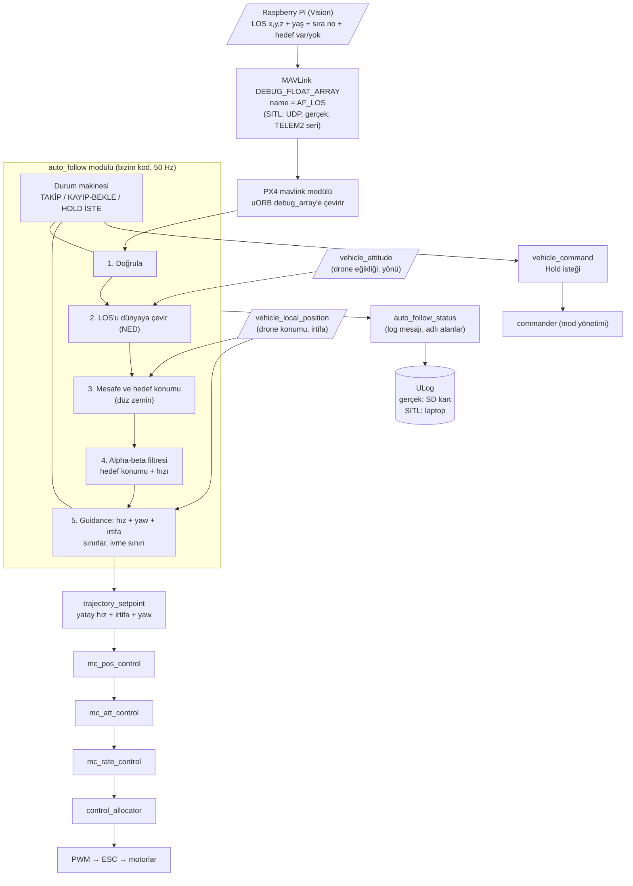
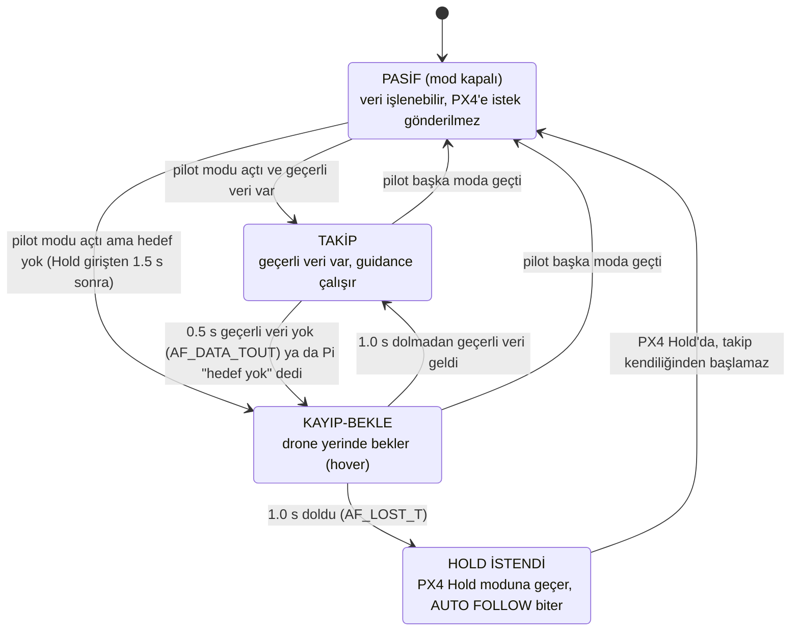

# AUTO FOLLOW (M15): Yapılanlar, kararlar ve oluşan sistem

> **Sürüm:** 2 (write-spec sonu), 2026-11-10
>
> **Hazırlayan:** Yusuf Kurt (kararlar) · Claude Code (yazım, kaynak araştırması)
>
> **Durum:** Henüz **kod yazılmadı**. Sürüm 1 iki günlük planlamanın (shape-spec) sonunu, sürüm 2 write-spec turundaki kararları anlatır. Uygulama ve test sonuçları geldikçe yeni sürümler eklenecek (bkz. "Belge geçmişi").

Bu rapor kod okumadan anlaşılacak şekilde yazıldı. Amaç, bir sorun çıktığında "bu neden böyle?" sorusunun cevabını tek yerde bulmak. Teknik terimlerin açıklamaları sondaki **Terimler sözlüğü**nde.

İlgili dosyalar (hepsi bu klasörde):

| Dosya | İçerik |
|---|---|
| `rapor.md` (bu dosya) | Bütün hikâye ve oluşan sistem |
| `spec.md` | Resmî spesifikasyon: kodun ne yapacağı, `dosya:satır` kanıtlarıyla |
| `log-sozlugu.md` | Bizim verdiğimiz bütün adların sözlüğü: mod, modül, parametreler, log alanları, durumlar, dosyalar |
| `planning/requirements.md` | Gereksinimler: write-spec'in girdisi, geçerli kararların resmî listesi |
| `planning/karar-gunlugu.md` | Her soru, seçenek, cevap ve gerekçe, kronolojik sırayla |
| `planning/tur1-cevaplar.md` | 1. tur cevaplarının kısa tablosu (tarihsel kayıt) |
| `planning/raw-idea.md` | Görevin ilk tanımı |
| `planning/visuals/` | İki akış şeması (Mermaid) |

---

## 1. Özet

Drone'daki Raspberry Pi, kamerada insanı bulur ve Pixhawk'a yalnızca **"hedef, drone'a göre şu yönde"** bilgisini (body FRD LOS birim vektörü) ve bu bilginin **ne kadar eski olduğunu** gönderir. M15'te Pixhawk'ın içine **AUTO FOLLOW** adlı yeni bir uçuş modu yazılacak. Bu mod:

1. gelen yönü kontrol eder (bozuk veya eski veriyi atar),
2. yönü dünyaya göre çevirir ve düz zemin kabulüyle hedefin uzaklığını ve yerini hesaplar,
3. hedefin konumunu ve hızını **alpha-beta filtresiyle** yumuşatır,
4. **hız tabanlı** bir kuralla drone'un ne hızla nereye gideceğine ve burnunu nereye çevireceğine karar verir (guidance),
5. bu isteği PX4'e verir. PX4 kendi kontrol zinciriyle motorlara kadar götürür.

Hedef kaybolursa drone önce yerinde bekler, kısa sürede hedef gelmezse **Hold** moduna geçer ve pilot modu yeniden açana kadar takibe dönmez. Modun her iç durumu, logda **kendi adlarıyla** her uçuşta kaydedilir.

**En önemli kararlar:**

| Konu | Karar |
|---|---|
| PX4'e bağlanma | **External mode** modülü (`mc_nn_control` kalıbı) |
| Kodun yeri | `src/modules/auto_follow/`, SITL ve Pixhawk 6C firmware'ine girer |
| Girdi | MAVLink `DEBUG_FLOAT_ARRAY`, adı `AF_LOS`: LOS x/y/z + yaş + sıra no + hedef var/yok (varsayım; ICD bekleniyor) |
| Guidance | Hız tabanlı: hız = c·hedef hızı + K·(mesafe − istenen mesafe), alpha-beta filtresi |
| İstenen mesafe | Takip açısından: yükseklik farkı / tan(takip açısı) |
| PX4'e verilen | `trajectory_setpoint`: yatay hız + sabit irtifa + mutlak yaw |
| Hedef kaybı | Kademeli (D): 0.5 s veri yoksa yerinde bekle, 1.0 s daha gelmezse Hold |
| Log | Kendi mesajımız `auto_follow_status`, her zaman kaydedilir, log sözlüğü yazılır |
| Test | Kısa birim testi + Gazebo SITL'de S1–S7 senaryoları, sonuçlar pyulog ile ölçülür |
| Güvenlik | Bu modda arm yasak, kalkış Position'da; yerde arm'lıyken moda geçiş engellenecek; modül açılışta kendiliğinden başlar |
| Adlar | Mod `AUTO FOLLOW`, parametreler `AF_*` |

---

## 2. Görev ve bağlam

- **Görev:** [Issue #6](https://github.com/Auto-Follow/Auto-Follow/issues/6), "[M15] Body frame hedef vektöründen PWM'e: PX4 takip kodu". Kişi: Yusuf Kurt. Son teslim: **2026-11-15**.
- **Yol haritası:** Madde 15 "PX4 entegrasyon yaklaşımının seçimi". Devamı madde 13 (kontrol algoritması) ve 16 (PX4 takip modu).
- **Issue'nun istedikleri:**
  1. PX4'te neyin nereye bağlanacağının seçenekleri ve gerekçesiyle belirlenmesi;
  2. SITL'de elle verilen bir hedef vektörüyle drone'un tepki verdiğini gösteren çalışan kod;
  3. şemaların ve test sonuçlarının (ne verildi, drone ne yaptı, log adı) spec klasöründe olması;
  4. CI'da `verify-pin`, `derleme-sitl` ve `derleme-fmu-v6c` kontrollerinin yeşil olması.
- **Ekipteki bağlantılar:**
  - **Yusuf Ortatepe (m10, Vision):** Pikselden body frame'e dönüşüm; bizim girdimizi üretecek taraf. Eksenler onunla eşlenecek.
  - **Ahmet Kazalcı (m06, Autopilot/Gazebo):** Gerçekçi simülasyon, kamera montajı ve yaklaşma mesafesi. Takip açısı onun kamera dokümanından gelecek; hazır olunca testler onun simülasyonuna taşınacak.
  - **Hüseyin Uygun (repo sorumlusu):** Kilitli PX4 dosyalarının değiştirilmesine onay verecek kişi.
- **Sabit kısıtlar:**
  - PX4 **v1.17.0'da kilitli**. Değiştirilebilir yollar `tez/pin/allowed-paths.txt`'de; dışındakiler için repo sorumlusunun onayı gerekiyor.
  - Pixhawk 6C'nin flash'ı **~%98 dolu**.
  - Yeni MAVLink mesajı eklenemez.
  - Simülatör Gazebo Harmonic.

---

## 3. Nasıl çalıştık?

### 3.1 Yöntem
- **Agent OS `shape-spec`** aşaması kullanıldı: önce gereksinimler sorularla netleştirildi, kod yazılmadı.
- Kullanıcının koyduğu çalışma kuralları:
  - **Hiçbir kararı Claude vermez.** Her konu için seçenekler artı ve eksileriyle, PX4 v1.17.0 kaynağından **`dosya:satır` kanıtıyla** ve bir öneriyle sunuldu; kararı kullanıcı verdi.
  - **Adlar** (modül, parametre, mod, dosya, topic) kullanıcıya soruldu.
  - Doğrulanamayan her şey "(doğrulanacak)" diye işaretlendi; ad, topic veya alan uydurulmadı.
  - **Her şey kayıt altına alındı.** Kullanıcının sözleriyle: "Bazen dediklerin mantıklı geldi ama çok detaylı bilgiye sahip olmadan verdim; kodu elle yazmayacağım; ne yapıldığını kod okumadan bilecek seviyede yazılsın." Bu yüzden öneriye güvenilerek verilen kararlar **"öneri kabul"** diye ayrıca işaretlendi; sorun çıkarsa ilk bakılacak yerler bunlar.
  - Agent OS bir aşamayı bitirince, açık konular konuşulmadan bir sonrakine geçilmedi.
- Bilgi kaynakları:
  - bu repodaki PX4 v1.17.0 kaynak kodu;
  - çatı repodaki ürün planı (`../agent-os/product/`) ve standartlar (`../agent-os/standards/`);
  - issue #6, #7 (m06) ve #8 (m10);
  - repolardaki diğer dallar.

### 3.2 Zaman çizelgesi

**Oturum 1: 2026-11-08**
1. Issue #6 ve talimat dosyası okundu.
2. Spec klasörünün adı soruldu: `2026-11-08-m15-takip-kodu` (dal adıyla aynı).
3. Şemaları PNG'ye çevirecek araç (`mmdc`, Node.js) kurulu değildi. Kullanıcı "şimdilik PNG'siz devam" dedi.
4. Spec klasörü açıldı; iki şema `planning/visuals/`'a kopyalandı.
5. PX4 kaynağı tarandı ve ilk soru listesi hazırlandı.
6. Kullanıcı "ana çatıdaki agent-os bilgilerini dikkate alıyorsun değil mi?" diye sordu. O ana kadar yalnızca PX4 kaynağına bakılmıştı. Çatıdaki ürün planı ve standartlar okundu, sorular bunlara göre yeniden yazıldı. Bu eksik, sonraki işler için Claude'un hafızasına kural olarak yazıldı.
7. 14 başlıklı 1. tur soru listesi sunuldu. Kullanıcı birçoğunu cevapladı, bazılarını "detaylı konuşalım" diye ayırdı.
8. Kullanıcının isteğiyle bütün repolar tarandı: hiçbir yerde Pi'den yön gönderen kod yok (bkz. 9).
9. Cevaplar `planning/tur1-cevaplar.md`'ye yazıldı ve commit edildi.

**Oturum 2: 2026-11-09** (şarj bittiği için ara verildi, `claude --resume` ile devam edildi)

10. Hedef kaybı davranışı konuşuldu; kullanıcı "önemli" olarak işaretledi. Karar: D.
11. Yükseklik parametreleri ve fmu-v6c kararları verildi.
12. Guidance yasası ayrıntılı konuşuldu: hız tabanlı, alpha-beta, takip açısı.
13. Kullanıcı her şeyin kaydedilmesini istedi; `planning/karar-gunlugu.md` açıldı.
14. Test ve log konuşuldu. Kullanıcının Betaflight "track hold" örneğinden bir log sözlüğü kuralı çıktı. Masaüstünde `AUTO-FOLLOW LOG` klasörü açıldı.
15. Kapsam ve toparlama yapıldı; spec-shaper ajanı `planning/requirements.md`'yi yazdı ve commit edildi.
16. Spec-shaper'ın bulduğu açıklar konuşuldu: süreler, eşikler, yükseklik formülü, log kaydı, hedef yokken moda giriş, TBD'ler.
17. Adlar verildi: `AUTO FOLLOW`, `AF_*`.
18. Zaman damgası konusunda bulgu: `DEBUG_VECT` zaman bilgisini taşıyamıyor. Girdi `DEBUG_FLOAT_ARRAY`'e çevrildi.
19. Kullanıcı write-spec'e geçmeden her şeyin kaydedilmesini istedi: `requirements.md` güncellendi ve bu rapor yazıldı.

**Oturum 3: 2026-11-10** (write-spec)

20. Spec-writer ajanı `spec.md`'yi yazdı, şema kopyalarını güncelledi.
21. Claude ajanın bulgularını PX4 kaynağında kontrol etti; belgelerdeki hatalar (A), yeni bulgular (B) ve öneriler (C) kullanıcıya sunuldu.
22. Kullanıcının cevaplarıyla `spec.md`, `requirements.md`, karar günlüğü ve bu rapor güncellendi; bütün adların sözlüğü `log-sozlugu.md` yazıldı.

### 3.3 Commit'ler (dal `ozellik/m15-takip-kodu`, push yok)

| Commit | Ne |
|---|---|
| `2adda900bb` | Ham fikir, şemalar, 1. tur cevapları |
| `76ae2878a4` | Hedef kaybı davranışı (D, Hold m15'te) |
| `41ab91fa88` | Yükseklik parametreleri (13-iii), fmu-v6c (3.1-ii) |
| `45895b8c3c` | Guidance kararları ve karar günlüğü |
| `04ff974d35` | Test kapsamı ve log kararları |
| `5e0b3cd65e` | Log mesajı ve birim testi kararı |
| `16f53b1fa4` | Log alan adları için gerekenler; `logger_topics.txt` düzeltmesi |
| `6d479e0101` | Kendi log mesaj tipi kararı (L2-b) |
| `e44529d567` | Kapsam ve toparlama (14) |
| `7f34f4cf01` | Açık konular güncellendi |
| `fef6bb9972` | `requirements.md` |
| `b484ec9127` | Cevap tablosuna güncellik notu |
| `8769196099` | Mod adı AUTO FOLLOW, `AF_` ön eki |
| `a9791e8014` | Süreler, eşikler, formül, log, parametre adları |
| `696289b889` | `AUTO_FOLLOW_TARGET` uyarısı |
| `f2c68b3433` | Girdi mesajı `DEBUG_FLOAT_ARRAY` |
| `676c4ced10` | `requirements.md` güncellemesi ve bu rapor (sürüm 1) |
| `71361a82ba` | Rapor başlığı biçim düzeltmesi |
| `164b6131f0` | `spec.md` (taslak; öneriler onay bekliyordu) |
| *(bu sürüm)* | Write-spec turu kararları, sözlük, rapor sürüm 2 |

---

## 4. Oluşan sistem

### 4.1 Büyük resim



**Bizim yazdığımız tek parça `auto_follow` modülü.** Pi tarafı Vision ekibinin işi. `trajectory_setpoint`'ten motorlara kadar her şey PX4'ün kendi, denenmiş kodu. Bu zincirin varlığı kaynakta doğrulandı:
- `mc_pos_control` `trajectory_setpoint`'i okur (`src/modules/mc_pos_control/MulticopterPositionControl.hpp:107`) ve `vehicle_attitude_setpoint` yayınlar (`:99`);
- `mc_att_control` → `vehicle_rates_setpoint` (`src/modules/mc_att_control/mc_att_control.hpp:105,115`);
- `mc_rate_control` → tork ve itki (`src/modules/mc_rate_control/MulticopterRateControl.hpp:100,110,111`);
- `control_allocator` → `actuator_motors` (`src/modules/control_allocator/ControlAllocator.hpp:178,179,187`).

### 4.2 Modun PX4'e bağlanması: external mode
- PX4 v1.17.0, PX4'ün içinde ya da dışında çalışan bir programın kendini **yeni bir uçuş modu** olarak kaydettirmesine izin veriyor. Örneği PX4'ün kendi `mc_nn_control` modülü (`src/modules/mc_nn_control/mc_nn_control.cpp:135-142`).
- `auto_follow` açılışta PX4'e "ben **AUTO FOLLOW** adında bir modum" der. PX4 ona dış modlara ayrılmış **23–30** aralığından bir mod numarası verir (`msg/versioned/VehicleStatus.msg:59-66`). Bu mod QGC'nin mod listesinde görünür ve RC anahtarına atanabilir.
- Mod aktifken PX4 kendi uçuş görevlerini (FlightTask) **çalıştırmaz** (`src/modules/flight_mode_manager/FlightModeManager.cpp:139-144`). Bu yüzden konum kontrolcüsüne istek (`trajectory_setpoint`) vermek bizim modülün işi.
- PX4 her 300 ms'de modüle "çalışabilir misin?" diye sorar; modül 50 ms içinde cevap vermelidir (`HealthAndArmingChecks/checks/externalChecks.hpp:69-70`). Modül donarsa PX4 bunu fark eder ve kendi failsafe'ini çalıştırır.
- **Modül açılışta kendiliğinden başlar.** PX4 arm iken yeni mod kaydını kabul etmiyor (`ModeManagement.cpp:371-380`); uçuş sırasında mod listesi değişmesin diye. Bu yüzden modül arm'dan önce başlamalı. Çözüm: PX4'ün her multikopter açılışında çalıştırdığı `rc.mc_apps` dosyasına bir satır (SITL'de ve 6C'de aynı dosya; `mc_nn_control` da böyle başlıyor, `rc.mc_apps:40-43`). Bu kilitli bir dosya; Hüseyin'in onayı gerekiyor (7. yol).
- **Modül "çalışabilirim" der** (`can_arm_and_run = true`), hedef yokken bile. "Çalışamam" derse PX4 drone'u Hold'a değil **eve dönüşe (RTL)** gönderir (`src/modules/commander/failsafe/failsafe.cpp:698-702`); hedef bir an görünmedi diye drone eve uçmamalı. Hedefin yokluğunu modül kendisi yönetir (4.4). Tek istisna adayı: drone yerde arm'lıyken ve mod henüz açık değilken "çalışamam" demek; böylece PX4 yerdeyken moda geçişi reddeder (4.7). Mod açık değilken RTL tehlikesi yoktur.
- Moda **QGC'den** ya da **RC anahtarından** geçilir. **Bu modda arm etmek yasak** (kalkış Position modunda yapılır; bu modda kalkış mantığı yok). Araç arm edilmemişken ise moda geçilebilir; PX4 disarm araçta her mod değişikliğine zaten izin veriyor (`src/modules/commander/UserModeIntention.cpp:54-55`). Bu, kullanıcının "masa testinde arm etmeden moda geçebilmeliyim" isteğini karşılıyor.
- **Neden bu yol seçildi?** Değerlendirilen diğer yollar:
  - **Yeni FlightTask:** kilitli birçok PX4 dosyasını değiştirmeyi gerektirir.
  - **Offboard:** kod Pi'ye taşınır; issue ve misyonla çelişir.
  - **PX4'ün Follow Me'sini uyarlamak:** GPS konumu bekliyor, bizim girdimiz bir yön.

  External mode, kilitli dosyalara en az dokunan, kodu PX4'ün içinde tutan ve PX4'ün kendi kontrol zincirini ve güvenlik mekanizmalarını kullanan yol.

### 4.3 Girdi: Pi'den ne geliyor?

| Kutu (`data[]`) | İçerik | Birim |
|---|---|---|
| 0, 1, 2 | Hedef yönü, LOS birim vektörü (body FRD: x ileri, y sağ, z aşağı) | — |
| 3 | Yaş: görüntünün çekildiği andan gönderime kadar geçen süre | ms |
| 4 | Sıra numarası | — |
| 5 | Hedef var (1) / yok (0) | — |

- Taşıyıcı mesaj: MAVLink `DEBUG_FLOAT_ARRAY`, `name` = `AF_LOS`. PX4 bunu uORB `debug_array`'e çevirir (`src/modules/mavlink/mavlink_receiver.cpp:2814-2832`).
- **Neden bu mesaj?** İlk seçim `DEBUG_VECT` idi. Kullanıcı "Vision bana body frame ve **timestamp** gönderecek" deyince kaynak yeniden incelendi: PX4 bu mesajların kendi zaman alanını atıp yerine varış anını yazıyor (`mavlink_receiver.cpp:2804`). `DEBUG_VECT`'in veri kısmı yalnızca 3 sayı olduğu için zaman bilgisi FC'ye ulaşamazdı. `DEBUG_FLOAT_ARRAY` 58 sayılık bir kutu; zaman, sıra no ve bayrak sığıyor.
- **Neden "yaş"?** Pi'nin saati ile Pixhawk'ın saati aynı değil. Pi "X ms önce çektim" derse Pixhawk kendi saatiyle hesaplar: çekim anı ≈ varış anı − X. Kablo gecikmesi birkaç ms, ihmal edilir.
- **Bu bir varsayım.** Kesin biçim ortak ICD'de (yol haritası 3–5) belirlenecek. Vision tarafıyla bu yerleşim konuşulacak.

### 4.4 Modun durumları



- **Zaman çizelgesi:**
  ```
  son geçerli mesaj ──0.5 s──▶ KAYIP-BEKLE (yerinde bekle) ──1.0 s──▶ Hold
  ```
  Toplamda son geçerli mesajdan 1.5 s sonra drone Hold'dadır. Pi "hedef yok" derse ilk 0.5 s beklenmez, KAYIP-BEKLE hemen başlar.
- **Takibe dönüş:** Hold'dan sonra drone, hedef görünse bile takibe **kendiliğinden dönmez**. Pilot QGC'den modu yeniden seçer (tek tık) ya da RC anahtarını başka konuma alıp geri getirir. Anahtarı yerinde bırakmak yetmez, çünkü PX4 yalnızca anahtar **konumu değişince** mod isteği gönderiyor (`src/modules/manual_control/ManualControl.cpp:176-177`).
- **Hold nasıl istenir:** Modül `VEHICLE_CMD_SET_NAV_STATE` komutunu gönderir (`src/modules/commander/Commander.cpp:936-944`).
- **Hedef görünmezken moda girilirse:** KAYIP-BEKLE ile başlanır, ama süre **giriş anından** sayılır: 0.5 + 1.0 = 1.5 s içinde geçerli hedef gelmezse Hold. (Sürüm 1'deki şema yanlışlıkla 1.0 s gösteriyordu.) Pratikte mod, hedef görünürken açılır.
- **Neden bu davranış (D)?** Değerlendirilen dört seçenek:
  - **A:** Moddan hiç çıkma, hedef gelince devam et.
  - **B:** Hemen Hold'a geç, pilot yeniden açar.
  - **C:** Hold'a geç, hedef gelince modül takibi kendiliğinden yeniden açar.
  - **D:** Kısa kayıpta A, uzun kayıpta B.

  Kullanıcı ilk uçuşlar için en güvenlisini sordu. Cevap B davranışıydı. Gerekçeler:
  - Model yanlış bir şeyi hedef sanarsa drone pilot onayı olmadan harekete geçmez.
  - Denenmemiş kodumuz yerine PX4'ün denenmiş Hold modu devreye girer.
  - Mod değişimi QGC'de herkesçe görülür.

  D seçildi, çünkü `AF_LOST_T` kısa tutulunca (1 s) pratikte B gibi davranır; güven arttıkça bu süre uzatılarak kısa kayıplarda takibin kesilmemesi sağlanır. C reddedildi: pilotun bilerek moddan çıktığını ayırt etmek zor ve yanlış algılamayla birleşince drone onaysız harekete geçebilir.
- **"Sorun olunca yayını kesmek" neden yapılmıyor?** Çatı standardı hata anında "setpoint üretmeyi bırak" diyor (`../agent-os/standards/global/error-handling.md:4`). Ama PX4 kaynağında, istek yayını kesilirse konum kontrolcüsü **son gelen isteği uygulamaya devam ediyor**; yedek güvenli istek yalnızca modun ilk açıldığı anda üretiliyor (`MulticopterPositionControl.cpp:438, 443-449, 636-686`). Yani yayını kesmek "son hıza devam et" demek. Bu yüzden modül, sorun anında susmak yerine aktif olarak "yerinde dur" isteği gönderir. Bu çelişki spec'e not olarak yazıldı.

### 4.5 Her döngüde ne oluyor? (50 Hz, adım adım)

Modül saniyede 50 kez çalışır. Veri gelmese de çalışır; yalnızca veri gelince çalışsaydı veri kesildiğinde modül de durur ve kesintiyi fark edemezdi.

**Adım 1: Girdiyi doğrula.** Yeni bir `AF_LOS` mesajı geldiyse:
- Adı `AF_LOS` mu? (`debug_array`'i başka yazılımlar da kullanabilir.)
- Sayılar geçerli mi (NaN ya da sonsuz değil mi)?
- Vektörün uzunluğu 1'e yakın mı? (±`AF_NORM_TOL` = 0.1)
- Sıra numarası öncekinden büyük mü? (Tekrar eden ya da geri giden mesaj atılır.)
- Yaşı, veri zaman aşımından (`AF_DATA_TOUT` = 0.5 s) küçük mü?
- "Hedef var" bayrağı 1 mi?
- Yön yeterince aşağı bakıyor mu? (en az `AF_MIN_DEP` = 10°)
- Hesaplanan mesafe en büyük menzilden (`AF_MAX_RNG` = 40 m) küçük mü?
- Drone'un kendi konum bilgisi geçerli mi?

Geçmeyen mesaj atılır, nedeniyle birlikte sayılır ve (çok sık olmamak üzere) loga yazılır. Guidance hesabına asla girmez.

**Adım 2: Yönü dünyaya çevir.** Pi'nin verdiği yön drone'a göredir (ileri/sağ/aşağı). Drone'un o anki eğikliği ve burnunun yönü (`vehicle_attitude`) kullanılarak "kuzey/doğu/aşağı" (NED) yönüne çevrilir. Görüntünün çekildiği anki eğiklik değil, verinin geldiği anki eğiklik kullanılır (V3); farkın önemli olup olmadığı loglardaki gecikmeye bakılarak sonra karar verilecek.

**Adım 3: Mesafe ve hedefin yeri.** Zemin düz kabul edilir:
```
yükseklik farkı = drone yüksekliği − AF_GND_OFS − AF_TGT_HGT
mesafe          = yükseklik farkı / tan(aşağı bakış açısı)
hedef konumu    = drone konumu + mesafe × (yönün yatay kısmı)
```
- Drone yüksekliği PX4'ün kendi irtifa tahmininden okunur (`-vehicle_local_position.z`); zemin = kalkış yeri.
- `AF_TGT_HGT` (1.0 m): Pi insanın ayağına değil gövdesine bakıyorsa o noktanın yerden yüksekliği.
- `AF_GND_OFS` (0 m): Hedefin yürüdüğü zemin kalkış yerinden yüksekse (ör. tepe) farkı.

**Adım 4: Alpha-beta filtresi.** Ölçülen hedef konumu her görüntüde biraz titrer. Filtre iki iş yapar:
- **Tahmin:** "Hedef en son şu hızla gidiyordu, şimdi şurada olmalı."
- **Düzeltme:** Yeni ölçüm gelince tahmin ile ölçüm arasındaki fark `AF_ALPHA` oranında konuma, `AF_BETA` oranında hıza eklenir.

Çıktı: yumuşatılmış hedef konumu ve **hedefin hızı**. PX4'ün Follow Me modundaki benzer filtre GPS mesajına bağlı olduğu için doğrudan kullanılamadı (`flight_mode_manager/tasks/AutoFollowTarget/follow_target_estimator/TargetEstimator.hpp:112, 210`); küçük, kendi filtremiz yazılacak.

**Adım 5: İstenen mesafe.** Kullanıcının takip tasarımı: "Hedefi sabit yükseklikte ve sabit açıyla, kadrajın ortasında tutarak takip edeceğim."
```
istenen mesafe = yükseklik farkı / tan(AF_TRK_ANG)
```
`AF_TRK_ANG`, hedefin kadraj ortasında durduğu aşağı bakış açısı, yani kameranın eğimi. Değeri m06'dan gelecek; SITL'de 30°.

**Adım 6: Hız kuralı (guidance).**
```
yatay hız = AF_K_FF × (filtrenin hedef hızı) + AF_K_DIST × (mesafe − istenen mesafe) × (hedefe doğru yatay yön)
```
- Hız en fazla `AF_VEL_MAX` (2 m/s) olur.
- Hız isteği bir anda değil, en fazla `AF_ACC_MAX` (3 m/s²) ivmeyle değişir; drone sert eğilmez.
- `AF_K_FF` = 0 iken drone yalnızca mesafe farkına bakar. Yürüyen hedefin biraz gerisinde kalabilir. `AF_K_FF` açılınca hedefin hızı eklenir ve bu açık kapanır. İlk testlerde 0 tutulur (nedeni 4.9'da).
- **Neden hız tabanlı?** Konum tabanlı yasada ("hedefin 8 m gerisine git") her ölçümde hedef noktası zıplar ve drone sarsılır; PX4 bu mesaj için yumuşak istek bekliyor (`msg/versioned/TrajectorySetpoint.msg:3`). Pure pursuit ve PN önleme ("hedefe çarp") yasaları; mesafe korumazlar.

**Adım 7: Yaw ve irtifa.**
- **Yaw:** Burun hedefe çevrilir, böylece hedef kadrajın ortasında kalır. Hedef 1 m'den (`AF_YAW_MIN_D`) yakına gelirse ("tam altında") yön belirsizleşir; o zaman yaw değiştirilmez.
- **İrtifa:** Moda girildiği andaki irtifa sabit tutulur.

**Adım 8: PX4'e ver.** `trajectory_setpoint` yayınlanır: `velocity[0..1]` = yatay hız, `position[2]` = irtifa, `yaw` = burun açısı; diğer alanlar boş (NaN). PX4 bu karışımı geçerli sayıyor: her eksende konum ya da hız verilmiş olması, x ve y'nin aynı türde olması yeterli (`src/modules/mc_pos_control/PositionControl/PositionControl.cpp:224-250`).

**Adım 9: Log mesajını yayınla** (4.8).

**Sayısal örnek (baştan sona):**
- Drone 10 m irtifada, burnu kuzeyde, düz duruyor. Pi'den yön (0.8, 0, 0.6) geliyor, yani hedef önde ve aşağıda.
- Adım 2: Drone düz ve kuzeye baktığı için NED yönü de (0.8 kuzey, 0 doğu, 0.6 aşağı).
- Adım 3: Aşağı bakış açısı = asin(0.6) ≈ 36.9°. Yükseklik farkı = 10 − 0 − 1.0 = 9.0 m. Mesafe = 9.0 / tan(36.9°) = 9.0 / 0.75 = **12.0 m**.
- Adım 5: İstenen mesafe = 9.0 / tan(30°) = **15.6 m**.
- Adım 6: Fark = 12.0 − 15.6 = −3.6 m → hız = 0.5 × (−3.6) = **−1.8 m/s**, yani hedeften uzaklaşarak 1.8 m/s geri (2 m/s sınırının altında).
- Adım 7: Yaw kuzeyde kalır.
- Sonuç: Drone hedef 30°'lik açıda, yani kadraj ortasında görünene kadar yavaşça geri çekilir.

### 4.6 Parametreler

Hepsi QGC'den değiştirilebilir, kod yeniden derlenmez. Ön ek `AF_` (PX4 v1.17.0'da çakışma yok); her biri en fazla 16 karakter. Değerler **başlangıç** değeri; gerçek değerleri testler gösterecek.

| Parametre | Anlamı | Başlangıç | Neden bu değer |
|---|---|---|---|
| `AF_TRK_ANG` | Takip açısı (kamera eğimi) | 30° (SITL) | m06'dan gelecek |
| `AF_K_DIST` | Mesafe kazancı | 0.5 1/s | 2 m hata → 1 m/s, yumuşak |
| `AF_K_FF` | Hedef hızı katsayısı | 0 | Açık çevrim testlerde kaçmayı önler (4.9) |
| `AF_VEL_MAX` | En fazla hız | 2 m/s | İlk testler için yavaş |
| `AF_ACC_MAX` | İvme sınırı | 3 m/s² | PX4'ün otomatik modlardaki değeri (`MPC_ACC_HOR`, `multicopter_autonomous_params.c:88`) |
| `AF_ALPHA`, `AF_BETA` | Filtre katsayıları | SITL'de seçilecek | |
| `AF_DATA_TOUT` | Veri zaman aşımı | 0.5 s | Pi 10–30 Hz gönderir; 0.5 s, 5–15 kayıp mesaj demek |
| `AF_LOST_T` | Kayıptan Hold'a | 1.0 s | PX4 offboard kaybı da 1 s (`COM_OF_LOSS_T`); ilk uçuşlarda kısa |
| `AF_YAW_MIN_D` | Bunun altında yaw sabit | 1 m | Hedef altındayken yön belirsiz |
| `AF_TGT_HGT` | Hedef noktası yüksekliği | 1.0 m | İnsanın gövde ortası |
| `AF_GND_OFS` | Zemin farkı | 0 m | Düz arazi |
| `AF_NORM_TOL` | Vektör uzunluk toleransı | 0.1 | Bozuk veri yakalayıcı, ince ayar değil |
| `AF_MIN_DEP` | En küçük aşağı bakış açısı | 10° | Aşağıdaki tablo |
| `AF_MAX_RNG` | En büyük menzil | 40 m | Aşağıdaki tablo |

`AF_MIN_DEP` ve `AF_MAX_RNG` neden gerekli? Hedef ufka yakın göründükçe açıdaki küçük bir hata mesafede büyük hataya dönüşür (5 m irtifada):

| Aşağı bakış açısı | Mesafe | Açıda 1° hata olursa |
|---|---|---|
| 30° | 8.7 m | ~0.5 m hata |
| 10° | 28.4 m | ~3 m hata |
| 5° | 57.2 m | ~10 m hata |

Çevrim hızı parametre değil; kodda sabit 50 Hz.

### 4.7 Güvenlik davranışları

| Durum | Ne olur |
|---|---|
| Bozuk mesaj (NaN, yanlış ad, uzunluk ≠ 1, tekrar eden sıra no, yukarı bakan yön, çok uzak) | Atılır, sayılır, loga yazılır; drone etkilenmez |
| Görüntü çok eski (yaş > 0.5 s) | Atılır |
| 0.5 s geçerli veri yok ya da Pi "hedef yok" dedi | KAYIP-BEKLE: drone yerinde bekler (mevcut konum, hız 0, son yaw) |
| 1.0 s daha veri yok | Hold istenir; takip kendiliğinden başlamaz |
| Hedef görünmezken moda girildi | Aynı kural, 1.5 s içinde hedef yoksa Hold |
| Drone'un kendi konumu geçersiz (ör. GPS yok) | Hedef hesaplanmaz, takip yapılmaz; yatay hız 0 istenir |
| Hız isteği | En fazla 2 m/s, en fazla 3 m/s² ivmeyle değişir |
| Modül donarsa | PX4 cevap alamadığını fark eder ve kendi failsafe'ini çalıştırır |
| Pilot | Her an başka moda geçebilir. İlk uçuşta RC'de Position moduna ayrılmış bir anahtar konumu olmalı |
| Bu modda arm | Yasak. Önce Position'da arm edilip kalkılır, AUTO FOLLOW havada açılır |
| Yerde arm'lıyken moda geçiş | Engellenecek (kullanıcı: "AUTO FOLLOW'da kalkış yok"); yöntem kullanıcıya soruldu |
| Hold isteği reddedilirse | Yerinde beklemeye devam eder; 1 s arayla en fazla 3 kez yeniden ister |

- **(doğrulanacak):** RC çubuğuna dokununca external moddan çıkılıp çıkılmadığı.
- **İlk uçuş önerisi:** `AF_LOST_T` kısa (1 s), `AF_VEL_MAX` düşük (2 m/s), `AF_K_FF` = 0.

### 4.8 Loglama

**Kullanıcının gereksinimi:** "Her durumu log kaydına almamız gerek; gerekirse ek kod yazalım. Alpha-beta filtresinin girdisi ve çıktısı ve analizi çok önemli. Yazılan durumları logda kendi adlarıyla göreceğim; ekstra bir şey açmama gerek kalmasın."

Bu isteğe kullanıcının bir örneği eşlik etti: Özelleştirilmiş bir Betaflight'taki "track hold" modu için `trk` önekli bir log alan sözlüğü yapılmıştı (ör. `trkAzErr` = azimut hatası). Bizde de her özelleştirmenin loga girmesi ve bir sözlüğü olması kararlaştırıldı.

- **Log mesajı:** Kendi uORB mesajımız `msg/AutoFollowStatus.msg` → topic `auto_follow_status`. Alanlar logda adlarıyla görünür (PlotJuggler ve Flight Review'da da).
- **Her logda her zaman kaydedilir:** PX4'ün varsayılan log listesine eklenir; kullanıcı ayrıca bir ayar açmaz.
- **İçerik** (alan adları kararlaştı, önek yok; tam liste ve anlamları `log-sozlugu.md`):
  - Pi'den gelen ham veri (LOS x/y/z, yaş, sıra no, hedef var),
  - doğrulama sonucu ve atılan mesaj sayaçları,
  - filtrenin girdisi (ölçülen hedef konumu) ve çıktısı (kestirilen konum ve hız),
  - mesafe, istenen mesafe, hız isteği,
  - durum (TAKİP / KAYIP-BEKLE / HOLD İSTENDİ),
  - toplam gecikme,
  - AUTO FOLLOW'un mod numarası.
- **`DEBUG_FLOAT_ARRAY` yalnızca taşıyıcı.** Logda bakılan, `auto_follow_status`'un adlı alanları. Ham `debug_array` logda yalnızca debug ayarı açıksa ve `data[0]`… diye görünür; ihtiyaç yok.
- **Zaten kendiliğinden kaydedilenler:** `trajectory_setpoint`, `vehicle_status` (mod değişimleri), `vehicle_command` (Hold isteği), `vehicle_local_position`, `vehicle_attitude`, `vehicle_control_mode`, `actuator_motors` (`src/modules/logger/logged_topics.cpp:131-150, 214`).
- **Sözlük:** `log-sozlugu.md`. Kullanıcının isteğiyle yalnız log alanları değil, **bizim verdiğimiz bütün adlar** orada: mod, modül ve komutları, parametreler, girdi mesajı, log alanları, durumlar, doğrulama sonuçları, dosyalar. Her ad için anlam, birim, frame ve hangi durumda ne değer aldığı yazılır. Kod değişince aynı commit'te güncellenir.
- **Logların yeri:**
  - **Gerçek uçuş:** 6C'deki SD kart, `/fs/microsd/log/<tarih>/<saat>.ulg` (`logger.cpp:1296`).
  - **SITL:** laptop, `build/px4_sitl_default/rootfs/log/<tarih>/<saat>.ulg`. Bu klasör `make clean` ile ya da 7 klasör sınırı dolunca silinir (`SDLOG_DIRS_MAX` = 7, `ROMFS/px4fmu_common/init.d-posix/rcS:183`). Bu yüzden her testten sonra **`~/Desktop/AUTO-FOLLOW LOG/`** klasörüne kopyalanır.
  - Log dosyaları repoya girmez (kural 9); spec'e yalnızca adları yazılır.
- **Masa testinde log almak** (kod gerekmez; kullanıcı kendisi yapar):
  1. SD kart takılı olsun.
  2. QGC → Vehicle Setup → Parameters → `SDLOG_MODE`'u kullanıcı kendisi seçer. Bilgi: 1 = açılıştan disarm'a kadar (masada arm/disarm yapılırsa kayıt orada durur), 2 = açılıştan kapanışa kadar.
  3. Kartı yeniden başlat; bu parametre yeniden başlatmadan devreye girmez (`logger/module.yaml:31`).
  4. Testten sonra logu Analyze Tools → Log Download ile indir ve `AUTO-FOLLOW LOG`'a koy.
  5. Uçuştan önce `SDLOG_MODE` = 0'a dön ve kartı yeniden başlat. Varsayılan 0 = "yalnızca arm iken"; kullanıcı bunu varsayılan bırakmak istedi.
- **⚠️ Uyarı (log sözlüğüne de yazılacak): PX4'ün kendi `AUTO_FOLLOW_TARGET` modu bizim AUTO FOLLOW ile ilgili değildir.**
  - PX4'ün GPS tabanlı Follow Me modu, `nav_state` = **19** (`msg/versioned/VehicleStatus.msg:55`; kod `FlightTaskAutoFollowTarget`, parametreler `FLW_TGT_*`). Bazı log araçları 19'u "Auto Follow" diye gösterebilir.
  - Bizim AUTO FOLLOW **23–30** aralığından bir numara alır; hangisi olduğu `auto_follow_status`'ta yazar.
  - Çalışma anında çakışma yok: PX4 modları numarayla ayırıyor, kod, parametre ve topic adları da ayrı. Kodda hiçbir şeye `AutoFollowTarget` / `follow_target` adı verilmeyecek. RC anahtarı (`COM_FLTMODEx`) bizim mod numarasıyla ayarlanır. QGC listesinde "Follow Me" ile "AUTO FOLLOW"u karıştırmayın.

### 4.9 Test planı

İki aşama, en basitten başlayarak.

**1) Birim testi (kısa tutulacak; süre kısıtlı)**
- Guidance hesabı uçuştan bağımsız bir sınıfta (`AutoFollowGuidance`) olduğu için bilgisayarda drone'suz ve Gazebo'suz, saniyeler içinde test edilir (GoogleTest, `AutoFollowGuidanceTest.cpp`; `../agent-os/standards/testing/test-writing.md:6-10`).
- Yalnızca temel hesaplar sınanır:
  - mesafe ve yön (ör. "10 m, şu yön → 12 m"),
  - hız kuralı ve sınırları,
  - bozuk veri,
  - zaman aşımı.
- Testler firmware'e girmez, flash'ı etkilemez.

**2) SITL testleri (Gazebo, `gz_x500`)**
- Drone **Position** modunda kalkar, havada AUTO FOLLOW'a alınır ve geçici test script'i (`tez/sitl/af_los_gonder.py`, pymavlink 2.4.50) Pi gibi `AF_LOS` mesajı gönderir.

Örnek değerler: irtifa 10 m, takip açısı 30° → istenen mesafe 15.6 m.

| # | Script ne gönderir | Drone'dan beklenen | Çevrim |
|---|---|---|---|
| S1a | "Hedef uzakta" (aşağı bakış 18°, takip açısından sığ) | İleri gider; kural ~6 m/s ister, 2 m/s'de kırpılır | Açık |
| S1b | "Hedef yakında" (aşağı bakış 37°, takip açısından dik) | ~1.8 m/s geri gider | Açık |
| S2 | "Hedef sağında" | Burnunu sağa çevirir; açık çevrimde dönmeye devam eder (beklenen) | Açık |
| S3 | "Hedef neredeyse tam altta" (80°) | Geri gider; kural ~7 m/s ister, 2 m/s'de kırpılır | Açık |
| S4 | Göndermeyi keser / "hedef yok" der / hedef yokken mod açılır | 0.5 s sonra yerinde bekler, 1.0 s sonra Hold (hedefsiz girişte girişten 1.5 s) | Açık |
| S5 | Bozuk veri (NaN, yanlış ad, yukarı bakan yön, tekrar eden sıra no, eski, çok uzak) | Atar, sayaç artar, etkilenmez | Açık |
| S6 | Yerde duran hayali insan | Takip açısının verdiği mesafeye gelip durur | Kapalı |
| S7 | Yürüyen hayali insan, `AF_K_FF` > 0 | Geride kalmadan takip eder | Kapalı |

- **Neden S1 ikiye ayrıldı?** Sürüm 1'de "hedef önünde → ileri gider" yazıyordu; bu yanlıştı. Drone hedefe, aşağı bakış açısı takip açısına (30°) eşit olacak mesafede durmak ister. Hedef 30°'den sığ görünüyorsa uzaktadır → ileri; dik görünüyorsa yakındır → geri.
- **Neden S2'de burun dönmeye devam eder?** Script hep "hedef sağda" der. Drone döndükçe hedef yine sağda görünür. Bu kodun hatası değil, testin doğası. S2'de yalnızca dönüş yönü kontrol edilir; yaw'ın hedefte doğru durması S6'da ölçülür.
- **Ön kontroller** (her test oturumunun başında): modül açılışta başladı mı, QGC'de `AUTO FOLLOW` görünüyor mu, disarm iken moda geçiliyor mu, bu modda arm reddediliyor mu, yerde arm'lıyken moda geçiş reddediliyor mu, QGC ve RC anahtarıyla giriş/çıkış, Hold'dan sonra anahtar aç-kapa ile yeniden giriş.
- **Hangi test SITL'siz?** Yalnızca birim testi. Açık çevrim testleri de Gazebo'da yapılır ama basittir: script sabit bir yön gönderir.
- RC kaybı ve modül donması testleri bu spec'te yok; m16 adayı.
- **Açık çevrim:** Script sabit bir yön gönderir. Hedef drone'la birlikte kayıyormuş gibi davranır.
- **Kapalı çevrim:** Script yerde hayali bir insan tutar, drone'un konumunu okur ve o insana göre gerçek yönü hesaplar. Mesafe tutma ancak böyle gerçekten test edilir.
- **Neden S1–S5'te `AF_K_FF` = 0?** Sabit yön gönderilince filtre "hedef de benim hızımla gidiyor" sanır; hedef hızı eklenirse drone hızlandıkça hedef de hızlanmış görünür ve drone `AF_VEL_MAX`'a kadar kaçar.
- **Değerlendirme:** Göz kararı test sayılmaz. Her testin logu `tez/analiz/af_log_analiz.py` (pyulog 1.2.4) ile okunur. Spec'e her senaryo için ne verildi, ne beklendi, ne ölçüldü ve log adı tablo olarak yazılır. Kesin başarı eşikleri yol haritası madde 1'de belirlenecek; şimdilik öneri.
- **Sonrası:** Ahmet'in gerçekçi simülasyonu (m06) hazır olunca testler oraya taşınır. Kullanıcı: "O bitene kadar her şey bizde."

### 4.10 Dosyalar ve kilitli yollar (planlanan)

| Yol | Ne | Kilit durumu |
|---|---|---|
| `src/modules/auto_follow/` (`AutoFollow.cpp/.hpp`, `AutoFollowGuidance.cpp/.hpp`, `AlphaBetaFilter.hpp`, `AutoFollowGuidanceTest.cpp`, `CMakeLists.txt`, `Kconfig`, `module.yaml`) | Modül, guidance, filtre, birim testi, parametre tanımları | **Kilitli**, onay gerekli |
| `boards/px4/sitl/default.px4board`, `boards/px4/fmu-v6c/default.px4board` | `CONFIG_MODULES_AUTO_FOLLOW=y` satırı | **Kilitli**, onay gerekli |
| `msg/AutoFollowStatus.msg` | Log mesajı | **Kilitli**, onay gerekli |
| `msg/CMakeLists.txt` | Mesaj listesine bir satır (`:39`) | **Kilitli**, onay gerekli |
| `src/modules/logger/logged_topics.cpp` | `auto_follow_status`'u her zaman kaydeden bir satır | **Kilitli**, onay gerekli |
| `ROMFS/px4fmu_common/init.d/rc.mc_apps` | Açılışta `auto_follow start` satırı | **Kilitli**, onay gerekli |
| `tez/sitl/af_los_gonder.py` | Geçici test göndericisi | İzinli (`tez/*`) |
| `tez/analiz/af_log_analiz.py` | Log değerlendirme script'i | İzinli |
| `agent-os/specs/2026-11-08-m15-takip-kodu/` (`log-sozlugu.md`, `rapor.md`, …) | Dokümanlar | İzinli |

- Kilitli **yedi** yolun `tez/pin/allowed-paths.txt`'e eklenmesi için **repo sorumlusu Hüseyin'e tek bir talep** iletilecek. `rc.mc_apps` reddedilirse geri dönüş: SITL'de modül elle başlatılır, 6C'de SD karttaki `etc/extras.txt` kullanılır. Ekleme ayrı ve açık bir PR ile yapılır; Claude listeyi kendisi genişletmez. Kullanıcı: "Kilitli dosyalara böyle durumlarda dokunuruz, sıkıntı yok."
- **Log mesajı için neden kilitli dosya:** PX4'ün SD karttaki `logger_topics.txt` dosyasıyla kilitli dosyaya dokunmadan ek topic loglanabileceği önce düşünüldü. Ama bu dosya varsa PX4 **yalnızca içindekileri** logluyor ve varsayılan listeyi tamamen kapatıyor (`logged_topics.cpp:531-540`). Doğru yol, `logged_topics.cpp`'ye bir satır eklemek.
- **Geri dönüş:** Hüseyin log mesajı için gereken yolları reddederse PX4'ün hazır `debug_array` mesajı kullanılır; alanlar logda `data[0]`… diye görünür, adlar sözlükten okunur.
- **Flash:** 6C'nin flash'ı ~%98 dolu. Derleme çıktısındaki kullanım spec'e yazılır. Taşarsa Hüseyin'e haber verilir; modül kapatarak yer açılmaz (o iş m14). Not: `CONSTRAINED_FLASH` ayarı açılırsa `DEBUG_FLOAT_ARRAY` işleyicisi derlemeden çıkar (`mavlink_receiver.cpp:284-305`), yani m14'te dikkat edilmeli.

---

## 5. Bütün kararlar

"Tür" sütunu: **Karar** = kullanıcı açıkça seçti; **Öneri kabul** = kullanıcı Claude'un önerisine güvenerek kabul etti (sorun çıkarsa ilk bakılacak yerler).

| # | Konu | Seçenekler | Seçilen | Neden | Tür |
|---|---|---|---|---|---|
| 1 | Kapsam (m15 ile m16) | a) issue #6'yı izle · b) iskelet m15, gerisi m16 · c) önce Hüseyin hizalasın | a | Görev ve teslim issue'ya bağlı; fark not edilir | Karar |
| 2 | PX4 entegrasyonu | a) external mode · b) FlightTask · c) offboard · d) Follow Me uyarla | a | Kilitli dosyalara en az dokunan; kod PX4 içinde; PX4 zinciri ve failsafe'i kullanılır | Karar |
| 3 | Kodun yeri | a) `src/modules` + px4board · b) `tez/` dış modül | a | Standardın öngördüğü düzen | Karar |
| 3.1 | 6C firmware'i | i) yalnız SITL · ii) 6C de | ii | "Asıl amaç 6C'ye derlemek; önce SITL'de test" | Karar |
| 4 | Modül iç yapısı | — | `nav_and_controllers` kuyruğu, sabit 50 Hz, ayrı guidance sınıfı | Veri kesilince de çalışmalı; test edilebilirlik | Öneri kabul |
| 5 | Girdi mesajı | `DEBUG_VECT` · `DEBUG_FLOAT_ARRAY` · `LANDING_TARGET` · `NAMED_VALUE_FLOAT` | Önce `DEBUG_VECT`, sonra **`DEBUG_FLOAT_ARRAY`** | Zaman bilgisi `DEBUG_VECT` ile taşınamıyor | Karar (varsayım) |
| 5b | Zaman bilgisinin kullanımı | — | Yaş (ms) + sıra no + hedef bayrağı; eskilik kontrolü; gecikme loga; telafi şimdilik yok | Saatler farklı; güvenlik; ihtiyaç veriyle belirlenecek | Karar (öneri) |
| 6 | Guidance yasası | a) hız tabanlı · b) konum tabanlı · c) PN / pure pursuit | a | Yumuşak; tek kazanç; mesafe korur | Karar |
| 6.1 | Filtre | yok · alçak geçiren · alpha-beta | Alpha-beta, kendi sınıfımız | Kullanıcının isteği; hem konum hem hız verir | Karar |
| 6.1b | Hedef hızı yasaya | — | Eklenir, katsayıyla (0 = kapalı) | Yürüyen hedefte geride kalmayı önler | Karar |
| 6.2 | İvme sınırı | var · yok | Var (3 m/s²) | İlk uçuşlarda sert eğilmeyi önler | Öneri kabul |
| 6.3 | Hedef altındayken yaw | — | 1 m altında yaw sabit | Kullanıcının sabit açılı tasarımında nadir; geçici durumlara koruma | Karar |
| 6.4 | İstenen mesafe | açı ile · mesafe ile | Açı ile (`AF_TRK_ANG`) | Kullanıcının "sabit yükseklik, sabit açı, kadraj ortası" tasarımına birebir uyuyor | Öneri kabul |
| 7 | PX4'e verilen | `trajectory_setpoint` · `goto_setpoint` | `trajectory_setpoint`, mutlak yaw | Hız tabanlı yasaya uyan tek seçenek | Karar |
| 8 | Doğrulama | — | 4.5 Adım 1'deki liste | Standart (`validation.md`) | Öneri kabul |
| D | Hedef kaybı | A · B · C · D | D, Hold m15'te, ilk uçuşlarda kısa süre | Güvenlik + kullanılabilirlik | Karar ("önemli") |
| S | Süreler | — | 0.5 s / 1.0 s | Pi hızı; PX4 offboard ile tutarlı | Öneri kabul |
| E | Eşikler | — | Hepsi parametre; 0.1 / 10° / 40 m | Kullanıcı: "tahmin olacak, parametre olsun" | Karar (değerler öneri) |
| 9 | Disarm durumda moda geçiş | — | PX4 zaten izin veriyor | Masa testi gereksinimi | Bulgu |
| 5a | Hedef yokken moda giriş | a) D aynen · b) girişte daha uzun bekle | a | En basit ve en güvenli | Karar |
| 10 | Test | — | Kısa birim testi + S1–S7 | "En basitten başla, süre kısıtlı" | Karar |
| L2 | Log mesajı | a) `debug_array` · b) kendi mesajımız · c) `debug_key_value` | b (geri dönüş a) | "Kendi adlarıyla göreceğim" | Karar |
| L1/4 | Log kaydı | her zaman · debug ayarıyla | Her zaman, ham girdi mesaja kopyalanır | "Ekstra bir şey açmama gerek kalmasın" | Karar |
| L3 | Masa testi logu | — | `SDLOG_MODE` varsayılan; kullanıcı elle değiştirir | "Parametreden ayarlarım" | Karar |
| L4 | Logların yeri | — | `~/Desktop/AUTO-FOLLOW LOG/` | SITL logları silinebiliyor | Karar |
| 11 | Kalıcı gönderici | — | Vision ve m06 ile konuşulacak; geçici olanı biz yazıyoruz | "Karar bende değil" | Açık |
| 12 | Adlar | — | `AUTO FOLLOW`, `AF_*`, `auto_follow`, `auto_follow_status`, `AF_LOS` ve dosya adları | Kullanıcı verdi | Karar |
| 12b | `AUTO_FOLLOW_TARGET` | adı değiştir · uyarı yaz | Uyarı (sözlük ve rapor) + log'a mod no | Çalışma anında çakışma yok | Karar |
| 13 | Yükseklik | i · ii · iii | iii (hedef yüksekliği + zemin ofseti) | Mesafe hatasını düzeltir | Karar |
| 14 | Kapsam ve toparlama | — | 14.1–14.5 öneri gibi; 14.3 yerine bu rapor | Masaüstü dosyası kişisel çalışma | Öneri kabul + Karar |
| A1 | Senaryo listesi | spec-shaper'ın S6/S7'si (RC kaybı, modül) · konuşulan tablo | Konuşulan tablo; RC kaybı ve modül donması m16 adayı | "En konuştuğumuz hale getir" | Karar |
| A2 | S1 beklentisi | — | S1a (uzak → ileri) / S1b (yakın → geri) | İleri/geri, açıya bağlı | Karar |
| A3 | Hedefsiz girişte süre | — | Girişten 1.5 s sonra Hold | Karar 5a ile tutarlı | Karar |
| A5 | Masa testinde `SDLOG_MODE` | 1 · 2 | Kullanıcı kendisi seçer | "Kendim ayarlayacağım" | Karar |
| B2 | Modülün açılışta başlaması | a) elle / SD kart · b) `rc.mc_apps` satırı | b (7. kilitli yol) | Unutulma riski yok, kendiliğinden | Karar |
| B4 | Yerde arm'lıyken moda geçiş | a) PX4'e "çalışamam" bildir · b) girişte Hold iste | Engellenecek; yöntem açık | "AUTO FOLLOW'da kalkış yok" | Karar (yöntem açık) |
| C1 | Bu modda arm | serbest · yasak | Yasak; disarm iken geçiş serbest | "Arm değilken bu moda geçebileyim" | Karar |
| C2 | Davranış ayrıntıları (filtre, ivme sınırı başlangıcı, Hold reddi, konum geçersiz, parametre sınırları, `AF_ALPHA` 0.5 / `AF_BETA` 0.17) | — | Spec'teki öneriler | — | Öneri kabul |
| C3 | Log alan adları ve sözlük | önekli · öneksiz | Öneksiz; bütün adlar için ayrıntılı sözlük | "Her şeyi detaylı kaydet" | Karar |

Ayrıntılı gerekçeler ve kullanıcının kendi sözleri: `planning/karar-gunlugu.md`.

---

## 6. Varsayımlar (ortak spec'ler yazılınca güncellenecek)

| # | Varsayım |
|---|---|
| V1 | Girdi, body FRD frame'de hedef yönünü gösteren LOS birim vektörü (x ileri, y sağ, z aşağı). Kamera montaj açısı Pi tarafında uygulanmış. |
| V2 | Taşıyıcı `DEBUG_FLOAT_ARRAY` (`AF_LOS`), kutu yerleşimi 4.3'teki gibi. Kesin biçim ve frekans ICD'de (m3–5). |
| V3 | LOS → NED dönüşümünde verinin geldiği andaki tutum kullanılır; gecikme telafisi yok. |
| V4 | Drone yüksekliği `-vehicle_local_position.z`; zemin düz ve kalkış yeri. |
| V5 | Hedefin bakılan noktası `AF_TGT_HGT` kadar yüksekte; zemin farkı `AF_GND_OFS`. |
| V6 | Eksen yönleri ve işaretleri Yusuf Ortatepe'nin m10 çalışmasıyla eşlenecek (**açık**). |

---

## 7. PX4 kaynağından öğrenilenler

Bunlar kararları doğrudan etkileyen bulgular; hepsi PX4 v1.17.0 kaynağında doğrulandı.

1. **External mode'da PX4 uçuş görevi çalıştırmıyor:** İsteği bizim modül vermeli (`FlightModeManager.cpp:139-144`).
2. **Yayın kesilirse son istek uygulanmaya devam ediyor:** Güvenli davranış aktif olarak gönderilmeli (`MulticopterPositionControl.cpp:438, 443-449`).
3. **"Çalışamam" sinyali RTL'e götürüyor:** Hold'a değil (`failsafe.cpp:698-702`).
4. **Hold bir komutla istenebiliyor** (`Commander.cpp:936-944`).
5. **RC mod anahtarı yalnızca konum değişince istek gönderiyor** (`ManualControl.cpp:176-177`).
6. **Disarm araçta her mod değişikliğine izin var** (`UserModeIntention.cpp:54-55`); "bu modda arm etme" yasağı moda geçişi engellemiyor (`modeCheck.cpp:196-205`).
7. **MAVLink debug mesajlarının zaman alanı FC'de atılıyor** (`mavlink_receiver.cpp:2804, 2822`).
8. **`logger_topics.txt` varsayılan log listesinin yerine geçiyor** (`logged_topics.cpp:531-540`).
9. **`debug_vect` / `debug_array` yalnızca debug ayarı açıksa loglanıyor** (`logged_topics.cpp:290-294`). SITL varsayılanı bu ayarı içermiyor (`SDLOG_PROFILE` 131).
10. **Gerçek kartta log varsayılan olarak yalnızca arm iken alınıyor** (`SDLOG_MODE` = 0); değişiklik yeniden başlatma ister (`logger/module.yaml:16-31`).
11. **SITL loglarının en fazla 7 klasörü tutuluyor** (`init.d-posix/rcS:183`).
12. **PX4'ün Follow Me hedef filtresi GPS mesajına bağlı** (`TargetEstimator.hpp:112, 210`).
13. **Follow Me = `nav_state` 19, dış modlar = 23–30** (`VehicleStatus.msg:55, 59-66`).
14. **Hız (xy) + konum (z) karışımı geçerli** (`PositionControl.cpp:224-250`).
15. **PX4'ün otomatik modlarındaki yatay ivme sınırı 3 m/s²** (`multicopter_autonomous_params.c:88`).
16. **PX4 arm iken yeni mod kaydını reddediyor** (`ModeManagement.cpp:371-380`); modül arm'dan önce başlamalı.
17. **`rc.mc_apps` her multikopter açılışında çalışıyor**, SITL'de de 6C'de de (`init.d-posix/rcS:289`, `init.d/rcS:485`, `rc.vehicle_setup:20-24`).
18. **Arm'lı araçta mod geçişi, modun "çalışabilirim" cevabına bakıyor** (`UserModeIntention.cpp:58-59`, `externalChecks.cpp:158-160, 188-190`); ret QGC'de mesaj ve uyarı sesiyle görünüyor (`Commander.cpp:2620-2638`).
19. **`DEBUG_FLOAT_ARRAY`'in veri kısmı MAVLink 2 ek alanı** (`common.xml:7630-7631`); MAVLink 1 ile değerler 0 gelir.

---

## 8. Yol boyunca düzeltilen hatalar

Şeffaflık için: Süreç içinde Claude'un yaptığı ve sonradan düzeltilen hatalar.

1. **İlk soru listesi çatı repo standartlarını içermiyordu.** Kullanıcı sorunca düzeltildi; artık her spec işinin başında çatı dokümanları okunuyor.
2. **"Local position estimator `FOL_` parametresi kullanıyor" notu yanlıştı.** Spec-shaper kaynakta kontrol etti; böyle bir parametre yok.
3. **"`logger_topics.txt` ile kilitli dosyaya dokunmadan loglanır" bilgisi eksikti.** Dosya varsayılan listeyi tamamen kapatıyor. Düzeltildi ve karar günlüğüne yazıldı.
4. **Girdi mesajı ilk başta `DEBUG_VECT` seçilmişti.** Zaman damgasını taşıyamadığı sonradan görüldü; `DEBUG_FLOAT_ARRAY`'e geçildi.
5. **V1–V6 varsayım metinleri ilk soru listesinden sonra dosyalara yazılmamıştı.** Spec-shaper bulamadı; ana konuşmadan tamamlandı.
6. **Görev talimatını içeren prompt dosyası `/tmp` altındaydı** ve yeniden başlatmada kaybolabilirdi. İçeriği Claude'un kalıcı hafızasına alındı.
7. **`requirements.md`'de S6/S7 konuşulandan farklıydı** (RC kaybı / modül sağlığı). Spec-shaper eski taslak şemadan almıştı; konuşulan tabloya döndürüldü.
8. **S1'in beklentisi yanlıştı** ("hedef önünde → ileri"). İleri/geri açıya bağlı; S1a/S1b olarak düzeltildi.
9. **Hedefsiz girişte süre** bu raporun şemasında 1.0 s görünüyordu; karar 1.5 s idi. Düzeltildi.
10. **İş sırasında S4'ün Hold testi, Hold kodundan önce** yazılmıştı. Sıra düzeltildi.
11. **Masa testi için `SDLOG_MODE` = 2 yazılmıştı**; kullanıcı değeri kendisi seçmek istiyordu. Öneri kaldırıldı.
12. **Spec-writer ajanı, talimata rağmen `git status` çalıştırdı** (yalnızca okuma; zarar yok).

---

## 9. Ekip bağımlılıkları ve yapılacaklar

| Kim | Ne | Neden önemli |
|---|---|---|
| **Hüseyin** | 4.10'daki **yedi** kilitli yol için onay (tek talep; `rc.mc_apps` dahil) | Onay olmadan CI'daki `verify-pin` kırmızı kalır |
| **Hüseyin** | `tech-stack.md`'de "entegrasyon yaklaşımı: external mode" güncellemesi | Ürün planını yalnızca o günceller |
| **Hüseyin** | İstenirse "her özelleştirmenin log sözlüğü olsun" ekip standardı (ayrı m00) | Herkes için bağlayıcı olsun diye |
| **Hüseyin** | Vision `model-training` dalında `.pt` model dosyaları var (Vision PR #5) | Kural 9: model ağırlığı repoya girmemeli |
| **Yusuf Ortatepe (Vision)** | `AF_LOS` biçimi: LOS x/y/z, yaş (ms), sıra no, hedef var/yok. MAVLink 2: ✓ doğrulandı (2026-11-10) | Bizim girdimiz |
| **Yusuf Ortatepe (m10)** | Eksen yönleri ve işaretleri | V6 |
| **Ahmet (m06)** | Kamera eğimi → `AF_TRK_ANG`; gerçekçi simülasyon | Takip açısı ve testlerin taşınacağı yer |
| **Yusuf Kurt** | WhatsApp grubuna log kuralları notu | Ekip bilgilensin |

Repo taraması sonucu (2026-11-08): Hiçbir repoda Pi'den yön gönderen kod yok. Ahmet'in `deney/ai-follow-sim` dalı, README'sine göre "tezde kullanılmayacak" bir deneme; `FOLLOW_TARGET` (GPS) ile PX4'ün Follow Me'sini kullanıyor. Geolocation ve gecikme/kayıp simülasyonu için fikir kaynağı.

---

## 10. Kapsam dışı (m16 ve sonrasına kalanlar)

- Hold'dan sonra takibe kendiliğinden dönüş (C) ve ayrıntılı failsafe akışı → **m16**
- Nihai guidance yasası ve ince ayar; gecikme telafisi (gerekirse) → **m13** / **m16**
- Pi tarafı, ICD ve kalıcı gönderici → **Vision** (m3–5, m12)
- Gerçekçi simülasyon ve hareketli insan modeli → **m06**
- Gerçek uçuş → **m22**, **m25**
- Flash'ta yer açma → **m14**
- Ekip için log sözlüğü standardı → ayrı **m00**
- RC kaybı ve modül donması SITL testleri → **m16** adayı

Yol haritasındaki m15 yalnızca "iskelet derlenir" diyor; bu spec, issue #6'yı izleyerek m16'nın bir kısmını da kapsıyor (karar 1).

---

## 11. Açık konular

- **`rc.mc_apps` satırının koşulu:** koşulsuz mu, açma/kapama parametresiyle mi? (Parametreyle olursa adı kullanıcı verir.)
- **Yerde arm'lıyken moda geçiş engelinin yöntemi:** (a) PX4'e "şu an çalışamam" bildirmek · (b) girişte yerdeyse Hold istemek.
- **RC çubuğuna dokununca Position'a geçilsin mi?** (doğrulanacak; SITL'de denenecek)
- **Kodun iç düzeni:** hesapların `AutoFollowGuidance` kütüphanesinde saf fonksiyonlar olması (birim testi için).
- **Masa testi:** GPS yokken neler gözlenecek (spec A3'te öneri listesi).
- Şemaların PNG'ye çevrilmesi: ertelendi; araç kurulmadan önce sorulacak.

---

## 12. Sonraki adımlar

1. Yukarıdaki açık konular cevaplanınca `spec.md` son haline gelir.
2. **Kullanıcı onay verirse** `/agent-os:create-tasks`: görev listesi.
3. Uygulama, iş sırasıyla:
   1. iskelet (moda kaydolan modül, açılışta başlatma, yerdeyken geçiş engeli, SITL ve 6C derlemesi)
   2. guidance ve alpha-beta
   3. kısa birim testi
   4. SITL ön kontroller + S1–S5 (S4'ün yalnız yerinde-bekleme kısmı)
   5. Hold geçişi, S4'ün tamamı
   6. S6–S7, log mesajı ve sözlük güncellemesi

   Her görev grubundan sonra ne yapıldığı, neden yapıldığı ve nasıl test edildiği bu rapora ve spec klasörüne sade dille yazılır.
4. Yetişmeyenler "m16'ya kalanlar" listesine; PR açıklamasına `Closes Auto-Follow/Auto-Follow#6`.

---

## 13. Terimler sözlüğü

| Terim | Anlamı |
|---|---|
| **LOS** (line of sight) | Görüş doğrultusu: drone'dan hedefe bakan yön |
| **Body FRD** | Drone'a bağlı eksenler: x ileri (Forward), y sağ (Right), z aşağı (Down) |
| **NED** | Dünyaya bağlı eksenler: Kuzey (North), Doğu (East), Aşağı (Down) |
| **Birim vektör** | Uzunluğu 1 olan, yalnızca yön bilgisi taşıyan vektör |
| **Guidance** | "Drone ne yapmalı?" kararını veren katman (hız, yön, burun); kontrolcü değil |
| **Setpoint** | PX4'e verilen istek ("şu hızla git, burnunu şuraya çevir") |
| **External mode** | PX4'e sonradan kaydolan, QGC'de görünen kullanıcı uçuş modu |
| **Alpha-beta filtresi** | Ölçümü yumuşatan ve hedefin hızını kestiren basit filtre |
| **Hold** | PX4'ün olduğu yerde asılı kalma modu |
| **RTL** | Eve dönüş modu |
| **Failsafe** | Bir şey ters gidince PX4'ün kendi güvenlik tepkisi |
| **SITL** | Gazebo simülasyonunda gerçek PX4 kodunun çalıştırılması |
| **ULog (`.ulg`)** | PX4'ün uçuş log dosyası |
| **uORB / topic** | PX4 içindeki modüllerin birbirine veri gönderdiği kanal ve kanalın adı |
| **MAVLink** | Pi / QGC ile Pixhawk arasındaki haberleşme dili |
| **ICD** | Pi ile Pixhawk arasındaki mesajların ortak tanımı (henüz yazılmadı) |
| **`nav_state`** | PX4'ün o anki mod numarası |
| **QGC** | QGroundControl, yer kontrol yazılımı |
| **Flash** | Pixhawk'ta firmware'in durduğu kalıcı bellek (~%98 dolu) |
| **PWM / ESC** | Motor sürücüsüne giden sinyal / motor sürücüsü |
| **Açık / kapalı çevrim test** | Sabit veri gönderen test / drone'un tepkisine göre veri üreten test (ikisi de Gazebo'da) |
| **Birim testi** | Drone'suz ve Gazebo'suz, bilgisayarda saniyeler içinde biten hesap testi |
| **Arming check** | PX4'ün modüle düzenli sorduğu "çalışabilir misin?" sorusu ve cevabı |
| **Land detector (`landed`)** | PX4'ün "drone yerde mi?" kararını veren parçası |
| **`rc.mc_apps`** | PX4'ün her multikopter açılışında çalıştırdığı başlatma dosyası |
| **MAVLink 2 ek alanı** | Yalnızca MAVLink 2'de taşınan mesaj kısmı; MAVLink 1 ile 0 gelir |
| **Bizim verdiğimiz adlar** | Hepsi `log-sozlugu.md`'de |

---

## Belge geçmişi

| Sürüm | Tarih | Ne eklendi |
|---|---|---|
| 1 | 2026-11-09 | Shape-spec sonu: süreç, bütün kararlar, oluşan sistem (henüz kod yok) |
| 2 | 2026-11-10 | Write-spec turu: S1–S7 düzeltmesi (S1a/S1b), açılışta başlatma (`rc.mc_apps`, 7. kilitli yol), bu modda arm yasağı, yerdeyken geçiş engeli kararı, hedefsiz girişte 1.5 s, `SDLOG_MODE` kullanıcıya bırakıldı, öneriler kabul, bütün adların sözlüğü |
