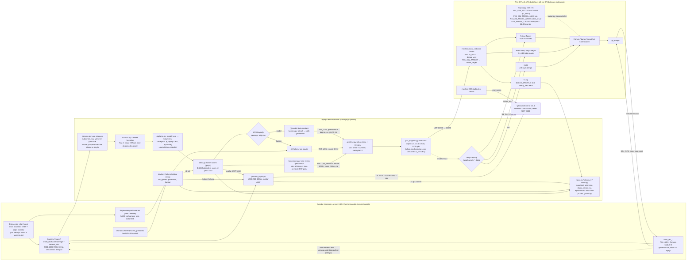

# Spesifikasyon: m06 Simülasyon Ortamı

- Yol haritası maddesi: **m06** (madde 6: simülasyon kamera ve hareketli insan hedefi kurulumu) · issue Auto-Follow/Auto-Follow#7 (son teslim 15.11.2026)
- Dal `ozellik/m06-sim-ortami` · PR başlığı `[M06] Simülasyon ortamı` · gereksinimler: `planning/requirements.md`
- Tek spec, iki faz: **Faz A** 15.11'e kadar ilk PR (bu belgenin "Özel Gereksinimler" bölümünün tamamı), **Faz B** 15.11'den sonra aynı spec'e bağlı ikinci PR ("Faz B" bölümü).

## Amaç

`tez/sim` üzerindeki F0/F1 çalışmasının üstüne, el çizimindeki **Gazebo kamera → model → PX4 → simülasyon** döngüsünü kapatmak. Camera Module 3 benzeri kamera görüntüsü laptopta okunur. Yusuf Ortatepe'nin modeli CPU'da bu görüntüde çalışır. Geçici bir Model → PX4 okuyla (`TEZ_LOS` / `FOLLOW_TARGET`, bkz. "Varsayımlar") stok Follow Me ile ya da takılan bir harici modla takip yapılır. Her koşu aynı ölçütleri ve VLC'de açılan bir MP4 üretir. PX4 dosyalarına dokunulmaz.

## Kullanıcı Hikâyeleri

- Kontrol ekibinden biri (Yusuf Kurt, m15) olarak kendi PX4 takip modumu sime takıp aynı senaryo, aynı ölçütler ve aynı videoyla stok Follow Me'yle karşılaştırmak istiyorum; böylece modumu gerçek uçuştan önce ölçerek geliştirebilirim.
- Görüntü ekibinden biri (Yusuf Ortatepe) olarak modelimin Gazebo kamera görüntüsünde ne kadar iyi ve ne kadar hızlı çalıştığını (IoU, kaçırma, yanlış kişi, gecikme) hakeme göre ölçmek istiyorum; böylece m08'deki asıl çalışma için bir başlangıç noktam olur.
- Takım üyelerinden biri olarak repoyu klonlayıp birkaç betikle simi kendi bilgisayarımda ayağa kaldırmak ve sonucu VLC'de video olarak izlemek istiyorum; böylece kurulumla uğraşmadan test yapabilirim.

## Özel Gereksinimler

**1. PX4 tarafı: (b) yolu, yani stok 4001 + gerçek dron ayarları (PX4 dosyası değişmez)**
- ROMFS'teki 3 dosya v1.17.0 hâline döner (`4030_gz_x500_tez`, `4030_gz_x500_tez.post`, `airframes/CMakeLists.txt`). İskelet "Tez Auto Follow" modülü (`tez/px4/`) daldan çıkarılır. `tez/pin/verify_pin.sh --worktree` "KILIT SAGLAM" vermelidir; bugün bu dalda bu 3 dosya yüzünden "KILIT BOZULMUS" veriyor.
- `calistir.sh` PX4'ü şu ortam değişkenleriyle başlatır:
  - `PX4_SYS_AUTOSTART=4001`: stok `4001_gz_x500` airframe'i seçilir (rcS satır 41–44).
  - `PX4_GZ_MODEL_NAME=x500_tez_0`: PX4 dünyadaki drona bağlanır (`px4-rc.gzsim` 184–190).
  - `PX4_GZ_WORLD=<dünya>` ve `PX4_SIM_MODEL=x500_tez`: ikincisi yalnız bilgi amaçlıdır.
  - Not: Yalnız `PX4_SIM_MODEL=x500_tez` vermek yetmez. rcS bu durumda `<no>_x500_tez` adlı bir airframe dosyası arar ve "Unknown model" diyerek çıkar.
- **Parametre yükleme yöntemi:** v1.17.0 posix rcS'teki `PX4_PARAM_<AD>=<değer>` ortam değişkeni döngüsü kullanılır (rcS 129–136).
  - Döngü `param reset_all`'dan sonra, airframe dosyasından önce `param set` yapar. `param set` değeri kullanıcı katmanına yazar, `param set-default` yalnız varsayılanı değiştirir; bu yüzden airframe'in `param set-default` satırları bu değerleri ezmez.
  - İstisna (uygulamada bulundu, `param.cpp` `do_set`): `param set`, değer o anki değere eşitse hiçbir şey yazmaz. Varsayılana eşit bir değer kullanıcı katmanına girmez ve sonradan bir `set-default` satırı onu değiştirebilir (ör. `--param MPC_THR_HOVER=0.5` → 4001'in `0.60`'ı kazanır). Bu yüzden F0 her değeri PX4'ten geri okur; bugünkü dosyalarda 15/15 aynıdır.
  - Her açılışta `parameters*.bson` silinir; koşular birbirinin parametresini devralmaz. Çağıranın kabuğundan gelen `PX4_PARAM_*` değişkenleri `calistir.sh` tarafından silinir; tek yol `--param`'dır.
- **Elenen yollar ve nedenleri:**
  - Açılıştan sonra MAVLink `PARAM_SET`: kalkışla yarışır; bazı ayarlar modül başlarken okunur.
  - `px4 -s <betik>`: rcS'in kopyalanmasını ve veri klasörünün elle verilmesini gerektirir.
  - PATH üzerinden `px4-rc.*` dosyalarını gölgelemek: kırılgandır.
  - Hazır bir `parameters.bson`: ikili dosyadır ve derlemeye bağlıdır.
- **Parametre dosyaları:**
  - `tez/sim/parametreler/gercek_dron.params`: 4019 kazançları ve 22.08 dosyasından davranış parametreleri.
  - `tez/sim/parametreler/sim.params`: yalnız sim için. `SDLOG_PROFILE 163` sayesinde `debug_vect` ULog'a girer.
  - Biçim: her satırda `AD DEĞER  # kaynak`. Ad `^[A-Z0-9_]{1,16}$` kuralına uymalı, değer sayı olmalıdır (`nan`/`inf` değil). Kaynak yorumu zorunludur; aynı dosyada aynı ad iki kez yazılamaz. Hatalı satır, dosya adı, satır numarası ve adıyla reddedilir ve sim hiç açılmaz.
  - Ayrıştırıcı: `araclar/parametreler.py` (`calistir.sh` onu `TEZ_PYTHON` ya da ekip venv'iyle çağırır ve yazdığı `PX4_PARAM_*` satırlarını dışa aktarır).
- **Yükleme sırası** (aynı parametre birden fazla yerde varsa sonuncu kazanır): `gercek_dron.params` → `sim.params` → senaryodaki `takip.px4_parametreleri` → `--param AD=DEĞER`.
- **Seçim kuralı:**
  - Dahil: `MC_*`, `IMU_*_CUTOFF`, `MPC_*`, `FLW_TGT_*`, `EKF2_HGT_REF`, `EKF2_MAG_TYPE`.
  - Hariç: `CA_*` geometri (22.08'deki ±1 değerleri sim modeline uymaz), `MPC_THR_HOVER` (model fiziğine bağlı), `CAL_*`, `RC*`, `BAT*`, `SENS_*`, `MAV_*`, `SER_*`, failsafe ayarları, `MIS_TAKEOFF_ALT` (bunu senaryo verir).
  - Uygulamada 22.08 dosyası v1.17.0 varsayılanlarıyla betikle karşılaştırılır. Tablo "Faz A Dosya Planı"ndadır; karşılaştırmanın tamamı `implementation/gorev-grubu-01.md`'dedir.
- F0 kabul testi stok modlara ve parametre doğrulamasına uyarlanır (bkz. "Test Planı"). `tez/sim/README.md` (b) yoluna göre yeniden yazılır. Hüseyin'in onayı bekleniyor.

**2. Kare okuyucu ve kamera kusurları aşaması**
- `araclar/goruntu.py` `/x500_tez/kamera/image` konusuna `subscribe_raw` ile abone olur.
  - Geri çağırma yalnız ham baytı, varış anını (`time.monotonic`) ve sayacı saklar.
  - Protobuf yalnız işlenecek karede çözülür. 9 MB'lık bir kareyi saf Python protobuf ile çözmek ~14 ms sürer
    (uygulamada, ekip venv'inde ölçülen `cozme_ms` ort. 1.3–1.6 ms; kare verisi kopyalanmadan salt okunur görünüm olur).
  - Uygulamada eklendi (4. grup): yerine yenisi gelen karenin yalnız ilk 256 baytı (başlığı) saklanır ve model kareyi
    alırken çözülür (`goruntu.stamp`). Böylece atlanan her karenin sim zamanı da bilinir ve kayıt penceresindeki
    sayılar (`uretilen`, `atlanan`) tahminsiz çıkar. Kare verisi yalnız işlenen karede çözülür.
- Kare nesnesi şunları taşır:
  - RGB `uint8` dizi (1296×2304×3).
  - `t`: Gazebo başlık damgası. Bu sim zamanıdır ve SITL lockstep'te PX4 zamanıyla aynıdır.
  - `varis`: duvar saatiyle varış anı.
  - `sira`: kare sayacı.
- Okuyucu yalnız en yeni kareyi tutar. Model meşgulken gelen kare bir öncekinin üstüne yazılır ve `atlanan` olarak sayılır. Kuyruk büyümez, eski kare işlenmez.
  - Defter (`ozet.json` → `kare_defteri`, model sürecinin bütün ömrü): okuyucuya gelen = işlenen + atlanan + bekleyen;
    işlenenlerin hepsi ana sürece ve `algilama.csv`'ye ulaşır (`tutarli: true`). Kayıt penceresinde ayrıca hakemin
    kamera karesi sayısıyla (`camera_info`) karşılaştırılır: `okuyucuya_ulasmayan` (gz-transport'ta kaybolan kare).
- Sim gerçek zamanda akar. Gazebo Python'u beklemez; model yavaşsa sim yavaşlamaz, kareler atlanır.
- Gecikme ölçümü için sim saati ile duvar saati eşlenir. Eşleme `/world/<dünya>/clock` konusundan tutulur (abonelik ~100 Hz'e kısılır).
  - Uygulamada bulundu (4. grup): eşleme, geri çağırmanın çalıştığı an yerine Gazebo'nun saat mesajına yayın anında
    yazdığı sistem saatiyle (`Clock.system`) yapılır. Ana süreç meşgulken (hakemin segmentasyon karelerinin saf Python
    çözümü, MAVLink) geri çağırma onlarca ms gecikiyor ve eşleme kayıyordu: ilk koşuda `ulasma_ms` ortalaması −5 ms
    çıktı. Düzeltmeden sonra 31 ms. Boştaki bir süreçte alış − `system` farkı 0.09–0.31 ms ölçüldü.
- `araclar/kusurlar.py` görüntü ile model arasında bir aşamadır: `KameraKusurlari.uygula(kare, t) -> kare`. Senaryonun `kusurlar:` alanından ayarlanır.
  - Faz A'da alan boştur, yani kusurlar kapalıdır ve kare bit bit değişmeden geçer.
  - Faz B alan adları ayrılmıştır: `gurultu`, `bulaniklik`, `rolling_shutter`, `pozlama`. Faz A'da biri açılırsa "Faz B'de uygulanacak" hatası verilir.
- Aşamanın süresi (`kusur_ms`) her karede loglanır. Faz B'de aynı kusurlar, aynı tohumla video karelerine de uygulanır.

**3. Model arayüzü ve v0.2'nin laptop CPU'sunda çalışması**
- Arayüz `araclar/algilama.py` içindedir: `Algilayici.algila(kare_rgb) -> list[Kutu]`.
  - `Kutu` alanları: `u0, v0, u1, v1, guven, sinif, sinif_adi`.
  - Kutular tam çözünürlükte, piksel kenarı olarak verilir (`u0 ≤ u < u1`), hakem kutularıyla aynı kural.
  - Vision'ın m08/m10 kodu bu arayüze uyan yeni bir sınıf olarak takılır. `../Vision` yoluna bağlanılmaz (kural 7).
- `YoloAlgilayici`:
  - Ultralytics'i `device=cpu` ile çalıştırır.
  - `torch.set_num_threads(cekirdek)` uygulanır. Varsayılan 4'tür; Gazebo ve PX4'e CPU kalsın diye.
    Uygulamada bulundu: ultralytics ilk tahminde iş parçacığını kendi sayısına (CPU − 1, en çok 8) çeker
    (`select_device`). Bu yüzden kurucu bir ısınma tahmini yapar, sayıyı ondan sonra kurar ve her karede denetler.
  - Yalnız verilen dosyayı yükler. Otomatik model ve yazı tipi indirme ile analitik kapalıdır: ultralytics içe
    aktarılmadan önce `YOLO_OFFLINE=1` (açılıştaki DNS kontrolü ve analitik yok), `YOLO_AUTOINSTALL=0` ve
    `YOLO_CONFIG_DIR` geçici bir klasör (`sync: false` ayarıyla, süreç bitince silinir; `~/.config/Ultralytics`
    oluşmaz). Dosya yoksa ultralytics'e hiç verilmez (internette arardı).
  - `ultralytics` modülü yalnız bu sınıf içinde içe aktarılır. Böylece birim testleri torch olmadan çalışır.
  - Kare RGB gelir; ultralytics numpy kareyi OpenCV BGR sayar, bu yüzden çevrilerek verilir (`model_ms`'e dahil).
  - `imgsz` modelin adımının (v0.2: 32 px) katı olmalıdır; değilse ultralytics'in sessizce yuvarlaması yerine
    alan adıyla hata verilir.
- Model dosyasının yolu şu öncelik sırasıyla belirlenir:
  1. `--model <yol>`
  2. Senaryodaki `algilama.model`
  3. `~/auto-follow-modeller/person_detection_model_v0.2.pt`

  Dosya yoksa sim açılmadan hata verilir ve dosyanın nereden alınacağı söylenir.
- Sınıf, imgsz ve conf:
  - Sınıf adları `.pt` içindeki `names` alanından okunur. Varsayılan sınıf, adı büyük/küçük harf ayırmadan `person` olandır (v0.2'de `{0: 'Person'}`, COCO'da `0: person`).
  - `--sinif ad|no` ile başka bir sınıf seçilebilir.
  - `--imgsz`: varsayılanı `.pt` içindeki eğitim değeridir.
  - `--conf`: varsayılanı 0.25'tir.
- Dosyanın sha256 özeti her koşuda hesaplanır ve `ozet.json`'a yazılır.
  - Özet, `tez/sim/modeller.yaml` içindeki bilinen özetle karşılaştırılır; farklıysa uyarı verilir. Kayıt önce
    özetle, bulunamazsa dosya adıyla eşleşir (adı değişmiş bir kopya yine tanınır).
  - Senaryo koşusuna bağlanması (yol, sha256, `ayarlar.algilama`) 4. görev grubunda, model süreciyle birliktedir;
    3. grup `algilama.py`'deki parçaları ve deneme aracı `araclar/model_dene.py`'yi verdi.
  - v0.2 bilgileri "Belgeler > Model dosyası" bölümündedir.
  - Kıyas için stok COCO `yolov8s.pt` aynı klasöre elle konur ve `--model` ile seçilir. Onun sha256 özeti uygulamada yazılır.
- Model ayrı bir süreçte çalışır (`multiprocessing`, "spawn" başlatma).
  - Amaç: GIL çekişmesinden ve gz-transport'un fork sonrası sorunlarından kaçınmak.
  - Sonuçlar ana sürece FIFO kuyrukla gelir.
  - `--modelsiz` ya da `algilama.etkin: false` verilirse model süreci hiç başlatılmaz (F1 testi bunu kullanır).
  - Uygulamada (4. grup): süreç, simülasyon açılmadan ve çıktı klasörüne bir şey yazılmadan önce açılır ve modelin
    yüklenmesi beklenir; model bir ayarı reddederse (`--sinif`, `--imgsz`) koşu Gazebo açılmadan çıkış kodu 2 ile
    durur. Model, Gazebo kare yayınlamaya başladığı andan kayıt bitene kadar çalışır (gerçek araçta da model hep
    açıktır); kayıt bitince kapanır, iniş modelsiz yapılır. Ctrl+C'de model süreci SIGINT'i yok sayar, ana süreç onu
    durdurur, defter yine gelir.
- Kare başına `model_ms` (ön işleme + çıkarım + son işleme) loglanır.
  - Uygulamada `model_ms`, algılayıcının `algila()` çağrısının çevresinden ölçülür (renk çevirme ve kutu dönüşümü
    dahil); Vision'ın takacağı başka bir `Algilayici` da aynı ölçümü alır. Ayrıca `cozme_ms` (mesajın çözülmesi) ve
    `kusur_ms` ayrı yazılır.
- Lisans: Ultralytics AGPL-3.0'dır. Model yalnız yerel simde çalıştırılır, dağıtılmaz.

**4. Gecikme zinciri, kare atlama ve zaman ölçümü**
- İşlenen her kare için şu zaman damgaları tutulur:
  - `t`: yakalama anı (sim zamanı).
  - `varis`, `basla`, `bitis`, `serbest` (gecikme hattından çıkış), `gonderim`: duvar saati (`monotonic`).

  Duvar zamanları saat eşlemesiyle sim saniyesine de çevrilir.
- Bunlardan türetilenler:
  - `ulasma_ms` = varış − yakalama.
  - `bekleme_ms` = başlama − varış.
  - `model_ms`.
  - `ek_gecikme_ms`: yapay gecikme.
  - `uctan_uca_ms` = gönderim − yakalama, sim milisaniyesi olarak.
- Kare atlama iki sayaçla ölçülür: üretilen kare sayısı (`uretilen`, kamera karesi) ve işlenen kare sayısı (`islenen`).
  - `atlanan_kare_orani = 1 − islenen/uretilen`.
  - `islenen_kare_hizi_hz`: sim saniyesi başına işlenen kare.
- `araclar/gecikme.py`, yakalama → PX4 yoluna yapay bir gecikme hattı ekler: `ek_ms` + `titresim_ms` (düzgün dağılımlı, tohumlu). Sıra korunur; bir mesaj kendinden önceki mesajdan önce çıkmaz.
  - Uygulamada (5. grup, 1. kısım): `gecikme.DelayLine`. Her `TEZ_LOS` hattan geçer; çıkış anı `serbest` damgasıdır.
    Gecikme yokken ve hatta bekleyen yokken mesaj çağıranın iş parçacığında hemen çıkar (ölçülen yola fazladan bir
    iş parçacığı geçişi eklenmez; ölçülen `ek_gecikme_ms` ort. ≈ 0.03 ms). Gecikme varken hattın kendi iş parçacığı
    sırayı korur (testli). `ek_ms` ≠ 0, titreşim ve saat modeli 12. grupta bağlanır.
- Saat modeli: gönderilen `time_usec = t_kare + saat_ofset_ms + saat_kayma_ppm × geçen süre`.
  - PX4 v1.17.0 bu alanı `DEBUG_VECT` ve `FOLLOW_TARGET` için kullanmaz; uORB damgası mesajın varış anıdır.
  - Bu yüzden saat kaymasının stok PX4 tüketicileri üzerinde etkisi yoktur. Ortak ICD zaman damgalı bir mesaj seçerse anlam kazanır (bkz. "Varsayımlar").
- Gerçek zaman oranı (RTF) koşu boyunca ölçülür. 0.9'un altına düşerse raporda uyarı çıkar; model CPU'yu Gazebo'dan alıyor olabilir.
  - Uygulamada: `rtf_ort` (kayıt penceresi) ve `rtf_min_5s` (en yavaş 5 s'lik dilim), saat eşlemesinden. Ölçülen
    (11.11, `kalabalik_park`): modelsiz 0.998–1.000, model 4 çekirdek **0.84** (uyarı çıkar), model 2 çekirdek 0.93.
    Kameraya pasif bir abone (bütün 9 MB'lık kareleri alan ama işlemeyen) RTF'yi düşürmedi (1.000); düşüşün
    sebebi modelin hesap yüküdür. Karar bekliyor (bkz. "Açık Konular").
- Faz A varsayılanları: yapay gecikme ve saat ayarlarının hepsi 0'dır; yalnız doğal gecikme ölçülür.

**5. İki LOS kaynağı, hedef seçimi ve `TEZ_LOS` gönderimi**
- LOS kaynağı (i), `model`:
  1. Seçilen kutunun merkezi alınır.
  2. `kamera.Camera.pixel_to_los` ile optik eksenlerde yön bulunur. İç parametreler `camera_info`'dan gelir; bozulma da hesaba katılır.
  3. `kamera.camera_to_body(45°)` ile gövde FRD'ye çevrilir.

  Sonuç gövde FRD'de bir birim vektördür: kameradan hedefe, montaj açısı eklenmiş.
- LOS kaynağı (ii), `hakem`: o karenin `los_govde` değeri (`kayit.py`). Yalnız hedef `gorunur` iken ve her kamera karesinde (30 Hz) kullanılır. Hakemin canlı satırı, segmentasyon karesi geldikten sonra kullanılır; bundan doğan ek gecikme de ölçülür.
  - Uygulamada (5. grup): `kayit.Recorder(on_frame=...)` her kamera karesini, satırı (daha sonraki bir dron pozu
    gelince oluşur) ve segmentasyon karesi ikisi de gelince (`kayit.FrameJoin`, hangisi önce gelirse) takip tarafına
    verir; o an `kaynak_hazir` damgasıdır (`tez_los.csv` → `kaynak_ms`). Hakem yalnız kayıt sırasında çalışır
    (segmentasyon çözümü ana süreci yorduğu için, 1. gruptan beri); kayıttan önce kare yine bildirilir ama satırsızdır:
    `hakem` kaynağında `TEZ_LOS` NaN gider ("hedef yok"; operatör henüz hedef seçmemiş gibi).
- Hedef seçimi geçicidir; m11'de asıl çözüm gelir.
  - İlk kilit: hedefin hakem kutusuyla IoU'su en yüksek kutu seçilir. Bu, operatörün hedefi seçmesinin yerini tutar.
  - Sonraki karelerde, merkezi önceki seçime en yakın kutu seçilir. Merkezler arası mesafe en fazla önceki kutunun köşegeninin 1.5 katı olabilir.
  - Kilit kaybı: 10 işlenen kare boyunca eşleşme olmazsa kilit düşer ve hakemle yeniden kilitlenilir. Bu sayılır (`yeniden_kilit_sayisi`).
  - Uygulamada (5. grup, `araclar/takip.py` `Selection`):
    - Kilit için hedef `gorunur` olmalı ve kutunun IoU'su en az **0.3** olmalı (`LOCK_MIN_IOU`; ölçütlerin bir
      kutuyu bir insana ait saydığı eşik). Eşik olmasaydı IoU'su 0.01 olan uzak bir kutuya, operatörün tıklamayacağı
      yere kilitlenilirdi. Kilit yoksa nedeni yazılır: `hakem_yok`, `hedef_gorunmuyor`, `kutu_eslesmedi`.
    - Kilitliyken hakeme hiç bakılmaz (hile olurdu); kapı, son eşleşen kutunun merkezi ve köşegeniyle kurulur ve
      kaçırılan karelerde büyümez.
    - Kilit 10. kaçırmada düşer; yeniden kilit en erken **bir sonraki işlenen karede** denenir (operatörün tepki süresi
      0, iyimser; bkz. "Açık Konular").
    - Kutu merkezi `((u0 + u1) / 2, (v0 + v1) / 2)`: piksel kenarı kuralında sürekli koordinat; Gazebo'nun asal
      noktası `cx = W/2 = 1152` iki orta pikselin sınırıdır, `Camera.project` ile aynı kural (testte gidiş-dönüş
      < 0.01°, bozulmalı bir kamerayla da).
- Mesaj `DEBUG_VECT` olarak gönderilir:
  - `name="TEZ_LOS"`.
  - `x, y, z`: birim LOS, gövde FRD.
  - `time_usec`: yakalama anı, saat modelinden geçirilmiş.

  İşlenen her kare için bir mesaj gider, en çok 30 Hz. Aynı kare iki kez gönderilmez.
- "Hedef yok": hedef seçilemeyen işlenmiş karede aynı yoldan `x=y=z=NaN` gönderilir. Eski veri tekrarlanmaz (hata yönetimi standardı).
- Göndermeden önce doğrulama yapılır: değerler sonlu olmalı ve `|norm − 1| < 1e-3` sağlanmalıdır. Bu sağlanmazsa mesaj gönderilmez ve sayılır (iki taraflı doğrulama).
- `TEZ_LOS` her takip kaynağında gönderilir, `yok` dahil. Böylece veri akışı her zaman vardır ve ULog'a girer.
- Uygulamada (5. grup):
  - Akış: model sonucu (`ModelProcess`'in sonuç iş parçacığı = takip iş parçacığı) → seçim → LOS (i) → gecikme hattı
    → `px4_baglanti.LosSender` → `Vehicle.send_los`; sonra `algilama.csv` satırı yazılır. `hakem` kaynağında hakemin
    kareleri kendi iş parçacığında (`tez-hakem-los`) aynı hattan gider; model kareleri yine seçilir ve yazılır.
  - `LosSender` kuralları, sırayla: geçersiz vektör (sonlu değil, 3 bileşen değil, `|norm − 1| ≥ 1e-3`) → `gecersiz`;
    MAVLink bağlantısı yok → `baglanti_yok`; aynı kare → `ayni_kare`; daha eski kare → `eski_kare`; bir önceki
    gönderilenin yakalama anından **30 ms**'den yakın → `hiz_siniri`. "En çok 30 Hz" yakalama zamanıyla uygulanır:
    simde kamera kareleri 4 ms'lik fizik adımı yüzünden 32 / 36 ms arayla gelir, 33.3 ms'lik bir sınır geçerli
    kareleri atardı; gönderim (duvar) zamanı ise iş parçacıklarıyla titrer. Her sonuç sayılır (`ozet.json` →
    `tez_los.sonuclar`).
  - Akış PX4 bağlantısı kurulunca başlar (önceki işlenmiş kareler `baglanti_yok`) ve kayıt bitince, model süreciyle
    birlikte kapanır (gerçek araçta model ve gönderim birlikte durur; iniş zaten "Land" modundadır).
  - Tek gönderim kilidi: `px4_baglanti.serialize_sends`, bağlantının `MAVLink.send`'ini bir kilitle sarar; GCS
    heartbeat, komutlar ve `TEZ_LOS` aynı kilitten geçer (pymavlink'in `send`'i iş parçacığı güvenli değil: sıra
    numarası, tampon).
  - Gönderim anı (`gonderim`) soket yazımından **hemen önce** okunur. İlk denemede yazımdan sonra okunuyordu; PX4'ün
    kendi varış damgasıyla karşılaştırınca karelerin %7'sinde 10 ms'den, en çok 71 ms geç çıktı (yazımdan sonra iş
    parçacığı GIL'i ve yüklü işlemcide sırasını bekliyor).
  - Çıktılar: `algilama.csv`'ye seçim, LOS (i), giden vektör ve zaman sütunları; her `TEZ_LOS` denemesi için yeni
    `tez_los.csv` (her iki kaynak; `t_us` anahtarıyla birleşir); `ozet.json` → `tez_los` (bütün koşu: sonuçlar, kilit
    olayları, hakemin eksik kareleri) ve `olcutler`'de kayıt penceresinin sayıları (aşağıda "Ölçüt Tanımları").

**6. Takip kaynağı / kontrolcü seçimi (birinci sınıf gereksinim)**
- Takip kaynağı senaryoda `takip.kaynak`, komut satırında `--takip` ile seçilir: `yok`, `follow_me` ya da `tez_los`. Dron `drone.yukseklik_m`'ye kalktıktan sonra mod adıyla seçilir:

  | Takip kaynağı | Seçilen PX4 modu |
  |---|---|
  | `yok` | "Hold" |
  | `follow_me` | "Follow Target" |
  | `tez_los` | `takip.mod_adi` / `--mod-adi` |

  Mod adları PX4'ün `AVAILABLE_MODES` listesinden çözülür (`px4_baglanti.Vehicle.modes`). Ad listede yoksa koşu başlamadan, mevcut adları listeleyen bir hata verilir.
  - Uygulamada (5. grup): PX4 `AVAILABLE_MODES`'ta MAVLink standart modlarına (Position, Altitude, Return, Mission,
    Land, Takeoff, Orbit) ad yazmaz (`standard_mode` dolu, `mode_name` boş); bunlara PX4'ün kendi adı verilir
    (`nav_state_names`). Seçilemeyenler (`MAV_MODE_PROPERTY_NOT_USER_SELECTABLE`: kayıtsız harici yuvalar
    "(Mode not available)", Termination) listeye girmez. Koşuda okunan liste `ayarlar.takip.px4_modlari`'ye yazılır
    (stok 4001'de 17 ad).
  - "Koşu başlamadan": PX4'ün mod listesi ancak PX4 açılınca okunur. Bu yüzden ad, sim açılmadan PX4 v1.17.0'ın
    seçilebilir stok modlarıyla (`px4_baglanti.STOCK_MODE_NAMES`, 17 ad; testte PX4 kaynağıyla, koşuda PX4'ün
    listesiyle karşılaştırılır) denetlenir; yoksa hata bu adları ve harici modun nasıl ekleneceğini söyler
    (0.7 s, çıkış kodu 2). `takip.px4_baslat` / `--px4-baslat` verilmişse (harici mod, 10. grup) ad PX4 açılıp
    modül başladıktan sonra, kalkıştan önce PX4'ün listesinde aranır.
- `follow_me` için `araclar/konumlama.py` kutunun alt ortasını (ayak noktası) düz zemine izdüşürür.
  - Kare anındaki EKF pozu kullanılır: `ATTITUDE_QUATERNION` + `LOCAL_POSITION_NED`, `time_boot_ms` ile interpolasyon. SITL'de bu zaman sim zamanıyla ±4 ms içinde aynıdır.
  - NED konumu `GPS_GLOBAL_ORIGIN`'e göre enlem/boylama çevrilir.
  - Şu durumlarda konum hesaplanmaz (reddedilir):
    - Kutu görüntü kenarına 8 px'ten yakınsa (ayak görünmüyor olabilir).
    - Işının aşağı bileşeni `u_D < 0.25` ise (ufka yakın, uzak tespit).
    - Poz geçmişi kare anını 0.15 s içinde kapsamıyorsa.
- `FOLLOW_TARGET` işlenen kare başına en çok 10 Hz gönderilir.
  - Alanlar: `est_capabilities=1`; hız `NaN` (0 gönderilirse PX4 hedefi "duruyor" sayar); `alt` ev noktasının AMSL yüksekliği (`FLW_TGT_ALT_M 0` iken kullanılmaz).
  - PX4 konumu en sık 500 ms'de bir kaynaştırır ve 3 s mesaj gelmezse hedefi kayıp sayar.
  - LOS kaynağı `hakem` ise `FOLLOW_TARGET` hedefin gerçek konumundan, yalnız hedef görünürken gönderilir. Bu bir "mükemmel algılayıcı" referans koşusudur.
  - Uygulamada (6. grup, `araclar/konumlama.py`, `takip.Tracker`):
    - Ayak noktası kutunun alt ortasıdır: `((u0 + u1) / 2, v1)` (piksel kenarı kuralı). Işın `Camera.pixel_to_los`
      (camera_info, bozulma dahil) + nominal montaj (45°, FRD (0.151, 0, 0.035) m) + kare anındaki EKF duruşuyla NED'e
      döner, kameranın EKF konumundan çıkar ve `D = ev_D + 0.227 m` düzlemini keser (0.227 m: x500 iniş ayaklarının
      altı, `base_link_collision_3/4`). Nokta PX4'ün kendi izdüşümüyle (lib/geo `MapProjection`, 6371 km küre,
      azimutal eşuzaklık) `GPS_GLOBAL_ORIGIN`'e göre enlem/boylama çevrilir; PX4'ün hedef kestiricisi aynı izdüşümle
      geri çevirdiği için gidiş-dönüşe yalnız mesajın 1e-7° tamsayıları (≤ 0.56 cm) eklenir (testli).
    - Kenar kuralı: kutu **sol, sağ ya da alt** kenara 8 px'ten yakınsa ret (`kenar`). Üst kenar ret nedeni değildir:
      başı kesik bir kişinin ayakları yerindedir (spec'teki gerekçe "ayak görünmüyor olabilir" alt kenar içindir).
    - Ret nedenleri sırayla: `kutu_yok`, `kamera_yok`, `kenar`, `poz_yok` (kare anından en çok 0.15 s önce ve en çok
      0.15 s sonra örnek yok; iki akış için ayrı ayrı), `referans_yok` (EKF kökeni ya da ev noktası henüz gelmedi),
      `ufka_yakin` (`u_D < 0.25`). Konum her takip kaynağında hesaplanır ve `algilama.csv`'ye yazılır; FOLLOW_TARGET
      yalnız `follow_me`'de gider.
    - EKF pozu: `ATTITUDE_QUATERNION` 50 Hz, `LOCAL_POSITION_NED` 30 Hz (PX4'ün onboard bağlantı hızları; önceden
      `LOCAL_POSITION_NED` 10 Hz'e kısılıyordu), `time_boot_ms` ile; duruş nlerp, konum doğrusal. SITL'de PX4 saati
      Gazebo'nun saatidir (gz_bridge her adımda eşler), kare zamanı doğrudan PX4 zamanı olarak kullanılır.
      Ölçülen: kareden sonraki örnek ort. 16 ms, en çok 36 ms sonra; `poz_yok` hiç olmadı.
    - EKF kökeni: PX4 `GPS_GLOBAL_ORIGIN`'i yalnız köken kurulunca/değişince ya da istenince gönderir
      (`_force_next_send`); bağlantı kökenden sonra kurulursa hiç gelmez (bir gösterim koşusunda böyle oldu, bütün
      kareler `referans_yok`). Bu yüzden bağlantı kurulunca ve kalkıştan sonra (ev noktası arm ile geçerli olur)
      `MAV_CMD_REQUEST_MESSAGE` ile istenir (`Vehicle.wait_references`, testli). Pi'de de aynısı gerekir.
    - `alt`: zeminin AMSL yüksekliği (`köken_alt − zemin_D`, kişinin ayaklarının yüksekliği); spec'teki "ev noktasının
      AMSL'si"nden 0.227 m aşağıdadır. `FLW_TGT_ALT_M 0` iken PX4 kullanmaz (kestiricinin D'sine girer).
    - Hız: `[NaN, NaN, NaN]`; ivme, duruş ve açısal hız MAVLink'in "bilinmiyor"u (0); `position_cov` NaN. PX4 v1.17.0
      `lat, lon, alt, vel` dışında hiçbir alanı okumaz (`handle_message_follow_target`).
    - Hız sınırı yakalama zamanıyla: ardışık iki FOLLOW_TARGET'ın kare zamanları en az **96 ms** (30 Hz kameranın her
      üçüncü karesi 96 ya da 100 ms sonradır; 100 ms'lik bir sınır her dördüncüsünü, 7.6 Hz verirdi). `TEZ_LOS` ile
      aynı akış kuralları (`px4_baglanti.FrameStream`). Ölçülen: hakem kaynağında 9.7, model kaynağında 5.1 mesaj/sim-s.
    - FOLLOW_TARGET, karenin `TEZ_LOS`'unun arkasından aynı gecikme hattından gider; her deneme `follow_target.csv`'de.
    - `--los hakem`: FOLLOW_TARGET, hedefin gerçek dünya konumunun Gazebo'nun WGS84 dönüşümüyle (`spherical_coordinates`,
      gz-math LOCAL2 = ENU; dronun GPS'i de buradan gelir) enlem/boylamıdır, yalnız hakemin `gorunur` dediği karelerde.
- Follow Me ayarları:
  - `FLW_TGT_HT` senaryoda verilmezse `drone.yukseklik_m` kullanılır.
    Uygulamada: `takip.px4_parametreleri`'nin başına kaynak `drone.yukseklik_m (follow_me)` ile eklenir (dosyalardan
    sonra, senaryo ve `--param`'dan önce); senaryo ya da `--param` verirse eklenmez. Koşuda PX4'ten geri okunur.
  - `FLW_TGT_DST` parametre dosyasından gelir (8 m).
- PX4 tarafı (uygulamada 6. grupta okundu ve koşularda görüldü, PX4 v1.17.0):
  - `TargetEstimator` (alfa-beta-gama, `FLW_TGT_RS` 0.1) konumu en sık 500 ms'de bir kaynaştırır; aradaki mesajlar yalnız
    "bayat" sayacını sıfırlar. Hız NaN olduğundan yalnız konum kaynaşır, hız ardışık konumlardan kestirilir.
  - FOLLOW_TARGET kesilince kestirici son hızla **öngörmeye devam eder**; 3 s sonra `stale` olur, hız/ivme sıfırlanır,
    son konum tutulur. Kestirim `valid` kaldığı için Follow Target görevi o noktanın `FLW_TGT_DST` gerisinde havada
    bekler; mod değişmez, PX4 v1.17.0'da hedef kaybı için bir failsafe yoktur. Görevdeki 1.5 s'lik zaman aşımı
    (`TARGET_ESTIMATOR_TIMEOUT_US`) kestiricinin yayınına aittir, FOLLOW_TARGET mesajına değil.
  - Moda girince yörünge açısı 0'dan (hedefin kuzeyi) başlar ve hedefin rotası + `FLW_TGT_FA` (180°) yönüne döner;
    hedefin rotası yalnız hızı ≥ 1 m/s iken güncellenir. Dron yaw'ı hep hedefe bakar. Kestirim gelmeden mod açıksa dron
    yerinde (hız 0) bekler.
  - **Kaydedici bulgusu:** PX4'ün kaydedicisi isteğe bağlı konulara (`follow_target`, `follow_target_estimator`,
    `follow_target_status`) yalnız kendisi başlarken o konu varsa abone olur (`LoggedTopics::add_topic`,
    `orb_exists`). Bu konular ilk FOLLOW_TARGET ve Follow Target moduyla doğduğu için stok bir koşunun ULog'unda
    yoktur; **gerçek araçta da aynı olur**. Uygulamada `follow_me` koşusunda kaydedici, üç FOLLOW_TARGET gittikten
    sonra ve kayıt penceresinden önce bir kez yeniden başlatılır (`simulasyon.restart_logger`, rcS'in argümanlarıyla,
    ayrı iş parçacığında). ULog iki dosyaya bölünür: `ucus_once.ulg` (açılış → ≈ 27 s) ve `ucus.ulg` (≈ 27 s → iniş).
    Uçuşa etkisi yoktur. Gerçek araç için karar bekliyor (bkz. "Açık Konular").
- `tez_los` kaynağında yalnız `TEZ_LOS` gönderilir. Takılan modül `--px4-baslat` ile başlatılır. Koşu sonunda `sim.log` içinde "unresponsive" aranır.
- Poz geçmişi pymavlink'in `message_hooks` kancasıyla toplanır; ana iş parçacığının `recv_match` döngüsü bozulmaz.
  - Bütün gönderimler tek bir kilitle yapılır; GCS heartbeat iş parçacığıyla çakışmaz.
  - `TEZ_MODE_NAME` sabiti kaldırılır.
  - Uygulamada (6. grup): `px4_baglanti.pose_hook` her ayrıştırılan mesajda (okuyan iş parçacığında) yalnız otopilotun
    (`srcComponent 1`) `ATTITUDE_QUATERNION`, `LOCAL_POSITION_NED`, `GPS_GLOBAL_ORIGIN`, `HOME_POSITION`'ını
    `konumlama.PoseHistory`'ye yazar (kilitli; takip iş parçacığı okur); hiç istisna fırlatmaz.
- Her takip kaynağı aynı ölçütleri ve aynı MP4'ü üretir. `araclar/karsilastir.py` birden çok koşunun `ozet.json` dosyalarını tek tabloda yan yana koyar.

**7. Takım arkadaşı için kurulum ve PX4 modülü takma**
- `derle.sh --harici <klasör>` verilen klasörü `EXTERNAL_MODULES_LOCATION` olarak kullanır.
  - Bayrak verilmezse ve `tez/px4/src/CMakeLists.txt` varsa o klasör kullanılır. O da yoksa stok `px4_sitl_default` derlenir (+ `px4_gz_plugins`).
  - Çıktı her durumda `build/px4_sitl_tez`'dir.
  - Klasör önbellekteki değerden farklıysa CMake yeniden yapılandırılır.
- Ağaç içi modüller için de aynı `derle.sh` çalışır. Bunlar `src/modules/...` + `.px4board` ile eklenir ve kendi spec'leriyle birlikte bir kilit listesi PR'ı gerektirir. m06 kilit listesine yol eklemez.
- `calistir.sh --px4-baslat "<komut>"` (birden çok verilebilir) `.post` dosyasının yerini alır.
  - rcS'in bitmesi beklenir: `px4-logger status` başarılı olana kadar, en çok 90 s.
  - Sonra komutlar `rootfs` içinde `bin/px4-<komut>` istemcisiyle çalıştırılır; çıktıları sim log'una yazılır.
- Senaryodaki iki alan aynı işi `calistir.sh`'a devreder:
  - `takip.px4_baslat`: başlatma komutları.
  - `takip.px4_parametreleri`: modülün kendi parametreleri, başlangıçta yüklenir.

  Mod yalnız adıyla seçilir. Mod numarası (`nav_state` EXTERNALn, `custom_mode`) koda gömülmez.
- SITL'de `COM_MODE_ARM_CHK=1`'dir (stok `px4-rc.simulator`). Bu yüzden modül havadayken başlatılsa da kaydolabilir.
- `kur.sh` çalışmasının sonunda model klasörünü ve sha256 özetlerini kontrol eder ve sonucu yazar; model dosyası indirmez. Python betikleri yorumlayıcıyı `TEZ_PYTHON` ortam değişkeninden alır. Varsayılan, `VERSIONS.md`'deki ekip venv'idir.
- README'ye eklenecekler:
  - Ön koşullar.
  - AMD hibrit GPU için `DRI_PRIME=1` notu.
  - QGC AppImage için `libfuse2t64`.
  - Adım adım kılavuz (taslak: "Takım Arkadaşı Kılavuzu" bölümü).

**8. Senaryo dosyası ve komut satırı**
- `drone.mod` alanı kalkar, çünkü iskelet mod yok. Yerine `takip` bloğu gelir; ayrıca `algilama`, `gecikme`, `kusurlar` ve `video` blokları eklenir. Alan tablosu "Faz A Dosya Planı" bölümündedir.
- Mevcut 3 senaryo `takip: {kaynak: yok}` olarak güncellenir. Yeni `senaryolar/takip_yuruyen.yaml` eklenir: `yuruyen_insan` yolu, `follow_me`, 8 m yükseklik / 8 m geride, LOS kaynağı model.
- Yanlış alan adı ya da değer, hangi alan olduğu söylenerek reddedilir (`hedef._check_keys` deseni). Ayrıca:
  - `tez_los` için `mod_adi` zorunludur.
  - `algilama.etkin: false` iken `takip.los: model` reddedilir. `los` hiç verilmemişse ve algılama kapalıysa: `yok`
    kaynağında LOS yoktur (`ayarlar.takip.los: null`; F1 böyle koşar), `follow_me`/`tez_los` ise `los: hakem` ister.
  - `takip.px4_parametreleri` ve `--param`, `.params` dosyalarıyla aynı ad ve sayı kuralından geçer
    (`araclar/parametreler.py`). `MIS_TAKEOFF_ALT` reddedilir: kalkış yüksekliğini `drone.yukseklik_m` verir ve
    `px4_baglanti.takeoff` onu zaten yazar; aksi hâlde verilen değer sessizce ezilirdi.
- `senaryo.py`'ye eklenen bayraklar:
  - `--model`, `--imgsz`, `--conf`, `--sinif`, `--modelsiz`
  - `--takip`, `--mod-adi`, `--los`
  - `--param AD=DEĞER` ve `--px4-baslat KOMUT` (ikisi de birden çok verilebilir)
  - `--gecikme-ms`, `--qgc`, `--videosuz`, `--kareleri-sakla`
- Komut satırı YAML'daki değeri ezer. Koşuda geçerli olan ayarların hepsi `ozet.json` içindeki `ayarlar` alanına yazılır. Bunlara PX4'e yüklenen parametreler ve model özeti de dahildir.
  - Komut satırı değerleri doğrulamadan önce senaryonun bloklarına yerleşir (`hedef.load(ad, CommandLine)`); hata
    mesajı YAML alan adını ve bayrağı birlikte söyler. `--param` ve `--px4-baslat` senaryonun listesinin sonuna
    eklenir (yükleme sırası korunur). `--kareleri-sakla` yalnız komut satırındadır (`ayarlar.video.kareleri_sakla`).
  - `ayarlar.px4_parametreleri`: yüklenen her başlangıç parametresi (dosyalar + senaryo + `--param`) için istenen
    değer (`deger`), kaynağı (`kaynak`: dosya:satır # yorum, `takip.px4_parametreleri` ya da `--param`) ve koşuda
    kalkıştan önce PX4'ten geri okunan değer (`px4`, `PARAM_REQUEST_READ`). PX4 istenen değeri tutmuyorsa koşu
    kalkıştan önce durur ("TAMAMLANMADI"; 1. maddedeki `param set` istisnası). `takip.px4_parametreleri` ve
    `--param` bu yüzden 2. görev grubunda bağlandı; 10. grup yalnız `px4_baslat`'ı bağlar.
  - Ara durum (m06 sürerken, tasks.md 2.5): sonraki bir görev grubunda bağlanacak ayar varsayılan dışında verilirse
    `senaryo.py` simülasyonu açmadan "`<alan>`: Görev grubu N'de bağlanacak" hatasıyla durur (`hedef.check_wired`;
    `senaryo.run` de aynı kontrolü yapar). Varsayılanı henüz etkin olmayan ayarlar `ayarlar.henuz_bagli_degil`'de
    grup numarasıyla listelenir (5. gruptan sonra yalnız `{"video.mp4": 8}`; 4. grup `algilama.etkin` satırını ve
    `algilama.*` / `kusurlar` ara hatalarını, 5. grup `takip.kaynak: tez_los`, `takip.los: hakem` ara hatalarını ve
    `henuz_bagli_degil["takip.los"]`'u, 6. grup `takip.kaynak: follow_me` ara hatasını sildi). Her grup kendi
    satırlarını `hedef.unwired` / `hedef.not_in_effect`'ten siler.
  - `ozet.json`'daki eski `takip_kaynagi` alanı `ayarlar.takip.kaynak`'a taşındı (`ayarlar.takip.mod`: seçilen PX4
    modunun adı).
- `calistir.sh`'a `--param` ve `--px4-baslat`, `derle.sh`'a `--harici` eklenir. Mevcut `--ekransiz`, `--dunya` (`calistir.sh`) ve `--temiz` (`derle.sh`) aynen kalır. `calistir.sh` her açılışta parametreleri zaten sıfırlar.

**9. Ölçütler, rapor ve MP4 video**
- Her koşu `tez/sim/sonuclar/<tarih>_<ad>/` altına şunları yazar (git'e girmez):
  - `algilama.csv`: işlenen kare başına zamanlar, seçilen kutu, LOS, durum ve konum hesabı.
    4. grupta yazılan sütunlar: `t_us` (= `round(t*1e6)`), `t`, `sira`, `onceki_atlanan`, duvar saatinde (`monotonic`)
    `varis`, `basla`, `bitis`, `alinma` (sonuç ana sürece ulaştı) ve sim saniyesinde `varis_sim`, `basla_sim`,
    `bitis_sim`; `ulasma_ms` (sim ms), `bekleme_ms`, `cozme_ms`, `kusur_ms`, `model_ms`, `islem_ms` (bitiş − başlama),
    `teslim_ms` (FIFO'da geçen süre), `kutu_sayisi`. 5. grupta eklenenler: seçim (`secim`, `kilitsiz_neden`, `kilit_no`,
    `ardisik_kacirma`, `secilen_kutu`, `secilen_u0…v1`, `secilen_guven`, `kilit_iou`, kapı `kapi_u/v/px`,
    `merkez_mesafe_px`), `los_i_x/y/z`, giden `tez_los_x/y/z` + `tez_los_sonuc`, `hazir`/`serbest`/`gonderim` (+ `_sim`),
    `takip_ms`, `ek_gecikme_ms`, `uctan_uca_ms`; satır `TEZ_LOS` gittikten sonra yazılır. 6. grupta eklenen konum sütunları:
    `konum` (durum), `ayak_u/v`, `isin_asagi` (u_D), `poz_once_ms`/`poz_sonra_ms`, kare anının EKF pozu `ekf_n/e/d`,
    `ekf_roll/pitch/yaw_deg`, zemin noktası `konum_n/e/d`, `konum_lat/lon/alt`, `konum_menzil_m`, `konum_yatay_m`,
    dünyada `konum_x/y`, değerlendirme için `gercek_x/y` ve `konum_hatasi_m`, FOLLOW_TARGET'ın `ft_sonuc`,
    `ft_gonderim_sim`, `ft_uctan_uca_ms`. Model sürecinin
    bütün ömrünü kapsar (kalkış dahil); ölçütler yalnız kayıt penceresinden hesaplanır. Dosyalar ilk sonuçla açılır.
  - `tez_los.csv` (5. grupta eklendi): her `TEZ_LOS` denemesi (`t_us`, `t`, `kaynak`, `hedef`, `x y z`, `time_usec`,
    `sonuc`, `kaynak_hazir`/`hazir`/`serbest`/`gonderim`, `gonderim_sim`, `kaynak_ms`, `hazir_ms`, `ek_gecikme_ms`,
    `uctan_uca_ms`).
  - `follow_target.csv` (6. grupta eklendi, `follow_me`): her FOLLOW_TARGET denemesi (`t_us`, `t`, `kaynak`, `lat`,
    `lon`, `alt`, dünyada `x y`, `gercek_x/y`, `hata_m`, `hata_gonderimde_m`, `sonuc`, zamanlar, `uctan_uca_ms`).
  - `kutular.csv`: modelin bulduğu bütün kutular (`t_us`, `t`, `sira`, `kutu` (0 = en güvenli), `u0 v0 u1 v1`,
    `guven`, `sinif`, `sinif_adi`).
  - `dogru_cevap.csv`: mevcut hakem dosyası.
  - `ozet.json` ve `rapor.html`: yeni bölümlerle.
  - `kosu.mp4` ve `ucus.ulg` (`follow_me`'de ayrıca `ucus_once.ulg`: kaydedici yeniden başlamadan önceki kısım).
- Ölçüt tanımları "Ölçüt Tanımları" bölümündedir. Başarı eşikleri boş kalır, yalnız ölçülür; eşikleri m01 belirleyince eklenir.
- Video kareleri `goruntu_yayini.py` tarafından toplanır.
  - Kayıt penceresinde, sim zamanında 15 fps ızgarasına denk gelen kareler (her 2. kare) alınır.
  - Kareler 1280×720 JPEG (kalite 90) olarak `kareler/` klasörüne yazılır.
  - MP4 üretildikten sonra bu klasör silinir; `--kareleri-sakla` verilirse kalır.
- Koşu bitince `araclar/video.py` videoyu birleştirir: 2000×720, 15 fps.
  - **Sol (1280×720), dron kamerası:**
    - Hakemin kutuları: hedef mavi, diğer insanlar turuncu.
    - O anda PX4'ün elindeki son model sonucu: seçilen kutu kalın kırmızı ve güven değeriyle, diğerleri ince çizgiyle.
    - "HEDEF YOK" yazısı; sim zamanı, mod ve uçtan uca gecikme.
  - **Sağ (720×720), üstten görünüm:**
    - Dron, hedef, diğer insanlar, ağaçlar.
    - Kameranın zemindeki izdüşümü ve son 10 s'lik iz.
    - `follow_me`'de gönderilen `FOLLOW_TARGET` noktası.
    - Ölçek çubuğu ve yatay mesafe.
- Kodlama:
  - Kareler ham BGR olarak `ffmpeg`'e borudan verilir (`rawvideo`, `bgr24`).
  - `ffmpeg` ayarları: `libx264`, `-pix_fmt yuv420p`, `-preset veryfast`, `-crf 23`, `-movflags +faststart`. Video VLC 3.0.20'de açılır.
  - OpenCV `VideoWriter` kullanılmaz; pip'ten gelen OpenCV'de H.264 kodlayıcı yoktur.
  - `onizleme.py` de WebM yerine aynı kodlayıcıyla MP4 üretir.
- ULog özeti genişler: PX4'e ulaşan `TEZ_LOS` (`debug_vect`) sayısı ve hızı, `follow_target` sayısı ve `vehicle_status` mod zaman çizelgesi.

**10. QGC'ye canlı video**
- `araclar/goruntu_yayini.py` deney dalındaki dosyanın yeniden yazımıdır.
  - Kaynak `/x500_tez/kamera/image`'dır. Deney dalındaki sabit `x500_mono_cam_0` konu adı kullanılmaz.
  - Kareler `subscribe_raw` ile alınır ve 15 fps'e göre her 2. kare kullanılır.
  - Çıktı 1280×720'dir.
- Kutular iki şekilde gelir:
  - Senaryo koşusunda: ana süreç `127.0.0.1:5610` adresine UDP JSON gönderir (son model sonucu + o karenin hakem kutusu).
  - Tek başına çalışırken (açık sim + QGC ile elle uçuş): `--model` ile kendi algılayıcısını çalıştırır. Bu modda LOS gönderilmez ve hakem kutusu yoktur.
- GStreamer hattı, sırasıyla:
  1. `appsrc`: BGR, 1280×720, 15/1, canlı kaynak.
  2. `queue leaky=downstream max-size-buffers=2`.
  3. `videoconvert` → I420.
  4. `x264enc tune=zerolatency speed-preset=ultrafast bitrate=2000 key-int-max=15`, `constrained-baseline` profili.
  5. `rtph264pay config-interval=1 pt=96 mtu=1400`.
  6. `udpsink host=127.0.0.1 port=5600 sync=false`.
- QGC 5.1.4 ayarı: Uygulama Ayarları → Video → kaynak "UDP h.264 Video Stream", port 5600. QGC'siz kontrol için `gst-launch-1.0` alıcı hattı ya da VLC ile `araclar/yayin.sdp` kullanılır.
- Yayın `--qgc` ile açılır. Ayrı bir süreçtir ve kuyruğu sızdırandır; model ve kayıt hattını yavaşlatmaz.
- apt paketleri ve sürümleri:
  - Gerekenler: `python3-gi`, `gir1.2-gstreamer-1.0`, `gir1.2-gst-plugins-base-1.0`, `gstreamer1.0-plugins-base`, `gstreamer1.0-plugins-good`, `gstreamer1.0-plugins-ugly` (x264enc), `gstreamer1.0-libav` (yalnız `gst-launch` ile izlemek için), `ffmpeg`.
  - Sürümler uygulamada `dpkg-query` ile okunup `VERSIONS.md`'ye yazılır (şimdilik TBD).
  - `gstreamer1.0-plugins-bad` (`netsim`) Faz B'de gerekir.
- Wi-Fi gecikme/kayıp benzetimi Faz A'da yoktur (Faz B).

## Görsel Tasarım

**`planning/visuals/blok_diyagram_elle.jpeg`** (el çizimi, 23.10)
- Dört kutu vardır: "Gazebodaki kamera" → "Model" → "PX4" → "Simülasyon".
- Model'den PX4'e kıvrık, PX4'ten Simülasyon'a düz bir ok çizilmiştir.
- Simülasyon'dan kameraya dönüş oku çizilmemiştir ama döngü örtüktür: dron hareket edince görüntü değişir. Dijital diyagramda bu ok kesikli çizilir.
- Kavramsal bir çizimdir, arayüz tasarımı değildir. Ayrıntılar dijital diyagramdadır.

**`planning/visuals/blok_diyagram_dijital.mmd`** (aşağıdaki Mermaid kaynağının aynısı)
- Gazebo tarafı: dünya ve actor'lar, `x500_tez` kamera konusu, hakem segmentasyon kamerası.
- Laptop tarafında akış sırasıyla:
  1. Kamera kusurları aşaması (varsayılan kapalı).
  2. Kare okuyucu.
  3. Model (`.pt`, CPU).
  4. Hedef seçimi.
  5. LOS kaynağı seçimi: (i) model kutusu → `kamera.py`, ya da (ii) `los_govde`.
  6. Düz zemin konum hesabı.
  7. Gecikme hattı.
- MAVLink UDP 14540 ve takip kaynağı anahtarı: `follow_me`, `tez_los` + harici mod ya da `yok`.
- PX4 SITL: stok 4001, `PX4_SIM_MODEL=x500_tez` ve başlangıç parametreleri. `gz_bridge` üzerinden dron Gazebo'da hareket eder; kesikli ok döngüyü kapatır.
- Çıktılar: QGC video (RTP 5600), kayıt, rapor ve MP4.

**Süreçler ve zamanlama (diyagramın arkasındaki düzen)**
- **Ana süreç** (`senaryo.py`):
  - Gazebo/PX4'ü açar ve kapatır.
  - MAVLink bağlantısını tutar (14540; poz geçmişi `message_hooks` ile).
  - Hakemi çalıştırır (`kayit.Recorder`).
  - Takip iş parçacığında model sonucunu alır, hedefi seçer, LOS'u ve konumu hesaplar, gecikme hattından geçirip gönderir. Ardından satırı `algilama.csv`'ye yazar.
- **Model süreci** ("spawn"): kare okuyucu + kusur aşaması + algılayıcı. Sonuçlar FIFO kuyrukla ana sürece gider.
- **Yayın süreci** (`goruntu_yayini.py`): MP4 karelerini her zaman yazar; `--qgc` verilmişse RTP de yayınlar.
- MP4 koşu bittikten sonra çevrimdışı birleştirilir. Böylece video, koşunun zamanlamasını etkilemez ve her kontrolcü için aynı yolla üretilir.

## Yararlanılacak Mevcut Kod

**`tez/sim/araclar/kayit.py` ve `kamera.py` (hakem ve eksen zinciri)**
- `kayit.py` kamera karesi başına doğru cevabı üretir: `los_govde` (kameradan hedefe, gövde FRD), `gorunur`, hedef ve diğer insanların segmentasyon kutuları. Bunlar LOS kaynağı (ii) ve model ölçütlerinin referansıdır.
- Satırlar `round(t*1e6)` anahtarıyla eşlenir. `algilama.csv` de aynı anahtarla birleştirilir: model karesi, kamera karesiyle aynı sim zamanını taşır.
- `kamera.py` Hüseyin'in "Pikselden Vektöre" zincirini uygular: `Camera.pixel_to_los`, `undistort`, `camera_to_body`, `body_to_ned`, `project`. LOS (i), konum hesabı ve üstten görünümdeki kamera izdüşümü bunu kullanır; dönüşüm kodu kopyalanmaz.
- `Recorder.camera_offset` ve `camera_dcm` montajı Gazebo'dan okur. Takip tarafı ise Pi'deki ölçülmüş montaj yerine nominal değerleri kullanır (45°; FRD (0.151, 0, +0.035) m). Böylece ileride bilerek montaj hatası eklenebilir.

**`tez/sim/araclar/px4_baglanti.py`, `simulasyon.py`, `calistir.sh`, `derle.sh`**
- `Vehicle` zaten 14540'a GCS gibi bağlanıyor: 4 MB alım tamponu, GCS heartbeat, `modes()` (AVAILABLE_MODES), `switch_mode()`, `takeoff()`, `land()`. Bunlara gönderim kilidi, `send_los`, `send_follow_target`, `get_param` ve `message_hooks` ile poz geçmişi eklenir.
- `simulasyon.Simulation` simi açıp kapatır ve sorunları toplar. Değişecekler:
  - Hazır satırı `"registered as"` yerine `"Startup script returned successfully"` olur.
  - Parametreler ve başlatma komutları `calistir.sh`'a aktarılır.
  - "unresponsive" kontrolü yalnız harici modlu koşularda yapılır.
- `calistir.sh` dünya seçimini, ekransız çalışmayı, temiz parametreleri ve PX4'ü kapatma yolunu koruyarak (b) değişkenlerini ekler. `derle.sh` ayrı derleme klasörü düzenini korur.

**`tez/sim/araclar/senaryo.py`, `hedef.py`, `rapor.py`, `onizleme.py`, `f0_testi.py`**
- `senaryo.run` akışı korunur ve genişletilir: dünya yazma, sim, kalkış, mod, kayıt, iniş, ULog, rapor. Model ve yayın süreçleri kayıt başlamadan açılır, kayıt bitince kapanır.
- `hedef.load` alan doğrulama deseni (`_check_keys`, `_number`) yeni bloklar için de kullanılır.
- `rapor.metrics`, `_visibility` ve `plot_map` korunur. Yeni ölçütler `olcum.py`'de hesaplanır, `rapor.write` onları ekler. MP4'teki üstten görünüm `plot_map` ile aynı renkleri kullanır.
- `onizleme.py`'nin kutu çizimi (`Frames.annotate`) ve ffmpeg çağrısı `video.py`'ye taşınıp ortak kullanılır.
- `f0_testi.py`'nin rapor ve "GEÇTİ/KALDI" düzeni `m06_testi.py` için şablon olur.

**Deney dalı `origin/deney/ai-follow-sim:tez/deney/follow_sim/` (yalnız okunur; kod kopyalanmaz, yeniden yazılır)**
- `video/goruntu_yayini.py`: `subscribe_raw` ile yalnız yayınlanacak kareyi çözme, GStreamer hattı (appsrc → leaky queue → x264enc zerolatency → rtph264pay), kutu ve ayak noktası çizimi.
- `geolocation.py`: düz zemin kesişimi (`pixel_to_ground`), NED ↔ enlem/boylam (eşdikdörtgensel), açı/yükseklik hatası duyarlılığı. Burada `kamera.py` zinciriyle yeniden yazılır.
- `follow_core.py`:
  - `FOLLOW_TARGET`'ta bilinmeyen hızın `NaN` olması.
  - Kare anındaki EKF pozunun kullanılması.
  - Kenara değen kutunun reddi.
  - Zemin = ev noktası D + gövde iniş yüksekliği.
  - Faz B için `LinkImpairment` (Gilbert-Elliott) deseni.
- Alınmayacaklar: kırmızı renk eşikli dedektör, `mono_cam_cm3` / `renkli_duz`, Tk paneli, kilitli `Tools/simulation/gz` altına symlink, `px4_hook.post`, sabitlenmemiş `reportlab`.

**PX4 tarafı kaynakları (kılavuz ve parametreler için)**
- `ROMFS/.../4030_gz_x500_tez` içindeki 7 kazanç satırı (4019'dan) `gercek_dron.params`'a taşınır, sonra dosya geri alınır.
- İskelet modülün notları kılavuza girer. Kaynak: `tez/px4/src/CMakeLists.txt`, `TezAutoFollow.cpp`, dalın `c4b4abf342` commit'i.
  - `config_module_list_external` `PARENT_SCOPE` ile tanımlanır.
  - PX4 kütüphanelerine `DEPENDS` yazılmaz.
  - `register_ext_component_request` + arming check cevabı; mod adı en fazla 24 karakter.
- `~/Desktop/Follow/4_Ucus/Drone parametreleri/22.08.2026.params` (v1.17.0, gerçek araç): parametre seçiminin kaynağıdır, repoya girmez.

## Kapsam Dışı

- PX4 özel takip modu (m15, Yusuf Kurt). m06 yalnız onu takmayı ve test etmeyi kolaylaştırır.
- Asıl piksel → gövde dönüşümü (m10), asıl hedef seçimi ve geçersiz veri yönetimi (m11). m06'dakiler geçicidir.
- Hailo, asıl model seçimi ve Hailo ile tutarlı sim algılaması (m07/m08). Model eğitimi, veri toplama ve etiketleme (Aşama 8).
- Qt operatör arayüzü; gerçek Pi video yayını ve yer istasyonunda gösterim (m20/m24, Vision).
- Gerçek uçuş, CM3 kalibrasyonu (m09) ve dronun gerçek kütlesi (m21; ölçülene kadar standart X500).
- Ortak ölçüm altyapısı (m17) ve ortak spec'ler (m03 frame'ler, m04 haberleşme, m05 ICD).
- PX4, ROMFS veya submodule dosyasında değişiklik, kilit listesine yol eklenmesi, yeni MAVLink mesajı ya da dialect.
- ROS 2 ve Gazebo Classic.
- Sonraya bırakılanlar (taahhüt yok, belki ileride): rüzgâr ve esintiler, gerçekçi GPS gürültüsü, %3–7 eğimli zemin + aşağı bakan mesafe sensörü, insan çeşitliliği.
- Başarı eşikleri (m01 sayıları belirleyince) ve sim testlerinin CI'ya eklenmesi.

## Faz A Dosya Planı, Senaryo Alanları ve Teslim Sırası

### Dosyalar

| Yol | Durum | İçerik |
|---|---|---|
| `ROMFS/px4fmu_common/init.d-posix/airframes/4030_gz_x500_tez`, `.post`, `airframes/CMakeLists.txt` | v1.17.0 hâline döner | (b) yolu; `verify_pin.sh --worktree` geçer |
| `tez/px4/` | daldan çıkar | İskelet modül m06 PR'ına girmez |
| `tez/sim/parametreler/gercek_dron.params`, `sim.params` | yeni | Başlangıç parametreleri (tablo aşağıda) |
| `tez/sim/calistir.sh` | değişir | `PX4_SYS_AUTOSTART=4001`, `PX4_GZ_MODEL_NAME`, `PX4_PARAM_*`; `--param`, `--px4-baslat` |
| `araclar/parametreler.py` | yeni | `.params` ayrıştırma, yükleme sırası, `PX4_PARAM_*` satırları; F0 için geri okunan değerin karşılaştırılması |
| `tez/sim/derle.sh` | değişir | `--harici`, değişince yeniden yapılandırma; `tez/px4` yoksa stok derleme |
| `tez/sim/kur.sh` | değişir | Sonda model klasörü ve sha256 kontrolü (indirmez) |
| `tez/sim/modeller.yaml` | yeni | Bilinen model dosyaları: ad, sha256, boyut, kaynak |
| `araclar/goruntu.py`, `kusurlar.py`, `algilama.py` | yeni | Kare okuyucu, kusur aşaması (Faz A kapalı), algılayıcı arayüzü + YOLO + model süreci |
| `araclar/model_dene.py` | yeni (3. grup) | Modeli bir resimde ya da bir senaryonun Gazebo karelerinde (PX4'süz) dener; model ve hakem kutularını çizer, `model_ms` yazar |
| `araclar/takip.py`, `konumlama.py`, `gecikme.py` | yeni | Hedef seçimi, LOS (i)/(ii), gönderim döngüsü; düz zemin konum hesabı; gecikme hattı + saat modeli. 5. grupta: `takip.py`, `gecikme.py` 1. kısım (sıra koruyan hat), `kayit.py`'ye canlı hakem akışı, `tez_los.csv`. 6. grupta: `konumlama.py` (konum, poz geçmişi, PX4 ve Gazebo enlem/boylam dönüşümleri), `takip.py`'ye konum + FOLLOW_TARGET, `follow_target.csv`; `px4_baglanti.py`'ye `FrameStream`, `FollowTargetSender`, `pose_hook`; `simulasyon.py`'ye `restart_logger` |
| `araclar/goruntu_yayini.py`, `yayin.sdp`, `video.py` | yeni | 15 fps kare kaydı + QGC RTP; MP4 birleştirme |
| `araclar/olcum.py`, `karsilastir.py` | yeni | Model/LOS/zaman/takip ölçütleri; koşuları yan yana koyma |
| `araclar/m06_testi.py`, `m06_kabul.sh` | yeni | m06 SITL kabul testi |
| `araclar/px4_baglanti.py`, `simulasyon.py` | değişir | 6. ve "Yararlanılacak Mevcut Kod" maddelerindeki değişiklikler |
| `araclar/senaryo.py`, `hedef.py`, `rapor.py`, `onizleme.py` | değişir | Yeni alanlar, bayraklar, süreçler, ölçütler, MP4. 3. grupta: `onizleme.capture()` / `people_of()` ayrıldı, `hedef.read_detection()` herkese açık oldu (`model_dene.py` kullanır) |
| `araclar/f0_testi.py`, `f1_testi.py` | değişir | Stok modlar + parametre doğrulaması; `--modelsiz` |
| `senaryolar/*.yaml`, `senaryolar/takip_yuruyen.yaml` | değişir / yeni | `drone.mod` → `takip`; Follow Me 8/8 senaryosu |
| `testler/test_*.py` | yeni | "Test Planı"ndaki birim testleri |
| `tez/sim/ruff.toml` | değişir | `known-first-party`'ye yeni modüller |
| `tez/sim/README.md` | değişir | (b) yolu, kurulum, kılavuz, AMD, QGC; `TEZ_` ön eki ve "kilit listesinde izinli iki dosya" ifadeleri düzeltilir |
| `tez/env/model-requirements.txt` | yeni | `ultralytics` 8.4.174, `torch` 2.14.1+cpu, `torchvision` 0.29.2+cpu ve bütün bağımlılıklar sabit sürümle (3. grup) |
| `tez/env/VERSIONS.md` | değişir | Model paketleri, video apt paketleri, `libfuse2t64`, AGPL notu, `DRI_PRIME` |

Sürüm sabitliği (kural 4) için:
- `ultralytics`, `torch` ve `torchvision` sürümleri uydurulmaz. Uygulamada Python 3.12 / x86_64 için kurulabilir olan CPU sürümü denenir ve temiz bir venv'den `pip freeze` ile alınır. `ultralytics`'in çektiği `opencv-python`, `analiz-requirements.txt`'teki 5.0.0.93 ile uyumlu olmalıdır.
- `.pt` dosyası Ultralytics 8.4.174 ile kaydedilmiş. Seçilecek sürüm bu dosyayı yükleyebilmelidir.
- **Sonuç (11.11, 3. grup):** `ultralytics` 8.4.174, `torch` 2.14.1+cpu, `torchvision` 0.29.2+cpu (PyTorch CPU dizini), OpenCV 5.0.0.93 değişmedi. Her bağımlılık tek bir dosyada sabittir (numpy, matplotlib… `requirements-lock.txt`; opencv `analiz-requirements.txt`; geri kalanı `model-requirements.txt`). Ekip venv'inin kopyasında ve yalıtılmış bir venv'de `pip check` temiz, v0.2 yüklendi. Ayrıntı ve gerekçeler: `implementation/gorev-grubu-03.md`.
- Çatıdaki `agent-os/product/tech-stack.md` ve `docs/02-ortak-yazilim-surumleri.md` ayrı bir çatı PR'ında güncellenir (Hüseyin).

### Başlangıç parametreleri

| Parametre | Değer | Kaynak | v1.17.0 varsayılanı |
|---|---|---|---|
| `IMU_GYRO_CUTOFF` | 30 | 4019_x500_v2 + 22.08 | 40 |
| `MC_ROLLRATE_P`, `MC_PITCHRATE_P` | 0.14 | 4019 + 22.08 | 0.15 |
| `MC_ROLLRATE_I`, `MC_PITCHRATE_I` | 0.3 | 4019 + 22.08 | 0.2 |
| `MC_ROLLRATE_D`, `MC_PITCHRATE_D` | 0.004 | 4019 + 22.08 | 0.003 |
| `FLW_TGT_HT`, `FLW_TGT_DST` | 8, 8 | 22.08 (45° raporu, stad ayarı) | 8, 8 |
| `FLW_TGT_ALT_M` | 0 | 22.08 | 0 |
| `EKF2_HGT_REF` | 1 (GPS) | 22.08 | 1 |
| `EKF2_MAG_TYPE` | 0 | 22.08 | 0 |
| `MPC_YAWRAUTO_MAX`, `MPC_TILTMAX_AIR` | 60, 45 | 22.08 | 60, 45 |
| `SDLOG_PROFILE` (`sim.params`) | 163 | sim: 131 + 32 (DEBUG_TOPICS, `debug_vect` için) | SITL rcS: 131 |

Davranışı yalnız ilk 7 kazanç değiştirir. Gereksinimlerde sayılan 22.08 değerleri zaten v1.17.0 varsayılanlarıyla aynıdır; izlenebilirlik için yine açıkça yazılır.

Karşılaştırmanın sonucu (11.11, `implementation/gorev-grubu-01.md`): 22.08'deki 1109 parametreden "dahil" sınıfında olup stok 4001 SITL'in etkin varsayılanından (meta veri + açılıştaki `set-default` satırları) farklı olan **yalnız bu 7 kazanç**tır. `MC_AT_EN` (22.08: 1) meta varsayılandan farklıdır ama SITL rcS onu zaten 1 yapar. Tablo değişmedi.

### Senaryo alanları (Faz A, yeni)

Şema 2. görev grubunda tamamlandı (`araclar/hedef.py`): bütün alanlar okunur ve doğrulanır. Son sütundaki grup
gelene kadar o ayar varsayılan dışında verilirse koşu simülasyon açılmadan durur (8. madde, "Ara durum").

| Alan | Değerler, varsayılan | Not | Bağlandığı görev grubu |
|---|---|---|---|
| `takip.kaynak` | `yok` \| `follow_me` \| `tez_los`; `yok` | Mod: Hold / "Follow Target" / `mod_adi`; `--takip` | `yok`: 1 · `tez_los`: 5 (bağlandı) · `follow_me`: 6 (bağlandı) |
| `takip.mod_adi` | metin | `tez_los`'ta zorunlu; AVAILABLE_MODES'taki ad, sim açılmadan stok adlarla denetlenir; `--mod-adi` | 5 (bağlandı) |
| `takip.los` | `model` \| `hakem`; `model` (algılama kapalı + `yok`: LOS yok) | LOS kaynağı (i) / (ii); algılama kapalıyken `model` olamaz; `--los` | 5 (bağlandı) |
| `takip.px4_baslat` | metin listesi; boş | PX4 açıldıktan sonraki komutlar; `--px4-baslat` sona eklenir | 10 |
| `takip.px4_parametreleri` | {AD: sayı}; boş | Dosyalardan sonra, `--param`'dan önce yüklenir; koşuda PX4'ten geri okunur; `MIS_TAKEOFF_ALT` yazılmaz | 2 |
| `algilama.etkin` | `true` | `false` / `--modelsiz`: model süreci yok | `false`: 2 (model zaten yok) · `true`: 4 |
| `algilama.model`, `imgsz`, `conf`, `sinif`, `cekirdek` | yol (`~` açılır); `.pt`'deki (tam sayı ≥ 32); 0.25 ((0, 1]); adı `person` olan (ad ya da numara ≥ 0); 4 (≥ 1) | Komut satırı ezer (`--model`, `--imgsz`, `--conf`, `--sinif`) | 4 |
| `gecikme.ek_ms`, `titresim_ms`, `saat_ofset_ms`, `saat_kayma_ppm` | hepsi 0 (ilk ikisi ≥ 0) | Yakalama → PX4 yolu; `--gecikme-ms` = `ek_ms` | 12 |
| `kusurlar` | `{}` | Faz A: kapalı; Faz B alanları ayrılmış (yazılırsa senaryo yüklenirken "Faz B'de uygulanacak"); alanları `kusurlar.check` denetler | 4 |
| `video.mp4`, `video.qgc` | `true`, `false` | `--videosuz`, `--qgc`; `--kareleri-sakla` yalnız komut satırında | `mp4: false`: 2 (video zaten yok) · `mp4`, `--kareleri-sakla`: 8 · `qgc`: 11 |
| `drone.mod` | kaldırılır | Yerine `takip.kaynak` | 1 |

### Teslim sırası ve 15.11'deki en az demo

1. (b) yolu: ROMFS geri alma, `tez/px4` çıkarma, parametre dosyaları, `calistir.sh`/`simulasyon.py`, F0 uyarlaması, `verify_pin`.
2. Kare okuyucu, model süreci, `algilama.csv` ve kare atlama / gecikme ölçümü.
3. LOS (i)/(ii), hedef seçimi, `TEZ_LOS`; takip kaynakları `yok` / `follow_me` / `tez_los` (adla mod), konum hesabı, `FOLLOW_TARGET`.
4. Ölçütler, rapor ve MP4.
5. `derle.sh --harici`, `--px4-baslat`, README kılavuzu.
6. QGC yayını, yapay gecikme ve saat ayarları, `karsilastir.py`.
7. `m06_kabul.sh`, `VERSIONS.md` / `model-requirements.txt`, son README.

**En az demo (15.11):**
- `takip_yuruyen` senaryosu v0.2 modeliyle (CPU) ve stok Follow Me ile kapalı döngüde uçar.
- `kalabalik_park` senaryosu `yok` ile koşar ve model ölçütleri çıkar (karıştırma, örtülme).
- İki koşu da `rapor.html`, `ozet.json` ve VLC'de açılan `kosu.mp4` üretir; `TEZ_LOS` ULog'da görünür.
- `verify_pin.sh --worktree` geçer.
- Bu belgedeki belgeler hazırdır.

5–7. gruplar demoya yetişmezse 15.11'den sonra aynı PR'da, merge'den önce tamamlanır. Bunlar Faz A'dır, Faz B'ye kaymaz. Her görev grubu ayrı commit olur (`2026-11-10-m06-sim-ortami: Görev grubu N — ...`).

## Belgeler

### Yaklaşma mesafesi: kamera neden 45° aşağı bakar? (`planning/kaynaklar/Kamera_ve_Takip_Ayarlari_Raporu.pdf`, 23–24.10)

> **Kaynak notu:** Geniş taramadaki sayılar eski (WSL dönemi) simülasyondan gelir. O taramada hedef bir insan modeli değil kırmızı bir kutuydu, kamera gövde hizasındaydı ve takip PX4'ün hazır Follow Me moduyla yapıldı. Eğim aynı olduğu için görüş geometrisi değişmez; yalnız birkaç santimlik yer farkı vardır. Gerçek modelle, yeni simde ve kapalı döngüde yeniden ölçüm **Faz B**'dedir.

**Kural:** Kamera gövdenin altına sabit 45° aşağı bakacak şekilde takılır. Dron kaç metre yüksekte uçuyorsa takip ettiği kişinin yaklaşık o kadar gerisinde durur.

| Uçuş alanı | Yükseklik | Geride durma |
|---|---|---|
| Stad | 8 m | 8 m |
| Çim alanın açık kısmı | 10 m | 10 m |
| Ağaçların üstü | 15 m | 12 m |

Bu ayarların her biri, dronun kişiyi yalnız kendi kamerasıyla takip ettiği 3 denemenin 3'ünde başarılı oldu; kişi zamanın %91–96'sında görüntüdeydi.

**Kamera yerde neyi görür?**
- CM3 Standard yatayda 66°, dikeyde 41° görür; yani optik eksenin 20.5° yukarısını ve 20.5° aşağısını. Simde 66° ve 16:9'dan dikey ≈ 40.1° çıkar (bkz. kamera tablosu).
- Düz ileri bakan kamera simde kişiyi zamanın yalnız %2'sinde gördü. 45° aşağı bakan kamera kişiyi görüntünün ortasında tutar.
- Görüntü 2304×1296'dır. 15 m'de bile kişi 100 pikselden büyük görünür; bu, tespit için rahat bir boyuttur.

| Yükseklik | Yerde görülen şerit (dronun önünde) | Kişinin olduğu yerde görüntü genişliği | Kişinin görüntüdeki boyu |
|---|---|---|---|
| 8 m | 3.6 → 17.5 m | ≈ 15 m | ≈ 195 px |
| 10 m | 4.6 → 22 m | ≈ 18 m | ≈ 155 px |
| 15 m | 6.8 → 33 m | ≈ 28 m | ≈ 115 px |

**Neden tam 45°?**
1. Kural kolay: yükseklik = geride durma mesafesi. Sahada hesap yapmadan ayarlanır.
2. Denemelerde başarılı oldu: kurala uyan beş ayarın hepsi 3/3 başarılıydı. Kişi zamanın %91–96'sında görüntüdeydi, en uzun kayıp 2 s'nin altında kaldı.
3. İnsanların başına yakın uçmaz: 8 m'de dron başların ~6 m üstündedir. Daha küçük eğimler dronu 3–4 m'ye, yani başların yalnız 1–2 m üstüne indirir; kalabalıkta tehlikelidir.
4. Araya biri girince hedefi daha zor kaybeder: 45°'de bu ancak biri kişinin 1.8 m yakınına girerse olur. Bu mesafe 30°'de 3.5 m, 15°'de 4.6 m'dir.
5. Ağaçların üstüne çıkabilir: aynı montajla 15 m'den takip edilir. Stad ve çim alan için tek montaj yeter.

**Konum hesabı için de 45° iyidir.** Kamera mesafeyi ölçemez, yalnız yön verir. Mesafe yükseklik ve bakış açısından bir üçgenle bulunur. Kişinin 8 m gerisinde uçarken 1°'lik açı hatasının mesafede yaptığı hata (Δd = 2d / sin 2θ):

| Bakış açısı | 20° | 30° | 45° | 60° |
|---|---|---|---|---|
| Mesafe hatası | 0.43 m | 0.32 m | 0.28 m | 0.32 m |

- Sığ açı, el fenerini yere yatık tutmak gibidir: küçük bir oynama lekeyi çok uzağa kaydırır. Çok dik açıda ise aynı mesafede kalmak için dron çok yükselmek zorunda kalır. 45° ikisinin ortasıdır.
- Hesap zemini düz kabul eder. Kişinin bastığı yer kalkış noktasından 1 m yüksekse hesaplanan konum kayar: 45°'de (8/8) ≈ 1 m, 30°'de (4/8) ≈ 2 m, 15°'de (3/8) ≈ 2.7 m. Kampüsteki çim alan doğuya doğru %3–7 eğimlidir.

**45°'de dikkat edilecekler:**
- Yükseklik ile mesafe birlikte değişmelidir. Yalnız yükseklik değişirse kamera kişiye göre yanlış yöne bakar; 6 m yükseklik / 8 m geride ayarı her denemede başarısız oldu.
  - Çalışan aralıklar: 8 m yükseklikte 6.5–10 m geride, 10 m yükseklikte 8–12 m geride.
- 6 m'nin altına inilmez. 5 m'nin altında güvenli bir ayar yok, 6 m'de iyi çalışan bir mesafe bulunamadı. En düşük rahat ayar 8 m / 8 m'dir.
- Dron hızlanırken ve frenlerken burnunu eğer ve kamera da onunla döner. Ağustos uçuşlarında burun çoğunlukla 11–18°'ye kadar eğildi, en fazla 26°. Kameranın payı ±20.5° olduğundan kişi normal uçuşta kadrajda kalır; çok sert manevrada kısa süre dışarı çıkabilir.
  - Simdeki kopmalar tam bu anlarda oldu: kişi birden koşmaya başlayınca görüntünün üstünden, aniden geri dönünce altından çıktı. Doğru yükseklik/mesafe çifti bu kopmaları önledi.
- Kameranın açısı araç üzerinde ölçülür. 1°'lik montaj hatası 8 m'de ≈ 0.3 m konum hatası demektir; ölçülen açı yazılıma girilmelidir.

**Neden başka bir eğim değil?** Aşağıdaki yükseklik ve geride durma değerleri, denemelerde başarılı olan en alçak ayardır.

| Eğim | Dron nerede uçar | Artısı | Eksisi | Ne zaman seçilir? |
|---|---|---|---|---|
| 0–10° | 3 m, 12–15 m geride | — | Kişi uzakta ve küçük görünür, kolay saklanır | Seçilmez |
| 15–25° | 3 m, 8 m geride | En net görüntü | Yükselemez; 3 m kalabalıkta tehlikeli | Boş ve düz alanda hep alçak uçulacaksa |
| 30° | 4 m, 8 m geride | Alçak uçuşta en iyi sonuç | Kalabalıkta riskli, kişi daha kolay saklanır, eğimli zeminde daha çok yanılır | Alanda insan ve engel yoksa |
| 35–40° | 6 m, 8 m geride | 45°'ye en yakın, güvenilir | Ağaç üstünde 15–20 m geride durmalı | Ağaç üstüne hiç çıkılmayacaksa en iyi yedek |
| **45°** | **8 m, 8 m geride** | Kolay kural, güvenli yükseklik, tek montaj her alana uyar | En alçak rahat ayar 8 m | **Seçilen** |
| 50–55° | 10–12 m, 8 m geride | Ağaç üstünde iyi | Stadda bile yüksek; kişi küçük | Çoğunlukla ağaç/bina üstünden uçulacaksa |
| 60° | 10 m, 6 m geride | — | Bazı denemelerde takip koptu; kişi dronun altından geçer | Seçilmez |

**30° neden seçilmedi?** Alçak uçuşta en iyi sonucu 30° verdi. Güvenlik ve alandaki insanlar hiç hesaba katılmasa bile iki fark kalır: konum doğruluğu ve ufkun kadraja girmesi.

| | 45° | 30° |
|---|---|---|
| Önerilen ayar (yükseklik / geride) | 8 m / 8 m | 4 m / 8 m |
| Takip başarısı (sim, yalnız kamerayla) | Kurala uyan 5 ayarın hepsi 3/3 | 12/12, alçakta en iyi |
| Kişinin görüntüdeki boyu | ≈ 195 px | ≈ 310 px |
| Zemin 1 m yüksekse konum kayması | ≈ 1 m | ≈ 2 m |
| Yükseklik 0.5 m yanlış ölçülürse | ≈ 0.5 m | ≈ 1 m |
| Tüm hatalar birlikte, kötü durumda (eski sim) | 1.3 m | 2.0 m (en yakın denenen 5 m / 8 m) |
| Ufuk kadraja ne zaman girer? | Burun 24.5° kalkınca | Burun 9.5° kalkınca |
| 15 m'ye çıkmak gerekirse geride durma | 12–15 m | ≈ 26 m |
| Başların üstünde | ≈ 6 m | ≈ 2 m |
| Araya giren kişinin saklayabildiği şerit | 1.8 m | 3.5 m |

1. **Konum hesabı iki kat daha hassas.** 30°'de küçük hatalar konuma iki kat büyüyerek yansır.
   - Çim alan eğimlidir.
   - Yükseklik GPS'ten tutulur (`EKF2_HGT_REF = 1`) ve GPS yükseklik hatası yarım metreyi bulur. Bu, 4 m'de yüksekliğin %12'si, 8 m'de %6'sıdır.
   - Projenin amacı kişinin yerini de hesaplamaktır.
2. **Ufuk kadraja çabuk girer.** Görüntünün üst kenarı optik eksenin 20.5° yukarısıdır. 45°'de bu kenar ufkun 24.5° altında, 30°'de yalnız 9.5° altında kalır. Ağustos uçuşlarında frenlerken burun 6–11° kalktı; 30°'de her sert frende ufuk kadraja girer. Bunun iki sonucu olur:
   - Ufka yakın uzak bir kişi ya da yanlış tespit için mesafe hesabı çok büyük çıkar.
   - Parlak gökyüzü otomatik pozlamayı karartır, yerdeki kişi koyulaşır.
3. **Yükselmek gerekince dron çok uzaklaşır.** 30°'de geride durma mesafesi yüksekliğin ≈ 2 katıdır; 15 m'de 26 m eder.

30°'nin daha iyi olduğu yanlar da var: alçak uçuşta takip biraz daha başarılı, kişi daha büyük ve daha yandan görünür. Tespit modelleri genelde yandan çekilmiş fotoğraflarla eğitildiği için bu tespiti kolaylaştırabilir. **Sonuç:** Alan boş ve düz olsaydı, hep alçaktan uçulacak olsaydı ve konum gerekmeseydi 30° iyi olurdu. Bu projede konum doğruluğundaki iki katlık fark ve ufkun sık kadraja girmesi 45°'yi öne geçirir.

**Bu sonuçlara nasıl ulaşıldı?**
- **Geniş tarama** (PX4 + Gazebo, Ekim 2026):
  - Hedef her seferinde aynı zor yolu izledi: yürüdü, döndü, durdu, birden koşmaya başladı, aniden geri döndü.
  - 3–20 m arasında 81 yükseklik/mesafe çifti, 0–60° arasında 13 kamera eğimiyle denendi.
  - En iyi 48 ayar, dron kişiyi yalnız kendi kamerasıyla bulacak şekilde 3'er kez uçuruldu: 144 uçuş.
  - 45° için 15/12 ve 12/10 ayarları da 3'er kez uçuruldu. Hepsi başarılıydı, en uzun kayıp 1.8 s.
- **Yeni sim ortamında kontrol:**
  - Kamera gerçek montaj yerinde, 45°'de. Görüş açısı ve montaj dama tahtasıyla ölçüldü.
  - `kalabalik_park` senaryosunda dron 10 m'de beklerken, 7–17 m uzakta yürüyen kişi zamanın %100'ünde kadrajdaydı. Gerçekten göründüğü süre (ağaç arkası hariç) %81.5'ti.
- **Sınırlar:** rüzgâr ve engebeli zemin yoktu; hedef kırmızı kutuydu; takip stok Follow Me ile yapıldı; gerçek uçuşla henüz doğrulanmadı.

**Dron ayarları ve ilk gerçek uçuş**
- Follow Me'de `FLW_TGT_HT` = yükseklik, `FLW_TGT_DST` = geride durma. Ekibin kendi modunda da aynı çift kullanılacak. Raporda kontrol tarafının önerdiği adlar `TEZ_FOL_ALT` / `TEZ_FOL_DIST`'tir; adları m15'i yapan kişi belirler.
- İlk uçuş önerisi:
  1. Kamera açısını araç üzerinde ölç.
  2. Stadda 45° ve 8 m / 8 m ayarıyla uç.
  3. Önce yürüyen bir kişiyi, sonra koşma ve ani dönüşü takip et.
  4. Görüntüyü ve uçuş kaydını sakla; kişinin kadrajda kalma oranını simle karşılaştır.

**Yazılım ekipleri için notlar**
- Kontrol tarafı:
  - 45°'de `ALT ≈ DIST` birlikte değişmelidir.
  - Dron yatayken kadrajdaki bir kişinin yön vektörünün aşağı bileşeni `u_D` 0.41–0.91 arasındadır. Takip edilen kişide bu değer burun eğilse bile 0.55–0.7 civarındadır.
  - 0.2–0.3'lük bir alt eşik, ufka yakın uzak tespitleri takip edilen kişiyi atmadan ayıklar.
  - Montaj açısı Pi'de yöne eklenir; araçta ölçülen değer kullanılmalıdır.
- Görüntü tarafı:
  - Kişi 8/8'de ≈ 195 px, 15/12'de ≈ 115 px boyunda görünür.
  - Kutunun alt kenarı kameraya yakın ayaktır; simde bu ≈ 25 cm öne kaymış bir nokta demektir.
  - Odak uzaklığı veri sayfasında bile %5 belirsizdir. CM3, 2304×1296 modunda dama tahtasıyla kalibre edilmelidir.

### Kamera parametreleri

| Konu | Değer |
|---|---|
| Model | Sim `tez/sim/models/x500_tez` (PX4 `x500` + kamera). Özel model seçildi: hazır `gz_x500_mono_cam` gövde üstünde düz bakar, CM3 çözünürlüğünde değildir ve hakem kamerası yoktur. Kilitli submodule'deki model de değiştirilemez |
| Sensör | Raspberry Pi Camera Module 3 Standard (Sony IMX708) |
| Görüş açısı | Yatay 66° (SDF `horizontal_fov` 1.151917 rad). Dikey: veri sayfasında 41° (±20.5°), simde 66° ve 16:9'dan 40.1° (±20.07°) |
| Çözünürlük / hız | 2304×1296 (2×2 birleştirilmiş mod), `R8G8B8`, 30 fps (`update_rate 30`) |
| İç parametreler | Tanımlı `fx = fy = 1152 / tan 33° = 1773.9 px`, ideal `cx, cy = 1152, 648`. 22.10 dama tahtası ölçümü: fx 1773.7 ± 0.2, cx 1152.3, cy 647.3, k ≈ 0, RMS 0.04 px |
| Bozulma | Yok (ideal pinhole); gerçek kamera m09'da kalibre edilene kadar |
| Kırpma | near 0.1 m, far 500 m |
| Gürültü | SDF Gaussian stddev 0.007. Ölçülen: 0.007 → 0 DN (etkisiz); 0.1 → 4.6 DN (beklenen 25.5). Gazebo tanımlananın ≈ 1/5'ini uygular; düzeltmesi Faz B'de |
| Montaj | Gövde altı ön, X500 V2 "Depth Camera Mount" yeri. `camera_link` base_link'e göre (0.151, 0, −0.035) m FLU (= FRD (0.151, 0, +0.035)); sabit 45° aşağı (pitch 0.785398). solvePnP montaj hatası 1.9 mm / 0.03°; kadrajda dron parçası yok |
| Konular | `/x500_tez/kamera/image`, `/x500_tez/kamera/camera_info`. Hakem: `/x500_tez/kamera_seg/labels_map` (instance, 1152×648, aynı açı, etiket 3. kanalda) |
| Saatler | RTF 0.97; PX4–Gazebo farkı ±4 ms (lockstep); 30.3 kare/sim-s; kare aralığı 32/36 ms; kare Python'a ≈ 20 ms'de ulaşır |
| Veri sayfası tutarsızlığı | 4.74 mm / 2.8 µm (2×2 birleştirilmiş piksel) → fx 1693 (HFOV 68.5°); oysa 66° → fx 1774. Simde 66° kullanılır; gerçek değer m09'da ölçülür |
| Görüntüde kişi boyu | 8/8 ≈ 195 px · 10/10 ≈ 155 px · 15/12 ≈ 115 px |

### İnsan hedefinin nasıl hareket ettiği

- **Model:** Gazebo Fuel "actor" (yazar Mingfei, sürüm 1, CC BY 4.0; tezde kaynak gösterilir). `kur.sh` sha256 kontrolüyle indirir, repoya girmez.
  - `walk_tez` / `run_tez` kopyaları `animasyon.py` ile üretilir. Döngü ayakların yan yana geldiği andan başlar (kalça ilerlemesi: yürüme 0.37 m, koşu 0.24 m).
  - Kalça ilerlemesi 0.91 ile ölçeklenir. Böylece basan ayağın kayması 1.4 m/s'de 0.12 m/s'den 0.00 m/s'ye iner.
- **Yol** (senaryo YAML):
  - `hedef.baslangic: [x, y]` ve `hedef.yol` listesi: `{nokta: [x, y], hiz_mps: v}` ya da `{dur_s: s}`.
  - `v > 2 m/s` koşu animasyonunu seçer; izin verilen en büyük hız 6 m/s'dir.
  - Koordinatlar Gazebo dünyasında: x doğu, y kuzey [m]. Dron (0, 0)'dan doğuya bakarak kalkar.
  - `zamanlama.baslama_s`: hedefin yürümeye başladığı sim zamanı.
- **İnsan gibi hareket** (`yuruyus.py`, değerler koddan doğrulandı):
  - İvmelenme ve yavaşlama: yürürken 2.0, koşarken 2.5 m/s². İlk adımın sonunda yürüme hızına ulaşılır.
  - Köşeler yayla dönülür. Yarıçap = v² / a_yanal; a_yanal yürürken 1.5, koşarken 3.0 m/s². 1.4 m/s'de bu ≈ 1.3 m eder.
  - 135°'den keskin dönüşlerde, ilk kalkışta ve beklemeden sonra yeni yöne kalkarken 0.3 m yarıçaplı dar bir yayda adım atarak, en çok √(1.5·0.3) ≈ 0.67 m/s ile dönülür. İnsan yerinde dönmez; modelde dönüş animasyonu yoktur.
  - Hız %5 standart sapmayla dalgalanır (dalga boyu 4–12 m).
  - Yürüme çizgisi 8 cm standart sapmayla yana sapar (dalga boyu 8–20 m). Sapma senaryo noktalarına 2 m kala söner.
  - Hareket tohumludur (`tohum`): aynı tohum aynı yürüyüşü verir.
  - Alanlar: `davranis: {dogal, tohum, hiz_dalgalanma, yol_sapmasi_m}`. `dogal: false` eski ideal hareketi verir.
  - Yol 20 ms çözünürlükle planlanır. Actor ara noktaları 0.2 s arayla yazılır (Gazebo Catmull-Rom ile doldurur). Ölçülen fark 0.05–0.19 m'dir; gövde merkezi yolun biraz önündedir.
- **Görünüş ve kalabalık:**
  - `hedef.kiyafet: {ust, alt, ten}`.
  - Renkler: `yesil` (varsayılan), `kot`, `kirmizi`, `turuncu`, `sari`, `mavi`, `lacivert`, `mor`, `beyaz`, `gri`, `siyah`, `kahverengi`, `bej`, `haki`. Ten: `acik`, `orta`, `esmer`, `koyu`.
  - `diger_insanlar`: hedefle aynı alanları alır, ayrıca `gecikme_s`. Aynı kıyafet karıştırma testi içindir.
  - Segmentasyon etiketleri: hedef 1, diğerleri 11, 12, …
- **Doğru cevap:** hedefin gövde merkezi yerden 0.9 m, baş 1.75 m kabul edilir. Görünürlük eşiği 40 px'tir.
  - Gazebo Harmonic actor konumunu yayınlamaz; doğru cevap yoldan hesaplanır.
  - `senaryo.py --dogrula` bunu tepe segmentasyon kamerasıyla kontrol eder.
- **Sınırlar ve bilinen önlemler:**
  - Actor ağaçla çarpışmaz; ağaç gövdesinden geçen yol reddedilir.
  - Herkes aynı bedendedir (kel, yalınayak).
  - `loop=true` + sonda 100000 s "dur" parçası kullanılır, çünkü `loop=false` + kamera sunucuyu kilitler.
  - `interpolate_x` hatası için her yörüngeye aynı dosyanın farklı bir yazımı verilir.
  - Hız ve ivme sınırları, gerçek insanlarla ölçülene kadar varsayımdır.
- **Hazır senaryolar:**
  - `yuruyen_insan` ve `kivrimli_yuruyus`: `duz_alan` dünyasında.
  - `kalabalik_park`: `cayir` dünyasında hedef + 4 kişi (patikada yürüyen, çapraz koşan, durup yürüyen, aynı kıyafetli); hedef bir süre çamın arkasında kalır.
  - `takip_yuruyen` (yeni): Follow Me 8/8.

### Model dosyası (v0.2)

| Konu | Değer |
|---|---|
| Dosya | `person_detection_model_v0.2.pt` → `~/auto-follow-modeller/` (repoya girmez, kural 9) |
| Geçici kaynak | Vision `origin/model-training` dalı, commit `ebff718`, `models/`. Ortak depolama yeri kararı bekliyor |
| Boyut | 22 525 930 bayt |
| sha256 | `c5f6838be50c2c09ca788e97381b68567f0df3f20e430905142ce88f8abaa440` |
| Dosyadaki üst veri | Ultralytics `DetectionModel`; taban `yolov8s.pt`; görev `detect`; tek sınıf `{0: 'Person'}`; eğitim `imgsz` 640, 100 epoch, batch 32, doğrulama `iou` 0.7; kaydeden sürüm 8.4.174; tarih 2026-10-09; veri `/content/person-1/data.yaml`; lisans AGPL-3.0 |
| Ultralytics ile yükleyince (11.11, 3. grup) | Üst satırın hepsi doğrulandı (ultralytics 8.4.174 + torch 2.14.1+cpu). Ek olarak: adım (stride) 32 px; 11.1 M parametre; optimizer SGD, `lr0` 0.002, `seed` 42, önceden eğitilmiş ağırlıkla; `conf` eğitimde verilmemiş (önerilen değer yok, varsayılan 0.25 kalır); son (sadeleştirilmiş) checkpoint. Dosyadaki eğitim doğrulama ölçütleri (Ortatepe'nin veri setinde, bizim ölçümümüz değil): precision 0.949, recall 0.878, mAP50 0.933, mAP50-95 0.582 |
| Okunma şekli | İlk satır bayt taramasıyla okundu; 11.11'de dosya ultralytics ile yüklenerek doğrulandı. Ortatepe'nin teyidi (önerdiği `conf`/`iou`, eğitimdeki torch sürümü, veri setinde eğik/üstten görüntü olup olmadığı) bekleniyor |
| Laptop CPU'sunda hız (11.11, Ryzen 7 5800H, Gazebo kapalıyken) | `imgsz` 640, 4 çekirdek: kare başına `model_ms` ≈ 56–66 ms (kare ortalaması; ilk çağrı ≈ 1.0–1.1 s, kurucuda ısınma olarak); 8 çekirdek ≈ 46 ms; `imgsz` 1280, 4 çekirdek ≈ 230–475 ms |
| Sim koşusu sırasında (11.11, 4. grup, `kalabalik_park`, PX4 + Gazebo açık, kayıt penceresi) | 4 çekirdek: `model_ms` ort. 85 ms (p95 92), işlenen 13.7 kare/sim-s, atlanan %55, RTF 0.84; 2 çekirdek: `model_ms` 135 ms, 7.8 kare/sim-s, atlanan %74, RTF 0.93. Kare model sürecine ≈ 31 ms'de ulaşır, modeli ≈ 18 ms bekler; sonuç kareden ≈ 120–140 sim-ms sonra hazırdır. Geçici IoU kontrolü: hedefin göründüğü 325 işlenmiş karenin 237'sinde bir model kutusu hedefle IoU ≥ 0.5 (en iyi 0.94) |

## Varsayımlar

> Ortak spec'ler (m03 frame/eksen, m04 haberleşme yöntemi, m05 ICD) henüz yazılmadı. Aşağıdakilerin **hiçbiri kesin değildir**; m06'nın çalışması için seçilmiş geçici kurallardır. Ortak spec'ler yazılınca bu bölüm ve kod onlara göre güncellenir.

1. **`TEZ_LOS` mesajı**
   - `DEBUG_VECT` kullanılır, `name = "TEZ_LOS"`. PX4 adı 9 karakterde keser; bu ad 7 karakterdir.
   - `x, y, z`: kameranın optik merkezinden hedefe birim yön vektörü, gövde FRD'de, montaj açısı eklenmiş. Hedef noktası kutu merkezidir (hakemde gövde merkezi).
   - İşlenen kare başına bir mesaj, en çok 30 Hz. SITL'de UDP 14540 (PX4 onboard 14580) üzerinden.
   - Alıcı `name` alanıyla süzmelidir: her bağlantıdan gelen `DEBUG_VECT` aynı uORB konusuna düşer.
   - Uygulamada bulundu (5. grup): PX4'ün `DEBUG_VECT` alıcısı (`mavlink_receiver.cpp`
     `handle_message_debug_vect`) yalnız `CONSTRAINED_FLASH` olmayan kartlarda derlenir. `px4_fmu-v6c` kart
     dosyalarında bu ayar yok, yani Pixhawk 6C de bu mesajı almalıdır; donanımda henüz denenmedi. Alıcı `x, y, z`'yi
     olduğu gibi (NaN dahil) yayınlar; `debug_vect.timestamp` varış anıdır. Bu yüzden ULog'daki bir kaydın hangi
     kareye ait olduğu yalnız değerleriyle bulunabilir (`rapor.tez_los_in_ulog`; NaN kayıtları belirsizdir).
2. **Zaman damgası anlamı**
   - Kare zamanı, Gazebo başlık damgasıdır (sim zamanı). SITL lockstep'te bu PX4 açılıştan beri geçen süreyle ±4 ms içinde aynıdır.
   - `DEBUG_VECT.time_usec` alanına yakalama anı yazılır. Ancak PX4 v1.17.0 bu alanı uORB'a taşımaz: `debug_vect.timestamp` mesajın varış anıdır.
   - Bu yüzden PX4 tarafı gecikmeyi mesajdan öğrenemez. Gecikme telafisi gerekiyorsa ICD'de zaman damgalı bir yol seçilmelidir (ör. TIMESYNC + zaman damgasını işleyen bir mesaj).
   - Saat ofseti ve kayması ayarları bu yüzden şimdilik yalnız gönderilen alanı ve Python tarafındaki kayıtları etkiler.
3. **"Hedef yok" sinyali**
   - Hedef seçilemeyen işlenmiş karede `TEZ_LOS = (NaN, NaN, NaN)` gönderilir.
   - Kare hiç işlenmezse mesaj gitmez. Alıcı kendi zaman aşımını uygular (`PX4_ISFINITE` + varış zamanı).
   - `FOLLOW_TARGET` hedef yokken gönderilmez. PX4 3 s sonra hedefi "bayat" sayar: o ana kadar son hızla öngörür,
     sonra son konumda durdurur ve dron onun `FLW_TGT_DST` gerisinde bekler (uygulamada kaynaktan okundu; 1.5 s'lik
     sıfırlama kestiricinin kendi yayını kesilirse olur, FOLLOW_TARGET'a bağlı değildir; bkz. 6. madde).
4. **Frame ve eksenler** (`kamera.py` ile aynı)
   - Optik: x sağ, y aşağı, z ileri.
   - Gövde FRD: x burun, y sağ, z aşağı.
   - NED: kuzey, doğu, aşağı.
   - Gazebo: dünya ENU, model FLU.
   - Montaj nominaldir: 45° aşağı, base_link'e göre FRD (0.151, 0, +0.035) m; yalpa/sapma montaj hatası yok. LOS'un çıkış noktası gövde orijini değil kameradır; 0.15 m'lik fark 10 m'de ≈ 0.8° eder.
5. **`FOLLOW_TARGET` kullanımı**
   - Stok Follow Me için Pi'nin hedef adına gönderdiği konum mesajıdır.
   - `lat/lon`, kutunun alt ortasından düz zemin hesabıyla bulunur. Ayak noktası ≈ 25 cm kameraya doğru kayıktır.
   - `est_capabilities = 1`, hız `NaN`, `alt` = ev noktası AMSL, en çok 10 Hz.
     Uygulamada: `alt` zeminin AMSL'sidir (ev − 0.227 m); "en çok 10 Hz" = kare zamanları en az 96 ms arayla.
   - PX4 konumu en sık 500 ms'de bir kaynaştırır. `timestamp` alanını kullanmaz.
6. **Düz zemin konum hesabı**
   - Zemin düzlemi: D = ev noktasının D değeri + 0.227 m. Bu, base_link'in iniş takımına göre yüksekliğidir; gerçek araçta ölçülür.
   - Kare anındaki EKF pozu `time_boot_ms` ile interpole edilir.
   - Reddedilenler: `u_D < 0.25`, kenardan 8 px içindeki kutular.
   - Bilinen sapma: simde EKF yaw değeri −4…−6° sabit kaymalı ölçüldü (Gazebo manyetik sapması −2.61°, PX4 WMM +3.41°). Bu 8 m'de ≈ 0.6–0.8 m yanal konum hatası demektir ve raporda görünür.
     Uygulamada (6. grup, uçuşta, kayıt penceresi): EKF yaw − gerçek yaw ortalaması koşudan koşuya değişti: −2.35°,
     +0.14°, +2.45°, +3.17°, +8.51° (anlık en çok 15.9°). Model kutusunun konum hatası gerçek pozla her koşuda
     0.21–0.27 m, EKF pozuyla 0.25–1.13 m: farkın çoğu bu yaw kaymasıdır (`ekf_yaw_hatasi_*`,
     `konum_hatasi_gercek_pozla_*`). Dünyanın manyetik alanını WMM'e eşitlemek karar bekliyor ("Açık Konular").
7. **Hedef seçimi:** ilk kilit ve kilit kaybından sonraki yeniden kilit hakemden yapılır (operatörün QGC'de hedefi seçmesinin yerine). Arada en yakın kutu izlenir. Asıl çözüm m11'dedir.
8. **Kontrolcü arayüzü:** m15 modunun adı ("AUTO FOLLOW"?), modülün yeri ve parametre öneki belli değildir. Bu yüzden mod yalnız adıyla seçilir ve ad senaryodan verilir. Bunlar `tez_los` dışındaki bir girdiye geçerse (ör. `FOLLOW_TARGET` + harici mod) takip kaynağı listesi genişler.
9. **Model:** v0.2'nin laptop CPU'sundaki davranışı, Hailo'daki davranışın ölçüsü değildir (m08).

## Ölçüt Tanımları

Ölçütler yalnız kayıt penceresinde hesaplanır (`zamanlama.baslama_s` → senaryo sonu). Hakem kutusu, segmentasyon kamerasında görünen piksellerin kutusudur: örtülü kısım dahil değildir ve 2 px'e yuvarlanmıştır. Eşleşme eşikleri ölçütün tanımının parçasıdır, başarı eşiği değildir.

| Grup | `ozet.json` anahtarı | Tanım |
|---|---|---|
| (a) Model | `algilama_orani`, `kacirma_orani` | Hedefin `gorunur` olduğu işlenmiş karelerde, hedefin hakem kutusuyla IoU ≥ 0.5 olan en az bir kutu bulunan kare oranı; kaçırma = 1 − bu |
| | `iou_ort`, `iou_p50` | Bu karelerde en iyi eşleşen kutunun IoU'su |
| | `secim_dogru_orani` | Hedef görünürken seçilen kutunun hedefle IoU ≥ 0.5 olduğu oran |
| | `yanlis_kisi_orani`, `yanlis_kisi_ayni_kiyafet_orani` | Seçilen kutunun başka bir insanın hakem kutusuyla IoU'sunun ≥ 0.3 ve hedefinkinden büyük olduğu işlenmiş kare oranı; aynı kıyafetli kişiler ayrıca sayılır |
| | `yanlis_pozitif_kare_basi`, `yeniden_kilit_sayisi` | Hiçbir insanın kutusuyla IoU ≥ 0.3 olmayan kutu sayısı / işlenen kare; hakemle yeniden kilit sayısı (uygulamada 5. grupta: kare zamanı pencerede olan yeniden kilitler; ayrıca `kilit_kaybi_sayisi`) |
| | `secili_kare_orani` | Uygulamada eklendi (5. grup): bir kutunun hedef seçildiği işlenmiş kare oranı (`secim_dogru_orani` da 5. grupta geçici olarak hesaplanır) |
| (b) LOS | `los_aci_hatasi_{ort,p50,p95,maks}_deg` | Gönderilen LOS ile aynı karenin `los_govde`'si arasındaki açı; yalnız seçilen kutu hedefken |
| | `los_i_ii_fark_{ort,p50,p95,maks}_deg`, `los_i_ii_kare` | Uygulamada eklendi (5. grup, geçici; 7. grup `los_aci_hatasi`'na taşır): her kaynakta, LOS (i) ile aynı karenin LOS (ii)'si arasındaki açı; seçilen kutu hedefken (IoU ≥ 0.5) |
| | `los_sapma_farki_{yatay,dikey}_ort_deg` | `kamera.deviation` bileşenlerindeki ortalama fark; sistematik kaymayı gösterir |
| (c) Zaman | `model_ms_{ort,p95}`, `ulasma_ms_ort`, `bekleme_ms_ort` | 4. gereksinimdeki tanımlar |
| | `uctan_uca_ms_{ort,p50,p95,maks}` | Gönderim − yakalama, sim ms. Uygulamada (5. grup): gönderim anı kayıt penceresinde olan gönderilmiş `TEZ_LOS`'lar (NaN dahil) |
| | `uctan_uca_px4_ms_{ort,p95}`, `px4_varis_eksi_gonderim_ms_{ort,p95,min}`, `tez_los_px4_eslesen` | Uygulamada eklendi (5. grup): ULog'daki yönlü her `TEZ_LOS` kaydı, değerleri aynı ve zamanca en yakın (≤ 60 ms) gönderilenle eşlenir; PX4'ün varış damgası − yakalama. PX4'ün saati Gazebo saatinin birkaç ms gerisinde olabilir (lockstep) |
| | `islenen_kare_hizi_hz`, `atlanan_kare_orani`, `rtf_ort` | Sim saniyesi başına işlenen kare; 1 − işlenen/üretilen; ortalama RTF |
| | `tez_los_px4_sayisi`, `tez_los_px4_hizi_hz` | ULog'daki `debug_vect` (`TEZ_LOS`) kayıtları; gönderilen sayıyla karşılaştırılır. Uygulamada 5. grupta öne alındı (pencere: PX4'ün varış damgası), `tez_los_px4_orani` = ULog / gönderilen; fark %5'i aşarsa olaylara yazılır |
| | `tez_los_gonderilen`, `tez_los_hedef_yok`, `tez_los_gecersiz`, `tez_los_reddedilen`, `tez_los_hizi_hz` | Uygulamada eklendi (5. grup): gönderim anı pencerede olanlar; geçersiz ve reddedilenler (aynı / eski kare, hız sınırı) karenin yakalama anına göre |
| (d) Takip | `yatay_mesafe_{min,ort,max}_m`, `kadrajda_kalma`, `gorunur_kalma`, `en_uzun_kayip_s`, `dron_yukseklik_ort_m` | Mevcut F1 ölçütleri (`rapor.metrics`) |
| | `mod_korunma_orani` | İstenen modda geçen süre / kayıt penceresi |
| | `geolocation_hatasi_{ort,p95}_m` | `follow_me`: gönderilen hedef konumu ile kare anındaki gerçek konum arasındaki yatay fark |
| | `yatay_mesafe_hatasi_ort_m` | `follow_me`: \|yatay mesafe − `FLW_TGT_DST`\| |
| | `geolocation_hatasi_{p50,maks}_m`, `geolocation_hatasi_gonderimde_{ort,p95}_m` | Uygulamada eklendi (6. grup, geçici; 7. grup `olcum.py`'ye taşır): gönderim anı pencerede olan FOLLOW_TARGET'lar; ikincisi gönderim anındaki gerçek konuma göre (hedef bu arada yürüdü) |
| | `follow_target_gonderilen`, `follow_target_hizi_hz`, `follow_target_konumsuz_kare`, `follow_target_uctan_uca_ms_{ort,p95,maks}` | Uygulamada eklendi (6. grup): giden FOLLOW_TARGET sayısı ve hızı, konumu olmadığı için gitmeyen işlenmiş kare, yakalama → gönderim |
| | `konum_hatasi_{ort,p50,p95,maks}_m`, `konum_kare`, `konum_hatasi_gercek_pozla_{ort,p95}_m`, `konum_durumlari` | Uygulamada eklendi (6. grup): her takip kaynağında seçilen kutunun düz zemin konumu − gerçek konum, kutu hedefken (IoU ≥ 0.5); aynı kutular dronun gerçek pozu ve Gazebo'nun montajıyla (kutunun payı); konum durumlarının sayısı |
| | `ekf_yaw_hatasi_{ort,maks}_deg`, `ekf_yatay_konum_hatasi_{ort,maks}_m` | Uygulamada eklendi (6. grup): kare anındaki EKF pozu − Gazebo'nun gerçek pozu |
| | `follow_target_px4_sayisi`, `px4_kestirim_hatasi_{ort,p50,p95,maks}_m`, `px4_kestirim_gecerli_orani`, `px4_kestirim_bayat_s` | Uygulamada eklendi (6. grup): ULog'daki `follow_target` (kaydedici 500 ms'de bir yazar) ve `follow_target_estimator`'ın kestirimi − aynı PX4 anındaki gerçek konum; bayat süre (3 s FOLLOW_TARGET yok) |
| (e) Video | `kosu.mp4` | 9. gereksinim; her koşuda aynı düzen |

## Test Planı

**Birim testleri** (pytest, donanımsız ve simsiz; mevcut 76 test geçmeye devam eder; `ultralytics`/`torch` gerekmez)

| Dosya | Ne sınanır |
|---|---|
| `test_parametreler.py` | `.params` ayrıştırma (yorum, boş satır, ad kuralı, sayı), hatalı satırın reddi, `PX4_PARAM_*` listesinin üretimi, yükleme sırası |
| `test_algilama.py` | Sahte algılayıcı; sınıf adı çözümü (`Person`/`person` → 0, numara, yoksa hata); taklit Ultralytics sonucundan `Kutu`'ya dönüşüm ve kırpma |
| `test_takip.py` | İlk kilit, izleme, kapı, kilit kaybı (10 kare); LOS (i) gidiş-dönüş: bilinen poz ve hedef → `project` → piksel → LOS, `los_govde` ile açı farkı < 0.01° |
| `test_konumlama.py` | Bilinen pozda zemin noktası → piksel → konum, hata < 1 cm; `u_D` eşiği, kenar reddi, poz aralığı reddi; NED ↔ enlem/boylam gidiş-dönüş |
| `test_mesajlar.py` | `DEBUG_VECT` paketleme/çözme (ad, birim norm, NaN = hedef yok); `FOLLOW_TARGET` (1e7 tamsayı enlem/boylam, NaN hız, `est_capabilities`); doğrulamanın geçersiz vektörü durdurması. 5. grupta ayrıca: akış kuralları (aynı / eski kare, hız sınırı, bağlantı yok), tek gönderim kilidi, `AVAILABLE_MODES` adları ve stok mod listesinin PX4 kaynağıyla aynılığı |
| `test_gecikme.py` | Sıra korunması, ek gecikme, tohumlu titreşim, saat ofseti/kayması (5. grupta: sıra korunması ve `serbest`; geri kalanı 12. grupta) |
| `test_kusurlar.py` | Boş ayarda karenin bit bit aynı kalması; Faz B alanının ve bilinmeyen alanın reddi |
| `test_olcum.py` | IoU, kaçırma, yanlış kişi (aynı kıyafet dahil), yanlış pozitif, LOS açı hatası, gecikme istatistikleri, atlanan kare oranı (elle hazırlanmış tablolarla) |
| `test_video.py` | Tek karelik birleşim (2000×720, çift boyutlar, kutuların yeri); taklit `subprocess` ile ffmpeg komutunda `libx264`, `yuv420p`, `+faststart` |
| `test_hedef.py` (eklenir) | Yeni senaryo alanları; hatanın alan adıyla verilmesi; `tez_los`'ta `mod_adi` zorunluluğu |

**SITL kabul testleri** (pencere yok)
- `f0_kabul.sh` (güncellenir, ~2 dk):
  - Kamera çözünürlüğü, hızı ve fx.
  - `SYS_AUTOSTART == 4001`; iki parametre dosyasındaki her satır PX4'te aynı değerde (`PARAM_REQUEST_READ`).
  - "Hold" ve "Follow Target" AVAILABLE_MODES listesinde.
  - 10 m'ye kalkış; Hold'da 15 s konum tutma (sapma < 0.5 m); iniş ve disarm; temiz kapanış.
- `f1_kabul.sh` (`--modelsiz`, `takip.kaynak: yok`): iki koşunun hedef farkı ≤ 0.15 m olmaya devam eder.
- `m06_kabul.sh` (yeni, ~8–10 dk): koşu 1 `takip_yuruyen` (`follow_me`, model); koşu 2 `kalabalik_park` (`yok`, model). İsteğe bağlı koşu 3: `--mod-adi "<ad>" --px4-baslat "<komut>"`, takılmış bir modül varsa. Geçme koşulları işlevseldir, başarım eşiği değildir:
  1. `verify_pin.sh --worktree` geçer; parametreler F0'daki gibi doğrulanır.
  2. Model yüklenir ve sha256 yazılır. En az bir işlenmiş karede hedefle IoU ≥ 0.5 kutu bulunur; model gerçekten görüntüde çalışıyordur.
  3. ULog'da `TEZ_LOS` adlı `debug_vect` vardır; sayısı gönderilen mesaj sayısının ±%5'i içindedir.
  4. Koşu 1'de "Follow Target"e geçilir, kayıt boyunca mod korunur ve ULog `follow_target` kaydı içerir.
     (Uygulamada: `follow_target` ULog'a kaydedicinin yeniden başlatılmasıyla girer, 6. madde "Kaydedici bulgusu";
     ULog'daki sayı ≈ 2/s'dir, gönderilen sayı değildir; mod `vehicle_status.nav_state` 19 ile `ucus.ulg`'den okunur.)
  5. `kosu.mp4`'ü `ffprobe` okur: h264, yuv420p, 2000×720; süre kayıt penceresinin ±1 s içindedir.
  6. `ozet.json`'da "Ölçüt Tanımları"ndaki bütün anahtarlar bulunur (değer NaN olabilir); `rapor.html` yazılır.
  7. Temiz kapanış; harici modlu koşuda "unresponsive" görülmez.

**Görsel kontrol** (Ahmet, VLC'de `kosu.mp4`):
- Model kutusu hedefin üstünde ve gecikmesi gözle görülebiliyor.
- Hakem kutusu hedefle çakışıyor.
- Üstten görünüm kamera görüntüsüyle tutarlı (izdüşüm, kişiler).
- `follow_me`'de dron hedefi 8 m geriden izliyor.
- Kalabalıkta yanlış kişiye geçişler videoda ve ölçütte aynı anda görülüyor.

Düzeltme, sorunun gösterildiği sahnede yeniden koşularak doğrulanır.

**Belgeleme ve kod kontrolleri**
- Her kabul koşusunun özet sayıları, commit'i ve karşılaşılan sorunlar spec klasöründeki `implementation/` altına yazılır; video ve ULog yazılmaz.
- `ruff format` + `ruff check` (`tez/sim/ruff.toml`).
- Commit/PR öncesi `verify_pin.sh --worktree`.

## Takım Arkadaşı Kılavuzu (README'ye girecek taslak)

**A. Kurulum (bir kez)**
1. `TEZ_README.md` kurulumunu yap: Ubuntu 24.04, PX4 bağımlılıkları, Gazebo Harmonic (`apt-mark hold`), `python3-gz-*`. Ardından `git submodule update --init --recursive` ve `tez/pin/verify_pin.sh --worktree` (sonuç "KILIT SAGLAM" olmalı).
2. `VERSIONS.md`'deki video apt paketlerini (sabit sürümleriyle) ve QGC AppImage için `libfuse2t64`'ü kur.
3. Laptop venv'ini `VERSIONS.md`'deki komutla oluştur ve kur: `analiz-requirements.txt` + `model-requirements.txt` (torch CPU dizini). Betikler başka bir yorumlayıcıyı `TEZ_PYTHON` ile kabul eder.
4. Model dosyasını `~/auto-follow-modeller/` altına koy ve `sha256sum` ile `tez/sim/modeller.yaml`'daki özete göre kontrol et. Ortak depolama yeri belli olana kadar kaynak, Vision `model-training` dalıdır.
5. `tez/sim/derle.sh` ve `tez/sim/kur.sh` çalıştır.
6. GPU ayarı:
   - AMD hibrit GPU: Gazebo'yu açmadan önce `export DRI_PRIME=1`. `glxinfo -B` çıktısında ayrık kart (ör. RX 6600M) görünmeli.
   - NVIDIA: `VERSIONS.md`'deki PRIME ayarları.
7. Doğrulama: `tez/sim/araclar/f0_kabul.sh` ve `m06_kabul.sh` → "SONUÇ: GEÇTİ".

**B. Çalıştırma**
- Senaryo koşusu: `senaryo.py --senaryo takip_yuruyen`. Ek seçenekler: `--takip`, `--los`, `--model`, `--qgc`.
- Sonuç `tez/sim/sonuclar/<tarih>_<ad>/` altındadır: `kosu.mp4`'ü VLC'de, `rapor.html`'i tarayıcıda aç.
- Elle uçuş: `calistir.sh` + QGC; görüntü için `goruntu_yayini.py --qgc --model <yol>`.

**C. Kendi PX4 modülünü takmak (ör. m15)**
1. Modülü kendi dalında `tez/px4/src/modules/<ad>/` altına koy. Adı ve parametre önekini kendi spec'in belirler.
   - `tez/px4/src/CMakeLists.txt`, `config_module_list_external`'ı `PARENT_SCOPE` ile tanımlar.
   - Modül `px4_add_module(... MODULE_CONFIG module.yaml)` ile eklenir; PX4 kütüphanelerine `DEPENDS` yazılmaz.
   - Örnek: iskelet modül (`c4b4abf342`). Ağaç içi bir modül istiyorsan kilit listesi PR'ı gerekir; repo sorumlusuna sor.
2. Modu kaydet: `register_ext_component_request` (ad en fazla 24 karakter) ve arming check cevabı. Mod QGC'de ve AVAILABLE_MODES'ta adıyla görünür.
3. Derle: `tez/sim/derle.sh` (`tez/px4`'ü kendisi bulur) ya da `--harici <klasör>`.
4. Başlat: `calistir.sh --px4-baslat "<ad> start"` ya da senaryodaki `takip.px4_baslat` alanı.
5. Girdiyi oku: `debug_vect` uORB'una abone ol ve `name == "TEZ_LOS"` ile süz. NaN = hedef yok. Zaman aşımını varış zamanına göre kendin uygula (bkz. "Varsayımlar").
6. Koştur: bir senaryoyu kopyala ve `takip: {kaynak: tez_los, mod_adi: "<ad>", px4_baslat: [...], px4_parametreleri: {...}}` yaz. Önce `--los hakem` (mükemmel algılayıcı), sonra `--los model` ile koş.
7. Karşılaştır: aynı senaryoyu `--takip follow_me` ile de koş, sonra `karsilastir.py sonuclar/A sonuclar/B`.
8. Gerçek kart: `make px4_fmu-v6c_default EXTERNAL_MODULES_LOCATION=$PWD/tez/px4`. Flash ~%98 dolu; taşarsa repo sorumlusuna haber ver. Kartta başlatma (`etc/extras.txt`) m15/m16'nın işidir.

## Faz B (15.11'den sonra, aynı spec'e bağlı ikinci PR)

**Kamera kusurlarının ayarı ve açılması** (`kusurlar.py`, ayrılmış alanlar)
- **Gürültü:** Gazebo tanımlananın ≈ 1/5'ini uygular. SDF gürültüsü kapatılır; Python'da sensöre benzer gürültü (okuma + atış gürültüsü) eklenir. Değerler CM3 kayıtlarıyla ayarlanır (m09 ile).
- **Hareket bulanıklığı:** pozlama süresi × açısal hızdan (Gazebo pozu) yönlü bir çekirdekle.
- **Rolling shutter:** satır okuma süresi × açısal hızla satırların kaydırılması. IMX708'in bu moddaki okuma süresi ölçülür ya da veri sayfasından alınır.
- **Pozlama/parlaklık:** otomatik pozlama; gökyüzü kadraja girince yerin kararması (45° raporundaki etki).
- **Kabul:** her kusur tek başına açılır ve birim testinden geçer; MP4'te kusurlu ve kusursuz görüntü yan yana karşılaştırılır; model ölçütlerine etkisi raporlanır.

**Wi-Fi gecikme/kayıp benzetimi** (yalnız video yolu; Vision uçakta çalıştığı için `TEZ_LOS` yolu etkilenmez)
- GStreamer `netsim` (`gstreamer1.0-plugins-bad`) ve Gilbert-Elliott kayıp modeli (deneydeki `LinkImpairment` deseni) kullanılır.
- Senaryo alanları: `video.wifi.{gecikme_ms, kayip, patlama}`.
- Ölçüm: QGC'de görüntü gecikmesi ve donma süreleri.

**Yaklaşma mesafelerinin yeniden ölçülmesi**
- Ayarlar 3'er koşu: 8/8, 10/10, 15/12; aralık sınırları (8 m'de 6.5 ve 10 m, 10 m'de 8 ve 12 m); olumsuz kontrol 6/8.
- Koşullar: gerçek model (v0.2 ya da m08'in modeli), kapalı döngü (`follow_me`; m15 hazırsa o da), raporun zor yolu (yürü, dön, dur, birden koş, geri dön), `duz_alan` ve `cayir`.
- Ölçütler: kadrajda kalma, gerçekten görünür kalma, en uzun kayıp, konum hatası.
- Sonuç bu belgedeki "Yaklaşma mesafesi" bölümüyle karşılaştırılır ve bölüm güncellenir.

## Açık Konular

- **Hüseyin'in onayını bekleyenler:**
  - (b) yolu ve iskelet modülün PR'dan çıkarılması.
  - m06/m08 sınırı.
  - Ortak model depolama yeri. Vision PR #5'teki `.pt` dosyaları kural 9'a aykırı.
  - Çatıdaki `tech-stack.md` / `docs/02` güncellemesi.
  - Gazebo standardındaki "NVIDIA'da çalışmalı" ifadesinin AMD (`DRI_PRIME=1`) için genişletilmesi. Bu, `agent-os-profilleri/` üzerinden yapılır.
  - Geri bildirim mesajının (`Huseyine_geri_bildirim.txt`) gönderilip gönderilmediği bilinmiyor.
- **Yusuf Ortatepe'den:** "Model dosyası" bölümündeki üst verinin teyidi; önerdiği `conf`/`iou`; eğitimde kullandığı `ultralytics`/`torch` sürümleri; veri setinde eğik açıdan (dron) görüntü olup olmadığı; v0.2'nin doğru seçim olup olmadığı. Soru listesi repo dışında (`~/Desktop/Follow/Yusuf_Ortatepe_model_sorulari.txt`).
- **Yusuf Kurt / Yusuf Algan'dan:** mod adı, modülün yeri (harici `tez/px4` mi, ağaç içi + kilit listesi mi), parametre öneki, `TEZ_LOS` biçiminin uygunluğu, `time_usec` ihtiyacı (PX4 bu alanı düşürüyor).
- **Ortak spec'ler** (m03/m04/m05) yazılınca "Varsayımlar" ve ilgili kod güncellenir: `TEZ_LOS` biçimi, frame, zaman damgası, "hedef yok".
- **Gerçek araçta `follow_target*` konularının kaydı (6. grupta bulundu, karar Hüseyin / Kurt ile, m17/m22/m25):**
  PX4 v1.17.0 bu konuları stok ayarla kaydetmez (6. madde "Kaydedici bulgusu"). Seçenekler: SD karta tam bir
  `etc/logging/logger_topics.txt` (profili tümüyle değiştirir), uçuşta kaydediciyi yeniden başlatmak (simdeki çözüm)
  ya da kayıtsız uçmak.
- **Yanlış kişiye atlama ve konum sıçraması (6. grupta ölçüldü, karar kullanıcı / Ortatepe m11, Kurt m15):** geçici
  seçim tek bir karede başka bir kişiye atlayınca o konum da `FOLLOW_TARGET` olarak gider; PX4'ün kestiricisi bunu
  6–10 m/s'lik bir hıza çevirip 3 s öngörür. `kalabalik_park`'ta (10 m / 10 m, model) 199 konumun 2'si yanlıştı, dron
  hedeften ≈ 35 m uzaklaştı ve bayat kestirimin gerisinde asılı kaldı. m06'ya geçici bir yer düzlemi sıçrama süzgeci
  (insan en çok 6 m/s) eklensin mi, yoksa stok davranış ölçülüp m11'e mi bırakılsın? Şimdilik eklenmedi.
- **Simdeki manyetik alan (6. grupta ölçüldü, karar kullanıcı / Hüseyin):** dünyaların `<magnetic_field>` değeri
  konumun WMM'iyle uyuşmuyor; EKF yaw'ı koşudan koşuya −2.4°…+8.5° kayıyor ve konum hatasının çoğu bundan. Alanı WMM
  değerine eşitlemek bu sim yapıntısını kaldırır ama bütün koşuları (F0/F1 dahil) etkiler.
- **Model kaynağının koşudan koşuya değişmesi (6. grupta ölçüldü):** `takip_yuruyen`'in üç model koşusundan ikisinde dron
  kişiyi sonuna kadar izledi, birinde kişi köşede koşmaya başlayınca kaybetti (dron 14–19 m uzakta kaldı). Hedef
  dururken kestiricideki sahte hızlar yörünge açısını rastlantısal yapıyor. Ölçütler tek koşuyla değil, birkaç koşunun
  dağılımıyla verilmeli (7./9. grup, m01).
- **En az yatay mesafe (6. grupta ölçüldü, m01):** model kaynağıyla hedef geri dönerken dron kişinin 0.76 m yakınına
  (8 m yükseklikte, tepesine) geldi; hakem kaynağıyla en az 2.94 m. Başarı ölçütlerinde bir eşik gerekebilir.
- **Model bu açıdan kişiyi sık kaçırıyor (6. grupta ölçüldü, m08 / Ortatepe):** `takip_yuruyen`'de (8 m / 45°) hedef
  açıkça görünürken işlenen karelerin %26–34'ünde hiç kutu yok (dört koşu).
- **Uygulamada sabitlenecek sürümler (TBD):** GStreamer, `python3-gi` ve `ffmpeg` apt paketleri; COCO `yolov8s.pt`'nin sha256 özeti. (`ultralytics`, `torch`/`torchvision` ve bağımlılıkları 3. grupta sabitlendi.)
- **Yeniden kilidin zamanı (5. grupta, karar m11 / kullanıcı ile):** kilit düşünce hakem bir sonraki işlenen karede
  yeniden kilitler; operatörün tepki süresi 0'dır (iyimser). `kalabalik_park`'ın ilk denemelerinde kısmi örtülmede kilit
  kaybından 70–200 ms sonra yeniden kilit görüldü. Gerçekte operatör ~1–2 s sonra tıklar ya da m11'in otomatik yeniden bulma yöntemi devreye girer.
  Bir tepki süresi alanı (`takip.*`) gerekirse m11'le birlikte eklenir.
  **Karar (12.11, kullanıcı):** 12. grupta `takip.yeniden_kilit_bekleme_s` alanı eklenir, varsayılan 0 s (tasks.md
  12.4). İlk kilidin en az IoU'su 0.3 kalır.
- **Ana sürecin yükü (5. grupta ölçüldü):** hedef yürürken `senaryo.py` bir çekirdeğin ≈ %90'ını kullanıyor (hakemin
  segmentasyon çözümü, MAVLink alımı, takip); model 4 çekirdek, Gazebo ≈ 1.8 çekirdek. Sonucun FIFO'dan ana sürece
  geçişi (`teslim_ms`, en çok ≈ 75 ms) ve gönderim anının titremesi bundan; uçtan uca gecikmeye girer ve ölçülür.
- **Model çekirdek sayısı ve RTF (4. grupta bulundu, karar kullanıcı/Hüseyin ile):** varsayılan 4 çekirdekte model
  Gazebo'yu yavaşlatıyor (RTF 0.84 < 0.9; modelsiz 1.00). 2 çekirdekte RTF 0.93 ama model 135 ms, kare hızı 7.8/s.
  RTF < 1 iken sim dünyası yavaş aktığı için model sim saatine göre olduğundan hızlı görünür (85 ms duvar ≈ 72 sim-ms).
  Seçenekler: 4'te kalıp uyarıyla yaşamak, 2–3 çekirdek, Gazebo yükünü azaltmak. Varsayılan şimdilik spec'teki 4.
  **Karar (12.11, kullanıcı):** 4 iş parçacığı kalır; RTF uyarısı raporda görünür.
- **`imgsz` seçimi (3. grupta bulundu, karar Ortatepe/Hüseyin ile):** 45° kameradan 10 m'de insan ≈ 150–200 px boyundadır; `imgsz` 640'ta modele ≈ 42–56 px olarak girer (640/2304 ölçeği). `kalabalik_park`'ın 4 karesinde (`model_dene.py`, sabit kamera 10 m / 45°) v0.2 640'ta görünen kişilerin 62 s'de 4/4'ünü, 66 s'de 3/5'ini (hedef ve beyaz-bej giysili kişi kaçtı), 73 s'de 3/4'ünü (beyaz-bej yine; hedef çamın arkasında), 78 s'de 2/3'ünü (sarılı kişi) buldu. Aynı kareler 1280'de bu kaçırılanların hepsini buldu ama ≈ 4–8 kat yavaş (CPU'da ≈ 230–475 ms). Varsayılan `.pt`'deki 640 kalır; ölçüt 4./7. gruplarda koşu içinde çıkar. Gözlemdir, ölçüt değildir.
